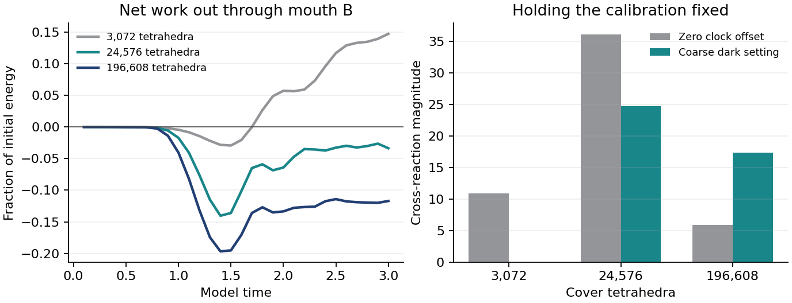

# What an antipodal wormhole network can select

## The result

Two external mouths can survive an antipodal quotient if the antipode exchanges **handles**. I constructed such a spatial manifold, propagated a real field through its interior, and accounted separately for the work at both physical rims. A second construction explains why trying to do this with one self-exchanged twisted spherical handle runs into trouble. A periodic clock can remove its fixed points, at the price of closed timelike curves and identifying its exterior rims. These are different physical models.

The most direct quantum-like result is a geometric mode filter. In a specified compact spacetime the seam enforces an exact node at the throat centre for every odd temporal harmonic of a Maxwell channel. A countable resonant family can carry oscillating energy through the lifted throat. Its action remains continuously variable. In a separate round-rim network, a clock setting selected on coarse grids suppresses received power on two finer grids. The original polyhedral exterior gives unresolved coupled measurements.

## What the repository already established

This audit surveyed PRs 320–354, examined the capstone and selected research records, and recomputed the spherical cap ledger from the merged source at `aa3a988`. The other historical measurements below come from the cited repository records.

| Research record | What survives scrutiny |
|---|---|
| [PR 329](https://github.com/davidmdrpi/geometrodynamics/pull/329) | Finite antipodal focusing alone gives no creation event. Earlier readout tests obtained different CHSH values from the same amplitudes by changing the intensity-to-probability rule. |
| [PR 350](https://github.com/davidmdrpi/geometrodynamics/pull/350) | The old blanket statement that compact handle constraints were never solved is obsolete. Eight gates passed for the twisted vacuum initial-data example, with off-grid residual $3.13\times10^{-12}$. A localized four-scalar example has separate assumptions. Neither is an evolved traversable vacuum throat. |
| [PR 351](https://github.com/davidmdrpi/geometrodynamics/pull/351) and [352](https://github.com/davidmdrpi/geometrodynamics/pull/352) | Static coherent joining was qualified. The registered responding-mouth detector experiment remains open. A time-reversing seam can remove a quadrature in the stated model. The clock offsets below preserve time orientation. |
| [PR 353](https://github.com/davidmdrpi/geometrodynamics/pull/353) | In its normal-reversed, angular-shift model the two cover faces give one quotient boundary. The integrated face-to-face angular momentum flux vanishes. A stronger opening response cannot create a second port. |
| [PR 354](https://github.com/davidmdrpi/geometrodynamics/pull/354) | I reproduced net cap export **1.166569852**, gross out/in **3.318386943 / 2.151817091**, and maximum tail-corrected residual **0.000212731**. Its scalar evolves on the round sphere and its loaded support supplies the released energy. Its handles carry no propagated field. |

## Relationship to PR #355

[PR #355](https://github.com/davidmdrpi/geometrodynamics/pull/355) propagates a scalar through the neck of a fixed **two-dimensional surface** joining antipodal mouths. At the time of this revision, #355 is a draft with its full-run archive pending. The reduced packet run reproduces a reversal of local axial angular momentum. Independent checks at both registered resolutions also find a counterexample to its separate P4 minimum-splitting prediction. The two-port computation below addresses a different question: can two distinct physical rim spheres survive a **global antipodal quotient of a compact three-dimensional space**? The chosen construction joins quarter-circle sites, exchanges whole tubes, and measures scalar energy. The compact-clock calculation is a separate boundary-value problem. None of these calculations completes the preregistered dynamic experiment in #351.

[Replay instructions and regression tests](../experiments/closure_ledger/antipodal_network/README.md) · [Numerical archives](../experiments/closure_ledger/runs/20261117_antipodal_network/)

## Why one self-exchanged spherical handle has a fixed point

Remove two antipodal open balls from $S^3$. The exterior is $S^2\times I$. Attach a second $S^2\times I$ between its ends with orientation-reversing sphere monodromy. The resulting spatial manifold $M$ is the twisted $S^2$ bundle over the circle. This specifies the fibre and the twist explicitly; PR 353 used a thickened torus locally.

Suppose a continuous transformation preserves the exterior and tube as pieces and exchanges the two ends of each. Its action on the base circuit reverses the generator of $H_1(M;\mathbb Q)$. The mapping-torus sequence gives $H_0=H_1=\mathbb Q$, $H_2=H_3=0$ over the rationals: the fibre generator in degree two changes sign. The Lefschetz number of the transformation is therefore $1-(-1)=2$. **Every such exchange has a spatial fixed point**, even without assuming a fibre-preserving formula in the interior. This does not apply to a brane-only or internal-bundle twist on an orientable spatial handle. [Lefschetz fixed point theorem, Hatcher §2.C](https://pi.math.cornell.edu/~hatcher/AT/AT.pdf)

### An exact compact-clock escape

On $(x,t,\Omega)\in\mathbb R^2\times S^2$, let $L$ be the optical circuit length and $T$ the time period. Take the following maps:
$$
D=(x+L,t+\tau,-\Omega),\quad C=(x,t+T,\Omega),\quad
P=(-x,t,-\Omega).
$$
Here $P$ is the time-preserving lift of the ordinary antipode on the exterior. The two translations $D,C$ specify the handle and clock identifications. Since $PDP^{-1}$ reverses the spatial translation and keeps its time shift, it equals $C^jD^{-1}$ exactly when $2\tau=jT$. Only $0$ and $T/2$ remain modulo $T$. With real unwrapped time and this specified lift, the condition is $\tau=0$.

A fixed orbit of $P$ needs $P=C^jD^k$ at a point. Its angular component forces $k$ odd, its spatial component gives $x=-kL/2$, and its time component requires $k\tau=0\pmod T$. Zero offset has a fixed sphere at the tube midpoint at each time. Half offset has **no** fixed spacetime point. The circle identification $C$ already makes fixed-position timelike curves closed. This is a boundary-value construction, not a Cauchy evolution or a dynamical explanation of the cosmic time period. MTY's original time-machine proposal is conditional on traversable wormhole support. [Morris, Thorne & Yurtsever, 1988](https://doi.org/10.1103/PhysRevLett.61.1446)

### A smooth example with a round spatial exterior belt

Use $g=a(x)^2[-dt^2+dx^2+b^2d\Omega^2]$ with positive, even, $L$-periodic $a$. On $|x|\le L/4$, set $x=b\log\tan(\chi/2)$ and $a=R\,\mathrm{sech}(x/b)/b$. The spatial metric there is exactly $R^2(d\chi^2+\sin^2\chi\,d\Omega^2)$. In the tube one may blend smoothly to $a_0+\epsilon[1+\cos(2\pi x/L)]$ near $x=L/2$, with $a_0,\epsilon>0$. This gives a nonzero minimum areal radius. The lapse varies even on the exterior; whole-sphere Einstein-static refocusing is not imported. At a strict waist minimum, a radial affine null ray has $R_{kk}=-2r^{-1}d^2r/d\lambda^2<0$, $r=ba$. Under Einstein's equations this requires negative null stress. No supporting matter action or backreaction was supplied.

## What the compact clock selects in a propagated field

As a probe, use a real source-free Maxwell potential $\mathcal A=u(t,x)X$ in one axial vector spherical harmonic $X=*dY_{\ell m}/\sqrt{\ell(\ell+1)}$. Its angular pullback under the antipode is $\sigma X$ with $\sigma=(-1)^{\ell+1}$. Four-dimensional Maxwell conformal invariance removes $a(x)$ from its action. Integrating the normalized angular harmonic gives
$$
u_{tt}-u_{xx}+\ell(\ell+1)u/b^2=0,\qquad
e=(u_t^2+u_x^2+\ell(\ell+1)u^2/b^2)/2,\quad J=-u_tu_x .
$$
This field solves on the entire exterior-plus-throat metric. Maxwell theory is an input here. [Conformal invariance of the Maxwell action](https://doi.org/10.1140/epjp/s13360-022-02563-4)

Write a time harmonic as $e^{-2\pi int/T}f_n(x)$. Descent gives $f_n(-x)=\sigma f_n(x)$ and $f_n(x+L)=\sigma(-1)^n f_n(x)$. Composing the two yields a rule independent of $\ell$ for this channel:
$$f_n(L/2+y)=(-1)^n f_n(L/2-y).$$
Odd temporal harmonics have a node at the waist; even harmonics have zero normal derivative. The rule survives arbitrary even periodic conformal factors and changes of optical aspect ratio. Existence of a nonzero solution at a particular $n$ also requires the wave equation.

**An infinite family at one chosen geometry.** In units $T=2\pi$, take $\ell=1$, $b=1/\sqrt2$ and $L=\pi/\sqrt5$. The equator-even standing waves $f=\cos(m\pi x/L)$ obey $n^2-5m^2=4$ with $m\equiv n\pmod2$. The first pairs $(n,m)$ are $(2,0),(3,1),(7,3),(18,8),(47,21),(123,55)$. Multiplication of $n+m\sqrt5$ by $(3+\sqrt5)/2$ iterates integer solutions of the same parity and norm. The integer 18 has no demonstrated relation to the repository's coupling fit. Increasing $L$ by 1% moves the $m=1$ natural frequency from 3 to 2.983535 and destroys that exact temporal resonance.

**A measured crossing.** Superpose the first two solutions,
$$u=\cos(2t)+\cos(3t)\cos(\sqrt5 x).$$
Individually they have zero waist flux. Together they give $J(L/2,t)=-2\sqrt5\sin(2t)\cos(3t)$, which reverses under $t\mapsto t+\pi$. The sampled peak magnitude is 4.06003, and the cycle mean is zero. The signed normal is defined on an oriented lift. The physical waist identifies the half-period events and reverses that normal. The exterior rims also form one orbit, so this result cannot certify exchange between independent bodies.

The direct spatial ODE gives monodromy error $5.23\times10^{-13}$ at $n=3$, versus 0.04316 at 3.01. An independent finite-difference solve reduces the frequency error fourfold per refinement. The integrated finite-interval energy residual is $2.03\times10^{-15}$. The clock control composes the actual generators in quarter-period units, tests conjugation, and solves the affine fixed-point equations on a fundamental strip. Scaling the field by 0.37 gives the expected energy ratio 0.1369 by linearity. The same amplitude freedom gives continuous single-mode action; this scaling check supplies no independent evidence of action selection.

## Two distinct quotient ports with a field inside the handle

For the real-time construction, remove four disjoint open balls centred at $e_0,e_1,-e_0,-e_1$ on the unit $S^3\subset\mathbb R^4$. Attach a tube from $e_0$ to $e_1$, and its antipodal copy from $-e_0$ to $-e_1$. Use the same proper ambient quarter-turn at corresponding ends, so the sphere-rim map preserves the orientation inherited from the exterior. A closed route through one tube reverses the three-dimensional orientation. The antipode exchanges the tubes freely. After quotienting, $[e_0]$ and $[e_1]$ are distinct rim spheres. Tube endpoints on the cover are a quarter-circle apart. Requiring every individual tube to join antipodes would exclude this solution.

The code triangulates a cross-polytope model of $S^3$, cuts four polyhedral balls, projects exterior vertices onto the unit sphere, and attaches product-prism tubes of length 0.95. Every triangular face has two incident tetrahedra. Orientation propagation detects a nonorientable connected cover. The simplicial antipode maps every tetrahedron to a disjoint tetrahedron. The spatial metric is piecewise flat. No antipodal-only scattering rule, mouth motion or additional oscillator is inserted. This is one handle in the quotient and two in its cover.

For a minimally coupled real scalar take the tube metric $-(dt-\beta dz)^2+dz^2+ds^2_{\rm rim}$, and an unshifted exterior. The signed optical clock offset is $\beta L_h$. The time integration uses $\beta=0.25$, giving 0.2375. Since $|\beta|<1$, $dt$ has timelike gradient and the spacetime has a global time function. These runs have compact space and real time. Across each attachment the field is continuous and the weak action balances the conormal flux.

The linear tetrahedral equations are $M\ddot q+G\dot q+Kq=0$ with $M>0$, $G^T=-G$. Mass is lumped. For the tube, its nodal reaction $r_h=M_h\ddot q+G_h\dot q+K_hq$ vanishes on its interior. The energy gained from each exterior rim is its trace velocity contracted with $r_h$. Implicit midpoint obeys the same quadratic work balance step by step. A tiny balance residual checks conservation of the discretized system; mesh changes test accuracy of the transfer amount.

**An initial packet inside the tube.** At 32 longitudinal layers, unit initial energy, and $t=1.2$, net outward work at rims A and B is 0.003835 and 0.474048. The maximum total-energy error is $1.34\times10^{-15}$. A separate experiment starts with **zero** field energy anywhere in the tube. Its initial velocity is supported at exterior nodes on the A side. Signed work at both rims and the tube energy are the observables. On the 16-layer mesh, by $t=3$, A has delivered 0.244969, B has received 0.151171, and the tube retains 0.093798. Earlier, B also admitted some energy. This measures net boundary work; individual portions of a coherent field cannot be tagged by origin after interference.

**Uniform refinement.** The companion figure uses the same exterior preparation, interpolated into every refined mesh and normalized to unit energy. It refines *both* the bulk and the throat. The time runs above that only refined the tube retain their original archive. The coarse net outward work at B fails to reproduce under full spatial refinement, which even changes its sign at the stated end time. The final figure gives the values.

## Interference on the polyhedral mesh sequence

Hold a unit harmonic displacement trace uniform on rim A and zero on rim B. Read the integrated reaction at B for this single spatial channel. Eliminate every interior field node in each region. On the unshifted mesh let $E(\omega)$ and $H(\omega)$ be the real off-diagonal dynamic stiffness of the exterior and tube. Using local optical time in the tube, the clock attachment multiplies its cross term by a phase. Up to the Fourier sign convention the total cross reaction is
$$Z_{BA}(\omega,\tau)=E(\omega)+e^{i\omega\tau}H(\omega).$$
The squared magnitude has the classical two-path interference term $2EH\cos(\omega\tau)$. The observable is a driven reaction amplitude at a constrained port. Other rim harmonics and the field itself can remain nonzero when this scalar readout cancels. The time-domain runs have free, coupled rims; the driven calculation imposes boundary traces for its transfer measurement.

At a regular frequency where the two reactions agree, turning the clock from zero to $\pi/\omega$ switches their sum from $2E$ to zero. The roots below were found by scanning and retuning. Every listed shift is less than the 0.95 optical tube length.

| Cover tetrahedra | Fitted frequency | Fitted clock shift | Zero-shift magnitude | Fitted dark magnitude |
|---:|---:|---:|---:|---:|
| 3,072 | 4.599770 | 0.682989 | 10.927 | $2.22\times10^{-14}$ |
| 24,576 | 4.867019 | 0.645486 | 11.393 | $2.97\times10^{-13}$ |
| 196,608 | 5.098952 | 0.616125 | 12.138 | $5.60\times10^{-13}$ |

**Holding the coarse frequency and clock fixed changes the conclusion.** On the middle mesh the supposed dark response is 24.736. On the finest it is **17.391**, while the zero-clock magnitude at the same frequency is **5.872**. The switch even changes which setting is brighter. Each mesh admits a fitted null, but there is no demonstrated continuum switching frequency or convergence of one particular root. The spatial refinements here subdivide the same polyhedral metric. They do not establish convergence to a smooth Einstein metric.

The separate tube-only refinement, which leaves the exterior fixed, appeared much more stable (4.599770, 4.596930, 4.596225). Full refinement exposes what that restricted test missed. This mesh sequence leaves the continuum switching frequency and the late packet direction unresolved. Both depend on the exterior response.

## A pure-metric cross-check

On a separate locally flat vacuum comparator replace the spherical fibre by a flat two-torus. Let both angular maps act as $(y,z)\mapsto(-y,z+\pi)$ with periods $2\pi$. Keep the same shifts of $t,x$. A standing transverse-traceless metric wave can be built from wavevectors $(\pm m\pi/L,0,2)$, projected into the exchange-even combination. The vacuum wave equation again gives $n^2-5m^2=4$. For four modes the transversality, trace, dispersion, and seam defects are below $1.1\times10^{-14}$. The $(3,1)$ wave has nonzero linear tidal curvature.

There is also a nonlinear obstruction. On its ordinary flat torus cover, the pure $(3,1)$ TT seed has spatial mean $\langle |\dot h|^2+|\nabla h|^2\rangle=9$ in the code normalization. For a pure TT perturbation on the flat compact vacuum cover with no homogeneous modes, the time-translation Killing constraint requires this positive quadratic integral to vanish. A zero integral forces both the velocity and the spatial gradient to vanish, leaving only a constant perturbation, excluded here. Thus every nonzero seed in this class encounters the obstruction. The value 9 is the chosen mode’s normalization ($n^2$ for this standing pair) and does not distinguish this seed. [Moncrief, J. Math. Phys. **16**, 493 (1975)](https://inspirehep.net/literature/2950476). [Brill and Deser, 1973](https://doi.org/10.1007/BF01645610)

## A physical readout and a calibration that transfers

Use one driven rim, $U_A=1$, and place a passive linear damper $c=1$ on the uniform coordinate of rim B. Its displacement is solved rather than prescribed. With time convention $e^{-i\omega t}$,
$$
U_B=-Z_{BA}/(Z_{BB}-i\omega c),\qquad
\overline P_B=\tfrac12 c\omega^2|U_B|^2 .
$$
The square law follows by integrating the mechanical dissipation $c\dot u_B^2$. This supplies a physical intensity observable. The damper and uniform-rim constraint are chosen apparatus. It records continuous work, with no rule for individual clicks, two-observer correlations, or a common probability measure across settings.

There is an exact continuum calibration for the through-handle part of this experiment. The pipe is a product with a constant cross section. Uniform Dirichlet traces excite its constant transverse mode away from interior poles. For optical length $L_h$ and cross-sectional area $S$, its real cross reaction at zero shift is $-S\omega/\sin(\omega L_h)$, with static limit $-S/L_h$. The actual triangulated cross section has $S=1.1844104$. At $\omega=1$, the continuum value is **−1.4560952**. The successive full-mesh values are **−1.4529456, −1.4550864, −1.4558396**. This prediction uses the tube geometry alone.

At $\omega=1$, $\tau=0.2375$ on the finest mesh, the power into B through the tube is **2.96876**. The exterior contributes **11.16059**. The source supplies **14.12934**. The two coarser meshes also deliver positive power through the tube, 5.48436 and 5.67285, so a precise continuum power at this frequency is still unresolved. At a lower held-fixed frequency of 0.2, total received powers are 0.021608, 0.021701 and 0.021864, a spread of about 1.2%. The division of that power between paths is less stable. Finite-element refinement validates the isolated tube coefficient much more accurately than the full coupled load.

For the free packet at $t=3$, net work out at rim B changes from **+0.14715** to **−0.03363** to **−0.11704**. Halving the finest time step changes the answer by only 0.00012. The full spatial refinement controls the conclusion. Positive energy enters the initially empty tube on every mesh. A preferred direction for the late unforced exchange is unresolved.

## Exterior convergence and a round-rim comparison

With the rims clamped, the reviewer measured the following lowest Dirichlet frequencies on the original polyhedral exterior. I independently reproduced the first three lumped ground frequencies with the published matrices. The fourth level and the consistent-mass columns are the reviewer’s measurements. Consistent mass gives a nested variational sequence. The decrement between the two finest levels is still about 4.3% of the finer frequency. A moving exterior pole makes the coupled measurements sensitive to the mesh, although its drift alone does not establish the cause of any particular change. [Review measurements and method](https://github.com/davidmdrpi/geometrodynamics/pull/356#discussion_r4610261283)

| Cover tetrahedra | Lumped mass | Consistent mass | Second consistent frequency |
|---:|---:|---:|---:|
| 3,072 | 1.37398 | 1.45527 | 2.13181 |
| 24,576 | 1.36410 | 1.38822 | 2.05737 |
| 196,608 | 1.28812 | 1.29348 | 2.01107 |
| 1,572,864 | 1.23705 | 1.23833 | 1.99074 |

**A second geometry.** We repeated the uniform-port experiment on the exact round unit three-sphere with four geodesic balls excised at the same centres. Each round rim has the measured polyhedral area $S=1.1844104$, giving angular radius $a=\arcsin\sqrt{S/(4\pi)}$. The tube keeps its length 0.95, and its constant transverse mode supplies its analytic two-port matrix. The exterior metric and rim shape have changed. The collar metric matches the induced rim metric; an Einstein support or smooth extrinsic-curvature match is outside this calculation.

For uniform traces the exterior solution is invariant under rotations of $(x_2,x_3)$ and reflections of $x_0,x_1$ away from resonances in the driven sector. In the chamber $x_0\ge x_1\ge0$ use $x_0=\cos r$, $x_1=\sin r\cos\alpha$. Here $0\le\alpha\le\pi/2$ and $a\le r\le\operatorname{atan2}(1,\cos\alpha)$. Exchanging the two chambers splits the port data into even and odd parts. On their common plane the even sector has a natural Neumann condition and the odd sector a Dirichlet condition. The strictly positive Dirichlet ground state belongs to the even symmetry sector. Higher poles reported in the archive are restricted to the uniform drive’s symmetry sectors.

The solver uses mapped bilinear elements, consistent mass and three-point Gauss quadrature per direction. It integrates the round metric on every grid. The quotient volume agrees with $\pi^2-4\pi(a-\sin a\cos a)$. An independent field-equation test prescribes the exact degree-two spherical harmonic $x_0^2-x_1^2$ on the mouth, solves at $\omega^2=8$, and checks second-order decay of the mass-norm nodal error.

| Subdivisions per chamber direction | Lowest exterior frequency | Observed order | Received power at $\omega=1$ | Through-tube contribution | Observed order of received power |
|---:|---:|---:|---:|---:|---:|
| 8 | 1.117521 | — | 1.727759 | 0.447508 | — |
| 16 | 1.108768 | — | 1.578159 | 0.415572 | — |
| 32 | 1.106535 | 1.970 | 1.542177 | 0.407838 | 2.056 |
| 64 | 1.105973 | 1.992 | 1.533266 | 0.405919 | 2.013 |
| 128 | 1.105833 | 1.998 | 1.531043 | 0.405440 | 2.003 |
| 256 | 1.105798 | 1.999 | 1.530487 | 0.405321 | 2.001 |

Power uses $U_A=1$, unit damping, and $\tau=0.2375$. The order is $\log_2| (q_{N/4}-q_{N/2})/(q_{N/2}-q_N) |$. These rates concern the round geometry and this drive.

**A clock setting tested on finer grids.** An exploratory scan found a matching of exterior and tube cross reactions on the interval $[5.75,6.00]$. For each fitted grid the archive checks the bracket against the first four computed Dirichlet poles of each exterior symmetry sector and the analytic tube poles. The 32- and 64-subdivision roots were 5.88861096 and 5.87913783. Second-order extrapolation gave $\omega=5.87598011425$ and $\tau=\pi/\omega=0.5346499805$. Those two settings were fixed before evaluating receiver suppression on the 128 and 256 grids. Power ratios compare the same source, load, and frequency with the clock set to zero.

| Subdivisions | Independently fitted root | Received power at fixed clock / zero-clock power |
|---:|---:|---:|
| 32 | 5.88861096 | $1.570\times10^{-3}$ |
| 64 | 5.87913783 | $1.029\times10^{-4}$ |
| 128 | 5.87677036 | $6.522\times10^{-6}$ |
| 256 | 5.87617863 | $4.128\times10^{-7}$ |

At 256 subdivisions the receiver absorbs $4.37\times10^{-6}$ at the fixed clock setting versus 10.5775 at zero shift. The fitted roots show observed order 2.000 on the final three grids. This demonstrates strong suppression on the finer round grids without retuning the drive. An exact continuum zero at the extrapolated frequency has not been established. The earlier polyhedral calibration at 4.59977 remains distinct. The original localized packet is outside this symmetry reduction, so its continuum transfer direction remains open. [Round-exterior archive](../experiments/closure_ledger/runs/20261117_antipodal_network/round_exterior.json)

## What would move the physics forward

The next discriminating test is to replace the imposed port traces and damper by a mechanically responding boundary whose action follows from an admitted gravitational support model. Predict the response at a held-out geometry before running it, and use full-domain refinement. Keep the linear intensity measurement and a single-event detector law as separate milestones. The present results establish topological selection, a calculable through-handle channel, and classical coherent response in specified models. A universal action unit, Born event frequencies, a spin-statistics law, and a nonlinear Einstein evolution of this network remain open.
