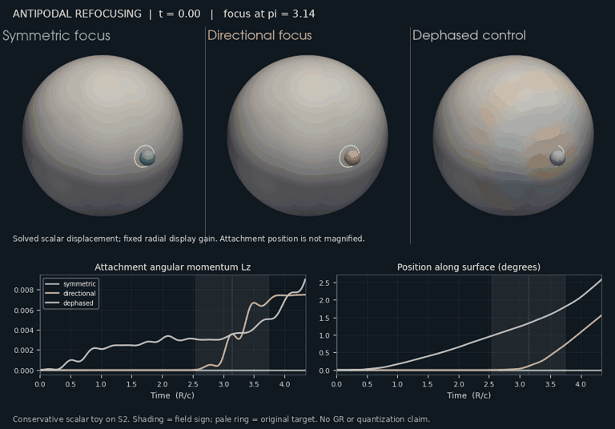
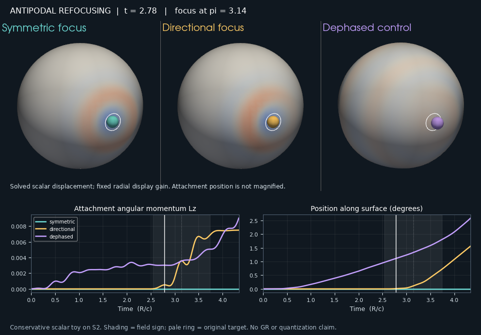
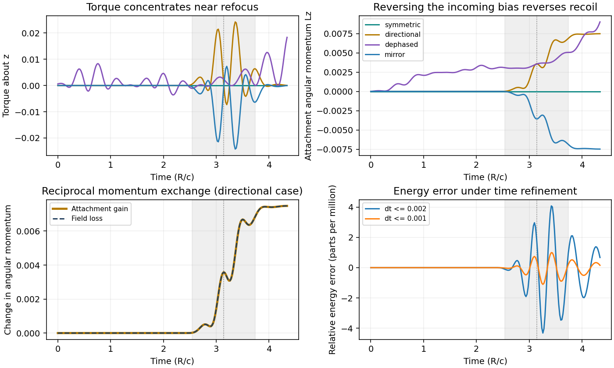

# A localized antipodal kick in a conservative scalar comparator

The [pre-set first-transit protocol](antipodal_kick_protocol.md) passes for
this smooth scalar/attachment family, including **asymmetric focusing**.
There is no focus-triggered force, threshold, reset, or assigned trajectory.
The attachment is coupled at every time. A coherent incoming packet produces
a localized exchange; the outgoing field carries the compensating change in
rotational momentum. This is a positive mechanism result within the stated
toy model, not an independently reproduced discovery or a GR/QFT derivation.



## What was computed

The field obeys the round-sphere operator `A=-Δ+1/4` with `R=c=1`, represented
in all spherical harmonics through l=32. This is an explicitly different
comparator from PR #338's minimal handled scalar. Frequencies `ω_l=l+1/2`
give a known free phase-space refocus at t=π; we integrate through it without
changing any law. Finite source width σ=0.20 and footprint width b=0.12 are
fixed while the harmonic cutoff is refined. No geometrical-optics divergence
is inserted, and no GR singularity avoidance is being claimed.

An attachment initially at X=(1,0,0) has a movable position on the sphere,
orbital angular momentum L, and an internal deformation q. Its mass is
M=0.30, shape mass μ=0.05, and shape frequency Ω0=5. The coupling energy is

    U = κ(q-ubar(X))²/2,       κ=1,

where ubar is a heat-kernel average of the field over the attachment's
footprint. The field, q, and X all respond to this same energy. Specifically,

    a_ddot = -ω² a + κ(q-ubar) w(X),
    μ q_ddot = -μ Ω0² q - κ(q-ubar),
    L_dot_i = κ(q-ubar) Re[w(X)* · D_i a],
    X_dot = (L/M) × X.

Here w_lm=h_l conjugate(Y_lm(X)), h_l=exp[-b²l(l+1)/2], and D_i generates
rotation of the scalar argument. There is no viscosity or external forcing
after the initial state. The finite footprint has smooth global tails,
so this is not a strict compact-support or relativistic-causality test.

For symmetric focusing the free target state is a radial profile f with
zero velocity. For **directional focusing**, the free target displacement
is the same radial f but its velocity is `p=-0.7 D_z f`. The full field state
is therefore not rotationally symmetric about the target: it carries a
preferred tangential flux through it. The actual incoming fronts are unequal.
Reversing 0.7→−0.7 reverses this bias without changing the energy. This is
phase-space asymmetry, not a shifted target or a manually assigned recoil.

Exact free backward propagation generates the initial packet near the source
antipode (-1,0,0). About 99.823% of directional launch wave energy lies in the
source cap of radius 0.6. In the uncoupled reference, 99.212% is in the target
cap at t=π, versus 0.00179% at mid-transit. A 48×96 cap quadrature measures
these reference fractions; they are descriptive, not the impulse pass gates.



## Results under the frozen criteria

All full-amplitude launches have wave energy 0.1. The dephased control has
an additional initial coupling energy 0.000179087; the coherent runs' initial
coupling energy is negligible. The observation interval is [0,π+1.2], with
the pre-set focus window W=[π−0.6,π+0.6]. No claim about infinite-time motion
or later circuits follows from this interval.

| Case | Focus-window ΔL_z | Final ΔL_z | Torque activity inside W | Final angular displacement |
|---|---:|---:|---:|---:|
| Symmetric focus | 0 | 0 | Not meaningful: numerical zero | 0° |
| Directional focus | +0.00686137 | +0.00747925 | 92.880% | 1.5623° |
| Mirrored directional focus | −0.00686137 | −0.00747925 | 92.880% | 1.5623° in opposite direction |
| Dephased directional control | +0.00198281 | +0.00900965 | 19.771% | 2.5851° |
| Uncoupled directional control | 0 | 0 | No torque | 0° |
| Half-amplitude directional focus | +0.00163929 | +0.00176825 | 93.810% | 0.3747° |

"Torque activity" means the integral of the torque's magnitude, not net
impulse. The signed impulses come directly from changes in L. The directional
focus-window impulse is **3.46 times** the dephased control and exceeds the
pre-set 1e-5 floor. Its 92.9% activity fraction exceeds the pre-set 75% gate.
There is further exchange after W; the kick does not cancel by the horizon.

The symmetric attachment still deforms: its maximum sampled internal shape
energy is 0.01638. The corresponding directional value is 0.01330. Thus
strong focusing and deformation alone do not select a recoil direction.

**The dephased run has MORE final recoil than the coherent run.** The positive
result is localization of exchange near the antipode, not an increase in
total transfer, exclusive antipodal interaction, or immunity to diffuse waves.
The dephased state preserves every harmonic mode's wave energy and the total
incoming rotational momentum, but has only about 8.10% of its initial energy
in the source cap. It is not a matched localized-launch control. One random
seed is not an ensemble result. These limitations belong with the positive
finding, not outside it.

Half the amplitude gives about 0.2364 of the final recoil, near the quadratic
weak-response expectation. This finite comparison supplies no evidence of
discrete action or an amplitude threshold. A localized event is not yet a
quantized event.

## Conservation, refinement, and independent checks within the implementation



The spherical conservation law is

    J_total = L - Re Σ p* D a.

We check all three components. A Strang step composes exact free oscillator
and geodesic flows with reciprocal interaction kicks. Each subflow preserves
J analytically; energy is conserved to the expected splitting error. Sphere
position and tangent-angular-momentum constraints are monitored every step,
as are the harmonic reality condition and energy/momentum errors.

- All ten frozen numerical/physical gates pass.
- Across production cases, maximum relative energy drift is 5.41e-6 and
  normalized total-angular-momentum drift is below 3e-14.
- Directional final impulse changes by 2.33e-6 relatively from l=24 to 32,
  and 1.65e-9 from l=32 to 40, at fixed widths and time step.
- Halving dt from at most 0.002 to at most 0.001 changes final impulse by
  1.34e-5 relatively; the energy error decreases by about four.
- Mirrored trajectories give equal-and-opposite L_z. Symmetric transverse
  recoil is at numerical zero, and the uncoupled attachment stays fixed.
- Eight tests check the analytic free refocus, Cartesian finite-difference
  rotation derivatives, force as the negative energy gradient, reciprocal
  three-component torque exchange, mode-energy-preserving dephasing,
  uncoupled rest, symmetry/mirror behavior, and second-order energy error.

The protocol was committed locally before the first coupled run; its SHA256
is recorded in the result summary. This is a pre-set computational test,
not an external preregistration. The code/tests and experiment were produced
in the same implementation effort; independent external reproduction remains
outstanding.

## Reproduction and visualization

```bash
pip install -e '.[dev,viz]'
python -m pytest -q tests/test_antipodal_kick.py
python experiments/closure_ledger/antipodal_kick_probe.py
python scripts/render_antipodal_kick.py
```

Run scripts from the repository root after installing the package (or set
PYTHONPATH=.). Headless rendering here used VTK's EGL backend. The
[archive](../experiments/closure_ledger/runs/20261016_antipodal_kick/) contains
nine full time-series CSVs, the summary with gates and parameters, sparse
full-precision spectral renderer states, and SHA256 hashes. Rerunning the
probe regenerates these; the renderer consumes the archived states.

The movie shows symmetric, directional, and dephased cases with a common
fixed field/displacement scale. Display radius is `1+0.18 tanh(u/u_ref)`,
where u_ref is the prescribed free directional target peak, fixed across
all cases and frames. This display map is not the solved metric. A small
attached sphere illustrates q using radius `0.10(1+2q)`; its angular position
is the actual X(t), without magnification. The pale target ring is a fixed
reference marker. Charts show the full trajectories with a moving time
cursor; the grey band marks W. No displayed crest or recoil is scripted.

## Next missing calculation

Test robustness to a family of smooth, localized launches with varied angular
aperture, target displacement, packet width, and attachment response; add a
control with equally localized initial data but deliberately aberrated
propagation. Preserve conservation and re-state pass criteria before running.
Then replace the attachment's imposed inertial/shape law with a derived mouth
response. The present result supplies an explicit example of localized
classical recoil at refocus; it supplies neither that mouth law nor the
selection of discrete exchanged action.
