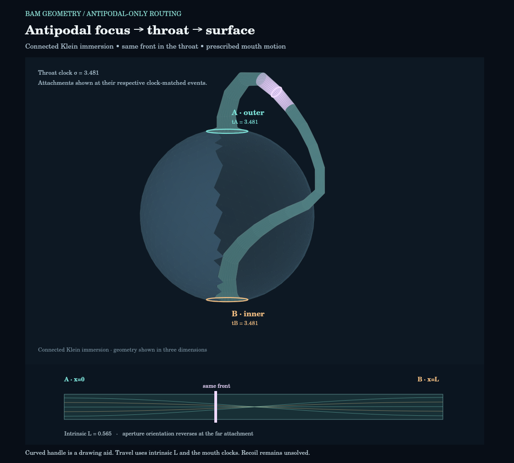

# PR #347 correction: antipodal-only transport through connected mouths

The earlier replay and local scalar-port action did not implement the requested
BAM interaction rule. They let a field act on a mouth at arbitrary positions
along a surface wave's propagation. Their force and trajectory results are
**not evidence for antipodal-only mouth dynamics**.

The current `geometrodynamics.waves.history_throat` entry point now exports
`AntipodalTransport`; the old action is isolated in `legacy_history_throat.py`.

The default [replay](images/history_throat/replay.html) now follows one front
through a connected route using the existing Klein-handle mesh. It shows the
outer and inner mouth attachments, an advancing surface front, its antipodal
focus, and the same front inside the throat. The curved handle remains an
immersion drawing of an extradimensional connection; its visible arc length
and intersection with the sphere are not physical propagation distances.



## Interaction rule actually implemented

For a front launched from unit vector n at exterior time t, the next surface
interaction is at **−n, t+π** (unit sphere and wave speed). No mouth is tested
or driven between these endpoints. At that arrival:

- If the focus lies within an open mouth's finite aperture at the **arrival
  time**, it enters that mouth. A mouth's earlier position cannot capture it.
- If the antipode is empty, the same front refocuses and propagates onward from
  there. This is the prescribed antipodal reflection rule, with a stated
  caustic phase. It is not a fresh source injection.
- A closed mouth at the focus reflects the front there. Inside the throat, a
  closed outlet reflects it back down the throat; it does not teleport to a
  surface antipode.

A throat leg obeys σ_out = σ_in + L, with σ_i(t) = ε_i s_i(t)+b_i.
The destination's actual clock history is inverted without extrapolation.
A negative exterior arrival interval is retained when those boundary data
require it. Playback follows the route and increasing throat time, so it does
not replace an advanced edge with a forward-time flight.

Spatial reversal acts on the two aperture coordinates (u,v) → (u,−v).
Outer and inner mouth charts are explicit. A test follows the actual mesh's
shared rim columns and checks that their attachment agrees with this map;
the mesh is non-orientable. This is separate from a scalar phase change and
from reversal of the temporal attachment.

The current idealized port transmits an entire front when open. Empty-focus
and closed-boundary reflections use a stated phase −1, configurable separately
from spatial parity. Neither this coefficient nor perfect transmission has
been derived from a GR boundary-value problem. The front's arbitrary continuous
amplitude is not an energy quantum, a measured full wave field, or a recoil.

## Six explicit routing controls

| Control | Surface captures | Throat exits | Antipodal reflections | Throat reflections |
| --- | ---: | ---: | ---: | ---: |
| Fixed antipodal mouths | 5 | 5 | 0 | 0 |
| Mouth displaced from first focus | 3 | 2 | 3 | 0 |
| Moving mouth reaches first focus | 1 | 1 | 5 | 0 |
| Moving mouth leaves first focus | 0 | 0 | 6 | 0 |
| Reversed temporal attachment | 2 | 2 | 0 | 0 |
| Closed throat outlet | 2 | 3 | 2 | 3 |

These counts cover the supplied finite histories. They are route bookkeeping,
not a spectrum or discrete momentum exchanges. The moving cases are prescribed
inertial histories with integrated proper clocks. Their positions were chosen
to exercise a hit and a miss; they are not independently evolved predictions.
The closed-outlet case has a front initially in the throat, explicitly supplied
as separate initial data.

The reversed case reaches an already visited event and is marked
`cycle_requires_boundary_solution`. It is stopped at that recurrence rather
than repeatedly injecting or amplifying the front. A self-consistent amplitude
on that loop has **not** been solved. Other cases reach the finite supplied
history boundary. Unresolved continuations remain in JSON and are never labeled
absorption; the replay plays only the supported legs.

## What this correction does and does not establish

The routing implementation and replay now obey the requested interaction
support. This is a characteristic transport reduction on supplied worldtubes.
It is **not yet a self-consistent field-and-mouth dynamics model**. No old local
port force, Coulomb acceleration, clock-energy correction, impulse estimate,
or old energy ledger is carried over as a result of this routing rule.

The old fourteen-case experiment remains archived with its negative results
and numerical checks at commit `48d9dc3ede4edaa6220dd86f3d162aa58df2944c`.
Its manifest describes files at that commit; it is not the manifest of this
correction. The original scalar candidate's failure of sustained approach and
collapse is preserved. Its local continuous coupling was the wrong interaction
support for the user's BAM rule, regardless of its numerical conservation.

The remaining dynamics task is to derive and solve the coupled boundary field
and mouth recoil with this restricted interaction support, including any
advanced consistency conditions. The current correction establishes no
self-acceleration, radius shrinkage, collapse, particle cycle, or QED mechanism.
The S² drawing is still a visualization reduction, not a solved S³ metric.

## Reproduction and checks

```bash
python -m pytest -q tests/test_antipodal_throat_transport.py tests/test_history_throat.py
python -m experiments.closure_ledger.antipodal_throat_replay
```

The new 15 tests check exclusion of intermediate captures, actual arrival
positions, finite apertures, exact throat clocks, spatial attachment, antipodal
and throat reflections, reversed routes, unresolved cycles, and history limits.
The original 12 tests continue to check the archived action, not the corrected
transport's dynamics. All 27 pass.

The six cases and their hashes are in
[`runs/20261021_antipodal_transport`](../experiments/closure_ledger/runs/20261021_antipodal_transport).
The HTML embeds all data and geometry and needs no network. The drawn handle
uses the existing Klein mesh with shared rim vertices; moving attachments deform
that display mesh without assigning its drawn lengths to the transport model.

Visualization QA executed all six controls over 495 sampled frames against a
real canvas renderer with finite-coordinate checks. Case selection, stepping,
rotation, cutaway, and playback termination were exercised. The rendered
connected-mouth preview was inspected. This is canvas execution and image QA;
a full browser layout screenshot was unavailable in this environment.

Optional canvas QA (requires the Node package `@napi-rs/canvas`):

```bash
node experiments/closure_ledger/check_antipodal_throat_viewer.cjs
python -m experiments.closure_ledger.antipodal_throat_replay
```

The final command refreshes the manifest after the preview image is rendered.
