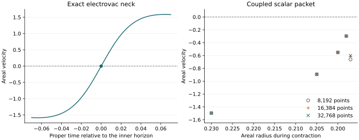

# Does a radial Maxwell flux stop the Nariai neck?

In the exact five-dimensional charged vacuum geometry, the initially contracting reflection center reaches a positive radius, stops, and expands again in the analytic extension. The turn is at the inner horizon. The spacetime still has a curvature singularity at r=0. In the fully coupled scalar packet the electric stress reverses the sign of the squared-radius acceleration, but the areal velocity remains negative. Comparing common-radius events across resolutions exposes where the scalar stress starts to dominate again.

[Registered protocol](charged_nariai_protocol.md) · [Neutral run](nariai_antipodal_loop.md) · [Numerical archive](../experiments/closure_ledger/runs/20261125_charged_nariai/probe.json)

## Maxwell terms in the existing solver

Keep the round S³ orbits, Λ=3, 8πG=1 and the time-oriented cover of #369. In the local orthonormal orbit-space frame the electric field is E=√6 Q/r³. Source-free Maxwell evolution and Gauss's law keep r³E constant in space and time. A nonzero flux can thread a noncontractible S³ on the compact S¹×S³ slice without a local electric charge density. At the time-reversing half-shift J the base volume two-form changes sign. A signed electric two-form with this nonzero flux is J-odd. Its stress descends under J. Descent of the field itself requires combining J with charge conjugation, or working on the cover; plain U(1) gauge transformations leave the curvature two-form fixed.

In this normalization the Maxwell energy density is ρₑ=3Q²/r⁶. Its principal pressures are −ρₑ longitudinally and +ρₑ in the three angular directions. It satisfies the NEC, saturating it on radial null directions. There is no radial energy flux in a local orthonormal frame. The Hamiltonian acquires +ρₑ on its matter side, while the momentum constraint and the scalar wave equation keep their previous forms. Maxwell adds no differential principal part to the reduced equations at regular positive radius.

With U=dr/dτ in synchronous gauge, w the unit spatial radial gradient, h the longitudinal expansion and p,f the scalar normal and spatial derivatives, the terms added to #369 are +Q²/r⁵ in U̇ and −4Q²/r⁶ in ḣ in addition to its dependence on U̇. In conformal gauge the wave source for r increases by 2 exp(2σ) Q²/r⁵ and the source for σ changes by −7 exp(2σ) Q²/r⁶ in total. At the geodesic reflection center w=0 and the proper-time identity is

$$
 \frac{d^2(r^2)}{d\tau^2}=2(r^2-1)+\frac{2Q^2}{r^4}
                         -\frac{r^2}{3}(p^2+f^2).
$$

For a radial affinely parametrized null ray the previous equation d²r/dλ²=−(r/3)(dφ/dλ)² still holds. Positive timelike acceleration does not supply radial null defocusing. A regular positive-radius turnaround also requires U to cross zero, with bounded local curvature. At such an event the regularity of the rest of the spacetime is a separate question.

## Exact electrovac and its horizons

The static solution has F(r)=1−μ/r²+Q²/r⁴−r²/2. Fix the three roots of F in squared radius at 0.04, 0.88 and 1.08, giving μ=0.5144 and Q=0.13786950. The inner, black-hole and cosmological horizon radii are 0.2, 0.938083 and 1.039230. A time-symmetric compact initial chain is obtained from s(x)=0.88+0.20 sin²x with r₀=√s and longitudinal scale √[2s/(s−0.04)]. This gives (∂ₗr₀)²=F(r₀). Tilt the slice with the same half-period-odd time displacement as #369. The signed center velocities are −0.0260312 and +0.0260312. The recovered mass is spatially constant within 1.2×10⁻¹⁶. The exact neutral and charged product branches are additional checks: at constant r, Q²=r⁴(1−r²) and the base curvature is 2−4Q²/r⁶, on the branch where this is positive. [Higher-dimensional charged Nariai solutions](https://doi.org/10.1103/PhysRevD.70.024002)

A neutral radial geodesic satisfies U²=ℰ²−F and U̇=−F′/2. At the reflection neck ℰ=0. From the outer to the inner bifurcation sphere the elapsed proper time is 2.19968022 by both direct integration and quadrature. From the actual tilted initial slice, the contracting center reaches its inner minimum after **1.94968022** and its inverted partner after **2.44968022**. There U̇=54.6. Integrating a further 0.005 in the analytic extension gives outward U=0.27074. A control geodesic with ℰ=0.2 crosses the inner horizon and turns at r=0.19963614. In the exact tilted data the Gaussian congruence loses its longitudinal Jacobi factor shortly before the zero-energy turn. The radial geodesic equation and static first integral provide the continuation through this chart failure.

The Riemann square is F″²+6(F′/r)²+12[(1−F)/r²]². It is finite at the zero-energy turn (17,876,296 in the chosen units), but diverges as 508 Q⁴/r¹² toward zero. The inner Cauchy horizon limits the globally hyperbolic development. The electrovac turning points here belong to its known analytic geometry and give no stability assertion about extending perturbed data.

## The same packet preparation with charge

For #369's fixed R=0.98, the constraints now set the initial scalar momentum by P²=6(R⁻²−1−Q²/R⁶). Consequently this specific packet preparation requires |Q|<R²√(1−R²). We retain its opposite velocity lobes, set φ=−3U/(RP), and use the smooth constrained longitudinal expansion. Varying Q at fixed metric and prescribed U necessarily changes the scalar preparation.

At nominal packet amplitude 0.05, charges 0.08, 0.14 and 0.17 encounter the original global synchronous scale guard before a central turn. The independent conformal runs encounter a lapse guard. At primary Q=0.14 the two global formulations agree on both center radii at matched early proper times to 3.8×10⁻¹¹ on 512 points. End radii on the different stopping slices are not a cross-gauge accuracy test.

**Local continuation after the global guards.** A second-order null-characteristic method evolves both scalar characteristics and the coupled orbit metric, dropping any cell whose past stencil is incomplete. A post-primary relabelling of both null coordinates puts more resolution near the center's late-time domain of dependence. The map is odd and has half-periodic derivative, so it preserves the slice and J. It changes the coordinate lapse. The code compares interpolated events at fixed areal radius and reports the local normalized null constraint. A masked or underresolved step never supplies evidence of a bounce.

| Primary center radius | U, 8,192 | U, 16,384 | (r²)″, 8,192 | (r²)″, 16,384 |
|---:|---:|---:|---:|---:|
| 0.230 | −1.497 | −1.497 | +12.07 | +12.07 |
| 0.205 | −0.892 | −0.893 | +20.06 | +20.07 |
| 0.200 | −0.551 | −0.552 | +21.94 | +21.94 |
| 0.198 | −0.297 | −0.298 | +20.86 | +20.89 |
| 0.197 | −0.661 | −0.615 | −1256 | −1048 |

At r=0.198, the null expansions on the 16,384-point grid are both −4.52. The claimed change of acceleration is present, while no reversal of areal velocity is detected. At r=0.197 the scalar kinetic energy density has risen to about 4.1×10⁴ on that grid, and the magnitude of the renewed inward acceleration is much more sensitive to refinement. The local mass diagnostic is μᵣ=r²(1+U²−w²−r²/2)+Q²/r². It need not be constant with scalar flux. An inner-horizon radius from the exact control cannot be assigned to the dynamical packet by matching r alone.

**Further refinement.** A 32,768-point run gives U=−0.29869, (r²)″=+20.9003 at r=0.198. At r=0.197 it gives U=−0.60232 and (r²)″=−990.7. The normalized null constraint at the latter event decreases from 0.00755 to 0.00275 to 0.00080 over the three finest grids. All three show the negative sign and no center minimum. The finest two also reach r=0.196, where the squared-radius acceleration differs by about 16% of the coarser magnitude. The last valid radii and masses vary with resolution; the archive retains them for diagnostics. No singular endpoint, regular continuation or asymptotic mass-inflation rate is measured.

## Why a positive repulsive term can coexist with collapse

In a separate homogeneous charged-scalar control, a r³ p is conserved and f=w=0. The difference of the two radial Einstein equations gives d(U/a)/dτ=−rp²/(3a) wherever the scale a stays positive. Starting from U=0 with p≠0, this homogeneous center stays contracting even if the acceleration of r² becomes positive. A high-accuracy independent proper-time ODE finds a peak positive squared-radius acceleration above 21. As the longitudinal scale cutoff decreases, the scalar blueshift dominates.

| Descending scale a | r | U | μᵣ |
|---:|---:|---:|---:|
| 0.04 | 0.20194 | −0.511 | 0.5313 |
| 0.01 | 0.20193 | −2.042 | 0.6906 |
| 0.001 | 0.20191 | −20.42 | 17.52 |
| 0.0001 | 0.20189 | −204.2 | 1700.6 |

These are finite-cutoff results. The homogeneous monotonicity proof does not apply to the inhomogeneous run. Neither numerical mass growth nor a last valid grid cell determines the regularity of a Cauchy horizon in the packet. Related Einstein–Maxwell–scalar analyses explicitly distinguish well-posed evolution from extendibility. [Costa et al.](https://doi.org/10.1088/0264-9381/32/1/015017)

## Replay

~~~sh
OPENBLAS_NUM_THREADS=1 python -m experiments.closure_ledger.gravity.charged_nariai
python -m experiments.closure_ledger.gravity.plot_charged_nariai
OPENBLAS_NUM_THREADS=1 python -m unittest discover -s tests -p 'test_*nariai*.py'
~~~
