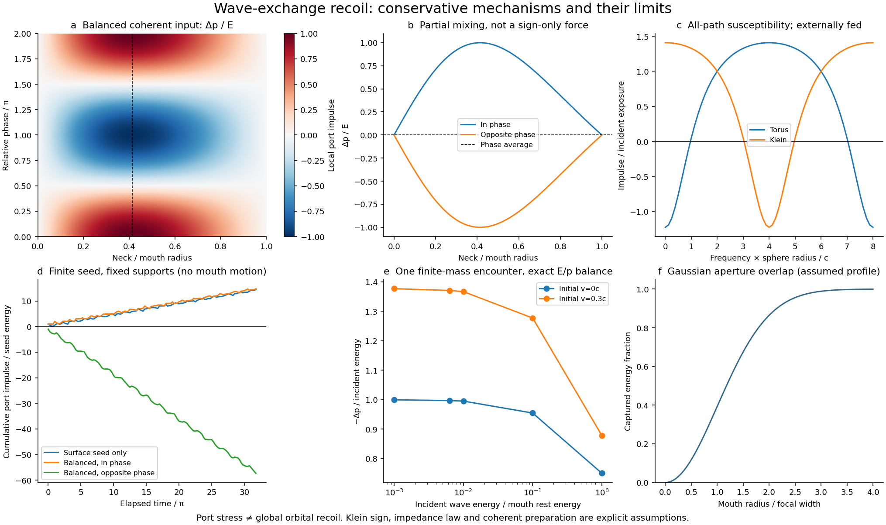

# Coherent wave exchange as a candidate mouth-recoil mechanism

This follow-up to #347 replaces an assumed signed impulse with a conservative
two-port scattering calculation. The most promising mechanism **within this
comparison** is interference between an antipodal surface return and a coherent
throat return at a partly reflecting mouth. It can give negative local port
stress without negative wave energy. A Klein compression flip changes the
relative phase and can change that stress's sign. It does not guarantee a pull.

**This is not yet self-consistent motion of the two mouths.** We derive a local
stress kernel, complete individual collisions with finite-mass energy/momentum
balance, and compare multiple paths on fixed geometry. A local port direction
has not been projected into the full orbital/spin stress of the glued S3
geometry. The fixed-geometry cumulative impulses must not be applied wholesale
to moving mouths. No binding, collapse, shrinking throat or QED derivation is
claimed. Earlier negative results remain intact.



## 1. Compute momentum flux, not a force linear in a wave's sign

Let the energy-normalized incident amplitudes be `a=(a_s,a_t)`, with incident
longitudinal directions `(+1,-1)` and outgoing directions `(-1,+1)`. For a
single matched transverse mode, equal wave speeds and positive characteristic
admittance ratio `z=Z_throat/Z_surface`, continuity of value and flux gives

\[
 b=S a,\qquad S=\begin{pmatrix}r&t\\t&-r\end{pmatrix},\qquad
 r=\frac{1-z}{1+z},\quad t=\frac{2\sqrt z}{1+z},\quad S^\dagger S=I.
\]

The real coefficients describe a reciprocal, lossless junction; they are not
derived from a resolved MTY mouth. The wave energy is `E=|a_s|²+|a_t|²`.
With `c=1`, incoming minus outgoing momentum gives

\[
 \Delta p=2r^2(E_s-E_t)+4rt\sqrt{E_s E_t}\cos\phi,
 \qquad \phi=\arg a_t-\arg a_s.
\]

The first term is ordinary reflection pressure from unequal incoming fluxes.
The second is coherent interference. Multiplying **all** amplitudes by −1
changes neither term. Flipping one channel changes only the interference term.
A single incident wave is unaffected by its compression sign. This is the
specific reason #345's assumed `sign(q)*sign(front)*Re(phase)` capture rule
cannot be treated as a consequence of passive linear scattering alone.

There is an independent virtual-work check. For a translated junction,
`S(x)=exp(iωJx) S(0) exp(iωJx)`, with `J=diag(1,-1)`,

\[
 {-i\over\omega}S^\dagger\partial_x S\big|_{x=0}
 =J+S^\dagger J S=K,\qquad \Delta p=a^\dagger K a.
\]

The eigenvalues of `K` are `±2|r|`, so `|Δp| ≤ 2|r| E`. This is a bound per
encounter, not a bound on repeated pressure over an arbitrary time.

For equal incoming energies, `Δp/E=2rt cosφ`. Its uniform phase average is zero.
For unequal inputs the reflection bias remains after phase averaging. A throat-
dominated incident field can give negative pressure without coherence; that
does not explain how such an incident field is generated or maintained.

## 2. Partial reflection and sizing

For **balanced input energies**, maximum phase-sensitive recoil occurs at
`R=r²=T=t²=1/2`, not at perfect transmission or perfect reflection. If, additionally,
the characteristic admittance is proportional to a three-dimensional throat
cross-sectional area, `z=(b/a)²`, the smaller-neck solution is

\[
 b/a=\sqrt2-1=0.4142135624.
\]

This is an optimum of the stated impedance model and input constraint, **not a
predicted BAM size or a universal optimum**. For arbitrary input energy ratios
the optimization changes. With `R=T=1/2` and `E_t≤E_s`, a negative single-
encounter impulse is possible only when `E_t/E_s > 3-2√2 ≈ 0.1716`, and the
relative phase is sufficiently close to π. Multiple returns can change that
input ratio, so it is not an initial-seed threshold for the entire network.

The independent Gaussian focus-overlap control gives
`η=1-exp[-a²/(2w²)]`: 0.118, 0.393, 0.865 and 0.989 for `a/w=0.5,1,2,3`.
Unmatched energy stays in the bulk. This assumes a circular Gaussian transverse
profile; it is not an aperture diffraction derivation. Spatial overlap,
temporal overlap and polarization/mode overlap are all needed for the cross term.

The repository's `physical_throat.VacuumThroat` supplies a useful geometry
control. Its scalar-flat, time-symmetric bridge has `b/a_areal=sin²(a_angular)`.
Passing those actual ratios through the assumed area-impedance model gives:

| Angular mouth radius | Neck / areal mouth | Transmitted energy fraction | Maximum balanced `|Δp|/E` |
| --- | --- | --- | --- |
| 0.05 | 0.002498 | 0.00002496 | 0.00999 |
| 0.16 | 0.025382 | 0.002574 | 0.10133 |
| 0.30 | 0.087332 | 0.03005 | 0.34144 |
| 0.50 | 0.229849 | 0.19065 | 0.78562 |

A narrow neck strongly suppresses the mixed-channel interference term in this
model. Increasing reflection alone cannot remove that bottleneck. This bridge
is spatial initial data, not an established traversable dynamical throat;
its ratios must not silently be imposed on an MTY solution.

## 3. Multiple paths, finite inventory and Klein reversal

Two fixed antipodal nodes are connected by a surface path of length π and a
throat path of length L. Each has the junction above. Surface interactions occur
only at the next antipodal node; throat interactions occur only at its ends.
This is an aligned-node reduction of #347, not a continuous local surface force.

The surface factor is either −i (post-caustic capture) or 1 (pre-caustic capture),
retaining #347's explicit open-boundary choice. A throat traversal carries the
**assumed compression holonomy** −1 for Klein and +1 for torus. This changes a
mixed surface/throat loop phase. It does not implement the tube's full momentum
map: the latest #345 review correctly distinguishes compression sign, spin and
the two orbital components. In particular a planar orbital reversal is present
for both of its tube maps.

Two complementary computations avoid confusing a driven resonance with free
energy:

1. **Closed finite pulse:** lossless delay lines and unitary scattering evolve
   one initial energy inventory of 1. There is no later injection or gain.
   An intensity-only `|S|²` control removes coherence while retaining energy.
   We scan 560 parameter/seed combinations, each with both evolutions, plus 30
   pulse-width/delay controls and 10 longer-duration controls.
2. **All-walk boundary susceptibility:** `a=b+ρ P S a` is solved as
   `(I-ρPS)^{-1}b`, and independently compared with its explicit walk sum.
   Here `ρ=0.8` is amplitude survival; escaped power is
   `(1-ρ²)||Sa||²`. This calculation has a source and is explicitly externally
   fed. Its pressure is divided by total incident exposure. There are 9,100
   combinations of frequency, length, size, handle and capture convention.
   `ρ=1` is rejected: a closed pole needs its homogeneous boundary solution.

The 32π fixed-geometry results are:

| Initial throat share | Initial relative phase | Negative cumulative port impulse / cases |
| --- | --- | --- |
| 0 | No initial throat field | 1 / 140 |
| 0.1 | π | 69 / 140 |
| 0.5 | Both 0 and π tested | 147 / 280 |

These counts describe a declared finite grid; **they are not probabilities of
physical attraction**. Changing initial mode occupation changes the answer.
The sole negative surface-seed case (`b/a=0.8`, `L=π`, Klein, pre-caustic)
has normalized impulse −0.00703 at 32π but +0.000189 at 64π. It therefore fails
a simple sustained-sign check. Its small later sign changes are retained in
`duration_controls.json`, not discarded.

Prepared balanced opposite-phase returns can retain a negative port stress:
at `b/a=√2-1`, `L=π/4`, post-caustic capture, its normalized cumulative value
changes from about −0.834 at 32π to −0.828 at 256π. This is a fixed-support
cavity stress, **not a moving-mouth trajectory**. The supports take the impulse;
they do no work because they do not move. Integrating that stress into a moving
mouth while leaving the same wave inventory and phases unchanged would violate
the required backreaction calculation.

Klein has no universal advantage: in the chosen spectral grid negative port
pressure occurs in about 14.9% of Klein samples and 15.6% of torus samples.
The two handles shift interference bands rather than select attraction.
No relaxation or attractor is present in the closed unitary network to choose
the desired coherent preparation automatically.

## 4. Advanced paths are boundary data, not an energy supply

For stationary mouths with `σ_A=t`, `σ_B=t+δ`, the directed throat delays are
`L-δ` and `L+δ`. The added 650 frequency-domain controls include `δ>L` and
`δ=π+L`, where one mixed geometric route has zero total coordinate-time delay.
These delays are checked against #347's actual clock-map inverses.

The propagation matrix remains unitary for real frequency, including negative
delays. An advanced phase changes interference but contributes no extra energy
factor. The regularized, externally fed resolvent is a **boundary diagnostic**,
not a causal initial-value evolution or proof of stability near a closed null
route. Advanced events are never inserted into the forward closed delay-line
simulation. A time-orientation reversing attachment, as opposed to a clock
offset, also requires opposite-frequency sectors and is not included in this
scalar fixed-frequency closure.

## 5. Finite-mass recoil: a local conservation step

For each encounter, boost both incident packet energies into the mouth's
instantaneous rest frame, apply `S`, then rescale the outgoing energies by a
common positive `k`. If `E,p_in` are the total incident rest-frame energy and
momentum, and `p_out` is the unrescaled outgoing momentum, impose

\[
 (M+E-kE)^2-(p_{in}-kp_{out})^2=M^2.
\]

The physical root is evaluated without subtractive cancellation and the result
is boosted back. Both energy and momentum close; the mouth remains on its mass
shell. Perfect reflection reproduces the independent photon/mirror recoil
redshift `E_out=ME/(M+2E)` for a stationary mouth. Matched transmission produces
no impulse. Tests also cover moving mouths and complex inputs.

The common energy rescaling is an explicit **constitutive completion**, not a
derived Doppler-resolved scattering spectrum. It does not yet tell us the
coherence of packets at the next encounter. This is why the finite-mass result
is not silently chained into the fixed-delay interference calculation.

Across 315 collisions (`v=-0.3,0,0.3`, wave/rest-energy ratios 0.001 to 1,
seven sizes and three phases), worst energy and momentum residuals are
`6.7e-16` and `4.5e-16`. An illustrative equal-input, opposite-phase encounter
at the optimal balanced size, `v=0.3`, and incident `E/M=0.0063`, changes mouth
momentum by `−0.0086364 M`: about 2.75% of its initial `0.314485 M`.
Outgoing wave energy grows from `0.0063 M` to `0.0088585 M`, paid by mouth
kinetic energy. This permits conservative braking, but it is neither a replay
of #345's flash nor a demonstration that the required paired returns occur.

## 6. Mechanism assessment and the remaining closure

| Mechanism | What this work establishes | Assessment |
| --- | --- | --- |
| Compression flip of an isolated front | No change in quadratic stress at fixed energy | Insufficient by itself |
| Unequal counter-incident fluxes | Ordinary reflection pressure has either sign depending on flux direction | Possible contribution; requires a source/history for the imbalance |
| Coherent surface–throat returns with partial reflection | Negative stress, translation virtual work, and individually conservative finite-mass recoil | Strongest supported wave-exchange candidate here; needs phase selection and full stress projection |
| Repeated paths / resonance | Alters occupation and phase; finite seed energy is conserved | Can maintain fixed-geometry stress, not unlimited acceleration |
| Advanced clock paths | Shift boundary phases without increasing flux norm | May affect coherence; no energy-generating mechanism established |
| Stored mouth/throat field or static flux | Not derived or evolved in this experiment | Candidate source of stronger coherent returns, still unresolved |

The concrete next closure is to obtain a frequency- and position-dependent
multi-component mouth scattering matrix from the same bulk/throat field action,
including finite aperture modes and the actual Klein ray/normal transport.
Its translation/rotation derivatives and stress flux must give the same orbital,
spin and radial work. Couple those forces to the mouth histories, update the
packet frequencies and antipodal interception times, and solve the advanced
branches as boundary conditions. Then test whether the **unprepared** birth
field selects a negative separation force, maintains overlap and pays for throat
shrinkage. A prescribed favorable relative phase does not close that argument.

## Reproduction and provenance

```bash
python -m experiments.closure_ledger.coherent_recoil_probe
python -m pytest -q tests/test_coherent_mouth_recoil.py tests/test_antipodal_throat_transport.py tests/test_history_throat.py
```

62 tests pass (18 new and 44 preceding regressions). Maximum closed-network
energy error is `7.6e-14`, including the 256π duration controls;
explicit-walk/resolvent agreement is `2.0e-15`, including advanced clock controls.
Doubling the time-grid resolution while retaining the same packet/delays changes
the selected integrated impulse by exactly zero. This tests the discrete model;
it does not establish continuum field convergence.

All grid data, pulse/duration/clock controls, geometry controls and hashes are in
[`runs/20261022_coherent_recoil`](../experiments/closure_ledger/runs/20261022_coherent_recoil).
The scalar candidate's failure of sustained approach/collapse and #345's signed-
exchange negative binding result are preserved. Its 22 trajectories were not
rerun or relabelled as outputs of this model.

The external motivation is methodological, not evidence for BAM: classical
optical binding through mode scattering/interference is demonstrated by
[Bykov et al., arXiv:1709.04053](https://arxiv.org/abs/1709.04053), and scattering-
matrix position derivatives are used by
[Ambichl et al., arXiv:1703.07250](https://arxiv.org/abs/1703.07250).
Neither supplies this throat's constitutive law or establishes its attraction.
