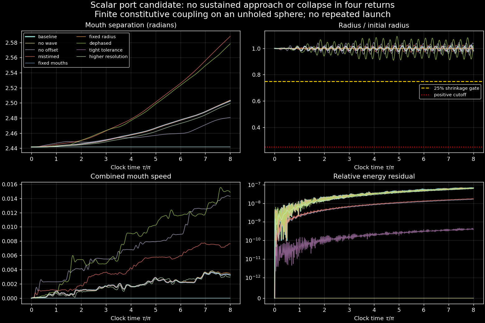

# Moving mouths and a dynamical throat: scalar candidate fails the sequence

The coupled scalar candidate does **not** produce sustained approach followed
by throat collapse. Over four full return periods, 0 ≤ τ ≤ 8π, its baseline
mouth separation increases from 2.44159265 to 2.50272673 radians. The smallest
throat radius is 0.97788699 of its initial value: only 2.21% shrinkage. Neither
the 25% shrinkage gate nor the positive-radius cutoff is reached. No outgoing
collapse burst is inserted. These are numerical results for one stated
constitutive model, not a no-go theorem for the MTY proposal.




## What is calculated

The [protocol](coupled_mouth_throat_protocol.md) specifies one autonomous action
for a spectral scalar on an **unholed round S²**, a resolved finite interval
field, two independent meridional mouth positions, and a dynamical radius.
Finite-aperture springs connect the sphere to the interval endpoints. Mouth and
radius forces include derivatives of the kinetic matrix, clock term, gradient
energy and port potential. One finite packet is launched; the same field then
evolves continuously. There are no assigned kicks, repeated launches, local
gain multipliers, or a time-programmed shrinkage curve.

The sphere operator is −Δ + 1/4, so its uncoupled frequencies are l+1/2 and a
full 2π return changes the field's sign. This operator is a modeling choice.
Mouth motion does not excise or remesh the sphere. The interval has no azimuthal
modes, so the experiment cannot distinguish Klein from torus gluing.
Finite ports on one τ slice are not exact matching on moving MTY worldtubes.
The scalar height in the visualization is magnified threefold; mouth angles
are not magnified. The neck-field panel is its actual resolved scalar field,
not a drawing of a physically collapsing tube. Frames are equal-τ slices of
the prescribed tilted chart, not equal external-time images.

The offset Δ = −1.2 is held fixed. Its clock profile can exchange angular
momentum with the field and mouths. The integrated support reaction is
included in the angular ledger. Energy conservation alone would not justify
calling this an isolated self-accelerating system. The clock support itself
is not evolved as an additional gravitating body.

## Controls and failure criteria

All nine cases reach 8π without a cutoff, clock-margin stop or mouth overlap.
The original first three 2π windows are retained for the acceleration test.
Baseline separation changes in these windows are approximately +0.00400,
+0.01226 and +0.01944 radians. All three have the wrong sign for approach.

| Case | Final separation (rad) | Minimum r/r₀ | Maximum relative energy residual |
| --- | ---: | ---: | ---: |
| Baseline | 2.502727 | 0.977887 | 6.88 × 10⁻⁸ |
| No wave | 2.441593 | 1.000000 | 0 |
| No offset | 2.480697 | 0.947327 | 1.68 × 10⁻⁸ |
| Mistimed offset −0.6 | 2.588128 | 0.971305 | 1.80 × 10⁻⁸ |
| Fixed mouths | 2.441593 | 0.971850 | 7.16 × 10⁻⁸ |
| Fixed radius | 2.503588 | 1.000000 | 6.99 × 10⁻⁸ |
| Dephased packet | 2.578135 | 0.909661 | 6.92 × 10⁻⁸ |
| Tighter tolerance | 2.502727 | 0.977887 | 4.60 × 10⁻¹⁰ |
| Higher resolution | 2.499034 | 0.965289 | 6.21 × 10⁻⁸ |

Baseline angular balance, including the prescribed clock reaction, has maximum
absolute residual 1.62 × 10⁻¹⁰. No-wave motion is exactly zero. Tightening the
ODE tolerance changes separation by at most about 8.3 × 10⁻⁹ radians. Raising
the sphere cutoff from 10 to 14 and interval nodes from 17 to 25 changes it by
up to 0.00456 radians, and changes radius by 0.00273. The negative qualitative
outcome survives; the small mechanical response is **not quantitatively
resolution-converged**. It should not be promoted into a precision prediction.

The throat receives at most about **0.1744%** of the initial total energy in
the baseline. The constitutive port coupling is weak and is not calibrated to
the glued geometry. Failure here therefore has limited reach: it rejects
these parameters and this coupling, not every possible throat transmission
law. The radius potential is k(r−r₀)²/2 with k=10; the cutoff barrier is about
0.02145 compared with the initial packet energy 0.08. Energy sufficiency does
not imply that the dynamics transfers it to the radius.

Across offset controls, the coordinate packet recipe is held fixed on different
tilted τ slices. These are not matched physical emissions at a common external
source time. The offset scan therefore cannot isolate advanced-time causation.
The dephased control uses one fixed phase per harmonic degree, recovered from
the preserved initial state and explicitly listed in the implementation.

## Recovery and reproducibility

The original protocol commit is `5c6e97105db746dead579973f70732d826195163`.
The original local implementation/results commit `178b544` was not uploaded:
publication stopped when automatic approval review hit an account usage limit.
The session reset then removed that worktree and its unpublished files.
Eight blobs had reached GitHub. Commit `dfe85d4` attaches those exact blobs:
two figures and the baseline, dephased and fixed-mouth CSV/NPZ archives.

This PR retains those three original archives in
`experiments/closure_ledger/runs/20261019_coupled_mouth_throat/` and records the
new nine-case replay separately in `runs/20261020_coupled_mouth_throat_replay/`.
The implementation was reconstructed from the frozen action. Its harmonic
conventions, initial packet and trajectories are checked against the preserved
states. The report's `recovered_archive_max_absolute_differences` records
the full comparisons. This is a recovery/replay, not an independent replication.
Across all sampled state components in the three preserved trajectories, the
maximum absolute replay discrepancy is less than 3.8 × 10⁻¹⁴.
The updated figures are generated from the replay data.

The original local protocol preceded pilots, but its publication did not.
The horizon amendment 6π → 8π followed pilots and is disclosed in the protocol.
No couplings, stiffnesses, amplitudes, acceptance signs or radius thresholds
were tuned to obtain a desired outcome. Ten tests check analytic derivatives,
the full Hamiltonian gradient, conservation, clock reaction, no-wave rest,
fixed constraints, an actual cutoff crossing with supplied inward radial
momentum, and the uncoupled sign-flipped return. The cutoff test adds no field
energy or invented burst.

From the repository root, with NumPy, SciPy (including `sph_harm_y`), Matplotlib,
Pillow and pytest installed:

```bash
python -m pytest -q tests/test_coupled_mouth_throat.py
OPENBLAS_NUM_THREADS=1 python -m experiments.closure_ledger.coupled_mouth_throat_probe
OPENBLAS_NUM_THREADS=1 python -m experiments.closure_ledger.coupled_mouth_throat_report
```

CSV files contain the trajectory and decomposed energy ledger. NPZ files hold
the exact initial/final states and sampled field/mechanical states. JSON files
record parameters, event status, gates and conservation errors. `summary.json`
contains all cases, refinement and recovery comparisons; `sha256.json` hashes
the source, tests, original archives, replay data and visualizations.

## Relation to the updated PR #345 and the next calculation

The three earlier review findings on commit `3428e48` were posted before this
experiment. PR #345 subsequently corrected the launch artifact, separated rim
flux from mechanical impulse, and separated threshold timing from null timing.
It also added a Maxwell pair-birth model. This branch incorporates that updated
base (`fe228ac`); this scalar experiment does not replace its Maxwell calculation.

The Maxwell model's opposite-flux attraction is a different mechanism from
these scalar value-matching ports. Its return to contact does not yet establish
a shrinking dynamical throat or an MTY clock-offset feedback loop. The useful
next calculation is to derive a radius-dependent neck/flux energy and its
forces in that same action, first checking static equilibria and the collapse
barrier. Then calibrate finite throat transmission to the glued geometry and
match the source event across clock-offset controls. A prescribed release can
illustrate a regularity law, but it must be labeled as such until an energy-
and momentum-conserving topology-transfer law has been specified and tested.
