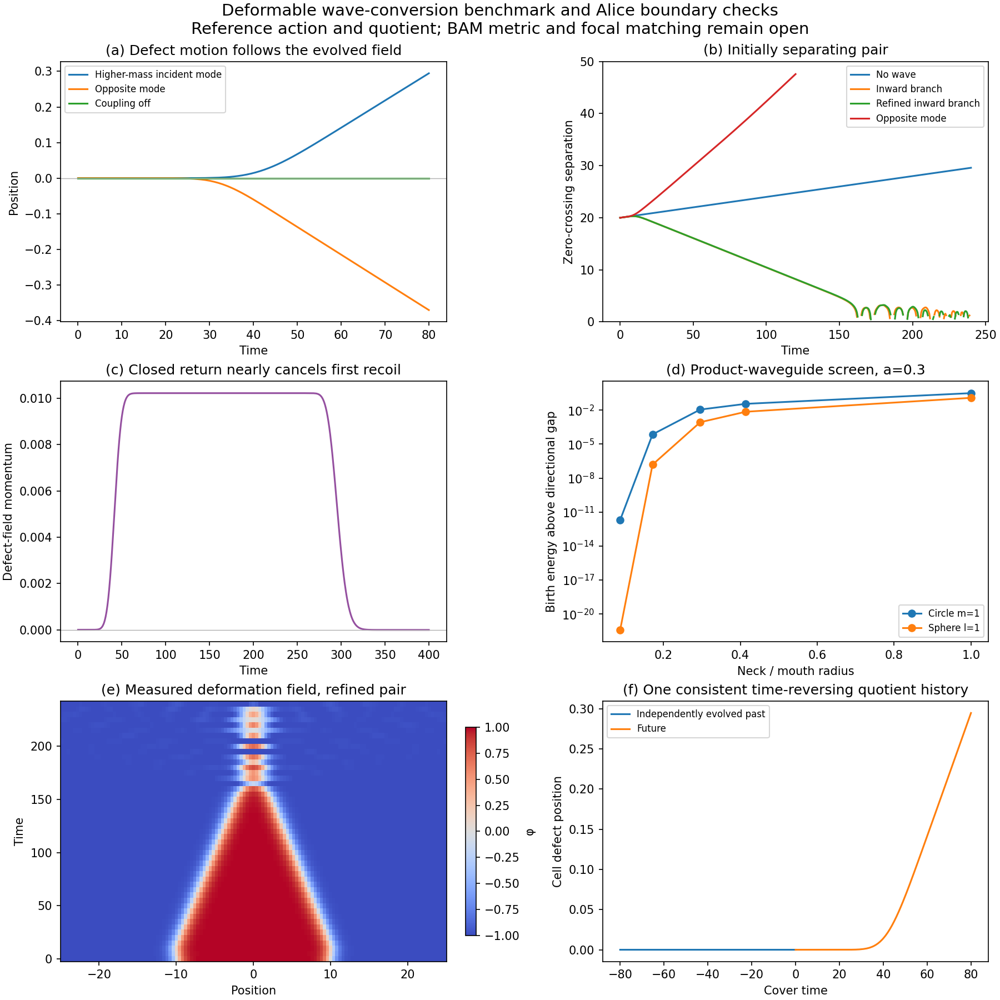

# Deformable wave conversion and Alice time orientation — PR #349 continuation

PR #349 remains the active calculation. This extension finds a **conservative
wave-induced attraction mechanism in a deformable-defect benchmark**, and
constructs a **nonlinear history on a time-nonorientable Lorentzian quotient**.
It does not establish that these are solutions of the BAM throat's Einstein
boundary problem. The benchmark's continuous local coupling is not installed
in the antipodal-only router.



## Return to the earliest attempts

| Earlier work | What actually determined motion | Consequence for this calculation |
| --- | --- | --- |
| [#1](https://github.com/davidmdrpi/geometrodynamics/pull/1), [#2](https://github.com/davidmdrpi/geometrodynamics/pull/2) | The original packaged worldline visualizer tests antipodal crossings, then `_fire_tx` assigns random velocity changes with coefficient 0.24. Its source/receiver energy updates have different coefficients and clipping. | Useful event geometry, but neither the recoil nor the energy transfer is derived. Do not inherit its pendulum as a solved trajectory. |
| [#25](https://github.com/davidmdrpi/geometrodynamics/pull/25) | Antipodal Compton kinematics starts with standard scattering momenta. | Establishes a kinematic consistency check, not an emission/absorption force. |
| [#58](https://github.com/davidmdrpi/geometrodynamics/pull/58), [#64](https://github.com/davidmdrpi/geometrodynamics/pull/64) | Prescribed radius energy and discrete C/P/T operations. | The #329 audit found the #58 normalization mismatch. Spinor CPT sign tables are not a metric gluing law or a force calculation. |
| [#175](https://github.com/davidmdrpi/geometrodynamics/pull/175), [#179](https://github.com/davidmdrpi/geometrodynamics/pull/179) | Weak-field self-gravity and an effective order parameter; #179 finds configurations by imaginary-time relaxation. | A bound stationary field is not a real-time two-mouth recoil solution. Retain the reciprocal-action principle, not the interpretation of relaxation as motion. |
| [#251](https://github.com/davidmdrpi/geometrodynamics/pull/251) | A prescribed one-wave loop and a recoil ledger. | The identification is useful, but its transmission, clock offset and recoil were input. |
| [#256](https://github.com/davidmdrpi/geometrodynamics/pull/256) and finite-throat successors | Flux-conserving boundary operators and finite transit. | Keep reflection, transmission and all propagating channels. Operator parameters and supported dynamical geometry still need derivation. Later positivity audits qualify the original spectrum claim. |
| [#322](https://github.com/davidmdrpi/geometrodynamics/pull/322) | Reciprocal finite-packet response with two deformation coordinates and fixed anchors. | Demonstrates conditional advanced self-signaling; the canonical response momenta are not mouth centre-of-mass recoil. |
| [#329](https://github.com/davidmdrpi/geometrodynamics/pull/329), [#330](https://github.com/davidmdrpi/geometrodynamics/pull/330) | Explicit ghost-scalar support and an EGB shell equation, respectively. | Support, radial stability, kinetic sign and nonspherical motion are separate requirements. Their restrictions are not erased by the benchmark below. |

The audit reads PR metadata and the existing implementations, including
`viz/antipodal_crossing.py`, `history/closure.py`, `two_way_psi_phi_q_probe.py`,
`finite_throat.py` and `physical_throat.py`. It does not rerun old experiments.

For comparison, [Shinkai and Hayward's Einstein/ghost-scalar simulations](https://arxiv.org/abs/gr-qc/0205041)
show that incident positive-energy pulses can collapse a supported Ellis throat,
whereas negative-energy perturbations can drive expansion. That is a concrete
example of wave-driven geometry, but it concerns radial evolution with explicit
exotic support. It neither derives tangential two-mouth attraction nor supplies
an Alice identification. The published result is a reference, not a new run here.

## A wave can pull a deformable object

Negative radiation pressure is an established classical possibility; examples
include [nonlinear kinks](https://arxiv.org/abs/0802.0080) and
[interacting scalar fields](https://arxiv.org/abs/0807.2314). The new calculation
uses an explicitly specified analogue, not an implementation of either paper:

\[
\mathcal L=\tfrac12\sum_{u=\phi,\psi_1,\psi_2}(u_t^2-u_x^2)-V,
\quad
V=\tfrac12(\phi^2-1)^2+2(\psi_1^2+\psi_2^2)
+\tfrac12\phi(\psi_1^2-\psi_2^2)
+\tfrac14(\psi_1^2+\psi_2^2)^2.
\]

All kinetic terms are positive. This potential is nonnegative: at fixed phi,
minimizing over the other fields subtracts at most
`max(|phi|-4,0)^2/4` from `(phi^2-1)^2/2`, which remains nonnegative.
The vacuum kink is `phi=tanh(x)` with continuum rest energy 4/3. Its position
and shape are extracted from the evolved field. No force or trajectory is
assigned to it. The benchmark has three effective fields and is **not** a
derivation of these degrees of freedom from gravity.

The two wave modes have squared masses `4+phi` and `4-phi`. For mode 1 incident
from the right, the mass decreases from sqrt(5) to sqrt(3) on transmission.
An independently integrated stationary wave equation gives reflection R and
energy transmission T; value and derivative are matched at both ends. With
incoming energy E and frequency omega,

\[
\frac{\Delta P_\phi}{E}
=\frac{T k_L-(1+R)k_R}{\omega},\qquad
k_L^2=\omega^2-3,\quad k_R^2=\omega^2-5.
\]

The force is toward the source when the transmitted wave leaves with more
momentum per energy. At omega=2.8, the calculation gives R=1.61914e-5 and
`Delta P/E=+0.183824`. The exact tanh-step reflection formula independently
agrees with the ODE. This is a momentum-conversion mechanism; no negative
wave energy or signed kick is required.

With a finite real packet of energy 0.0557273, the finest nonlinear run gives
total phi-field momentum **+0.0101956** and defect displacement **+0.294547** by t=80. The
monochromatic estimate is +0.010244; finite bandwidth, recoil and nonlinear
deformation are retained in the evolution. Restricting the momentum integral
to five units around the defect gives 0.0101958. Independently fitting its
late centre velocity gives 0.00764656, or `M gamma v=0.0101957` with M=4/3.
This distinguishes actual translation from momentum merely carried by
deformation radiation. Reversing the incident mode gives
negative momentum and displacement. Turning off their coupling leaves the
defect stationary. Offsetting the packet delays the encounter and retains its
impulse. These are mechanism controls, not fitted trajectories.

## Initially separating defects turn inward

A kink and antikink start 20 apart, moving outward at speed 0.02 each. Two finite
packets are prepared in the inner region and propagate toward the defects.
The packet energy is **0.424 of the initial defect energy**. This is substantial
prepared radiation, not a claim about the weaker BAM birth flash.

| Case | Separation at t=120 | Later observation |
| --- | ---: | --- |
| No wave | 24.7952 | Continues separating; 29.5903 at t=240 |
| Higher-mass inner mode, dx=0.1 | 8.18725 | Separation first below 2 at t=161.5 |
| Same, dx=0.05 | 8.22987 | Separation first below 2 at t=162.0 |
| Same, time step halved at dx=0.1 | 8.18767 | Separation first below 2 at t=161.5 |
| Opposite mode | 47.5793 | Radiation pushes the pair apart |
| Packet placement shifted by 1 | 8.19133 | Inward motion survives broken reflection symmetry |

The inward branch turns around at approximately t=9. There are no external
anchors or imposed equal/opposite impulses. After collision the field develops
a strongly nonlinear oscillating remnant; zero crossings disappear and can
reappear. Their absence at t=240 is **not** evidence of irreversible annihilation
or a gravitational throat collapse. Late collision details are more sensitive
to discretization than the well-converged approach before contact.

The largest recorded relative energy defect is 3.01e-4 in the coarse pair run and
7.63e-5 in the fine run. Time refinement alone gives 7.56e-5. Symmetric total
momentum cancels to rounding precision, so asymmetric controls are essential:
single-defect momentum residuals fall from 1.81e-4 to 4.50e-5 to 1.12e-5 as dx
halves. The lattice only approximates continuous translation symmetry; we do
not label its momentum ledger exact.

On the closed twisted circle, the returning packet exchanges mode labels.
By t=400 it almost cancels the first impulse: final defect momentum is
−6.23e-6, versus +0.01023 after the first passage. Thus one attractive encounter
does not establish sustained acceleration under repeated returns.

## Time orientation: tensor matching and an actual nonlinear quotient

[Diemer and Hadley](https://arxiv.org/abs/gr-qc/9905069) construct independent
spatial and temporal identifications and show why time coorientation matters
for electric flux. Their construction does not itself supply a supported
Einstein metric. We keep this distinction in both new calculations.

For a local Lorentz seam map J, the field and stress pull back as

\[
F_B=cJ^T F_AJ,\qquad T_B=J^TT_AJ,\qquad c=\pm1.
\]

The optional internal charge-conjugation sign c is independent of spatial and
time orientation. With static frames and `J=diag(epsilon,R)`, our covariant
Faraday convention gives `E_B=c epsilon R^T E_A` and
`B_B=c det(R) R^T B_A`. This is a tensor gluing convention; it must not be
confused with the usual active electromagnetic T convention, which includes
the additional field sign. Local energy stays positive. A time-reversing map
maps a future-directed null vector to a past-directed one in the destination
coordinate chart; the code retains that orientation.

For real waveforms, `t_A=epsilon t_B+delta` makes the positive-frequency map
complex-antilinear when epsilon=-1. Histories therefore solve

\[
a=Ua+V\overline a+b.
\]

The real SVD solver reports compatibility and nullity separately. It never
turns an incompatible least-squares residual into a solved history. Rotation,
spatial reflection, clock offset, moving frames and both time orientations
are exercised in 24 controls. A lossless single reversed loop has one
undetermined real quadrature and a source compatibility condition. Clock
reversal alone therefore does not select a unique physical incoming wave.

The nonlinear benchmark goes further. Its action is invariant under
`D(phi,psi1,psi2)=(-phi,psi2,psi1)`. On a flat Lorentzian cylinder of spatial
period 400, identify

\[
(t,x,u)\sim(-t,x+200,Du).
\]

This is a free time-reversing isometry, a reduced analogue of a nontrivial time
line bundle. Initial data obey `u0=G u0` and `v0=-G v0`, with G the half-period
shift followed by D. We independently evolve the nonlinear equations forward
and backward to |t|=80. The histories satisfy `u(-t)=G u(t)` and
`v(-t)=-G v(t)` exactly to the arithmetic used. This checks a construction by
symmetry and uniqueness on the cover, **not** a generic boundary-data selection
theorem or an independent convergence measurement. The two cover images are
the same quotient defect at different times, not two independent gravitating
mouths. The positive conserved energy ledger is on the cover.

An independent whole-field time-reversal run retraces the ordinary benchmark
within 1.6e-14 in field value and 1.3e-13 in velocity. Reversing only the wave
or only a sign in the force would not reproduce that history.

## What the actual neck still has to supply

The candidate mechanism is **conversion into an outgoing channel with greater
momentum per energy**, together with deformation and translation derived from
the same action. The finite-band benchmark demonstrates that this mechanism
can reverse initially separating objects. It does not show that an offset
Alice throat implements that action or those channels.

A first propagation screen is restrictive. For a product waveguide with
transverse radius b, the circle m=1 gap is 1/b and the sphere l=1 gap is
sqrt(2)/b. At a=0.3, using the earlier vacuum *spatial-slice* ratio
`b/sin(a)=sin(a)^2` gives gaps **38.747** and **54.797**. Only **1.99e-12** and
**3.90e-22**, respectively, of the actual Maxwell birth-flash energy lies above
those gaps. A wider ratio sqrt(2)-1 gives fractions 0.0363 and 0.00727 instead.
These are optimistic local propagation screens: they omit matching losses,
evanescent tunnelling, redshift and nonspherical mode conversion. They are not
transmission probabilities or a tensor-GR reduction. The original vacuum slice
does not specify a traversable Lorentzian development.

Dimension is retained explicitly. A scalar-flat, time-symmetric radial slice
in d spatial dimensions has `(f')^2=1-(b/f)^(d-2)`. Matching at `f=sin(a)` gives
`b/sin(a)=sin(a)^(2/(d-2))`. The d=4 spatial comparison therefore uses
`b=sin(a)^2` and an S3 l=1 transverse eigenvalue 3, rather than the d=3
relation above. Both are in the archive. The frequency weights are still the
available **S2 Maxwell** birth field: combining that source with these different
product geometries is a comparative screen, not a dimensionally unified BAM
prediction or an exclusion of transmission in the actual GR model.

The same screen is recorded with an assumed Doppler factor 2. A static time
reversal has unit frequency magnitude; a Doppler enhancement must come from
actual moving-boundary work and cannot be treated as free amplification.
The original strict antipodal capture restriction remains in force. The new
continuous defect action is an external benchmark, not a replacement for it.

A completed BAM solution still needs a supported spacetime throat, its
directional field operator and metric matching, and a self-consistent history
whose impulses satisfy antipodal support. The older scalar candidate's failure
of sustained approach and collapse remains preserved. PR #349 stays open on
that problem; neither the positive benchmark nor a time-reversing identification
is labelled a completed GR solution.

## Reproduction and evidence

```sh
OPENBLAS_NUM_THREADS=1 python -m experiments.closure_ledger.deformable_boundary_probe
python -m pytest -q tests/test_alice_boundary.py tests/test_deformable_mode_conversion.py
```

The run directory `experiments/closure_ledger/runs/20261023_deformable_boundary`
contains 14 field histories, the nonlinear time quotient, all final and initial
states, sampled fields, 15 scattering controls, 24 tensor/closure controls and
90 propagation screens. Pilot runs explored amplitudes 0, 0.2 and 0.35 before
selecting the 0.2 pair for refinement; this is exploratory evidence, not a
preregistered search. All scheduled controls are retained. No old trajectory
archive is overwritten or rerun.

Validation includes **18 new tests and 83 recoil/routing regressions**. The
independent state replay reconstructs final energies, momenta and centres for
all 14 histories, verifies the time quotient and checks every state hash.
