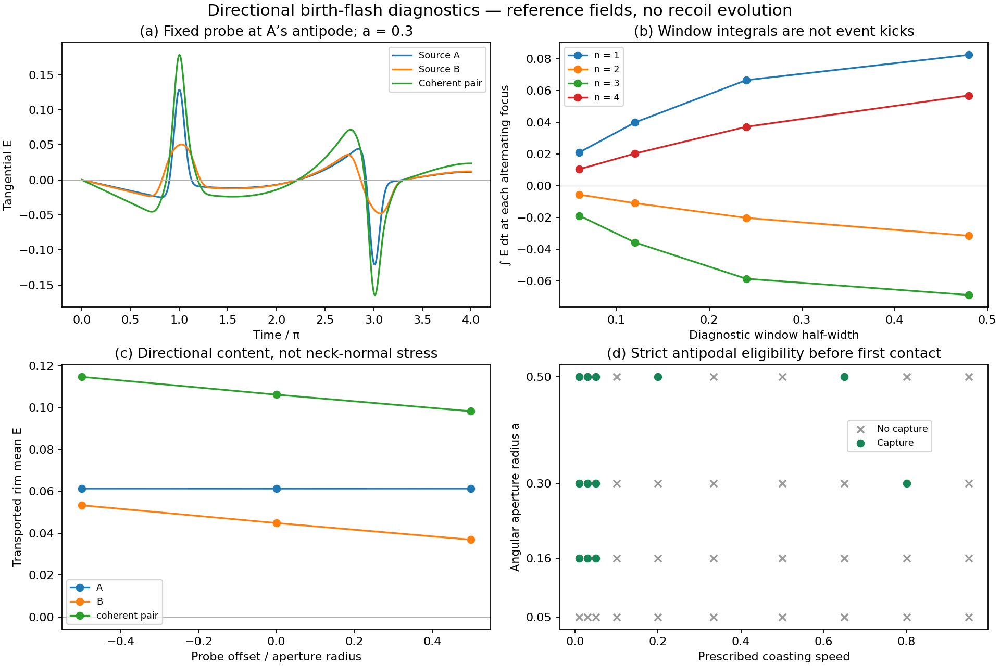

# Directional birth-flash response after PR #348

This calculation replaces modal-energy weights with the actual vector field of
`PairBirth.flash`. It measures a tangential electric response, its real azimuthal
m=1 content, and the reciprocal instantaneous field power. It separately checks
whether a mouth is present at a strict antipodal event. It does **not** add forces
between events, integrate a recoil trajectory, or supply a throat scattering law.



## Findings

The actual birth-current field has a nonzero tangential m=1 response even with a
centred probe. For a = 0.3, v = 1/3 at source A's first antipode, the coherent
pair gives E_parallel = **0.1778438095** and a transported rim mean **0.1062034417**.
The radial and azimuthal m=0 means are below 2 × 10^-17. Thus a directional
charged coupling is available in the reference field, without inventing an
offset-dependent dipole strength.

However, **neither birth front captures a mouth during the standard first
coasting flight**. Both returns at π and 2π meet empty foci; contact occurs at
7.62478, before 3π. The field at a hypothetical probe is therefore not an actual
mouth force in this strict-support control.

For an opposite-mouth capture at the first return, the geometric speed band is

    1 − 3a/π ≤ v < 1 − 2a/π.

The upper endpoint is contact, not capture. At a = 0.3 this band is
**0.71352 ≤ v < 0.80901**. A slower mouth can instead recapture its own second
return when v ≤ a/(2π). These conditions demonstrate a timing constraint on any
recoil mechanism, not a dynamical preference for these velocities.

The time integral remains sensitive to the specified window. At the centred
first antipode for a = 0.3, half-widths 0.06, 0.12, 0.24, 0.48 give parallel
integrals **0.020965, 0.039823, 0.066435, 0.082379** respectively. These are field
integrals, before multiplication by a receiver charge; no window is selected as
physical. Each later window is centred on that return's alternating focus and
uses a fixed receiver during the integral.

The maximum reciprocal-power residual over the 12 recorded probes is
**8.4 × 10^-17**. Increasing the spectral cutoff from 48 to 64 changes the reference
centre field by **2.8 × 10^-17**; the ring mean agrees at floating-point precision.
Increasing ring samples from 128 to 256 changes that mean by **4.3 × 10^-17**.
Lower-cutoff results are retained to show genuine convergence. These are local
projection checks, not accuracy bounds for a missing global boundary solution.

## What is calculated

The reference is the existing transverse Maxwell field on the round unit sphere:
ω_l = sqrt(l(l+1)), A = n × ∇χ, E_T = −∂_t A. The flash starts at
Q_k = −Q_quasistatic,k, P_k = 0, with a Gaussian source footprint 0.12 and the same
receiver footprint. Charges are ±0.75 and birth speed is 1/3 unless specified.
The free field is evolved analytically. Source copies are summed linearly before
projection; their energy would have to be squared only after summation.

No −i phase is applied on top of this propagator. Its Maxwell frequencies do not
produce the exact conformal antipodal propagator of the routing model. In
particular, this is not a boundary-matched incoming field on the glued topology.
The source's current direction already supplies directional content; a centred
probe need not have a zero tangential electric response. This does not contradict
the zero tangential resultant of the neutral, axisymmetric m=0 junction in #348.

At each ring we resolve the electric field into geodesic radial and azimuthal
components. With first Fourier coefficients (r_c,r_s) and (t_c,t_s), parallel
transport back to the centre gives the mean vector

    <E> = 1/2 (r_c − t_s, r_s + t_c).

A uniform transported vector has m=1 in both components. An axisymmetric radial
field has zero vector mean. This projection measures the modes a directional
junction would need. It does not assume that this ring mean is the net force on
a finite charged throat: the static field and boundary stress there remain unsolved.
The point-probe qE uses the existing Gaussian receiver action and has a different
meaning from the finite-radius ring diagnostic.

For fixed probes the time integral is exact:

    ∫[t1,t2] E_T dt = A(t1) − A(t2).

We report four explicitly chosen window widths, not a fitted impulse. A moving
probe needs convective terms and the magnetic Lorentz force as well. Coupling an
isolated instant for zero duration does not supply a finite q∫E dt. Switching an
interaction over a chosen window requires a boundary/action and its work ledger;
none is silently introduced here. A finite, discrete Maxwell spectrum on a
compact sphere is recurrent, so an infinite-time pulse-area argument also needs
care; these finite-window numbers do not establish a universal caustic sign rule.

## Reciprocity and interaction support

For arbitrary tangent test velocities, using the same footprint on the force and
the current gives

    Σ q_j v_j · E_T(x_j) + Re <P, Σ source_j> = 0.

This is an instantaneous electric-power identity of the existing Maxwell action.
The magnetic force does no work. It is not a finite-step energy or angular-momentum
closure test and does not justify importing continuous Maxwell/Coulomb forces
into the antipodal-only model.

The separate eligibility calculation uses `AntipodalTransport.mouth_at_focus`
without modification. Mouth centres coast at θ_A = a + vt, θ_B = −a − vt; the
first flight ends when the opposite rims meet, at t_contact = (π − 2a)/v. Birth
source k has foci (−1)^n x_k at t = nπ. Empty foci reflect; each source's free
surface audit stops at its first open capture. We do not continue a captured
source along a fictitious empty-sphere route. Contact and later rebirths are
excluded. Hypothetical fixed probes in the field tables are not actual mouths.

Eligible-source field values are explicitly **unglued Maxwell references**. Even
at an eligible event their values are not applied as BAM forces or impulses.
In particular, a field in a mouth's neighbourhood at another time is never
counted as an interception.

## Scope of the next boundary calculation

The remaining closure is a vector surface/throat scattering operator acting on
the m=1 fields, with flux normalization, the static charged solution, and throat
clock/orientation reversal. A spatial Klein rim map alone is not an electric
field transformation; time reversal also distinguishes electric and magnetic
data. The scalar two-port coefficient from #348 is not assigned to these vector
modes without a derivation. The resulting reciprocal boundary action must fix
the interaction duration or distributional impulse and its momentum ledger.

These results preserve the negative scalar trajectory result: no demonstrated
sustained approach, collapse, or bound trajectory. A local tangential response,
negative window integral, or favourable aperture overlap is not evidence of
binding. The earlier fixed-geometry neck-pressure results remain separate.

## Reproduction

The run records **108 directional projections, 144 diagnostic windows and 40
first-flight histories** (572 inspected source-focus events, 24 captures).
There are **13 new tests** in addition to the 70 passing recoil/routing regressions.

Run from the repository root:

```sh
OPENBLAS_NUM_THREADS=1 python -m experiments.closure_ledger.directional_flash_probe
python -m pytest -q tests/test_directional_flash_response.py
```

Data and relative-path SHA-256 manifest:
`experiments/closure_ledger/runs/20261022_directional_flash/`.
The controls include independent time quadrature, coordinate rotation,
source superposition, sign/time reversal, power reciprocity, spectral cutoff,
ring quadrature, and contact exclusion. No old trajectory run is repeated.
