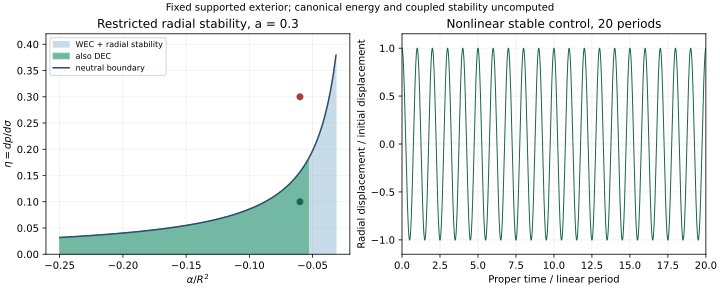

# Moving EGB mouths: an open radial window, coupled admission still open

**Result: `OPEN_RADIAL_WINDOW_COUPLED_ADMISSION_OPEN`.** In a restricted
five-dimensional model with a fixed supported exterior, direct identification
of two mouths admits an open set of radially stable equilibria with shell WEC,
and an open subset with shell DEC. The finite-amplitude control retains DEC
for 20 periods without corrective kicks. This is a model-specific calculation,
not a claim that ordinary-matter EGB wormholes or their stability are new in the
literature. It does not establish a healthy shell action or a quantum event.

The [numerical protocol](egb_shell_dynamics_protocol.md) was written after the
analytic prediction and before running the scan. It defines thresholds that
can fail. The [source-bound result](../experiments/closure_ledger/runs/20261012_egb_shell_dynamics/result.json)
and [grid/trajectory archive](../experiments/closure_ledger/runs/20261012_egb_shell_dynamics/samples.npz)
include the unstable countercontrol. The older smooth-neck failure is unchanged.



## What theory and geometry are being tested?

Set c=1, kappa5=8 pi G5, and use the bulk action

\[
S_g=\frac1{2\kappa_5}\int\sqrt{-g}\,[\mathcal R+\alpha\mathcal L_{GB}]\,d^5x,
\qquad ds^2=-dt^2+\frac{dr^2}{f(r)}+r^2d\Omega_3^2,
\qquad f(r)=1-r^2/R^2.
\]

Remove two equal antipodal balls from spatial S4 and identify their mouths,
with normals directed from the shell into the retained exterior on both sides.
The same local junction equations apply on these two boundary faces; they
are not two independently moving bodies. There is **no finite neck**. The
coordinates cover each mouth for 0<r<R; the equator is a boundary of this
radial chart, not a claimed curvature singularity. The common-radius radial
ansatz does not describe nonsymmetric mouth motion, an Alice bundle, or time
shifting. The static bulk has no future-trapped round spheres away from the
junction: its two future null expansions have opposite signs.

The Gauss--Bonnet coupling is constant, including outside the mouths.
This is an extension of the GR-away-from-foci baseline, not merely a new
boundary law in otherwise Einstein gravity. Its supporting bulk stress is

\[
\kappa_5\rho=6/R^2+12\alpha/R^4,
\quad \kappa_5p_{\rm bulk}=-3/R^2,
\quad C=1+4\alpha/R^2.
\]

For C>0 the bulk stress satisfies NEC (and here DEC). The existing
[`negative_egb.py`](../geometrodynamics/bulk/negative_egb.py) calculation gives
the exterior TT principal coefficients Ct=-C/2, Cs=1/2, so cT^2=1/C.
This is one necessary characteristic check, not a full matter or coupled
well-posedness result. A bulk material action and perturbative response remain
unspecified. At negative alpha the TT cone is wider than the metric null cone,
but the ultrastatic bulk still has a time function: the effective inverse
principal metric is proportional to diag(-C,g_spatial_inverse), hence
g_eff_inverse(dt,dt)=-C<0. With the common, unshifted t used here, the smooth
bulk TT cone permits no closed future-directed effective-causal curve. Wider
than the metric cone is not by itself a pathology of this background.
At the distributional shell there is no ordinary smooth pointwise effective
metric to apply this argument to. Perturbative junction conditions, or a
controlled finite-thickness model and its characteristics, must decide crossing
and coupled propagation. No claim is made for time-shifted identifications.

## Moving junction and the flux that cannot be dropped

Let v=dr/dtau, Delta=sqrt(f+v^2), q=Delta/r, where tau is proper shell time.
The mixed extrinsic-curvature eigenvalues are (k0,q,q,q), with

\[
k_0=\frac{\ddot r-f'v^2/(2f)}{\Delta}.
\]

The lapse is one. Substitution of a Schwarzschild-lapse expression for k0
would change this problem. The induced shell FRW curvatures are
A=ddot(r)/r and B=(1+v^2)/r^2. Write s=kappa5 sigma and p=kappa5 pressure.
The symmetric Davis junction condition gives

\[
s=-6q\left[1+4\alpha\left(B-\frac{q^2}{3}\right)\right],
\quad p=2k_0+4q+8\alpha[k_0(B-q^2)+2qA].
\]

Equivalently,

\[
p=4q+D\ddot r-\frac{Cf'v^2}{f\Delta},\qquad
D=\frac{2C}{\Delta}+\frac{16\alpha\Delta}{r^2}.
\]

The numerical implementation separately contracts the full intrinsic Riemann,
Ricci, P tensor and cubic extrinsic-curvature J tensor in Davis's equation (10).
It agrees with these reduced stresses to 1.99e-15 normalized error over 32
seeded moving/accelerating states. An independent embedding calculation checks
k0, and tests also cover the Einstein limit and radius scaling.

The shell does exchange energy with the supporting bulk:

\[
\dot s+\frac{3v}{r}(s+p)=\mathcal F,
\qquad \mathcal F=\frac{6Cv\Delta}{R^2 f}
=2\kappa_5(\rho+p_{\rm bulk})\gamma w,
\quad w=v/\sqrt f,\quad\gamma=\Delta/\sqrt f.
\]

This is the sourced conservation identity with the stated normals. At
equilibrium the flux is zero, but it is first order in moving perturbations.
The arbitrary-kinematics finite-difference identity has maximum normalized
residual 1.06e-8. Omitting the source at (R,r,v,alpha)=(1,.31,.12,-.06) leaves
residual 0.5801202. A source-free potential treatment would be inconsistent.
The integrated ledger is

\[
s r^3-s_i r_i^3+\int p\,d(r^3)-\int r^3\mathcal F\,d\tau=0.
\]

Multiply each term by 2 pi^2/kappa5 for the physical shell energy/work.
This ledger does not claim that the shell's energy alone is conserved or that
the total closed-bulk gravitational energy has been calculated.

The material task is concrete. The background fluid has
w_bulk=p_bulk/rho=-3/(6+12 alpha/R^2), equal to -0.5681818 at alpha=-.06 R^2,
whereas the equilibrium shell pressure is positive. A realization must supply
this stress exchange at the stated rate. **It is bidirectional**: F is odd in v,
positive for expansion and negative for contraction with these conventions.
An oscillating shell cannot be modeled as a one-way absorber. The stress
identity does not itself specify particle conversion, chemistry or entropy
production. Both F and the 2C/Delta part of D vanish as C approaches zero;
the Gauss--Bonnet part of D need not vanish. The archived scan has minimum
C=0.0004, while the selected trajectories use C=.76. Future coupled scans must
state a positive C margin in advance; the original grid has not been filtered
after observing its result.

## Equilibrium, material response, and the open interval

At r0=R sin(a), a=.3, q0=cos(a)/r0,

\[
s_0=-6q_0\left[1+\frac{4\alpha(2+\sin^2a)}{3r_0^2}\right],
\qquad p_0=4q_0.
\]

Since p0>0, the static shell cannot be empty. Shell WEC together with strictly
positive exterior C permits

\[
-R^2/4<\alpha\le-\frac{3r_0^2}{4(2+\sin^2a)}
=-0.03137935813R^2.
\]

Shell DEC further requires alpha<=-0.05229893022 R^2. The Gauss--Bonnet length
sqrt(|alpha|) is **at least** .599425 r0 over the WEC interval, not .6 r0
everywhere. At the chosen alpha=-.06 R^2 it is .8289 r0. These are substantial
curvature corrections, not a demonstrated controlled small-correction EFT.

Specify the **imposed**, affine material law

\[
p_{\rm EOS}=p_0+\eta(s-s_0),\qquad
\ddot r=\frac{p_{\rm EOS}-4q+Cf'v^2/(f\Delta)}{D}.
\]

The intercept is anchored separately at each prescribed r0 and alpha. This
fine tuning is explicit: no equilibrium radius or material law is dynamically
selected. The scan 0<=eta<=1 is a local response proxy; without a shell action
it is not proof of a causal material theory. There are no corrective kicks.

Define

\[
E_0=1-4\alpha/R^2+8\alpha/r_0^2,\quad D_0=2E_0/\cos a,
\quad \omega_r^2=-\frac{3\eta+2/E_0}{r_0^2}.
\]

The shell WEC interval has E0<0 throughout: at its upper endpoint
E0=-4 cos^2(a)/(2+sin^2(a)), and E0 decreases toward the lower endpoint.
Therefore **0<=eta<-2/(3E0)** gives radial linear stability; equality is neutral
and excluded. Strict inequalities give an open region, independently of grid
counts. The 101 by 101 grid finds 934 stable-WEC points and 662 also satisfying
DEC. The finite-difference acceleration Jacobian agrees with -omega_r^2 to
8.51e-11 normalized error.

The independent review supplies an especially useful identity. Define the WEC
bracket P=1+4 alpha/(3R^2)+8 alpha/(3r0^2), so s0=-6q0 P. Exactly,

\[
E_0=3P-2C.
\]

Shell WEC gives P<=0, while C>0, hence **E0<0 and D0<0 for every mouth angle
0<a<pi/2 in the stated radial parameter window**. This is structural, not
a numerical observation at a=.3. At fixed r0/R it separates this family from
the GR thin-shell branch. The radial coefficient vanishes at

\[
\alpha_D=-\frac{r_0^2R^2}{8R^2-4r_0^2},\qquad
-\frac{R^2}{4}<\alpha_{\rm WEC}<\alpha_D<0.
\]

For x=r0^2/R^2 in (0,1),
(alpha_D-alpha_WEC)/R^2=x(1-x)/(4-x^2)>0. Crossing from alpha=0 into the
WEC window at fixed geometry therefore encounters a degenerate radial
acceleration equation. No smooth continuation through that point is claimed.
At a=.3 the boundary is alpha_D/R^2=-0.0114149713041.

D0 is nonzero inside the window, so the radial ODE can be solved locally.
Its sign alone does not compute the canonical kinetic norm or prove the
absence of ghosts; no shell/support action and constraint-reduced quadratic
Hamiltonian has been supplied. The structural identity means changing a or
alpha cannot reverse **D0** within this window. It does not yet prove that one
canonical-energy sign governs every material completion. Even the same linear
oscillator equation follows from either sign of its quadratic Lagrangian.
A family-wide kinetic verdict needs the derived relation between D0 and the
physical quadratic form, including constraints, boundary terms and support.
That is an open admission gate, not a passed gate.

## Finite-amplitude controls and horizon

Choose (alpha/R^2,eta)=(-.06,.10). Then s0 R=17.69113710,
p0 R=12.93091258, C=.76, cT^2=1.31578947,
D0=-8.91048348, omega_r^2 R^2=1.94540699 and eta_critical=.15663222.
The horizon is 20 linear periods, tau/R=90.0958170. Use coordinate norm
sqrt(((r-r0)/r0)^2+(v/(r0 omega_r))^2), initial v=0.

| Initial displacement / r0 | Max norm / initial | Relative period error | Accumulated phase drift | Minimum DEC margin times R |
|---|---:|---:|---:|---:|
| 1e-3 | 1.00241314 | 5.414e-6 | -6.803e-4 rad | 4.678997 |
| 1e-4 | 1.00024079 | 5.402e-8 | -6.789e-6 rad | 4.752085 |

The observed nonlinear frequency shift scales approximately with squared
amplitude. At these amplitudes the fixed 20-period horizon accumulates much
less than one radian of drift. This justifies the reported short-time
comparison, not indefinite nonlinear stability. A canonical action variable I
has not been derived, so no physical d(omega)/dI or twist theorem is claimed.
The smaller-amplitude run tests approach to linear theory, not a new fitting
parameter. A tighter-tolerance replay agrees below 1e-11 in the coordinate norm.
All trajectory work-balance residuals are below 1.2e-14 after normalization by
initial shell energy. Integration stops or exceptions are failures, not bounces.

The preselected unstable control changes only eta to .30 and starts at 1e-5 r0.
After five predicted growth times its displacement grows 74.1847-fold, matching
linear cosh growth to 3.41e-4 relative error. No eventual collapse/escape endpoint
is inferred. Oscillation of the stable example cannot make this label unfalsifiable.

## Casimir scale screen: conditional, not an MMP exclusion

If an unenhanced one-scale quantum stress N_eff hbar/b^D must support curvature
1/b^2 through Einstein gravity, dimensional balance gives

\[
b\sim N_{\rm eff}^{1/(D-2)}\ell_{P,D},\qquad
\ell_{P,D}^{D-2}=\hbar G_D.
\]

For loops of length L and transverse area of order b^(D-2), the two-dimensional
Casimir scaling instead gives |T|~N_eff hbar/[b^(D-2)L^2], so
b^(D-4) L^2~N_eff ell_P,D^(D-2). With L=lambda b in native D=5,
b/ell_P,5~(N_eff/lambda^2)^(1/3). For N_eff=1 this is order one when lambda=1,
and .215 when lambda=10. A nominal sub-Planck estimate means the semiclassical
screen is not controlled; it is not evidence for a reliable smaller throat.
Order-one coefficients and the actual field spectrum/state remain unspecified.

This screen assumes Einstein curvature balance, not a large EGB contribution.
It is **not a no-go for Maldacena--Milekhin--Popov**: their charged,
near-extremal background and magnetically enhanced low-energy channels require
a different balance. An actual BAM proposal must specify these ingredients and
closed-loop boundary conditions before claiming a macroscopic throat.
On a globally ultrastatic compact optical space of finite diameter, long null
segments need not be achronal; the usual achronal-line ANEC obstruction cannot
simply be imported. That observation alone supplies no supporting vacuum stress.
Any Casimir mechanism already uses QFT and hbar; it does not derive quantum rules.

## What can reject this direction next?

The next binding calculation is a **closed bulk-plus-shell material model and
its constrained quadratic action**, including the required exchange law. A
negative physical kinetic norm, an ill-posed characteristic sector, or an
incompatible material response would reject that realization despite this
radial window. Nonspherical/coupled stability remains open. In parallel, a
finite-thickness construction must test whether this weak junction has any
smooth bounded-curvature realization with the same useful properties.

The shell has distributional curvature. It is a possible AP-R0 weak-junction
candidate only; it does **not** satisfy the stronger smooth regularity demand
merely because its surface density is finite. The earlier smooth-neck
obstruction therefore remains relevant to any attempted thickening. No focal
activation, topology creation, scattering law, or antipodal quantum event is
computed here.

**Geometry dependency break:** this direct identification has no scalar-flat
neck, so it does not inherit #328's neck transit 2S, waist b=R sin^2(a), or the
neck-based `finite_mouth` spectra and Dirichlet-to-Neumann operators. Transport
must be recomputed for the new junction and its field-matching law. The same
mouth radius and angular labels do not make the two interiors interchangeable.

## Sources and reproduction

- S. C. Davis, [Generalised Israel Junction Conditions for a Gauss-Bonnet Brane World](https://arxiv.org/abs/hep-th/0208205), equations (3), (6), (7), (10), (11).
  His kappa^2 is this document's kappa5; his H tensor is half the usual variation
  tensor, so his G+2 alpha H matches the repository's G+alpha H_standard.
- J. Maldacena, A. Milekhin, F. Popov, [Traversable wormholes in four dimensions](https://arxiv.org/abs/1807.04726), for the distinct magnetic Casimir mechanism.
- Repository [negative-EGB protocol and erratum](negative_egb_prereg.md), for
  the same supported exterior and its measured TT principal symbol.

```bash
python -m experiments.closure_ledger.egb_shell_dynamics_probe
python -m pytest tests/test_egb_shell_dynamics.py -q
```

The producer writes all 10,201 grid values, four trajectories (including the
tighter replay), a plot and a source/array-hash manifest. These are finite
numerical checks of the stated reduced model, not independent implementations
of a complete nonlinear EGB spacetime evolution.

Validation: 74 focused tests pass under both NumPy 2.3.5 and 2.2.6 (SciPy 1.17,
Python 3.12.14): ten new shell tests, 35 preceding focus/audit tests, and 29
existing negative-EGB tests. The archive test checks every recorded source
hash and the NPZ digest, then recomputes the stable trajectory metrics from
the saved arrays. This is local validation; repository-wide CI is separate.

## Independent review and response

The [review of 7d3745d](https://github.com/davidmdrpi/geometrodynamics/pull/330#issuecomment-6135900196)
reports an independent symbolic derivation of the embedding, sourced
conservation and linear frequency, closed-form reproduction of the grid counts,
and a separately written fixed-step RK4 reproduction of the nonlinear controls.
It also reports 74 passing tests with NumPy 2.4.6/SciPy 1.17.1 and an identical
NPZ digest on producer replay. These independent-code results are attributed
to the reviewer; the separate implementation is not part of this archive.

This response adds the structural identity, branch-separating degeneracy,
bulk TT time-function argument, explicit bidirectional exchange requirement,
and geometry dependency break above. Five new review tests check exact rational
identities and branch ordering, varying-angle/scaling agreement with the shell
implementation, the fluid stress projection, the critical-C limit, and both
flux signs in the archived oscillation. The original producer, frozen protocol,
simulation arrays and result manifest are unchanged. The accepted claim remains
the closed-form radial window; the common sign of D0 is not promoted into an
uncomputed universal canonical-energy verdict.

After these additions, 79 focused tests pass under NumPy 2.3.5 and 2.2.6,
including the original archive/source integrity checks.
