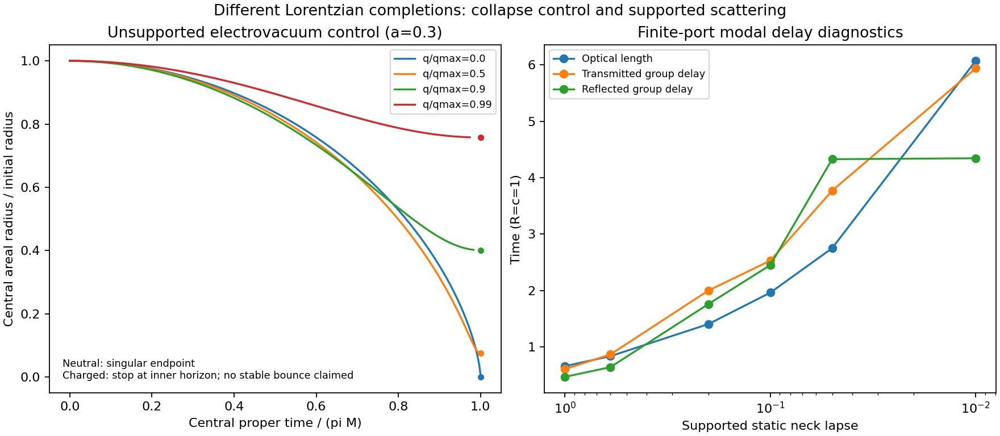

# Einstein throat evolution and the remaining mouth equation

This follows `3f72d9a` and addresses
[review 6458618899](https://github.com/davidmdrpi/geometrodynamics/pull/349#issuecomment-6458618899).
The review independently reproduces the throat scattering and outward Maxwell
waist loads. Those field loads are now supplemented by the gravitational
radius equation, an exact electrovacuum evolution control and an independent
numerical evolution. Finite-port group delays are also calculated.

**Result:** the unsupported spherical bridge initially contracts under Einstein
Maxwell evolution. Its neutral completion reaches a curvature singularity;
its charged ideal Reissner–Nordstrom completion reaches a nonzero inner-horizon
radius. Neither calculation is mouth-center attraction on S3 or nonsingular
annihilation at contact. The supported traversable two-port is a different
Lorentzian completion. Its unspecified support response is an actual missing
equation, demonstrated below by opposite initial accelerations at identical
constraint data. No fitted mass, collapse switch or off-antipodal force is added.

## 1. Derive acceleration, rather than divide the field load by a guessed mass

Use G=c=R_universe=1 and Maxwell normalization q=Q/sqrt(4*pi). On the initial
slice, K_ij=0 and h_ij dx^i dx^j=ds^2+r(s)^2 dOmega^2. Define normal proper-time
areal velocity U=D_tau r and radial derivative Gamma=r_s. The angular ADM
Einstein equation and Hamiltonian constraint give, at that slice,

\[
D_\tau U={r_sN_s\over N}
 -{1-r_s^2-rr_{ss}\over r}-4\pi r(p_s-\rho)
 ={r_sN_s\over N}-r_{ss}-4\pi r(\rho+p_s).
\]

The first expression follows directly from
R_theta_theta=1-r_s^2-r*r_ss and
D_t K_theta_theta=-D_theta D_theta N+
N[R_theta_theta-8*pi*S_theta_theta+4*pi*h_theta_theta*(S-rho)].
The second uses 1-r_s^2-2*r*r_ss=8*pi*rho*r^2. Tests evaluate the first
expression independently and compare with the reduced implementation.
For the charged slice,

\[
r_s^2=1-{2M\over r}+{q^2\over r^2},\quad
r_{ss}={M\over r^2}-{q^2\over r^3},\quad
\rho_{EM}=-p_{s,EM}={q^2\over8\pi r^4}.
\]

With only this Maxwell stress, geodesic normal observers (initial N=1) have

\[
\boxed{D_\tau^2r=-{M\over r^2}+{q^2\over r^3}.}
\]

This is a radius acceleration from Einstein's equation. Their four-acceleration
is zero: decreasing areal radius along a geodesic is not acceleration of a
massive particle due to a nongravitational force. At the waist Gamma=0, the
lapse-gradient term vanishes for any regular initial lapse. A choice of clock
alone cannot turn this contraction into staticity. Conversely, prescribing a
static metric changes the required stress, not just the clock.

A diagnostic normal geodesic initially at the rim has the same radial equation.
At a=0.3 its initial radius acceleration is -0.14776010 (neutral) or
-0.14502626 (charge fraction 0.9). This describes a spherical shell's area,
not translation of the aperture center along S3. It is not installed as a
mouth kick. Matching a moving rim to the exterior requires the exterior
geometry, stress and junction data; matching initial radius and slope is
insufficient.

## 2. Solve the central electrovacuum evolution exactly and numerically

For this control only, extend the spherical initial slice into the standard
Reissner–Nordstrom electrovacuum solution. This is a particular Lorentzian
completion of the interior data, not a solved closed-S3 exterior. A finite
bridge attached to dynamical exterior matter agrees only where its domain of
dependence agrees with this completion.

Write d=sqrt(M^2-q^2), b=r_+=M+d and r_-=q^2/(M+d). The central normal geodesic
starts from the bifurcation two-sphere, has Killing energy zero and obeys

\[
\dot r^2=-f(r)={2M\over r}-1-{q^2\over r^2},\qquad
r=M+d\cos\eta,\qquad \tau=M\eta+d\sin\eta.
\]

Here 0<=eta<=pi covers contraction. The code evaluates
r=r_-+2*d*cos(eta/2)^2 to avoid cancellation near the inner endpoint.
An independent DOP853 integration of the second-order radius equation starts
at r=b, dr/dtau=0. Twelve cases cover a=0.2,0.3,0.45 and charge fractions
0,0.5,0.9,0.99. It is not an inversion of the parametric solution.

At a=0.3:

| q/q_max | Initial neck b | Initial radius acceleration | Endpoint radius | Endpoint proper time pi*M |
| ---: | ---: | ---: | ---: | ---: |
| 0 | 0.02580843 | -19.37352 | 0 | 0.04053978 |
| 0.5 | 0.02415255 | -19.15613 | 0.00180325 | 0.04077128 |
| 0.9 | 0.01876659 | -15.96782 | 0.00751934 | 0.04128985 |
| 0.99 | 0.01501300 | -8.07443 | 0.01137321 | 0.04144736 |

These are times on the central normal geodesic, not derived arrival times on
the closed universe's mouths. The neutral endpoint has divergent invariant
curvature, not conversion into a regular outgoing flash. The charged endpoint
is an inner Cauchy horizon of the exact ideal solution. The calculation stops
there; it does not evolve a stable bounce or a repeated BAM cycle. Analytic
continuation of ideal RN permits further branches, but is not a prediction
of the original Cauchy data through a perturbed inner horizon.

The archive measures

\[
R_{abcd}R^{abcd}={48M^2\over r^6}-{96Mq^2\over r^7}
 +{56q^4\over r^8}.
\]

At the reflection-symmetric central sphere, Gamma=0 and the normalized radial
null expansions are theta_+=theta_-=2*U/r. They are both negative during
contraction. The initial bifurcation sphere is marginal. This is a trapped
interior, not the positive-lapse static transmitting channel used to calculate
S(omega). A finite-port supported scattering matrix cannot be reused during
this evolution without solving the time-dependent field problem.

This conditional result has historical precedent: Graves and Brill derived
ideal charged-bridge contraction and re-expansion in
[Phys. Rev. 120, 1507 (1960)](https://doi.org/10.1103/PhysRev.120.1507).
Fuller and Wheeler explain the neutral bridge's finite-time pinch-off and
failure to transmit between its exteriors in
[Phys. Rev. 128, 919 (1962)](https://doi.org/10.1103/PhysRev.128.919).
The ideal charged continuation must not be promoted to a stable cycle:
Poisson and Israel's spherical counter-streaming calculation exhibits
inner-horizon mass inflation in
[Phys. Rev. Lett. 63, 1663 (1989)](https://doi.org/10.1103/PhysRevLett.63.1663).
We have not simulated that instability here or inferred a specific BAM outcome
from it.

## 3. A constructive demonstration of the missing support equation

The prior static completion has support density zero on this slice. At the
waist its radial pressure is

\[
p_{\rm hold}=-{r_{ss}\over4\pi r}.
\]

It cancels the electrovacuum radius acceleration exactly. Keeping the same
h_ij, K_ij, electric flux, density and momentum density, let the initial support
pressure be alpha*p_hold. The constraints are unchanged, but

\[
D_\tau^2r\big|_{s=0}=-(1-\alpha)r_{ss}.
\]

Thus alpha=0 contracts, alpha=1 is initially stationary, and alpha=2 expands.
At a=0.3 and charge fraction 0.9 the accelerations are -15.96782, 0 and
+15.96782. This is an initial-data sensitivity demonstration, not three
complete material models or three proved long-time solutions. A covariant
support action or stress evolution law is still required to evolve alpha.
The code also verifies exact cancellation throughout the initial bridge for
the full static support stress and each declared lapse, including depth 0.99.

This resolves the apparent tension between the two reports. Maxwell's
fixed-metric shape load opens the waist, while Einstein gravity can contract
an unsupported bridge. Dropping the metric constraints and dividing that
Maxwell load by an assumed positive radius mass loses the gravitational
terms. Conversely, retaining a static supported metric while borrowing the
unsupported collapse trajectory combines incompatible equations.

A time reversal takes r(tau) to r(-tau); the second derivative is unchanged.
A regular free spatial/time quotient preserves local curvature and the local
Einstein equation. It does not supply p_hold or remove a curvature singularity.
It may select admissible global histories once the dynamics and seam data are
specified. The charged bundle and full exterior matching remain necessary.

## 4. Review follow-up: optical time is not group delay

For the previous supported finite-port problem, use exp(-i*omega*t) and fixed
rim reference planes. The requested delays are

\[
\tau_T=\operatorname{Im}(t^{-1}\partial_\omega t),\quad
\tau_R=\operatorname{Im}(r^{-1}\partial_\omega r),\quad
\mathcal Q=-iS^\dagger\partial_\omega S.
\]

The left-input Smith delay obeys Q_LL=T*tau_T+R*tau_R. The code checks this,
Hermiticity, frequency-step/ODE refinement and the high-frequency limit
 tau_T -> integral ds/N. Conditional delays are undefined at an exact zero of
the relevant amplitude. They are returned as null there, not assigned zero.

The six lapse depths from the review are recomputed for all 47 modes n=2..48
of the width-0.2 prescribed spectral drive. Output-weighted modal delays and
all individual complex-response derivative diagnostics are archived:

| Neck lapse | Transmitted weight | Optical length | Transmitted weighted delay | Reflected weighted delay |
| ---: | ---: | ---: | ---: | ---: |
| 1 | 6.3588e-7 | 0.66218 | 0.60848 | 0.47126 |
| 0.6 | 2.1436e-5 | 0.83802 | 0.86973 | 0.64425 |
| 0.2 | 0.27958 | 1.40704 | 2.00190 | 1.76187 |
| 0.1 | 0.78995 | 1.96375 | 2.53000 | 2.45260 |
| 0.05 | 0.92556 | 2.75065 | 3.77024 | 4.32810 |
| 0.01 | 0.75704 | 6.07056 | 5.93775 | 4.34448 |

For example, the neck-lapse-0.2 transmitted weighted delay is about 2.002,
not the optical length 1.407. At unit lapse the reflected weighted delay is
0.4713; the transmitted component carries only 6.36e-7 of the drive energy.
These are finite-port response diagnostics. In a dispersive broadband problem the
actual waveform requires multiplication by the complete complex S(omega)
and reconstruction, including phase and temporal spread. One weighted delay
is not an exact arrival time, causal front velocity or eligible capture gate.
In particular, an almost perfectly reflected pulse must not be delayed by the
full optical length merely because that was the old router's transit time.

The Z=omega port basis remains a declared boundary normalization. Attaching
the S3 exterior will change the composed phases and delays. Neither replacing
R,T by their averages nor allowing the reflected component to re-enter the
Klein throat map supplies the missing exterior, polarization and normal
transport. The current ideal unit-transmission router is a topology control;
it is not validated as the physical scattering law of this neck. The strict
antipodal interception rule remains unchanged in this follow-up.

One correction to the review is necessary: the limit beta=1 of our polynomial
lapse N=1-beta*(1-(s/S)^2)^3 is **not the vacuum lapse**. It has
N~3*s^2/S^2 near the neck, whereas the nonextremal vacuum/electrovacuum static
lapse is proportional to abs(s). N_ss/N diverges in the polynomial limit;
our static code excludes it. Both descriptions obstruct the proposed finite
static transit, but they are different geometries. The review's diverging
optical-delay trend is reproduced without equating these lapses.

## 5. What is and is not now solved

| Quantity | Status |
| --- | --- |
| Initial throat and diagnostic rim radius acceleration for declared stress | Derived from the angular Einstein equation |
| Unsupported central spherical electrovacuum history | Exact solution and independent numerical verification |
| Neutral singular contraction | Established for that completion; not annihilation |
| Charged contraction | Followed to the ideal inner horizon; no stable bounce asserted |
| Supported throat phase/group delays | Computed with the existing finite-port convention |
| Mouth-center acceleration along S3 | Unsolved: no directional exterior/junction evolution |
| Supported throat stability and collapse at mouth contact | Unsolved: support response and interacting metric are missing |
| Nonsingular matter-wave-matter cycle with Klein/time matching | Unsolved |

The next well-posed calculation must specify either a full supported
Einstein-Maxwell evolution or abandon the supported transmitting background
and evolve a nontraversable electrovacuum completion consistently. For moving
mouths, it must also supply the nonspherical exterior constraint data, the
mouth identification/worldtubes, and their field/junction conditions. The
angularly symmetric radius sector cannot determine the directional displacement
sector. These are equations and boundary data to derive, not additional fit
parameters to tune until a trajectory collapses. No claim that the actual BAM
acceleration-and-collapse problem is solved follows from these controls.

## Validation and reproduction

Run:

```sh
OPENBLAS_NUM_THREADS=1 python -m experiments.closure_ledger.einstein_throat_probe
python -m pytest -q tests/test_einstein_throat_evolution.py
python -c 'from experiments.closure_ledger.einstein_throat_probe import manifest; manifest()'
```

The focused suite passes 155 tests, including 12 new tests. Across the 12
independent evolution comparisons the maximum radius discrepancy divided by
the initial radius is 5.29e-12; maximum absolute velocity discrepancy is
2.45e-8 near the neutral singular limit. The largest refinement change in
incident Smith delay is 5.67e-6, and the largest conditional transmitted-delay
change in those checks is 3.27e-5. These convergence estimates do not validate
an exterior attachment or a broadband arrival approximation.

The archive stores 12 histories and ODE checks, 12 pressure-sensitivity cases,
282 modal scattering-delay calculations and 18 delay refinements. The neutral
singular endpoint is reported analytically; numerical histories stop at
eta=0.97*pi. Charged histories also stop before their inner horizon, whose
exact endpoint is tabulated separately. No old replay or negative result is
rewritten. The new manifest pins every source dependency and result.


