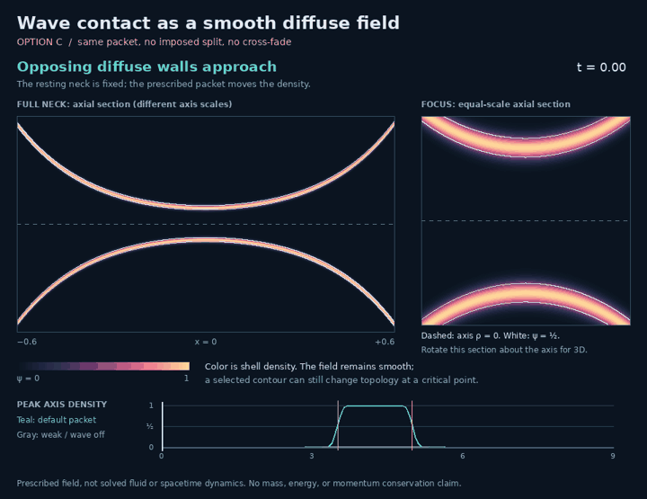

# Wave contact as a smooth diffuse field — review option C

[Interactive study](visualizations/finite_neck.html) — download and open locally.
The HTML needs no network or external packages.



The [independent review of #343](https://github.com/davidmdrpi/geometrodynamics/pull/343#issuecomment-6253167504)
identified a real failure in the previous visual. At the old contact event the
mid-surface radius remained ε, but its inner offset R−ε closed at **one axis
point**, with divergent hoop curvature. The renderer then jumped to two caps;
an image dissolve hid that jump. Finite thickness had moved the pinch inward,
not removed it.

This revision chooses **C: a smooth field with a derived boundary**. It removes
the imposed caps, retraction schedule, motion guides, and cross-fade. Every frame
samples the same scalar field. Its walls overlap and the passage reopens as the
prescribed packet passes. This changes what represents the continuum: the field,
not an infinitely thin material wall or an established GR metric.

## Field definition

The fixed resting profile and prescribed signed packet are unchanged, for
|x| ≤ h=.6, t ∈ [0,9], rim radius 1:

```text
R0(x) = b cosh[acosh(1/b) x/h],                         b = .16
u(x,t) = -A exp[-((x-c(t))/.18)^2] cos[14(x-c(t))] [1-(x/h)^2]^2
c(t) = -.85 + .20 t,                                  A = .18
R(x,t) = R0(x) + u(x,t).
```

With ε=.025 and radial coordinate ρ=√(y²+z²), define

```text
G(s) = exp(-s²/ε²)
ψ(x,ρ,t) = G(ρ-R) + G(ρ+R) - G(ρ-R)G(ρ+R).
```

The field is in [0,1] and invariant under ρ → −ρ and R → −R. A meridional
section therefore shows two approaching diffuse walls. Gaussian tails overlap
at all times: **there is no literal first contact of compact material surfaces**.
The event markers refer to a chosen density contour.

R is a **signed shell-center parameter** after it passes through zero. Its
minimum is b−A=−.02 for the default packet. It cannot then be interpreted as a
positive embedded mid-surface radius. The density formula remains well-defined;
there is no radius clamp or alternate post-contact formula. Large amplitudes can
produce more complex derived contours; their meaning is limited to this field
construction.

## What is smooth, and what is not

Writing s=y²+z² gives

```text
ψ = 2 exp[-(s+R²)/ε²] cosh(2R√s/ε²) - exp[-2(s+R²)/ε²].
```

Expand cosh in even powers: every term contains an integer power of s. Thus ψ
is analytic in Cartesian coordinates at the axis, as well as away from it, on
the modeled neck interior for finite ε. Its derivatives stay finite on compact
space-time domains. This does **not** give a bound uniform as ε → 0.

The white ψ=½ contour is a diagnostic. It can have a critical point and change
topology; it is not claimed to be an everywhere-regular embedded surface through
that change. A nonsingular scalar field is also **not a constructed nonsingular
spacetime metric**. The field width and union formula are additional modeling
choices. No Einstein equation, fluid equation, mass conservation, energy release,
or momentum transfer has been solved here. The narrow resting profile is assumed,
not asserted to be a stable catenoid equilibrium.

`hessian_components` evaluates the Cartesian Hessian in the axial/radial/
tangential basis, including the regular axis limit ψρ/ρ → ψρρ. The committed
241×217 spatial grid at 91 times samples a maximum Frobenius norm of about
58,170.9, or 36.3568/ε². This is a **sampled maximum**, not a certified global
bound. It includes the steep outer neck, unlike a local focus-only calculation.
Tests compare those derivatives with independent Cartesian finite differences
and check continuity across closure and reopening.

## Two thresholds and reopening

For this particular packet, R0≥b and u≥−A; equality occurs at x=0, t=4.25.
Consequently min over space and time of R is exactly b−A. The null controls test
this analytic amplitude inequality; they do not establish a dynamical stability
result.

| Diagnostic | Radius threshold | Amplitude for a nonzero closure interval | Default closes | Default reopens |
|---|---:|---:|---:|---:|
| Old radial band, R−ε | .025 | A > b−ε = .135 | 3.5300925421 | 4.9699074579 |
| Derived ψ=½ contour | .0277031945 | A > b−.0277031945 = .1322968055 | 3.5086365860 | 4.9913634140 |

For the field criterion, solve 2g−g²=½ on the axis, with g=exp(−R²/ε²).
The relevant radius is ε√[−log(1−√(1/2))]. Equality at either amplitude threshold
is a grazing event at t=4.25, not a finite closure interval. The weak wave A=.08
leaves a minimum old-band gap of .11; both it and the wave-off control stay open
at the half-density contour throughout the displayed horizon.

Events use an 801-point axial grid to bracket the minimum, continuous
golden-section refinement, and time bisection. An independent SciPy bounded
minimizer plus Brent root calculation agrees with both recorded event pairs to
better than 1e−9. The old review's reopening estimate of 4.971 is approximately
4.96991 under this refinement. These event times only label the frames; **they
do not control ψ**. Permanent separation would require different dynamics.

## Viewing and reproduction

The full-neck plot stretches the axial scale for readability. The focus view
has equal axial and radial scales. Rotating the section around its dashed axis
gives the axisymmetric 3D field. Color is ψ; white is ψ=½. The animation shows
approach, fusion, and reopening rather than freezing the outcome at fusion.

The HTML offers amplitude, waist and field-width controls; time scrubbing;
wave-off/weak-wave presets; contour visibility; and closure/reopening buttons.
Reduced-motion preference starts paused. Flexible control columns replace the
fixed 200 px inputs that overflowed a phone-width viewport.

```bash
python scripts/render_finite_neck.py
python -m pytest -q tests/test_neck_wave_contact.py
```

Rendering requires NumPy and Pillow. The checks cover null controls, analytic
thresholds including grazing, both event pairs, fixed rims, bounded/even density,
independence from event metadata, analytic-versus-numerical Cartesian derivatives,
time continuity, and matching Python/HTML fields and controls. The JavaScript
check uses Node with a mock canvas; it is not a full browser layout test.
The static frames and sampled animation frames are visually inspected.
`contact.json` records events, parameters, density samples, and the Hessian audit;
`sha256.json` fingerprints the generated artifacts.

The next physical step is a coupled wave–field/flow evolution with an energy and
momentum budget. Separately, an m=2 flattening perturbation can test contact
between distinct sheets instead of axisymmetric lumen closure. Neither follows
from the present prescribed field, and neither is silently included here.
