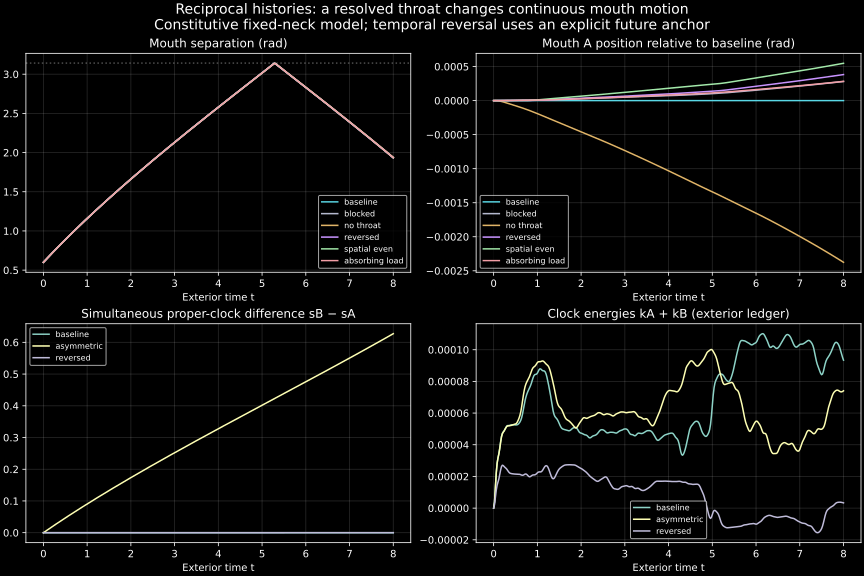

# Reciprocal proper-clock histories: a throat changes the mouth trajectories

The new model solves the closed-surface field, a finite throat field, two moving
mouths and their proper clocks **reciprocally**. It is no longer #346's fixed-tilt
model with an imposed clock offset. Clock energies are dynamical canonical
variables: they change inertia and motion instead of merely balancing a ledger
afterward. Fourteen cases converge and pass both stated conservation checks.

There is a small, resolved throat contribution to the trajectory. This is a
numerically consistent **constitutive classical model**, not yet a calibrated
wormhole, a QED derivation, or a particle collision/collapse cycle. No discrete
kick, repeated launch, local gain or topology surgery is programmed.

[Interactive replay (download/open HTML)](images/history_throat/replay.html) ·
[Action and protocol](history_coupled_throat_protocol.md) ·
[Case data and exact reassembly](../experiments/closure_ledger/runs/20261020_history_throat/README.md)



## What now couples to what

- A scalar field on a round, unholed S² has ω_l=l+1/2. Its closed-surface
  propagation produces antipodal refocusing and a sign-flipped 2π return.
- A resolved finite interval carries the throat field in its own clock σ.
  Its endpoint impedance produces transmission, storage and repeated reflections.
- Each mouth carries position q, momentum p, proper clock s and clock momentum k.
  The effective mass is μ=m+k+V_port, and s_dot=μ/√(p²+μ²)=√(1−q_dot²).
  Every computed case stays on the positive-μ branch.
- Endpoints sample the *same* throat history at σ=χ_i(s_i). The exterior
  trajectories determine the proper-time inverse maps that source the throat;
  the new throat history then changes the exterior forces. Iterate the two
  histories to a measured fixed-point residual, including the advanced branch.
- Opposite-flux Coulomb attraction uses #345's smoothed static potential.
  The radiative field here is a deformation scalar; it does not replace the
  full Maxwell transverse dynamics in #345. Birth supplies one stated initial
  scalar packet. Its energy is initial data, not a derived pair-creation flash.

Spatial parity η_B=±1 changes the sign of one scalar sector at the far port.
It is a reduced orientation control, not full Klein-bottle azimuthal geometry.
Temporal orientation ε_B=−1 instead reverses the clock map itself:
χ_B=S−s_B. It is an explicitly future-anchored global boundary condition.
It must not be confused with ordinary differential aging or a negative field
amplitude. Both controls change the solved fields and continuous mouth forces.

## A transmitting throat has an effect beyond local port forces

The g=0 control disconnects the ports. The blocked control retains their local
potential while fixing the neck field to zero. This distinction matters:
most of the difference from g=0 comes from the local port interaction.
The smaller transmitting-minus-blocked difference isolates the added resolved
neck response within this model.

| Final separation difference at t=8 | l_max=8, 17 neck nodes | l_max=12, 25 nodes | Change in effect |
| --- | ---: | ---: | ---: |
| Ordinary − disconnected | −0.00475121 | −0.00473519 | 0.34% |
| Ordinary − blocked | +0.000561177 | +0.000556422 | 0.85% |
| Time-reversed − ordinary | −0.000613828 | −0.000604291 | 1.55% |

Spacing is also halved from .02 to .01 in the higher-resolution cases. These
paired checks support the existence/sign of the small differences over this
window; two resolutions do not establish an asymptotic convergence order or
precision physical predictions. Tightening ODE/fixed-point tolerances changes
baseline separation by at most 2.68×10⁻⁸ radians. Absolute baseline separation
changes more under resolution refinement than the isolated throat contribution;
comparing matched controls at each resolution is essential.

The ordinary transmitting throat reduces A's outward angular displacement
relative to the blocked case by 2.81×10⁻⁴ rad at t=8. The net port impulses
are +2.506×10⁻⁴ and −2.506×10⁻⁴ for A and B. These are continuous, integrated
forces, not quantized exchanges. They need not have the same sign as the
transmitting-minus-blocked *difference* in impulse.

An endpoint load dissipates throat energy into an explicitly recorded sink.
Its final separation is 1.93427543, close to the blocked value 1.93427931,
versus 1.93484049 for the unloaded ordinary throat. The response is sensitive
to the interval's boundary impedance. This load changes both reflection and
transmission; it is not a clean deletion of reflected waves only.

## Clock history can produce an earlier-exit geometric route

For ordinary identification χ_A=s_A, χ_B=s_B, a first-pass ray obeys

    s_B(t_out) = s_A(t_in) + L.

The solver inverts the actual monotone clock histories. It does not replace
this equation with a simultaneous difference or extrapolate beyond computed
history. Symmetric births keep s_A=s_B; their ordinary routes remain retarded.

The (.45,−.15) asymmetric nominal birth momenta produce a maximum simultaneous
clock difference of 0.62724 by t=8. One illustrative supported route is:

| Clock-history resolution | Entry at A | Predicted exit at B | Exit minus entry |
| --- | ---: | ---: | ---: |
| l_max=8, 17 nodes | 7.500000 | 7.476515 | −0.023485 |
| l_max=12, 25 nodes | 7.500000 | 7.476642 | −0.023358 |

This is an **earlier-exit ray prediction**, not a measured tagged waveform,
proof of a closed null loop, or evidence of superluminal propagation through
the local medium. The discrete interval is dispersive. The event tables sample
emissions on a chosen .5 time grid and paths L, 2L, …, 6L; their event counts
are sampling conventions and have no interpretation as discrete quanta.
Only active transmitting cases receive these route tables.

The explicit ε_B=−1 branch has many earlier-exit routes because its clock map
is reversed by construction. Moving its future anchor from S=8 to S=9 changes
the result. That anchor is part of the boundary data, not an emergent prediction.
The ordinary asymmetric result does not contradict #345's smaller transient
offsets: the force model/charge and histories differ, and these runs have not
returned to contact and exchanged the fast/slow roles through a complete cycle.

## Conservation and what the energy means

Across all fourteen cases:

| Check | Worst residual |
| --- | ---: |
| Exterior autonomous Hamiltonian, relative | 1.78×10⁻⁸ |
| Meridional rotation charge, absolute | 1.31×10⁻¹¹ |
| Full throat/clock work identity, absolute | 3.24×10⁻⁸ |

The reciprocal cases converge in 17–22 relaxed iterations; disconnected and
blocked cases require one. All stop at the stated horizon, with no contact
or nonpositive effective mass. The tests verify the full canonical gradient,
proper-time identity, clock inertia feedback, free-clock mapping, actual reversal
of event order, no extrapolation, free sign-flipped surface return, both temporal
orientations' work identities, and failure on an unconverged iteration.

The conserved exterior Hamiltonian includes m+k+V_port inside each mouth's
relativistic energy. The separate throat identity is

    H_neck(S) − H_neck(0) + E_load = Σ ε_i [k_i(T)−k_i(0)].

They are two complementary time-generator checks of this two-time action.
Adding H_neck to H_ext is **not** the conservation law being claimed. The model
does not yet provide a GR stress-energy tensor or a physical total energy for
a non-time-orientable spacetime. Unlike #346's coordinate angular correction,
these k_i enter the Hamiltonian and affect the motion; nevertheless their
physical derivation as wormhole internal energies remains open.

## What the visualizations show

The HTML replay includes ordinary symmetric, ordinary asymmetric and explicitly
time-reversed cases. It displays the actual scalar field and unscaled mouth
angles. Surface height is magnified fourfold, and only display colors/fields are
quantized for a compact file. Exact arrays are in the binary archives.

The neck panel overlays the same z(σ,x) at the two attached clock times. Those
are generally different σ slices, not two independent fields or an equal-time
picture of a curved handle. The throat radius stays fixed. The trajectory panel
shows unwrapped q, so the geometrical fall in shortest separation after the
mouths pass antipodes is not mistaken for a reversal of their direction.
Neither mouth reverses its direction or reaches contact in these runs.

All 183 displayed frames and play/case controls were executed against finite
canvas-coordinate checks, and the static comparison figure was visually
inspected. A full browser screenshot check was unavailable because the browser
binary download failed; the replay has no external assets or dependencies.

## Reproduction and publication

The initial protocol was published before pilots as `6588ff0`. Its paired
resolution amendment and later asymmetric timing check are disclosed in the
protocol. No g, flux, packet energy, mass or horizon was tuned for a desired
outcome. A baseline pilot preceded the archived identical production run.
The original #346 solver, archives and negative result remain unchanged.

```bash
OPENBLAS_NUM_THREADS=1 python -m pytest -q tests/test_history_throat.py
OPENBLAS_NUM_THREADS=1 python -m experiments.closure_ledger.history_throat_probe --resume
OPENBLAS_NUM_THREADS=1 python -m experiments.closure_ledger.history_throat_report
```

Use `history_throat_report --assemble` to verify and reassemble published NPZ
parts without rerunning dynamics. Parts are at most 480,000 bytes. Every part
and reconstructed archive has a SHA-256 hash. CSVs contain trajectories, both
clocks/clock energies, field/Coulomb/port energies and separated port/Coulomb
forces. JSONs retain all iteration residuals, checks, parameters and event maps.
The binary data retain the full sphere and throat histories.

## Remaining physical work

The immediate advance is a working, reciprocal history coupling with measurable
backreaction and explicit reversal controls. It does **not** yet establish the
desired QED-like propagation mechanism. Before such an interpretation:

1. Calibrate the neck ports against matched observables on `HandleWaveSim`'s
   glued geometry. Momentum-flux and energy fractions are different observables.
2. Measure a tagged field response and its impulse around the predicted arrivals;
   do not infer signal timing or event-conditioned recoil from a ray map alone.
3. Derive the clock-energy sector and neck channel from the same physical
   mouth/flux action, including the full spatial orientation map.
4. Add a radius degree of freedom, a justified contact/release/re-creation law,
   and test an entire cycle while retaining all field and clock memories required
   by that law. No such cycle or collapse is claimed here.
5. Establish boundary-data selection and uniqueness for any time-reversed branch.
   This solver finds a converged fixed point from its stated seed; it is not a
   general existence or uniqueness theorem, nor a derivation of quantum amplitudes.
