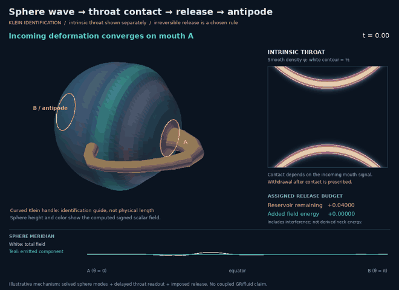

# Sphere → intrinsic throat → release → antipode



[Open the self-contained nine-stage viewer](visualizations/klein_release.html).
The GIF animates the full sequence; the viewer provides larger, scrubbable key
frames. This companion builds on #343's option C and the earlier Klein-handle
geometry. It depicts the user's proposed mechanism; it is not a claim that the
mechanism has been derived from GR or fluid equations.

## What the sequence shows

1. A signed scalar deformation converges on mouth A of the sphere.
2. The signal at that mouth drives a delayed disturbance along the intrinsic
   throat. The curved handle is retained as an **immersion/identification guide**;
   its drawn length does not set propagation time.
3. The diffuse throat field reaches the half-density contact criterion. An
   explicitly selected irreversible rule opens a gap in that density and
   withdraws both halves toward their respective mouths on the **same sphere**.
4. A finite-duration source at the two mouth sites transfers an assigned energy
   budget into the existing sphere field. The sphere-wave state is continuous;
   it is not replaced by a second field at contact.
5. The emitted component travels and refocuses at the antipodal mouth sites,
   then continues its standing-mode return cycle. It is a **traveling packet
   formed from standing modes**, not a stationary single-mode deformation.

The outer view shows sphere displacement as actual radial geometry and signed
color, rather than circles overlaid on a rigid sphere. The inset shows the
intrinsic throat density separately from its curved drawing. The sphere itself
is the round-S2 analogue; the handle is not a solved embedding of an
extradimensional spacetime. Ring outlines and the retracting immersed guide are
schematic, not physical material boundaries or a globally defined normal field
on a Klein bottle.

## One continuous sphere field

We retain axisymmetric conformal scalar modes throughout:

```text
u(theta,t) = sum_l a_l(t) sqrt[(2l+1)/(4pi)] P_l(cos theta),  l=0,...,24
omega_l = l + 1/2
u_tt - Delta_S2 u + u/4 = F.
```

The incoming packet has spectral weights proportional to
`l(l+1) exp[-.24² l(l+1)/2]`, free evolution focused at A at `t=1.2`, and energy
`.08` at the default drive. This is selected initial data, not a spontaneous
emission prediction. The packet propagates over the sphere throughout the
sequence; no discontinuous transfer between finite-element and spherical bases
is used. A prototype of such a transfer discarded too much wave detail and was
not adopted.

## Throat readout and irreversible withdrawal

The drawn Klein handle comes directly from `viz.klein_handles.build_surface`,
with one orientation-reversing mouth pair at ±x. Its intrinsic length is
`L=2 sin(.3) cos(.3)=.56464247`, independent of the long immersion arc.
For normalized throat coordinate x ∈ [−.6,.6], use the one-way delayed readout

```text
d(x) = L (x+.6)/1.2
w(x,t) = [u(A,t-d(x))/u_reference_peak] S((t-d(x))/.15)
R(x,t) = R0(x) - .18 w(x,t) [1-(x/.6)^2]^2,
R0(x) = .16 cosh[acosh(1/.16) x/.6].
```

`S(z)=10z³−15z⁴+6z⁵` inside [0,1], clipped to 0/1 outside, provides a C2
retarded startup. The reference peak is fixed when drive changes. The `.18`
gain is a chosen visualization coupling: neither the conversion from sphere
amplitude to throat radius nor a neck wave/stress equation has been derived.
This readout does not subtract energy from the incident sphere wave or include
reflections and backreaction.

The PR #343 density is then
`psi = G(rho-R)+G(rho+R)-G(rho-R)G(rho+R)`, with
`G(s)=exp[-s²/.025²]`. Contact is the first time its half-density contour fills
the axis. In this example `t_c=1.3698178941`. The smooth scalar, not the sharp
contour, represents the regularized continuum.

**The permanent separation is a new rule.** Without it the field need not stay
separated. For q=S((t−t_c)/.65), multiply the throat field by

```text
1 - S([1.25 q - (x/.6)^2]/.25).
```

This C2 window opens from the middle and withdraws to both rims. A C2 stopping
clock settles the transmitted readout over `.15` time units; it does not freeze
its time derivative abruptly. The guide retracts to its own two rims and loses
opacity according to the same window. This opacity belongs to an explanatory
drawing; no cross-fade between two physical interface solutions is claimed.
The inset zoom expands during withdrawal to keep the departing density visible.
With `detach=False`, no withdrawal or release source is applied. With zero drive
or weak gain `.08`, no contact occurs and neither event is triggered.

## Release energy: assigned, and accounted for

Once contact occurs, the sphere is driven for T=.3 by a smooth pulse

```text
F_l(t) = lambda h_l g(t-t_c)
h_l = sqrt[(2l+1)/(4pi)] [1-(-1)^l] exp[-.3² l(l+1)/2]
g(tau) = 30 (tau/T)^2 (1-tau/T)^2 / T,  0 < tau < T.
```

Opposite source signs at A and B are a selected emission parity, not a result
of Klein gluing. Duhamel integrals give the forced mode solution. After the
pulse, all modes again evolve freely. There is no jump in displacement or
velocity at source startup or shutdown.

The assigned reservoir is `.04`. Its work is measured against the freely
evolving incident field, including the interference term. The source amplitude
is chosen from the positive root of the quadratic energy equation. At the end:

| Quantity | Energy |
|---|---:|
| Emitted component's self-energy | .0711720861 |
| Interference with incident field | −.0311720861 |
| Actual increase in total sphere-field energy | **.0400000000** |

The signed work initially becomes negative: the forcing briefly absorbs energy
from the incident field before delivering the net release. The displayed
reservoir can therefore temporarily exceed `.04`; it is not clipped to hide
this. It never falls below zero beyond floating-point roundoff in the sampled
run. The cancellation in the table is why pulse self-energy alone would be an
incorrect transfer budget.

This is a **funded source model**, not a derivation of available neck energy.
There is no neck action or surface-energy functional here, and no full
sphere–throat conservation or momentum-transfer result. Quantization is not
inferred from the discrete spectral basis or the chosen trigger.

## Reproduction and checks

```bash
PYTHONPATH=. OPENBLAS_NUM_THREADS=1 python scripts/render_klein_release.py
PYTHONPATH=. python -m pytest -q tests/test_klein_release_model.py
```

The renderer uses NumPy, SciPy and Pillow, plus existing repository geometry.
No GPU, VTK, browser, or network is needed. `report.json` records contact,
parameters, signed work, pulse self/interference energies, and an emitted-wave
cap-energy comparison between midflight and antipodal refocus. Cap energy uses
Gauss–Legendre quadrature over the two .3-radian mouth caps.

Tests cover wave-off/weak-coupling nulls, the propagation delay and contact
criterion, optional withdrawal, continuity, the forced modal equation, signed
work including interference, reservoir funding, and the exact 2pi phase-space
return up to a global sign. These test the stated model, not a solved collapse
law. The generated frames are visually inspected; the stage viewer uses those
same frames. Checksums accompany the artifacts.

The next calculation would replace the assigned readout/withdrawal/source with
one coupled energy functional and evolution law. The present visual makes that
missing connection explicit and shows what the proposed mechanism is intended
to do.
