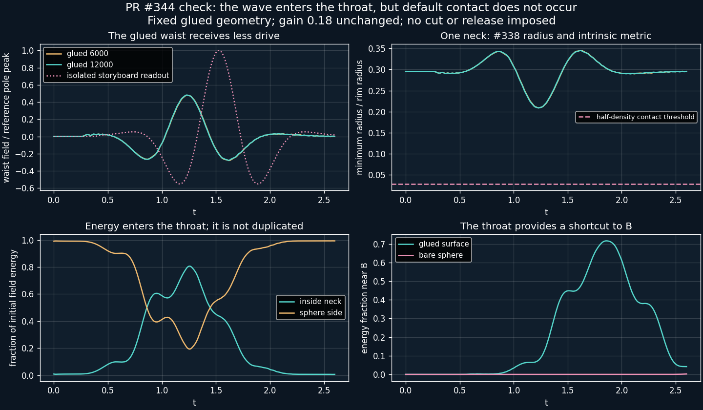

# Glued-surface test and counterfactual release storyboard

**Review result: the incoming wave enters the throat, but does not cause contact
at the selected gain `.18` on the fixed glued geometry.** The earlier animation
used a bare-sphere signal to prescribe throat deformation. That prescription
cannot establish collapse on the actual connected surface.



## Propagation on the connected surface

`scripts/klein_glued_probe.py` evolves the original incident data on the existing
#338 sphere-with-Klein-handle mesh. Sphere caps are removed and their rim
vertices are shared with the intrinsic neck. The curved handle drawing does
not determine distances. The initial field and velocity are the original
sphere modes on sphere vertices and zero in the neck interior; shared rims
retain the sphere values. These are selected initial data.

The cotangent finite-element system is

```text
M u_tt + K u + M u/4 = 0.
```

Here `+1/4` is a selected constant potential term. Its conformal interpretation
on the unit round sphere is not extended to the nonconstant-curvature neck.
Velocity Verlet uses `dt=.002`, with a stability estimate that reduces it if
needed. The probe runs to `t=2.6`, encompassing the first neck transit and the
early arrival at mouth B. It makes no claim about arbitrarily late contact.

The same intrinsic neck sets both propagation and the radius readout:

```text
s in [-S,S],  S = sin(.3) cos(.3)
r0(s) = sqrt(s²+b²)/sin(.3),  b = sin(.3)²
w(s,t) = azimuthal_mean(u(s,phi,t)) / original_reference_peak
R(s,t) = r0(s) - .18 w(s,t) [1-(s/S)²]².
```

All radii in this readout are in rim units. The Gaussian width is `.025` in
those same units. Half-density contact requires
`R <= .025 sqrt(-ln(1-sqrt(.5))) = .02770319`. The scalar-to-radius conversion
is still a prescribed diagnostic; the metric itself does not evolve.

| First-transit diagnostic | Coarse glued mesh | Finer glued mesh |
|---|---:|---:|
| Actual vertices | 7,562 | 13,266 |
| Peak neck energy / initial energy | .80528 | .80630 |
| Peak energy near B / initial energy | .71297 | .71601 |
| Peak waist field / reference pole peak | .47934 | .48151 |
| Minimum radius, in rim units | .20886 | .20855 |
| Contact threshold | .02770 | .02770 |
| Minimum sampled gain needed for contact | .54849 | .54655 |
| Maximum relative energy drift | .0001144 | .0001206 |

The gain remains `.18`; the larger critical-gain diagnostic is **not** applied.
The bare-sphere control recovers a pole peak of `.99987` of the original
reference. Near B means sphere triangles entirely inside a one-radian cap about
B; neck triangles are excluded. The fine glued run peaks there at `t=1.86`,
well before bare-sphere refocusing. Its waist peak is at `t=1.23`.

Energy is assigned by triangle, with each triangle's share of lumped kinetic
and potential mass and its own stiffness energy. Thus the sphere and neck
partitions include their respective shares at common rim vertices and sum to
total energy to roundoff. About 81% entering the neck does not mean 81% is
available for an independently added release pulse. This run performs **no cut,
withdrawal, or energy injection**: the field continues evolving on the connected
mesh. Coarse/fine agreement supports this first-transit null, not a general
convergence theorem or a nonlinear stability result.

## What the retained illustration means


[Open the self-contained nine-stage viewer](visualizations/klein_release.html).
The viewer and animation explicitly say **counterfactual storyboard**. They
illustrate the requested sequence if a separate contact-and-withdrawal law is
admitted. They do not depict the outcome of the glued probe above.

The sphere shows a signed deformation as radial displacement and color. A
curved guide illustrates the orientation-reversing identification; the inset
shows the intrinsic throat density. Neither is a solved embedding of an
extradimensional spacetime or a physical normal field on a Klein bottle.

The incident sphere field uses modes `l=0,...,24`, `omega_l=l+1/2`, and initial
energy `.08`. Its free evolution would focus at A at `t=1.2`. This field remains
continuous throughout the illustrative source-driven sequence. It lives on an
unholed sphere, so its throat readout has no backreaction or propagation through
the glued surface. That is precisely why the independent probe is necessary.

### Consistent illustrative geometry and causal timing

The storyboard retains #343's narrower profile
`R0(x)=.16 cosh(acosh(1/.16) x/.6)`, `x in [-.6,.6]`. Both axial and radial
coordinates are scaled by `sin(.3)`. Its propagation distance is now its own
meridian arclength,

```text
s(x) = sin(.3) integral[-.6,x] sqrt(1+R0'(y)²) dy,
L = s(.6) = .65472445.
```

It no longer borrows #338's `.56464247` length. The delayed bare-sphere readout
is `u(A,t-s(x))/reference_peak` with the existing smooth startup; it modifies
`R0` with gain `.18` and taper `[1-(x/.6)²]²`. Its Gaussian-union density reaches
the half-density criterion at `tc=1.42752092`, at `xc=-.06093770`.

Withdrawal is an additional irreversible law, not a consequence of the scalar
wave equation. Each position starts only after

```text
t_arrive(x) = tc + sqrt((s(x)-s(xc))² + .01²).
```

This smooth delay is at least the intrinsic signal travel time. A C2 smoothstep
withdraws the local density over `.65` time units; a local C2 stopping clock
settles its transmitted readout over `.15`. The guide retracts according to the
same local progress. The process is centred at the detected contact position,
not the geometric midpoint, and nothing freezes everywhere at contact.

The two mouth sources wait for their respective signal travel times:
`.30926446` and `.34546000` after contact. Each then lasts `.3`. Their selected
opposite signs are an emission-parity assumption, not a consequence of Klein
gluing. Duhamel integration preserves sphere displacement and velocity at every
source boundary. After both pulses, modes evolve freely again.

### Assigned release budget

The storyboard assigns a reservoir of `.04` and chooses the source amplitude
so the **net** sphere energy increase equals that budget. Work includes the
cross term with the incident field:

| Quantity after both sources end | Energy |
|---|---:|
| Emitted component's self-energy | .03384120 |
| Interference with incident field | .00615880 |
| Net sphere-field energy increase | **.04000000** |

Signed work briefly becomes negative; the reservoir can slightly exceed its
initial value and is not clipped. Its sampled minimum is zero to roundoff.
The emitted component travels to the antipodal caps and has a refocus-to-
midflight cap-energy ratio of about `47.68`. It is a traveling packet built
from standing modes, not a stationary single mode.

This is a funded illustrative source, **not** neck energy computed from the
glued evolution. It is never applied to the no-contact probe. Neither discrete
modes nor an assigned threshold establish quantization or momentum exchange.

## Reproduction and review checks

```bash
PYTHONPATH=.:scripts OPENBLAS_NUM_THREADS=1 python scripts/klein_glued_probe.py
PYTHONPATH=. OPENBLAS_NUM_THREADS=1 python scripts/render_klein_release.py
PYTHONPATH=.:scripts python -m pytest -q tests/test_klein_release_model.py tests/test_klein_glued_probe.py
```

Dependencies are NumPy, SciPy, Pillow, Matplotlib, and existing repository code.
The renderer creates a missing custom-output viewer directory. Recursive
checksums include the probe's CSVs, report, and figure. Run the probe before the
storyboard renderer to refresh that manifest.

The 12 tests cover the original null controls and modal work/continuity checks,
consistent arclength, causal mouth source timing and contact-centred withdrawal,
element-energy partition, and a fresh smaller glued run with no contact. CSVs
preserve the sampled first-transit diagnostics. Generated frames are inspected;
browser playback is not an additional physical validation.

## Next calculation

The fixed-metric null rejects the previous readout as evidence for the depicted
collapse. It does not rule out a geometry instability. The review identifies
the #338 neck as the thin catenoid branch under a soap-film area model. The next
candidate is coupled geometry response with a stated material/regularity law
and a conserved energy budget, rather than increasing the readout gain until
contact appears. That soap-film analogy is not a GR stability claim.

If a coupled model actually triggers contact, topology change must preserve the
surviving sphere vertex field and account for all neck energy and momentum.
The present probe deliberately reaches no such event; no topology-transfer law
has been implemented or validated here.
