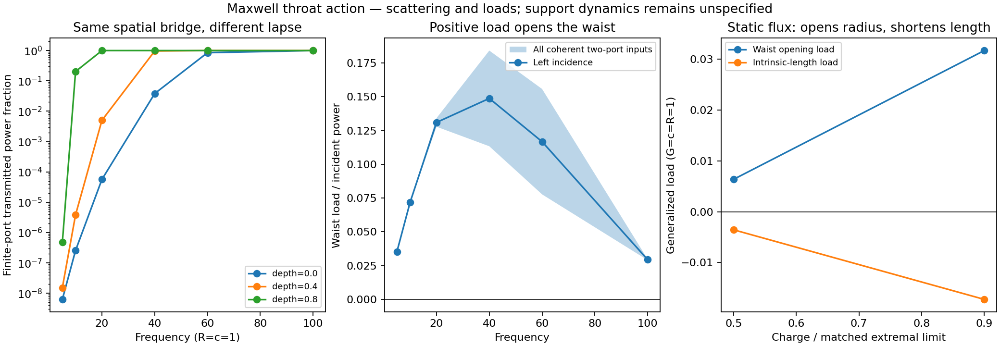

# Maxwell scattering and mechanical loads of the matched S3 throat

This follows PR #349 at `83db758`. It replaces an assigned area impedance with
a Maxwell boundary response derived on the repository's bridge geometry.
The field equation, scattering map and mechanical loads come from one action.
A charged extension solves the interior Einstein-Maxwell Hamiltonian constraint
before the static flux energy is included.

**The result separates three effects.** Radiation opens the throat waist for
the specified fixed-lapse, fixed-length radial variation. Static electric flux
also opens the waist, but supplies tension that favors a shorter intrinsic
throat. Neither statement by itself gives attraction along S3 or collapse.
Those require the embedding, dynamical metric and support response, which the
repository has not specified. The conducting-shell compression result from
the previous calculation applies to a different boundary and is not imported.

## 1. Which geometry is actually specified?

`physical_throat.VacuumThroat` gives a time-symmetric spatial bridge matched
in radius and slope to the round S3 at angular mouth radius a. Its neutral
profile obeys r_s^2=1-b/r, with b=sin^3(a). The new code reproduces exactly its
radius, length and static-flux integral. It does not substitute the S2
visualizer's neck radius.

The charged version is derived from the interior Hamiltonian constraint.
Use Maxwell action -F^2/4, G=c=R=1, flux Q=int E.dA and q=Q/sqrt(4*pi).
The static electric density is rho_EM=Q^2/(32*pi^2*r^4), so

\[
{}^{(3)}R={2q^2\over r^4},\qquad
r_s^2=1-{2M\over r}+{q^2\over r^2}.
\]

Matching r=sin(a)=r_m and r_s=cos(a) gives

\[
M={r_m^3+q^2/r_m\over2},\quad
0\le q<q_{\max}=r_m(1-\cos a).
\]

This is the subextremal outer-neck branch inside the mouth. Writing
d=sqrt(M^2-q^2), its explicit profile is

\[
r(x)=M+d\cosh(2x),\quad ds=2r(x)dx,\quad
s(x)=2Mx+d\sinh(2x),\quad
X={1\over2}\operatorname{arcosh}{r_m-M\over d}.
\]

The interval is -X<=x<=X. At q=0 these expressions reduce to the old bridge.
At a=0.3, the neutral neck radius is 0.0258084276 and length 0.6621766691.
At q/q_max=0.9 they become 0.0187665940 and 0.6858026159. These are different
constraint-satisfying initial geometries, not an evolved shrinking history.

Only the bridge's charged constraint is solved here. Matching the rim's
geometry does not solve the charged exterior's constraints or evolve the
ambient ESU matter. Shape derivatives below are off-shell variations used to
extract field loads; they are not asserted to be constraint-preserving
trajectories of the coupled Einstein system.

The spatial slice does not fix the lapse. We state it explicitly:

\[
ds_4^2=-N(s)^2dt^2+\lambda^2ds^2+r_\epsilon(s)^2d\Omega^2,
\quad r_\epsilon=r\,e^{\epsilon h},\quad
h=[1-(s/S)^2]^3,\quad N=1-\beta h,
\]

where S=s(X). Both shape variations leave the rim radius fixed; h and its first
two derivatives vanish at the ports. beta=0,0.4,0.8 is a family of **supported
static completions**, not a derived matter model. lambda is intrinsic-length
stretch; epsilon is a waist deformation. Neither is S3 mouth separation.

## 2. Maxwell reduction and exact finite-port scattering

For either radiative Maxwell polarization, angular index ell>=1, the normalized
master action is

\[
S_{\rm EM}={1\over2}\int dt\,ds\left[
{\lambda\over N}\dot\psi^2-{N\over\lambda}\psi_s^2
-{\lambda N\ell(\ell+1)\over r_\epsilon^2}\psi^2\right].
\]

There is no radiative Maxwell monopole. The static flux is a separate sector.
This is test-field scattering with metric and support held fixed. On a charged
background, fully coupled electromagnetic and gravitational perturbations can
mix; their coupled scattering matrix is not claimed here.
For lambda=1 and tortoise coordinate dz=ds/N, the wave equation is

\[
\psi_{tt}-\psi_{zz}+V_\ell\psi=0,\qquad
V_\ell=N^2\ell(\ell+1)/r^2.
\]

The Schwarzschild-lapse specialization reproduces the electromagnetic potential
in [Yang, Xia and Miao (2025), Appendix A](https://doi.org/10.1140/epjc/s10052-025-14446-w).
Here the operator is derived directly for the stated metric. The static,
positive-lapse bridge is not replaced by a Schwarzschild horizon with an
artificial second outgoing port.

For harmonic phasor u, define j=(N/lambda)u_s. Integrating the two-component
system gives the real Dirichlet-to-Neumann map D between (u_L,u_R) and
(-j_L,j_R). Independently, imposing outgoing right-port data and integrating
backward gives the scattering amplitudes. With characteristic impedance
Z=omega at each rim,

\[
S_\ell=-(D-i\omega I)^{-1}(D+i\omega I).
\]

The selected symmetric geometry gives S=[[r,t],[t,r]]. The boundary map is
reciprocal and lossless. These are **finite-port characteristic amplitudes**;
Z=omega is the canonical incoming/outgoing decomposition, not a fitted
cross-section impedance. A complete S3 exterior must still be attached to D.
The transmitted fractions are not global closed-universe capture probabilities.

There are 138 scattering cases over mouth size, angular channel, frequency,
lapse and charge. Maximum sampled unitarity defect is 6.86e-10. The real
Dirichlet-to-Neumann construction agrees independently with the complex
outgoing-solution method in the tests.

At a=0.3, q=0 and ell=1:

| omega | N_neck=1 | N_neck=0.6 | N_neck=0.2 |
| ---: | ---: | ---: | ---: |
| 10 | 2.585e-7 | 3.854e-6 | 0.204059 |
| 20 | 5.679e-5 | 0.005030 | 0.999668 |
| 60 | 0.851877 | 0.999993 | 0.999991 |

This demonstrates why the slice and topology alone cannot give a unique
scattering answer. The lapse changes the actual potential and optical length.

## 3. Mechanical loads from the same action

At fixed lapse and proper length, a nonnegative waist variation h gives

\[
F_\epsilon(t)={\delta S_{\rm EM}\over\delta\epsilon}
=\int ds\,{\lambda N\ell(\ell+1)h\over r_\epsilon^2}\psi(t,s)^2\ge0.
\]

Positive means opening the waist. This sign is a time-domain identity for
the stated variation, not a fitted trend. Coherent counter-propagating fields,
repeated passages, and allowed time-reversed histories can change its magnitude
but cannot make the square negative. The statement does not cover a deformation
that changes lapse at the same time, gravitational forces, or arbitrary angular
shape modes. For example, a lapse variation adds terms proportional to
-N_epsilon*(psi_t^2/N^2 + psi_s^2 + ell(ell+1)psi^2/r^2)/2 at lambda=1.

The intrinsic stretch load is separately

\[
F_\lambda(t)={1\over2}\int ds\left[
{\dot\psi^2\over N}+{N\over\lambda^2}\psi_s^2
-{N\ell(\ell+1)\over r_\epsilon^2}\psi^2\right].
\]

For two coherent inputs normalized so a^dagger*a is incident power, the
time-averaged loads have Hermitian matrices W_q, with F_q=a^dagger W_q a.
The internal field integrals are checked against the independent identity

\[
W_q={-i\over\omega}S^\dagger\partial_qS.
\]

This uses only the change in scattering phase under a geometry perturbation,
not the internal stress formula. Sixteen checks vary finite-difference step,
ODE tolerance and quadrature. Maximum absolute phase-force discrepancy is
5.53e-8; the maximum integral change under quadrature/ODE refinement is
1.34e-10. Waist-force eigenvalues are positive in every scanned case, as the
identity predicts. Stretch-force eigenvalues are also positive in this scan;
that second observation is not claimed as a general theorem.

The previous conductor feels pressure on its **outside**, which decreases its
enclosed radius. The throat master field stores angular-gradient energy inside
a varying cross-section; increasing the cross-section reduces that energy.
These are distinct variations of distinct boundary problems. Assigning the
conductor's negative radius load to this throat would reverse the derived sign.

## 4. Static flux supplies intrinsic tension

Gauss' law gives E_s=Q/(4*pi*r^2). At fixed Q, its Killing energy and loads are

\[
U_Q={Q^2\over8\pi}\int ds\,{\lambda N\over r_\epsilon^2},\quad
F_{\epsilon,Q}={Q^2\over4\pi}\int ds\,{\lambda Nh\over r_\epsilon^2}>0,
\quad F_{\lambda,Q}=-U_Q/\lambda<0.
\]

This is Maxwell radial tension: the flux opens the cross-section while pulling
toward shorter intrinsic length. The energy integral agrees with the old
closed-form neutral-profile resistance as a test-field identity. Finite static
charges in the reported coupled-constraint examples use the charged geometry
above, not an unchanged scalar-flat bridge. Finite differences of U_Q check
both force derivatives independently.

For a=0.3 and N=1, using the actual Q of each charged profile:

| q/q_max | Static energy | Waist load | Stretch load |
| ---: | ---: | ---: | ---: |
| 0.5 | 0.0035497621 | +0.0063745574 | -0.0035497621 |
| 0.9 | 0.0172443623 | +0.0317138626 | -0.0172443623 |

This tension is a candidate for the next coupling calculation, but it is not
yet a force between the mouths along S3. If their separation D changes the
intrinsic throat length L, the length contribution would be

\[
F_D=F_L\,{\partial L\over\partial D},\qquad F_L=F_\lambda/(2S).
\]

An extradimensional throat's drawn arc does not specify partial L/partial D.
If L is independent of D in an approximation, that contribution is zero.
The exterior Maxwell field can contribute separately. No continuous force or
off-antipodal exchange is inserted into the BAM router here.
Angular orthogonality removes static-flux/radiation cross terms for the
spherically symmetric waist and stretch variations used here. Such cross
stresses need not vanish for a translational or angular deformation. The
radial two-port therefore cannot replace the missing directional recoil solve.

Nine prescribed spectral-drive controls use the energy weights of the previous
width-0.2 S3 pulse at n=2,...,48. They are phase-averaged finite-port drives,
not a derived charged-mouth emission or a complete finite-duration encounter.
For the neutral slice their weighted transmission is 6.36e-7, 2.14e-5 and
0.27958 as the lapse depth rises from 0 to 0.4 to 0.8. For charge fraction 0.9
these become 5.35e-9, 1.51e-7 and 0.02829.

At charge fraction 0.9 and N=1, the imposed left-port drive's positive stretch
load balances the static tension at incident power 0.08456 in the stated
units. This is a load balance, not a stable mechanical equilibrium: both
contributions still open the waist, and support forces have not been added.

## 5. What remains to determine an actual mechanical response

The Einstein tensor of each static completion is audited. For the charged
profile, its density agrees with the radial Maxwell density. Subtracting
the Maxwell stress therefore leaves zero support density but nonzero support
pressures. At a regular minimum,

\[
8\pi(\rho+p_s)=-2r_{ss}/r<0.
\]

The static radial Maxwell field has rho_EM+p_s,EM=0; it cannot provide the
remaining negative null stress. All twelve sampled completions require
additional null-energy-violating support. Giving that support its equilibrium
stress does not specify its perturbation response, inertia or stability.
The required material/geometry response must enter the same coupled action,

\[
{\delta(S_{\rm EH}+S_{\rm support})\over\delta q}+F_{q,\rm EM}=0,
\]

with lapse and shift constraints retained. We have computed the field term,
not chosen an arbitrary mass and spring to turn it into acceleration.

Using instead the vacuum/electrovacuum Schwarzschild/Reissner-Nordstrom
Lorentzian development changes the problem: the static lapse reaches zero
at the neck. A regular positive-lapse two-port cannot be substituted for that
horizon. The horizon-admission control from the earlier report remains a
different calculation. Neither the present positive-lapse response nor the
spatial constraint alone establishes traversability or collapse.

## 6. Klein/time reversal and the latest review

An angular isometry acts through an orthogonal representation on the angular
and polarization channels. Once that representation is specified, it can be
attached to the two-port without altering the local radial field equation.
The radial profile alone does not choose the non-orientable charged field
bundle or its normal transport. We do not assign the old scalar sign to a
Maxwell polarization without deriving that attachment.

For a real field, time reversal conjugates frequency phasors and reverses
the appropriate canonical/magnetic data. The implementation therefore supplies
a real-linear seam map on (Re a,Im a), rather than inserting conjugation as
a complex phase. Tests verify the stated map, flux norm and reversal identity.
This is machinery for composing a declared seam, not a derived choice of eta
or a solved global advanced/retarded source condition.

[Review 6432265633](https://github.com/davidmdrpi/geometrodynamics/pull/349#issuecomment-6432265633)
correctly calls for closure of field and mouths together. The present two-port
is the geometry-dependent ingredient that can be connected to the exterior
return map. One distinction matters: E cross B=0 at an instant does not imply
zero Maxwell stress. Pure electric or magnetic data can exert shape pressure,
and zero total SO(4) charge does not preclude equal-and-opposite mechanical
exchanges. Actual exchange requires the interacting boundary/source solution;
the unchanged source-free closing flash cannot substitute for it.

## Validation and reproduction

The focused suite passes **143 tests**, including 12 new tests. Independent
checks cover the neutral profile, charged constraint, port flux, real
Dirichlet-to-Neumann map, scattering-phase force derivative, static-energy
shape derivative, coherent inputs, required Einstein stress and real-linear
time reversal. The archive contains 138 scattering cases, nine spectral drives,
16 refinement/derivative checks and 12 support profiles. Negative results and
earlier replay archives remain unchanged.

```sh
OPENBLAS_NUM_THREADS=1 python -m experiments.closure_ledger.maxwell_throat_probe
python -m pytest -q tests/test_maxwell_throat_response.py
python -c 'from experiments.closure_ledger.maxwell_throat_probe import manifest; manifest()'
```


