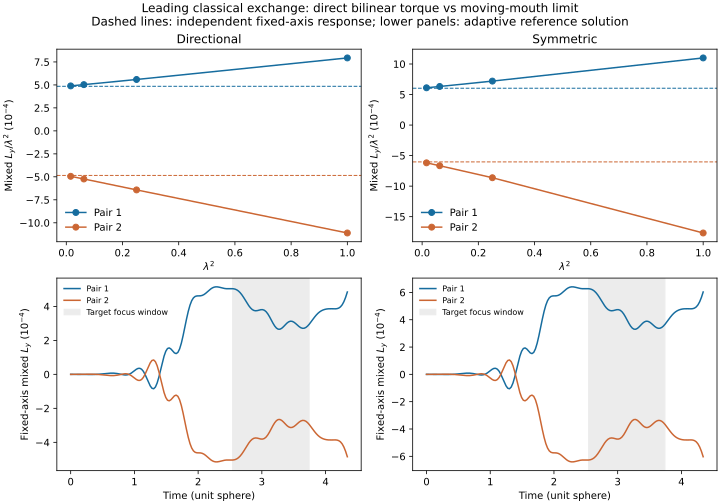

# First-transit exchange: numerical results

All quantities use the unit-sphere model units. These are mixed coefficients, not full recoil momenta.

| Preparation | Direct C1y | Direct C2y | Finest extrapolated C1y | Finest extrapolated C2y |
|---|---:|---:|---:|---:|
| directional | 0.0004847114769 | -0.0004847114769 | 0.0004846972341 | -0.000484651752 |
| symmetric | 0.0006030784541 | -0.0006030784541 | 0.0006030469655 | -0.0006029279644 |

## Frozen gates

| Gate | Directional | Symmetric |
|---|---|---|
| angular_ledger | PASS | PASS |
| complete | PASS | PASS |
| composite_quartic | PASS | UNRESOLVED |
| energy | PASS | PASS |
| extrapolation | PASS | PASS |
| field_quartic | PASS | PASS |
| independent_reference | PASS | PASS |
| moving_refinement | PASS | PASS |
| reciprocal | PASS | PASS |
| reference_ledger | PASS | PASS |
| reference_refinement | PASS | PASS |

The symmetric single-packet composite separation is zero to floating-point precision. Its quartic ratio is undefined, so that gate is UNRESOLVED rather than counted as a pass.

The two smallest adjacent amplitude ratios of retained mixed field Jy (expected 16) are:

- directional: 16.331632, 16.107910; estimated absolute numerical uncertainty 1.48e-11.
- symmetric: 16.675035, 16.168388; estimated absolute numerical uncertainty 1.89e-11.

## Where the exchange accumulates

Signed direct mixed impulse of pair 1 in four non-overlapping intervals; pair 2 has opposite y impulse.

| Preparation | Source half [0,.6] | Between [.6,pi-.6] | Target [pi-.6,pi+.6] | After [pi+.6,pi+1.2] |
|---|---:|---:|---:|---:|
| directional | 6.47249772e-06 | 0.000497482168 | -0.000209914684 | 0.000190671495 |
| symmetric | 8.05308746e-06 | 0.000618967759 | -0.000261176038 | 0.000237233645 |

**The target-focus window partly reverses an exchange that has already accumulated.**
The passing reciprocity test does not establish a localized antipodal exchange event.
A prospective localization test must measure signed and absolute torque inside and outside the focus window;
the window-resolved result here gives no basis to describe the whole endpoint impulse as an antipodal kick.

## Numerical checks

- directional: maximum relative energy error 5.58e-06; normalized angular ledger error 1.94e-14; largest timestep/cutoff change in normalized mixed y 4.1e-09; comparison budget 4.85e-06.
- symmetric: maximum relative energy error 6.94e-06; normalized angular ledger error 4.39e-16; largest timestep/cutoff change in normalized mixed y 5.13e-09; comparison budget 6.03e-06.

The archive contains 48 moving trajectories (16 three-packet comparisons), plus four direct references.
The last two amplitudes are independently refined in timestep and spectral cutoff.
No admitted run crosses the .65-radian stopping boundary if the complete gate passes.
The source solver also supplies a dense interpolated reference curve for the figure; event accounting uses exact requested times.

[Equations, interpretation and reproduction](mouth_exchange_results.md).
[Frozen protocol](mouth_exchange_protocol.md).
[Machine-readable gates and uncertainties](../experiments/closure_ledger/runs/20261017_mouth_exchange/gates.json).
