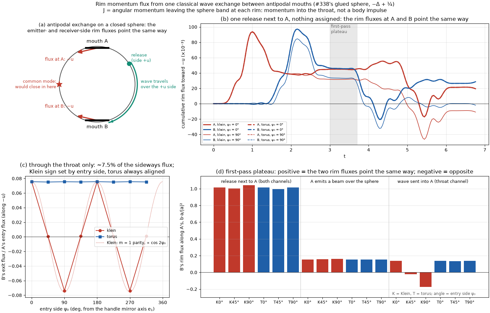
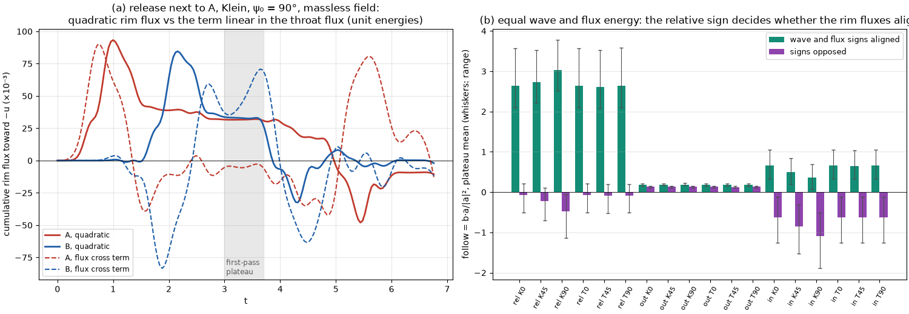
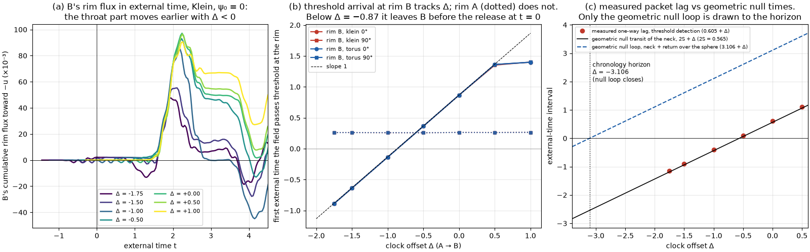

# Single wave exchanges between antipodal mouths: rim momentum flux, throat flux and clock offsets

Classical scalar experiments on #338's glued sphere, building on #344. The geometry is held
fixed and the mouths do not move. "Exchange" means a classical wave that leaves one mouth
and reaches the other. No quantization rule enters anywhere.

**What is measured, and what it is not.**
- **The measured quantity, J,** is the angular momentum the sphere band hands to each rim: the momentum leaving the sphere subdomain there. It is called the **rim momentum flux** below.
- **J is not a mechanical kick on a mouth.** The field continues through the rim into the neck, so part of J is momentum carried into, or stored in, the throat field, and no mouth action is specified.
- **Reading J as a kick needs more work.** It needs either a two-sided control volume around each mouth, or forces derived by varying an action with independent mouth coordinates. Neither is done here.
- **Displacement directions are conditional.** Where the directions a and b in which J "would move" A and B appear below, they say what J would do *if* each rim's flux acted on its mouth as a rigid body. That coupling is assumed, not derived.

**Questions.**
1. **Rim-flux scan.** For one wave exchange, do the rim fluxes at the two antipodal mouths point the same way, opposite ways, or neither? Through the throat, over the sphere, or both?
2. **Throat flux.** With a static flux threading the throat, one mouth is a source and the other a sink. Does the rim flux gain a part that depends on the relative sign of the wave and the flux?
3. **Clock offset.** With a mouth clock offset (the classical Morris–Thorne–Yurtsever ingredient), does a forward-propagating wave re-emerge from the far mouth earlier in external time?

**Answers in brief.**
1. **For a release next to mouth A, the rim fluxes at A and B are equal and point the same ambient way** on the first-pass plateau. Under the assumed rigid-mouth coupling, that common mode would close the mouths in.
   - **Route:** most of it travels over the sphere. The throat carries about 7.5% of the sideways flux.
   - **Orientation:** the handle's orientation matters only in the throat channel.
2. **Yes, there is a sign-dependent term.** The part of the rim flux linear in the throat flux and in the wave flips sign with either. At equal energies it is as large as the wave's own (quadratic) flux or larger.
   - With aligned signs, B's flux follows A's 2.6–3.0 times as strongly as without the throat flux.
   - With opposed signs, B's following is cancelled or reversed.
3. **Yes, by exactly the offset.** The threshold arrival at rim B moves with slope 1 in Δ, while the arrival at rim A does not move.
   - **Before release:** for Δ < −0.87 the wave leaves B before it is released.
   - **Before entry:** for Δ < −0.61 it leaves B before it enters A.
   - **Phase, not gain:** the offset changes timing only. A constant offset shifts when a component re-emerges; it does not amplify it.

## Model
- **Surface:** `viz.klein_handles.build_surface` (#338). A unit sphere carries mouths of angular radius 0.3 at A = +x and B = −x.
  - The mouths are joined by the catenoid neck r(s) = √(s² + b²), with waist b = 0.087 and intrinsic length 2S = 0.565.
  - The neck is glued as a Klein handle (rim angle ψ → π − ψ, orientation-reversing) or a torus handle (ψ → ψ + π).
- **Field:** u_tt = Δu − m²u, on the intrinsic cotangent mesh with lumped mass. Two values of m² are used:
  - m² = ¼, the #339/#344 conformal operator, for the scan;
  - m² = 0 for the flux and clock-offset parts, because a period around the handle is incompatible with a mass term. At m² = 0 the scan's fluxes change by 0.7%.
- **Rim momentum flux:**
  - On the band, rotations are Killing fields, so ℓ = −u_t ξ·∇u is conserved locally.
  - A smooth rim weight χ turns the flux through each rim into area integrals (`geometrodynamics/waves/rim_kicks.py`).
- **Waves:** a single-signed bump of width 0.25 and unit energy, starting 1.0 rad from A on side u(ψ₀), where ψ₀ is measured from the handle's mirror axis e₁. Three launches are used:
  - **release:** the bump starts at rest and spreads both into A and over the sphere;
  - **out:** A emits a beam toward B over the sphere, and its launch momentum is booked to A;
  - **in:** a wave arriving from elsewhere is sent into A.

**Reading the direction at antipodes.** Let a and b be the ambient directions J would move A and B under the rigid-mouth assumption.
- The separation is π − |a + b| to first order, so any non-rigid displacement shortens it.
- The informative quantity is therefore **follow = b·a/|a|²**: positive means the two rim fluxes point the same way (a common mode), negative means they point opposite ways (a rigid rotation).

## 1. Rim-flux scan
Two handles × three launches × eight entry sides, each to one full loop (2π + ½), on a 24,000-vertex mesh.
- **Units:** fluxes are ×10⁻³ per unit wave energy.
- **First-pass plateau:** t = 3.0–3.7, after the first passes over both mouths and before the second. The quadratic fluxes are steady there.

| launch | handle | entry side | A rim flux | B rim flux along A | follow (plateau) | follow (one loop) |
|---|---|---|---|---|---|---|
| release | Klein or torus | 0° | 44.8 | +45.5 | **+1.02** | +1.47 |
| release | Klein | 90° | 31.7 | +33.0 | **+1.04** | +0.19 |
| release | torus | 90° | 44.6 | +45.2 | **+1.01** | +1.46 |
| out (A emits) | either | any | 642–679 | +104 to +105 | +0.15 to +0.16 | +0.15 to +0.21 |
| in (throat) | torus (any side); Klein at 0° | — | 104 | +14.4 | +0.14 | −0.41 |
| in (throat) | Klein | 45° | 105 | −2.3 | −0.02 | −0.66 |
| in (throat) | Klein | 90° | 104 | −18.3 | **−0.18** | −1.16 |



**Why the fluxes align.**
- **Same ambient direction.** A wave that leaves A over the +u side carries momentum out through A's side of the band toward +u, so the flux at A points toward −u. It reaches B travelling −u, so the flux into B's rim points toward −u as well.
- **Flat space would differ.** There the same pair of fluxes would point apart. On the closed sphere they align.
- **A passing wave is different.** An outside wave that crosses A and carries on to B gives fluxes along its path, and at antipodes those point opposite ways (rigid rotation). That is why the "in" launch turns negative over the loop.

**Throat channel.**
- **The narrow waist reflects most of the sideways part.** The waist (radius 0.087) is narrower than the wavelength, so it reflects most of the m = 1 part. B's exit flux is 7.56% of A's entry flux, and the same at 48,000 vertices. A wider packet started farther out gives 6.2%.
- **The handles map that part differently.**
  - The torus map sends cos(ψ − ψ₀) to −cos(ψ − ψ₀), so B's flux follows A's for every entry side.
  - The Klein map sends it to −cos(ψ + ψ₀), giving cos 2ψ₀: aligned along the mirror axis, zero at 45°, opposite at 90°.
- **The absolute sign is a wave effect.** It comes from the relative phase of the transmitted m = 1 and m = 0 parts, and ray optics would predict the opposite sign for the torus. The cos 2ψ₀ relation between the handles is a symmetry statement.

## 2. Flux through the throat
**The static field.** A massless field admits a static harmonic field whose potential gains a period once around the handle loop:
- on the band, φ = c log tan(θ_A/2);
- in the neck, φ = c asinh(s/b).

This is Wheeler's charge without charge, for a scalar potential.
- **Source and sink.** Field lines leave A into the sphere and return through the neck, so A is a source and B a sink.
- **Period.** The period is 4c log cot(a/2), and the neck carries exactly half of it, because asinh(cot a) = log cot(a/2).
- **Same field for both handles.** The field is axisymmetric, so the Klein and torus handles carry the same one.

**The cross term.** With the field u = φ + w, the rim flux gains a term bilinear in φ and the wave w (`RimKicks.cross_rates`), and flipping either sign flips it exactly.
- **Size.** At equal (unit) energies it is as large as the quadratic flux or larger.
- **No plateau.** It does not settle within the first-pass plateau, because it follows the passing wave's sign. The table gives plateau means with ranges.

| launch | handle | quadratic A, B | cross A | cross B (range) | follow, signs aligned | follow, signs opposed |
|---|---|---|---|---|---|---|
| release | torus, or Klein at 0° | 44.8, +45.4 | −8.2 | +50 (+35 to +71) | **+2.64** (+2.10 to +3.57) | **−0.08** (−0.51 to +0.21) |
| release | Klein 90° | 31.7, +32.8 | −4.4 | +50 (+35 to +71) | **+3.03** (+2.52 to +3.77) | **−0.48** (−1.14 to −0.05) |
| in | torus, or Klein at 0° | 104.5, +13.5 | +19.3 | +67 (+26 to +115) | +0.66 (+0.33 to +1.05) | −0.62 (−1.26 to −0.12) |
| in | Klein 90° | 105.0, −19.4 | +24.9 | +67 (+26 to +115) | +0.36 (+0.07 to +0.68) | −1.10 (−1.89 to −0.51) |
| out | either | 682, +106 | −12.8 | +15 (0 to +34) | +0.18 | +0.13 |



**Reading.**
- **"Aligned" means a compression pulse released next to the source mouth.** The large cross term at B comes from the sphere-route wave passing through B's strong flux field near its rim. It is linear in both the field and the wave.
- **Compression and rarefaction now differ.** The quadratic flux cannot tell them apart; the cross term can. This is the sign-dependent ingredient that radiation pressure lacks.
- **What a single handle cannot test.** Its two mouths are always opposite (source and sink), so like versus unlike needs two handles.

## 3. Clock offsets (classical MTY)
#338's `HandleWaveSim` can glue the waist with a clock offset Δ: a signal crossing from A to B emerges Δ later in external time, or earlier when Δ < 0.
- **The spacetime.** It is stationary, and chronology-safe while the clock tilt stays below 1.
- **The bookkeeping.** The sphere band is static in external time, so the same rim-flux bookkeeping applies to the solver's external-time frames.
- **The runs:**
  - the release next to A, on the massless field, on a 12,000-vertex mesh;
  - the solver's own compact, zero-mean release of width 0.5. At width 0.25 that bump is under-resolved for the weighted ledger: 5–34% rim-weight dependence even at Δ = 0;
  - offsets from −1.75 to +1. At Δ = −2 the slicing comes within 5% of the chronology horizon, the solver's safety limit.

**The launch is handled explicitly.**
- **Why it matters.** With an offset, the external-time frames start before t = 0 and are zero-padded there, so the field at the source jumps at t = 0.
- **What the ledger does:**
  - t = 0 is placed on the frame grid;
  - the ledger advances to the pre-release state;
  - the bump is inserted with its true initial velocity (zero);
  - source velocities after t = 0 are differenced only from post-release frames.
- **The earlier bug.** The previous version differentiated across that jump. That gave a spurious A rim flux growing as 1/frame spacing, up to about 10% of the signal.
- **Arrival times were not affected.**

| offset Δ | clock tilt | field first at rim A | field first at rim B | B − A (threshold) | geometric neck transit 2S + Δ | follow at T = π + ½ (Klein 0°) |
|---|---|---|---|---|---|---|
| −1.75 | 0.84 | 0.261 | **−0.888** | −1.149 | −1.185 | +0.07 |
| −1.50 | 0.72 | 0.261 | −0.638 | −0.899 | −0.935 | +0.18 |
| −1.00 | 0.48 | 0.258 | −0.136 | −0.394 | −0.435 | −0.11 |
| −0.50 | 0.24 | 0.258 | +0.363 | +0.105 | +0.065 | +0.88 |
| 0 | 0 | 0.263 | +0.867 | +0.605 | +0.565 | +1.26 |
| +0.50 | 0.24 | 0.261 | +1.362 | +1.101 | +1.065 | +1.39 |
| +1.00 | 0.48 | 0.264 | +1.397 | +1.133 | +1.565 | +2.10 |

**Rim times** are the first external time the field passes 0.5% of the launch amplitude.
- **Both handles, both entry sides.** Klein and torus handles at entry sides 0° and 90° give the same rim times to 0.012. The clock tilt reaches 0.88 at most, so no closed causal curve exists.
- **Large positive Δ.** At Δ = +1 the sphere-route wave reaches B's rim before the throat wave, so the B time stays at 1.40.



**Two kinds of timing, kept apart.**
- **Threshold-detected timing.** The one-way lag from A's rim to B's rim is 0.605 + Δ.
  - It exceeds the neck's geometric null transit, 2S = 0.565, by 0.040.
  - That gap comes from threshold detection of a finite pulse.
- **Geometric null times.** The shortest null loop through the handle (neck plus the rim-to-rim return over the sphere) takes 3.106 + Δ in external time. It closes at the chronology horizon, Δ = −3.106.
  - The figure draws this geometric loop to the horizon.
  - The measured threshold lag is plotted separately and is not extrapolated to a loop period.
  - **Repeated circulation of a tagged packet has not been measured.**

**Rim fluxes with an offset.**
- **The history reshuffles.** The throat-transmitted part now leaves B earlier, while the sphere-route part does not move.
- **Follow at a fixed external time changes.** It drops from +1.26 at Δ = 0 to about 0 near Δ = −1. This compares runs at a fixed external time, not at aligned exchange events, so it is not a like-for-like comparison.
- **Uncertainty.** Across rim weights these values are uncertain by 3–7% (for weights sharing the inner radius), and up to 19% for the widest weight late in the plateau (see Checks).

## Checks
| check | result |
|---|---|
| bare sphere: flux into rims that do not exist | 0.37% of the packet's angular momentum |
| ring symmetric about the A–B axis: sideways flux | 0.12% of the release flux |
| two rim weights, scan (direct leapfrog, Gaussian) | agree to 3.8% |
| mesh, 24,000 vs 48,000 vertices | 1.3% (throat ratio 0.0756 vs 0.0756) |
| compression vs rarefaction, quadratic flux | identical to the last digit; the cross term flips exactly |
| m² = 0 vs ¼ | 0.7% |
| energy drift | below 8.5e-5 |
| offsets: frame spacing 0.0025 vs 0.00125 (Δ = 0, −1, −1.75) | 0.03–0.5% |
| offsets: frames vs direct leapfrog at Δ = 0, same initial data | 0.02–0.05% |
| offsets: rim weights (.35, .65) and (.5, 1.3) vs (.35, .9) | 3.2–6.8% and 4.4–18.7% (largest at T = π + ½, where the flux is smallest) |
| pre-arrival rim flux under an offset (the reviewer's launch reproduction) | −3.0e−5, the same at all three frame spacings (was −0.0019, −0.0038, −0.0076) |
| tests | `tests/test_rim_kicks.py`: 11 checks, including the launch reproduction and offset frame and weight convergence |

## Limits and next steps
- **Not a body impulse.** J is rim momentum flux. A mechanical recoil needs a two-sided control volume around each mouth, or an action with independent mouth coordinates.
- **Fixed geometry.** The mouths do not move, and neck stiffness is not modelled.
- **Antipodal mouths only.** `build_surface` places mouth pairs antipodally, so the separation dependence needs non-antipodal mouths.
- **No settling.** In the closed, lossless sphere the waves keep passing, so fluxes are read on the first-pass plateau. The cross term never settles.
- **Single handle.** It always has opposite mouths, so like versus unlike needs two handles.
- **The next acceptance test** for the exchange-and-collapse mechanism:
  - mouths that move independently and are not antipodal;
  - a two-sided force, or a recoil derived from an action;
  - event-aligned returns of the same field, with mistiming controls;
  - an explicit ledger of wave, mouth, neck and clock-support energy;
  - collapse as the outcome of a stated regularity law, not a scheduled event.

## Reproduction
```bash
python experiments/closure_ledger/mouth_kick_probe.py scan            # about 9 min on 4 cores
python experiments/closure_ledger/mouth_kick_probe.py flux
python experiments/closure_ledger/mouth_kick_probe.py offsets         # about 11 min
python experiments/closure_ledger/mouth_kick_probe.py offset_checks   # frame spacing, rim weights, direct comparison
python experiments/closure_ledger/mouth_kick_probe.py checks
python experiments/closure_ledger/mouth_kick_report.py                # tables, figures, summary.json, sha256.json
python -m pytest -q tests/test_rim_kicks.py
```
Results are in `experiments/closure_ledger/runs/20261019_mouth_kicks/`.
