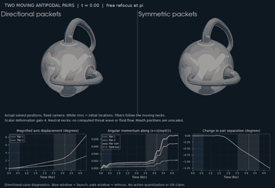

# Two moving mouth pairs: effective dynamics and visualization

The two Klein handles drawn in #338 now follow two independently solved
antipodal axes. There are **four mouths, organized into two constrained pairs**.
Both pairs recoil from a scalar field, and their relative separation changes.
No camera rotation, prescribed trajectory, or antipodal kick switch produces
the motion. The field receives the reciprocal torque.



This compact preview reduces image resolution and frame cadence only. The
original 57-frame animation and full-precision NPZ are stored losslessly in
checksummed `.parts` directories because large upload requests did not finish.
Run `python scripts/restore_moving_mouth_assets.py` to reconstruct both exact
original files. The renderer loads the NPZ pieces automatically; no experiment
rerun is required. Both reconstructions were verified byte-for-byte against
the originals. CSVs and their original manifest remain unchanged.

Left: directional packets. Right: symmetric packets. Teal rims belong to pair
1 (initially ±z), amber to pair 2 (initially ±x). White rings mark initial rim
locations. Both panels show actual, unmagnified positions with a fixed camera
and common scalar display scale. The charts enlarge angular coordinates
explicitly. Fibers follow the mesh; they do not cause motion. Neutral necks
have no computed scalar field.

The radial display law is 1+.15 tanh(4 u/u_ref), with u_ref fixed from the
free target profile for every frame/case; colors saturate at ±u_ref/4.
This fixed gain makes low-amplitude traveling deformations visible. It has
no effect on the field evolution, mouth axes, or momentum ledger.

For visible large-angle transport, the reviewer supplied the larger movie
below, now included with its source scripts. It extends the horizon to
4pi+1.2, uses a fixed sphere and no radial display, and holds the symmetric
panel at its last admissible sampled frame. This is **reviewer-produced
exploratory evidence**, not part of the frozen result or independently rerun
long-horizon evidence in this follow-up. See the [review audit](moving_mouth_review_audit.md)
for the display-stop versus integration-stop distinction and interpretation.


## Model and scope

This combines #339's **round-S² effective scalar mechanics** with #338's
**handle drawing and gluing**. It is not yet a moving version of #338's
handled-mesh scalar PDE. The complete round sphere, including the caps hidden
by the drawn mouths, remains the field domain. Four finite footprints are
effective couplings; no flux boundary condition or scalar propagation through
a neck is solved. The neutral neck shading makes this distinction visible.

For handle h and sign s, positions are x_hs = s X_h. A single pair inertia
M=.10 governs X_h; each mouth has a separate shape oscillator. The positive
Hamiltonian contains scalar energy, |L_h|²/(2M), four shape energies, and
four interactions kappa(q_hs-ubar(s X_h))²/2. Pair torque is the sum of its
two mouth torques. The exact rotational budget is

$$\mathbf J=\mathbf L_1+\mathbf L_2-\operatorname{Re}\langle p,\mathbf D a\rangle.$$

There is no imposed relation L_2=-L_1. The antipodal constraint is assumed:
the ends of ONE pair have opposite velocities and are not independently
translating objects. Equal endpoint masses M/2 give opposite ambient tangent
momenta within that pair, while their orbital angular momenta add. Neither
fact establishes an exchange law between handles. S² has rotational, not
ambient translational, symmetry. No GR inertia, fluid law, or quantum rule
is derived here.

Two coherent profiles target +x and +z, with relative profile weight .65 and
directional velocity bias eta=.7. Their JOINT field energy is .1 before free
backpropagation by pi. This is prepared incoming radiation, not spontaneous
emission from a mouth. Time zero is the source-side focal instant: negative
mouths see its outgoing half before positive mouths encounter the target-side
focus at pi. These are different events of the same mechanism, not two
different coupling laws. All initial mouth shapes and pair momenta vanish.
Initial interaction energy is below 6e-34 in the directional case, and is
included in the budget throughout. All masses, couplings, widths, preparation,
controls and failure criteria are in the [frozen protocol](moving_mouth_pairs_protocol.md).

The protocol was locally committed as `b786482` before the first coupled run.
SHA256: `2aa9c5e0c7b7b700ecc20369a6b66c85f96dc34312d5f6304b0d454febd1fc51`.
Publication follows the run; this is not external preregistration.
The identical protocol tree is published in commit `a24b518`.

## Results through pi+1.2

All ten frozen gates pass: **SUPPORTED_FOR_THIS_EFFECTIVE_FAMILY**.

| Case | Pair 1 final displacement | Pair 2 final displacement | Maximum separation change |
|---|---:|---:|---:|
| Directional | 3.19186° | 8.44402° | 1.26482° |
| Symmetric | 1.02484° | 1.38835° | 2.41319° |
| Mirrored directional | 3.19186° | 8.44402° | 1.26482° |
| Coupling disabled | 0 | 0 | 0 |
| Empty field and resting mouths | 0 | 0 | 0 |

Directional positive-axis separation ends at **88.73518°**, from 90°.
Post-review single-packet controls reproduce the dominant individual recoil.
Combining their independently evolved pair axes gives a **+0.43976°**
separation change, whereas the shared-field run gives **-1.26482°**.
The **-1.70458°** difference is a nonlinear interaction/backreaction
comparison; subtracting separate evolutions does not isolate a pure
bilinear interference torque. See the [archived controls and audit](moving_mouth_review_audit.md).
The final pair momenta (x,y,z) are:

- Pair 1: (0.00315843849, 0.00079377276, 0.00000014900), magnitude .00325666.
- Pair 2: (0.00000448832, -0.00111103324, 0.00949814160), magnitude .00956290.

Their sum is supplied by field loss. Reflection y -> -y makes positions
transform as polar vectors and angular momenta as axial vectors: Lx and Lz
reverse, while Ly does not. Negating all three components would be the wrong
mirror test. The symmetric superposition is not axisymmetric about either
pair: each sees the other packet and moves within the x-z plane. The
single-focus null of #339 therefore does not apply to this preparation.

The truncated source-focus window and full target-focus window are separate
events, not comparable full-cycle windows. These are **norms of integrated
vector torques**, not scalar quantities to add without their directions:

| Mouth | Outgoing half of source focus [0,.6] | Full target focus [pi-.6,pi+.6] |
|---|---:|---:|
| Pair 1, positive (+z initially) | 4.43e-8 | .00228976 |
| Pair 1, negative | .000540687 | .000112386 |
| Pair 2, positive (+x initially) | 1.95e-8 | .00733375 |
| Pair 2, negative | .00130843 | .000145667 |

The prepared field mainly kicks negative mouths at the initial source focus
and positive mouths at the target focus. Other interactions remain nonzero; this does not isolate
an echo-only contribution or place all final recoil at the antipode.
Final energies: field .09260310, pair kinetic .00051027, shape .00479245,
interaction .00209441. All four terms belong in the ledger. No dissipation or
irreversible absorption is included.

## Verification and reproduction

- A second review at `650e825` reproduced the supplementary archive
  byte-for-byte and all 50 tests; CI passed. Its new weak-field scaling and
  collision-stop observations, their limits, and the next scaling requirements
  are recorded in the [review audit](moving_mouth_review_audit.md#second-review-weak-field-reciprocity-and-an-actual-stopping-bracket).
- The independent reviewer reproduced all original CSVs and the NPZ
  byte-for-byte, as well as pixel-identical 3D panels. CI on `ab376e7` passed.
- **50 relevant tests pass**, covering the new mechanics/drawing, #339's
  scalar comparator, and #338's deformation, contour and handle regressions.
- Maximum relative energy error across seven runs: **7.06e-6**.
- Maximum normalized total-J error, checking all three components: **2.02e-14**.
- Final two-pair momentum changes by **4.30e-9 relatively** from cutoff 32
  to 40 and **4.63e-6** when dt is halved.
- Mirror positions, momenta, shapes and individual mouth impulses agree to
  <4.2e-17. Empty and uncoupled controls stay at rest exactly.
- Unit-axis and tangent-momentum constraints are checked every step.
- Tests independently differentiate the Hamiltonian to check each pair
  torque; verify all-component Noether conservation under a kick, analytic
  free geodesics, reversal, mirror covariance and time refinement.
- Pole-stable harmonic evaluation uses atan2(hypot(x,y),z); arccos(z) loses
  tiny transverse motions near ±z. #339's old helper remains unchanged.

The [archive](../experiments/closure_ledger/runs/20261016_moving_mouth_pairs)
contains seven CSV traces, sparse full-precision renderer states, a summary,
and SHA256 manifest. It records four mouth impulses/torques, four shape and
interaction energies, both kinetic energies and the field budget.

```bash
pip install -e '.[dev,viz]'
python -m pytest -q tests/test_moving_mouth_pairs.py tests/test_antipodal_kick.py
python -m pytest -q tests/test_viz_klein_handles.py tests/test_scalar_deformation.py tests/test_scalar_deformation_contour.py
python scripts/restore_moving_mouth_assets.py
python experiments/closure_ledger/moving_mouth_pairs_probe.py
python scripts/render_moving_mouth_pairs.py
```

The two pytest commands together reproduce the 50-test claim. Restore the
large assets **before** checking the original `sha256.json` manifest. The
renderer is a direct script entry point; its sibling loader import assumes
the documented `python scripts/render_moving_mouth_pairs.py` invocation.
The archived figures preserve the original rendering bytes. Their old
"Magnified axis displacement" wording denotes chart scale, not multiplied
angles; the renderer now says "Axis displacement (true degrees)".

## Coordinate motion and the remaining physical calculation

A viscous surface would require a velocity field, stress law, dissipation and
its energy reservoir. Here a Hamiltonian torque drives each pair. A smooth
coordinate map brings the surrounding sphere mesh to the solved rim position,
leaving distant coordinate locations fixed. Scalar samples are evaluated at
the **moved spatial locations**, not advected as cached mesh colors.

Each neck uses the shortest rotation from its reference to its solved axis,
with no extra spin degree of freedom. Rotating fibers around a fixed rim
would not alone demonstrate mouth translation or momentum exchange. These
fibers are drawing coordinates, not a fluid flow or calculated holonomy.
Shared vertices retain #338's exact Klein gluing permutation. Radial scalar
offsets at rims taper continuously into neutral necks. Every rendered frame
is checked for sphere-triangle inversion, rim mismatch and fixed distant
coordinates. Connectivity remains closed, non-orientable, with Euler
characteristic -2. See [geometry checks](images/moving_mouth_pairs/geometry_checks.json).

The next physical replacement is a moving handled-domain action: derive
the field mass/stiffness dependence on mouth coordinates and its reciprocal
force, including velocity-dependent coordinate terms. It must recover #338
when the mouth coordinates are held fixed and close the Noether budget
before interpreting through-neck transport. An independent source–receiver
preparation can then distinguish emission recoil, received momentum and
self-return without preloading a focusing packet. This PR establishes neither
GR mouth dynamics nor action quantization.
