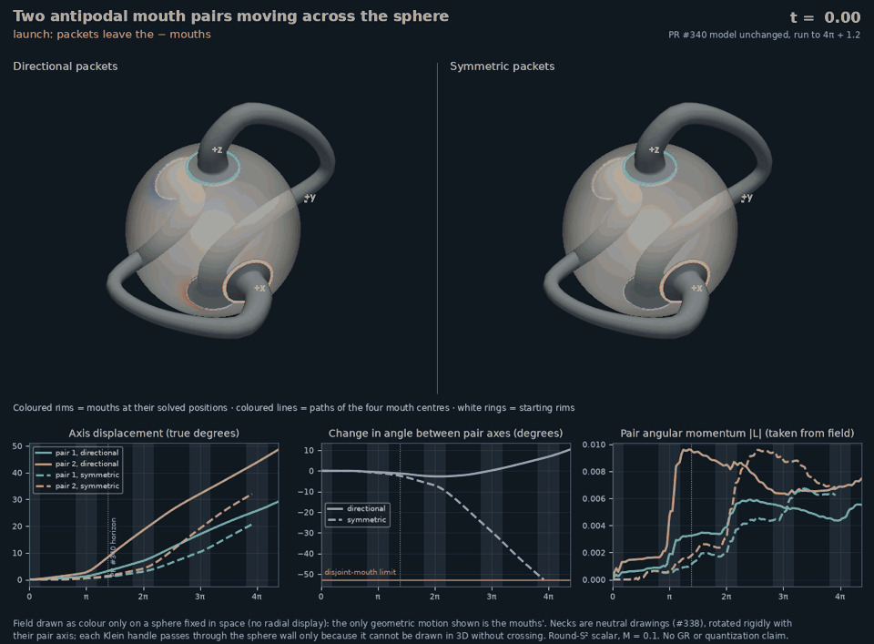

# Review follow-up: reproduction, interference and visible transport

Review: [#340 at ab376e7](https://github.com/davidmdrpi/geometrodynamics/pull/340#issuecomment-6230268219).

The reviewer reproduced all seven original CSVs and the restored NPZ
byte-for-byte on another Python/NumPy environment. The geometry diagnostics
also matched exactly; the PNG 3D panels were pixel-identical, with chart-font
differences. CI run 38992840372 passed on the reviewed head. This is strong
independent reproduction of the frozen finite-horizon effective-model result.

The reproduction block now lists all five test files (50 tests total) and
the restoration step before manifest verification. The renderer title now
reads "Axis displacement (true degrees)". Archived original frames retain
their old caption and exact bytes; its "magnified" referred to chart scale,
not multiplying the data. A comment documents the direct-script loader import.

## Large-motion visualization supplied with the review



These [review assets](reviews/pr340/README.md) are copied unchanged from
`bdda0a2edd334e7d3aa1c5360b3e53e708a4e1b8`. They extend the same model to
4pi+1.2 and use a fixed sphere with moving visual cutouts, color-only field,
and mouth paths. This makes actual transport much easier to see than radial
bobbing. It is an exploratory reviewer-produced extension, not another frozen
success or a long-horizon numerical replication performed in this follow-up.
The fixed-sphere visual cutouts are not a newly assembled handled-domain PDE
or an exact shared-rim moving finite-element mesh.

The review reports about 29°/49° directional travel and growing symmetric
approach, crossing the .65 rad disjoint-mouth limit near t=12.32. The movie
holds the last valid sampled symmetric frame at t=12.30. Inspection of its
`solve()` shows that it **integrates the whole horizon and truncates the
display afterward**. That is not an integration event stop. Numbers beyond
the .65 rad limit must not be interpreted as valid finite-mouth dynamics.
Likewise "coast" in a movie caption does not assert zero residual torque.

## What the single-packet subtraction can establish

The added `moving_mouth_review_probe.py` evolves the x and z packets
separately, each with the ORIGINAL JOINT normalization, using the unmodified
production `MovingMouthPairs.evolve()` and its exact output/event grid.
Their initial spectral states sum to the original state to numerical precision.
Directional and symmetric components are both included. These are post-review
replications, not additions to the frozen gates.

At fixed mouth coordinates the interaction torque is bilinear in the field
and shape variables. Once mouths move, their sampled field, shape response,
and field backreaction differ between runs. Consequently

$$\Delta\mathbf L_{\rm both}-\Delta\mathbf L_x-\Delta\mathbf L_z$$

is a **nonadditivity residual between nonlinear evolutions**, not an isolated
bilinear interference torque. The review's subtraction remains useful, but
calling the whole residual a measured pure cross term is too strong.

There is also a geometric correction. A single-packet run rotates one pair
while the other stays fixed, preserving 90° separation. It does not follow
that two independently rotating pairs would preserve 90°. If the z pair
rotates by alpha about x and the x pair by beta about z, their axes satisfy

$$X_z=(0,-\sin\alpha,\cos\alpha),\quad
X_x=(\cos\beta,\sin\beta,0),\quad
X_z\cdot X_x=-\sin\alpha\sin\beta.$$

The probe therefore also combines the independently evolved z-pair and
x-pair positions and measures their angle directly. This is a geometric
diagnostic, not a solution with one common field. It separates the angle's
own nonlinear geometry from the common-field interaction effects. Exact
values are archived in the supplementary summary and separation traces.

The replication gives:

| Preparation/comparison | Pair 1 displacement | Pair 2 displacement | Final separation change |
|---|---:|---:|---:|
| Directional x packet alone | 0° | 8.27490° | 0° |
| Directional z packet alone | 3.05694° | 0° | 0° |
| Both directional packets, shared field | 3.19186° | 8.44402° | -1.26482° |
| Composite of the two independent trajectories | 3.05694° | 8.27490° | +0.43976° |
| Both symmetric packets | 1.02484° | 1.38835° | -2.41319° |

Both symmetric single-packet runs remain centered. The shared-field
directional separation differs from the geometric composite by **-1.70458°**.
Thus the interaction reverses the independent-motion trend in this comparison;
the claim that *all* possible relative motion is a pure cross term is not
justified. All y momentum in the shared-field runs is nonadditive relative
to these single-packet controls, consistent with the review's measurements.

Four new single-packet runs and two comparison traces are in the
[supplementary archive](../experiments/closure_ledger/runs/20261017_moving_mouth_review).
Maximum relative energy error is 7.18e-6 and normalized total-J error is
2.68e-14. The initial data sum check and matching time-grid checks execute
inside the probe. The production model, frozen protocol, original CSVs and
original large-asset pieces are unchanged.

```bash
python experiments/closure_ledger/moving_mouth_review_probe.py
```

Cancellation of an off-focus pair's net torque is also not transparency:
its two individual mouth impulses can be nonzero and opposite, and its
shape oscillators can still take energy. The conclusion is a symmetry null
for the pair's net rotation in these preparations, not blindness to arbitrary
waves or an absence of scattering.
For example, the directional x-only run leaves pair 1 with zero net recoil
but final shape energy **5.1920e-5**; the z-only run leaves pair 2 with shape
energy **2.1878e-5** and zero net recoil. The individual mouth impulses in
those pairs are nonzero and cancel. These are measured counterexamples to
interpreting "blind" as no interaction.

## Source focus, target focus, and the next extended test

The preparation starts at a source-side energy focus with initially resting,
unexcited mouths. [0,.6] is the outgoing half-window of that prepared focus;
[pi-.6,pi+.6] covers a full target-side focus. They use the same coupling law.
Their impulse ratio cannot be explained solely by window length: mouth
positions and oscillator states also differ. The original CSV key `launch`
is retained for reproducibility; the prose and new caption make its meaning
explicit. A full source-return window at 2pi belongs in an extended protocol.

The review's displaced-pair runs (1°, 3°, 6°) report amplification of tilt,
correcting the earlier attractor conjecture. This is evidence of finite-time
defocusing in this family, not an established general stability exponent or
a theorem about damping. Those runs have not been independently repeated
in this follow-up. No attractor claim is warranted.

Before another long-horizon run, freeze these requirements:

- Stop integration at the first crossing of min(separation, pi-separation)
  = .65 rad. Bracket the crossing at integration-step resolution and report
  the last admissible state; never count later data as physical successes.
- Sample k*pi±.6 exactly and report vector impulse per mouth, pair and field
  for every full source/target focus and every intervening interval.
- Include ±1°, ±3°, ±6° single-symmetric-packet offsets and a centered null.
  Test signed restoring versus defocusing response and its time/cutoff
  convergence. Predefine an attractor failure as converged outward impulse
  and growing tilt near the axis; do not redefine a miss as successful trapping.
- Use fixed-sphere drawing for large motion. Keep the full-wave energy and
  Noether budget, and label any drawing-only frame/cutout approximation.

The next physical model still requires a moving handled-domain action,
including reciprocal geometric forces, rather than treating this effective
rotor comparison as a derivation of wormhole dynamics or quantized action.
