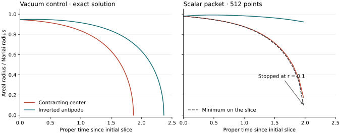

# Does an inverted antipode make a collapsing Nariai neck bounce?

The two centers start at equal areal radius with opposite normal velocities. In the exact vacuum control, **both necks reach a curvature pinch in their future**. One contracts immediately; its inverted partner first grows to a maximum and then contracts. With a genuine massless-scalar packet the numerical development reaches r=0.1 with two negative null expansions and rapidly increasing angular curvature. No bounce appears before that cutoff. The fastest collapse is on the flanks of the contracting packet. Signals from the two centers are still separated on the last primary slice. A shorter-loop control gives them time to cross and still collapses.

[Protocol registered before evolution](nariai_antipodal_protocol.md) · [Solver](../experiments/closure_ledger/gravity/nariai_loop.py) · [Numerical archive](../experiments/closure_ledger/runs/20261125_nariai_loop/probe.json)

## What the identification requires

Use Einstein gravity in five dimensions, 8πG=1, Λ=3, and round three-sphere orbits. The neutral Nariai product has areal radius 1 and a two-dimensional de Sitter factor of radius 1/√2. The circle coordinate has period L=2π. The involution on the time-oriented cover is J(t,x)=(−t,x+π), optionally accompanied by the sphere antipode, which leaves orbit scalars unchanged. At t=0 the intrinsic metric is periodic under the half-shift and the full extrinsic curvature reverses sign. Thus a single future normal on the cover gives U(x+π)=−U(x), with U=n(r). At later times J pairs opposite times. Enforcing this sign rule at equal future times throughout a simulation would change the problem. The evolution here uses the cover. An actual time-reversing quotient would require its own global causal analysis. [Higher-dimensional Nariai products and their extremal limits](https://doi.org/10.1103/PhysRevD.70.024002)

Write l for proper radial distance on a slice, w=∂ₗr and h for the normal expansion of the longitudinal metric scale. A massless scalar has normal derivative p and spatial derivative f. The Hamiltonian and momentum constraints in these conventions are

$$
 3(1+U^2-w^2)/r^2+3(hU-\partial_l w)/r=\Lambda+(p^2+f^2)/2,
 \qquad \partial_l U-hw=-rpf/3 .
$$

On an exactly constant-radius vacuum slice the second equation forces U to be constant. Half-period oddness then forces U=0. Allowing nonzero spatial momentum flux, or perturbing the intrinsic radius, gives constraint-compatible alternatives. Simply inserting a velocity bump into the vacuum product fails this test.

## Exact compact vacuum control

Start from a time-symmetric Kottler chain in Gaussian proper time T. Choose s(x)=1−ε cos(2x), μ=(1−ε²)/2, b=(s−2μ/s)/2. The spatial metric is a² dx²+r² dΩ₃². Its exact development is

$$
 r^2=s+b[\cosh(\sqrt2 T)-1],\qquad
 a=\frac{\sqrt{2s}}r\left[1+\tfrac12(1+2\mu/s^2)(\cosh(\sqrt2 T)-1)\right].
$$

For example, the radial first integrals are rₓ/a=ε sin(2x)/√(2s) and 1+U²−w²=μ/r²+r²/2. The Gaussian geodesic equation is r̈=r/2−μ/r³. These relations give the solution including its regular continuation at the extrema of s. At ε=0 it reduces to the exact homogeneous Nariai product, with a=√2 cosh(√2T) on this circle cover. Thus the radius perturbation changes the local vacuum solution, while the velocity lobes below come from a choice of slice within that solution. Spherical vacuum gravity in this reduction supplies no independent radial radiation mode.

Take the smooth initial surface T(x)=0.25 [exp(2(cos x−1))−exp(2(−cos x−1))]/(1−exp(−4)). Its half-period oddness gives the required J action. The code boosts both orbit derivatives into the slice's normal and tangent frames and checks the two constraints there. For ε=0.1 the maximum tilt speed is 0.149, the mass defect is below 3×10⁻¹⁶ and the opposite normal velocities agree in magnitude to 4×10⁻¹⁷.

At either neck r²=1−ε cosh(√2T). For future null normals n±eₗ, the expansions are θ±=3(U±w)/r. At the contracting center both start at −0.08568, at its partner both start at +0.08568. The expanding neck reaches the marginal bifurcation sphere at T=0, then enters the trapped sector. Its maximum radius is √(1−ε), where curvature is finite. At r→0 the invariant Riemann square is 10+72μ²/r⁸ and diverges. The proper pinch times from the tilted initial surface are 1.866528 and 2.366528 for ε=0.1. The agreement with direct radial ODE integration is tested at three amplitudes. These exact times concern the two symmetry centers.

## Coupled propagating packet

To test a physical wave, add a classical minimally coupled, canonical massless scalar. The near-product initialization has constant r=R=0.98 and initial longitudinal scale 1. Set

$$
 F=\cos x\,e^{(\cos 2x-1)/4},\quad U=-A F^3,\quad
 p=P=\sqrt{6(R^{-2}-1)},\quad \phi=-3U/(RP).
$$

This sets f=−3Uₓ/(RP). The Hamiltonian fixes h=−U/R+3Uₓ²/(2P²RU); the apparent division extends smoothly because Uₓ²/U=−9A F(Fₓ)². The scalar has odd J parity and its normal velocity has even parity. Both the spatial scalar gradient and its momentum flux propagate in the coupled equations. This is a scalar perturbation on a homogeneous scalar background. Even the A=0 control has nonzero scalar kinetic energy and contracts. The experiment tests whether inversion rescues the contracting region; it does not attribute all collapse to the packet.

The primary A=0.05 has U(0)=−0.05 and U(π)=+0.05. The two null expansions start at −0.15306 on one center and +0.15306 on the other. In conformal coordinates the initially expanding center reaches a maximum r=0.991754 at t=0.419877. A maximum followed by contraction differs from a bounce of an initially contracting neck.

**Independent clocks.** The first solver uses the metric e²ˢ(−dt²+dx²)+r²dΩ₃². It evolves the orbit Einstein equation, the base trace and the scalar wave equation, and monitors both null Einstein constraints. Its primary global lapse guard a=50 trips at t=0.789421, minimum radius 0.50453. The outgoing ray x=t from the contracting center still has affine dr/dλ=−0.09309 there (initially −0.05). This guard by itself cannot classify a pinch.

After seeing the guard, we repeated the Cauchy problem in synchronous proper time τ, using a first-order Einstein–scalar system. In addition to ṙ=U and ȧ=ah, its equations are

$$
 \dot U=r-(1+U^2-w^2)/r-r(p^2+f^2)/6,\quad
 \dot h=2-p^2-3\dot U/r-h^2,\quad
 \dot w=-rpf/3,
$$
$$
 \dot p=\partial_l f+3wf/r-(h+3U/r)p,\qquad
 \dot f=\partial_l p-hf .
$$

Here a is the longitudinal spatial scale. The identity w=rₓ/a is monitored independently. The solvers agree on both center radii at matched proper times at conformal t=0.6, with maximum errors of 2.47×10⁻⁶, 1.56×10⁻⁷ and 9.71×10⁻⁹ on 128, 256 and 512 points. Time slicing differs off the symmetry centers. Both solvers use fourth-order spatial differences and RK4 with time-step and resolution checks.

| First minimum radius on the 512-point slice | Synchronous time | Angular sectional curvature at that minimum |
|---:|---:|---:|
| 0.30 | 1.914506 | 63.62 |
| 0.20 | 1.951839 | 320.45 |
| 0.10 | 1.973320 | 5130.34 |

The orbit-plane curvature is (1+U²−w²)/r². At the last cutoff the two null expansions at the minimum are −212.76 and −212.79. The minimum is near |x|=0.38 about the contracting center; the center itself has r=0.17526 and its partner r=0.92314. The cutoff time changes by 5.92×10⁻⁶ between 256 and 512 points. The fine grid's maximum normalized Hamiltonian and momentum residuals there are 3.59×10⁻⁸ and 2.27×10⁻⁵. The null fronts emitted toward one another from the two centers are at x=1.418 and 2.417. In this run a post-launch center-to-center exchange could not have caused the observed collapse. The prescribed initial lobes have smooth tails, and the two centers are already correlated in the initial data.

At 256 points, A=0 and 0.025 also reach r=0.1 (τ=2.44047 and 2.19424). At A=0.10 the synchronous scale guard trips first, at τ=0.43115. The conformal gauge also trips its own guard for this amplitude. Its central end state is unresolved.

## Can the lobes communicate in time?

In a post-primary control the initial proper circumference was shortened from 2π to 1. The primary amplitude was scaled by (1/2π)² to hold fixed the amplitude of the derivative-squared term in the longitudinal constraint, which is proportional to A/L². This changes both length and pulse amplitude and tests causal access rather than isolating a response coefficient. Initial data still have opposite geometric velocities. Integrating both future radial light characteristics, dx/dτ=±1/a, gives center-to-center arrivals at τ=0.499 and 0.606. The contracting center itself reaches r=0.1 at τ=2.416536, with both expansions −210.63. The values at 256 and 512 points agree in cutoff time to 5×10⁻⁸. Causal communication is available well before this cutoff. An arrival time alone identifies no particular reflected waveform as the cause of collapse.

## What persists past a cutoff?

There is a timelike comparison at the contracting reflection center, where w=0 and the normal worldline is geodesic. The synchronous radial equation gives, for y=r²,

$$
 \ddot y=2(y-1)-y(p^2+f^2)/3 \le 2(y-1).
$$

The Green function of the difference equation with zero initial differences is sinh(√2τ)/√2, positive in the future. Hence y is bounded above by 1+(R²−1)cosh(√2τ)+√2 R U₀ sinh(√2τ). For R<1 and U₀<0 its first positive zero supplies a finite proper-time bound. Also r̈<0 whenever the contracting center is regular with r<1. A smooth bounce there is excluded even if a signal arrives from the antipode. For the primary the comparison time is 2.058609; for the short loop it is 2.742380. These are upper bounds on a smooth positive-radius continuation. If the center continues to r=0, its angular curvature is at least 1/r². The comparison leaves open earlier breakdown and does not assign an exact scalar pinch time.

The scalar obeys null convergence. Along an affinely parametrized radial null ray,
$$
 d^2r/d\lambda^2=-(r/3)(d\phi/d\lambda)^2 .
$$
An initially contracting null ray cannot reverse its areal velocity in a regular region. At the primary center with initial affine normalization k=n+eₗ, r/|kr|=19.6 bounds the affine length to focus if the ray extends that far. This is an upper bound, not a measured pinch time. To see why this trapped ray cannot simply focus at a regular polar origin, write D±=∂t±∂x in conformal gauge. Along it D₊D₋r=2e²ˢ(r−1/r)−2(D₊r)(D₋r)/r. While r<1 and both derivatives are negative the opposite expansion stays negative as well. Hence the orbit sectional curvature is at least 1/r² if the ray approaches zero radius. Smooth passage through a regular horizon does not reverse this sign argument. The scalar simulation stops at positive radius; it resolves trapped collapse and curvature growth, with a focusing obstruction to a smooth null bounce. Only the vacuum control supplies an exact singular endpoint.

This loop is a dynamical, spherically reduced gravity test. It does not establish a traversable throat, or rule out other matter, nonspherical gravitational radiation, a different action or different initial expansions.

~~~sh
OPENBLAS_NUM_THREADS=1 python -m experiments.closure_ledger.gravity.nariai_loop
OPENBLAS_NUM_THREADS=1 python -m unittest discover -s tests -p test_nariai_loop.py
python -m experiments.closure_ledger.gravity.plot_nariai_loop
~~~
