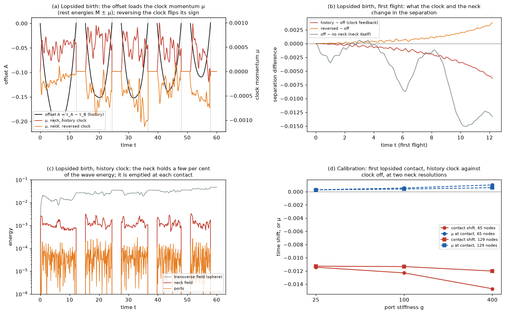
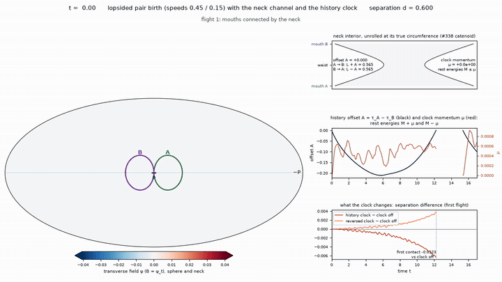
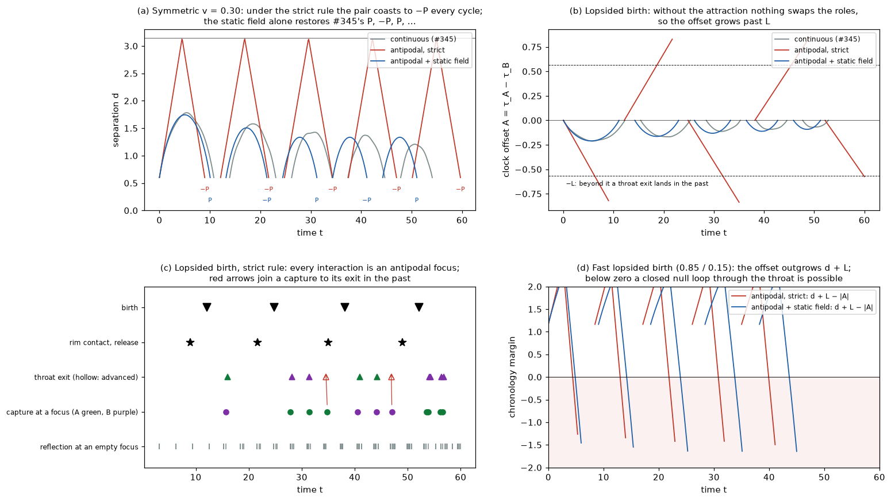
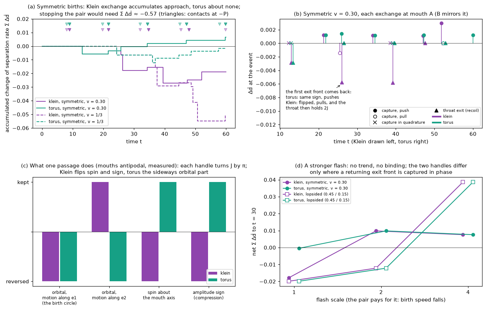
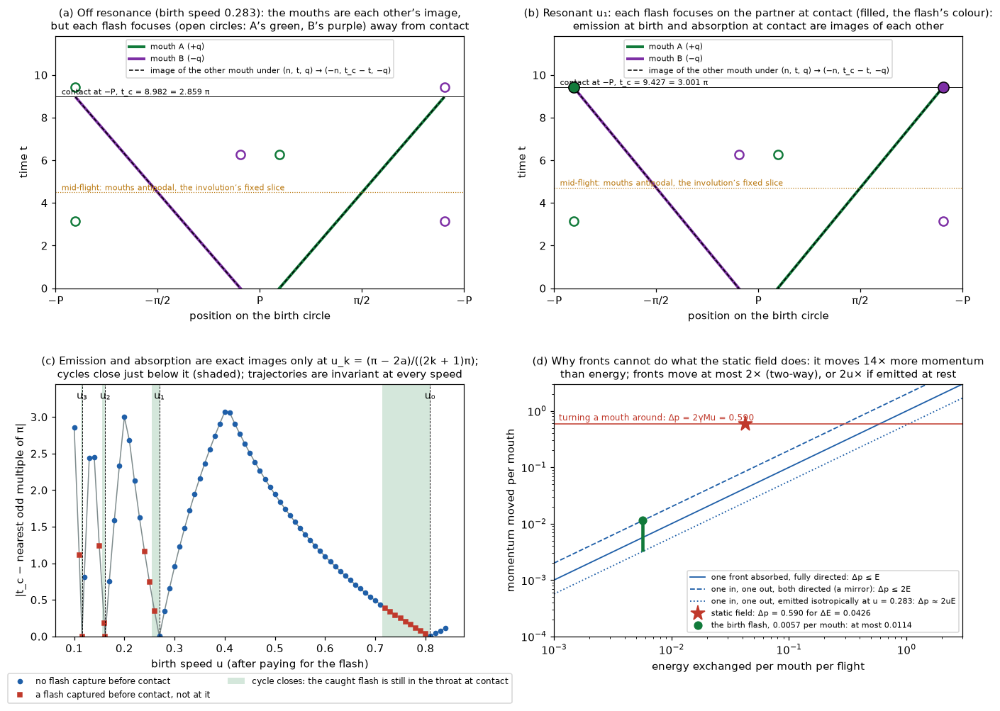
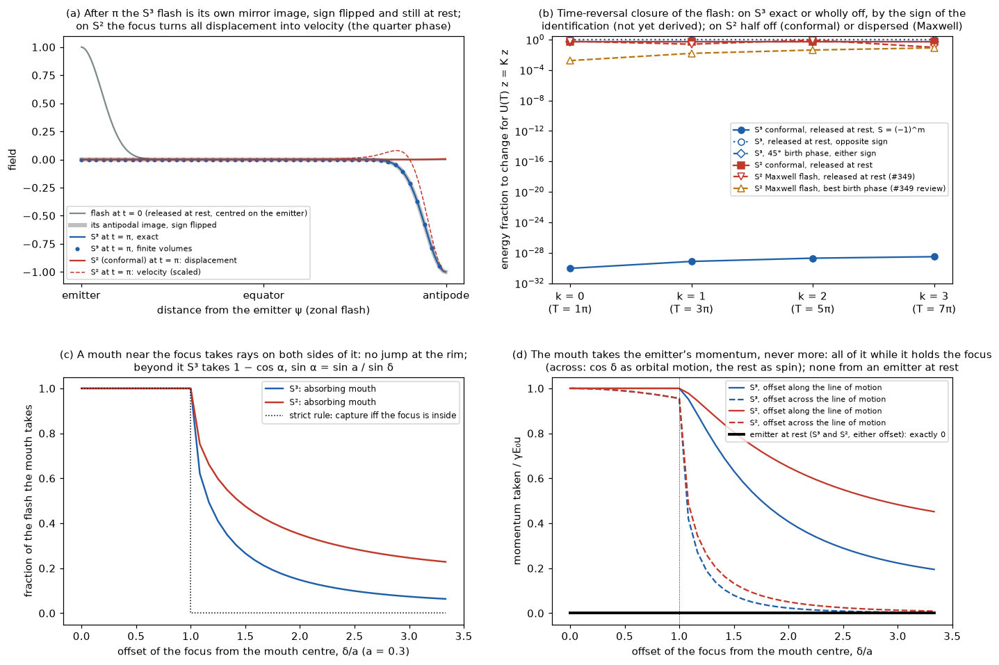
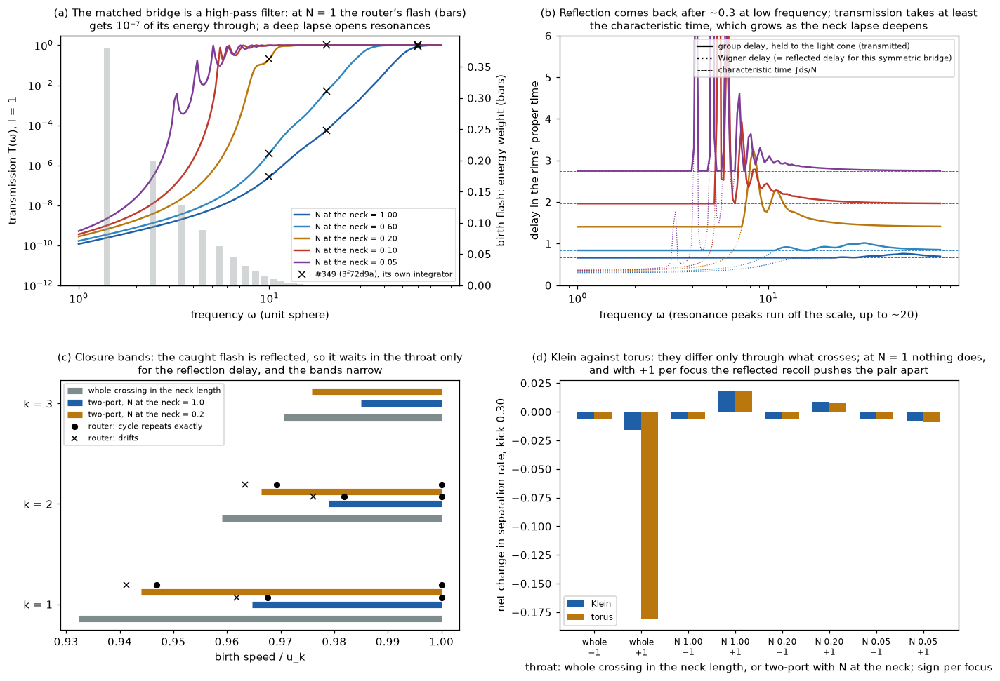

# Pair birth to annihilation: antipodal returns, attraction and release

A classical experiment on #345, answering the acceptance test set in its review (end of
[mouth_kick_experiments.md](mouth_kick_experiments.md)).
- **The story:** two mouths are born touching at a point P and fly apart with the momentum
  left over from pair creation. Then:
  - the wave emitted at birth refocuses at the antipode and comes back to meet them;
  - the pair slows, turns round, and is pulled back together;
  - the rims touch, the handle is removed, and its energy leaves as a wave.
- **The mouths move independently.** Every force on them comes from one action, and nothing
  about the motion is scheduled.
- **Classical throughout.** Nothing is quantized; "exchange" here means the retarded field of
  the partner.


**Answers in brief.**
1. **Without mouths,** a pulse released at P refocuses at −P at t = π. It comes back to P at
   t = 2π with its sign flipped, and repeats (panel a).
   - This is exact for the conformal operator.
   - The massless operator, which carries the mouths' field, refocuses to within a few per cent
     over two loops.
2. **The mouths attract because the flux is conserved.**
   - Two mouths sharing one handle carry equal and opposite flux (Wheeler's charge without
     charge).
   - The static energy of their field grows with separation, so they attract. The same pair
     treated as scalar sources would repel.
   - On the sphere the pull vanishes at antipodes, where the field lines are equally long both
     ways round.
3. **Born touching, apart, back: two outcomes.**
   - Without a field, the mouths always meet again on the far side, at −P, at t = (π − 2a)/v.
   - With the field, pairs slower than v ≈ 1/3 turn round and annihilate back at the birth point
     P.
   - Faster pairs pass the antipodal configuration and meet at −P, later than free motion.
   - At v = 1/3 the pair reaches 163°, stays beyond 143° for about 13 time units, and is
     pulled back to P.
4. **Waves decelerate.**
   - The sudden birth radiates a flash, which carries 13% of the birth kinetic energy.
   - The mouths pay for it, so the speed needed to cross over rises from 0.30–0.32 (no flash) to
     0.333–0.34.
   - The partner's flash reaches each mouth at t ≈ 0.8 and pulls it towards the partner. That is
     the first exchange.
5. **The flash comes back at the predicted times.**
   - After one or two antipodal foci, each returning ray pushes the mouth it crosses along the
     ray's direction of travel.
   - The returning ray from −P meets the outgoing mouth head-on and pushes it back towards P.
   - This held in 40 of 40 event windows across ten runs. Windows placed at the wrong
     (unshifted) times agree in 21 of 32, with half the impulse.
   - Later returns keep their timing but not a fixed sign.
6. **Near the threshold, timing decides where annihilation happens.**
   - Take the same birth at v = 1/3, with the flash re-timed after it has left the mouths.
   - Returns 0.5 or 1.0 later send the pair over to −P.
   - Returns earlier, or the flash absorbed, bring it back to P sooner.
   - The energy change of the intervention does not order these outcomes.
7. **Annihilation follows a stated rule.**
   - The glued surface is regular while the rims are disjoint. The dynamics brings them into
     contact at a computed time.
   - At contact the handle is removed. Its energy (rest, kinetic and Coulomb; 2.19 at v = 0.30)
     and its angular momentum leave as one deformation pulse.
   - The pulse refocuses at the antipode of the contact point and returns with its sign flipped,
     as in #344.
8. **The complete history closes the cycle, and the throat clocks follow it.**
   - The released pulse refocuses at the antipode after π, and the pair is re-born there. That
     is the archived v39 cycle, now with exact energy and angular momentum: five births and
     four re-births in 60 time units.
   - Each mouth carries its proper time since its own birth. The throat offset is the
     integrated difference, so it depends on the whole velocity history, never on position.
   - Symmetric pairs have no offset at all.
   - Even a lopsided birth (0.45 / 0.15) peaks at 0.215 mid-flight and is back below 0.0011 at
     contact. The offset resets at every birth.
   - A closed loop through the throat would need |offset| ≥ d + L_neck. The margin never falls
     below 1.155.
9. **With a neck channel, the offset acts back on the motion.**
   - The neck carries the field through the throat. Signals cross it in L + A one way and
     L − A the other, and the offset's reaction is a clock momentum μ that shifts the two rest
     energies by ±μ.
   - In the lopsided birth, the history clock brings the first contact 0.012 earlier than the
     same neck with its clock off, and the reversed clock 0.007 later. That is robust to the
     port stiffness and the neck mesh.
   - The reaction is small: μ ≤ 3 × 10⁻³. The effect compounds over later cycles to contact
     shifts of 0.05–0.4.
   - The neck itself, with or without its clock, changes the history more. Symmetric pairs feel
     no clock at all.
10. **Under the antipodal-only (BAM) rule of #347 the picture changes** (§9).
    - **The rule.** Waves act only at antipodal foci: an empty focus reflects with phase −i, a
      mouth there captures, and the throat carries captures on the clock histories.
    - **No force in flight.** Nothing pushes the mouths in flight. The static attraction
      breaks the rule, so pairs coast: symmetric pairs meet at −P every cycle. #345's P, −P
      alternation comes from the static field.
    - **Clock offsets.** Without the attraction to reverse them, lopsided offsets grow past L,
      and throat exits land in the past. A fast lopsided pair drives the chronology margin
      negative.
    - **Where captures happen.** A first flight meets its own flash only within a/u of birth
      or contact; captures in later cycles come from earlier flashes and throat exits.
11. **The Klein throat sets the sign of the exchange, not its size** (§10).
    - **The test.** Flash fronts carry momentum and a compression sign, and a capture pushes or
      pulls with that sign. Fronts leave the throat through the handle's map.
    - **What each handle does.** Each turns a front's angular momentum by π; neither reverses
      it as a whole. Both reverse the orbital part along the birth circle. The Klein handle
      also reverses the spin and flips compression into rarefaction; the torus keeps both.
    - **The flip makes the exchange attractive.** A returning front that pushes through a torus
      pulls through a Klein throat. Over 60 time units symmetric Klein pairs gain −0.019 and
      −0.051 in separation rate, against +0.007 and −0.002 through a torus.
    - **Nothing binds.** That is 3–8% of the 0.57–0.63 needed to stop the pair. The flash
      carries momentum E v ≈ 0.002 per mouth against the mouths' 0.3, and the rule allows about
      one exchange per flight. Every pair still meets at −P, and a 2× or 4× flash shows no trend.
12. **Under antipodal time reversal, the strict cycle is one mouth's history** (§11).
    - **The identification.** (n, t, q) → (−n, t_c − t, −q) maps every symmetric strict flight
      onto itself: birth at P onto contact at −P, mouth A onto mouth B.
    - **Closure.** With the flash included, the history is an exact image of itself only at the
      birth speeds u_k = (π − 2a)/((2k + 1)π), where each flash is caught by the partner at
      contact. Cycles repeat exactly, with nothing left over, in a band just below each u_k whose
      width the neck length sets.
    - **No return needed.** In the quotient the pair is one mouth, so its coasting to −P is a
      closure, not a failure to bind. Turning the mouths around with fronts would need about as
      much exchanged energy as the mouths have. The static field does it with 14 times less.
13. **On S³, BAM's space, the focus is exact, but closure and the router's handle result rest on
    a sign not yet derived; the impulse does not grow** (§12).
    - **Exact refocusing.** Free evolution for π is exactly ± the antipodal map, with no quarter
      phase: minus for the conformal scalar, plus the pullback for Maxwell (#349).
    - **Closure is a choice between two halves.** The time-reversing identification carries a
      sign. With one sign a flash released at rest closes exactly; with the other it is wholly
      off and only data with Q = 0 close. Which sign the throat imposes is not derived.
    - **A flash that closes carries no momentum at its foci.** Its P or its Q vanishes there. A
      kick at a focus has to come from the exchange between field and mouths.
    - **The impulse is bounded.** An absorbing mouth takes no momentum from an emitter at rest, at
      any offset. From a moving one it takes at most the emitter's flash momentum, and capture
      falls off continuously outside the rim.
    - **The router.** With −1 per focus and the 3-D neck, the closure bands widen slightly, and
      the Klein/torus difference of §10 disappears. With +1 per focus it returns.
14. **The derived throat is a mirror for the flash** (§13).
    - **Almost nothing crosses.** #349's Maxwell two-port for the matched bridge, recomputed here,
      passes 10⁻⁷ of the router's flash at N = 1. The rest comes back out of the catching mouth
      after 0.33.
    - **The closure bands narrow.** The caught flash now waits in the throat only for the
      reflection delay, not for the neck's length.
    - **The handle stops mattering.** Klein and torus agree, since nothing crosses. Under +1 per
      focus the reflected recoil pushes the pair apart.
    - **A deep lapse lets more through,** 2.5–16% of the flash, but slowly and through narrow
      resonances.
    - **The throat must be held open.** Unsupported, it pinches off before any signal can cross
      it (#349; Fuller and Wheeler), and the mouth then absorbs what it catches.

**What this is not.**
- **The field and mouths are effective.** The sphere-side field is 2+1 Maxwell on the round
  unit sphere, and the mouths are point particles with Gaussian footprints.
  - The neck is not part of the field domain, unlike #338/#345's glued mesh. The optional neck
    channel of §8 adds its interior as a 1-D wave channel attached by ports.
  - Its shape is rigid, and its static energy is a fixed rest energy M per mouth.
- **The removal is a rule, not dynamics.** The surgery at contact is a stated rule. #342's
  waist-barrier collapse is not coupled here.
- **The static part looks instantaneous only in this gauge.** The calculation uses Coulomb
  gauge. The gauge-invariant total field of each mouth is retarded.
- **None of this is QED.** It is a classical analogue, with no quantization step anywhere.

## Model
`geometrodynamics/waves/pair_birth.py`.

**Mouths.**
- There are two mouths, with independent positions x_A, x_B on the unit sphere and independent
  momenta.
- They are relativistic particles of rest energy M. That energy stands for the handle: neck
  surface energy plus the flux energy inside the neck. It is held fixed.
- Each mouth has a Gaussian footprint of width f, which smooths its charge and current as #340's
  footprint does.

**Charges.**
- A carries flux +q through the handle and B carries −q.
- On the sphere side, Gauss's law forces the two charges to be opposite whatever the gluing, so
  Klein and torus handles do not differ here.

**Field.** 2+1 Maxwell on the sphere, in Coulomb gauge.
- The longitudinal part has energy U(x_A, x_B) = ½∫|∇φ|².
  - It is fixed by the mouth positions.
  - It is a Legendre series in cos d, where d is the mouths' separation.
- The transverse part is A = n × ∇χ, with modes ω_l = √(l(l+1)) for l ≤ 32.
- Dual description: in 2+1 dimensions this is one scalar ψ, with E = n × ∇ψ and B = ψ_t.
  - ψ winds by ±q around the two rims, so the mouths are a vortex and an antivortex of one
    scalar wave field.
  - That is the 2-D form of Wheeler's charge without charge, and the dual of #345's static flux
    field.

**Action.**

  L = Σ_k [−M√(1 − v_k²) + q_k v_k·A(x_k)] − U(x_A, x_B) + ½ Σ_lm l(l+1)(|ċ_lm|² − l(l+1)|c_lm|²)

- **Conservation.** Total energy and total canonical angular momentum are conserved: the
  mouths' x × (p + qA), plus the field's.
- **Two-sided forces.** Every change of mouth momentum is matched by one in the field.
- **The field is split by source.** It is kept as one copy per mouth, each driven only by that
  mouth's current. Linearity then splits the force on A exactly into:
  - the partner's field: Coulomb plus transverse, the retarded exchange;
  - A's own transverse field: local reaction, plus A's own emission returning.

**Integrator.**
- It alternates exact free-field flow (mouths frozen, transverse electric kick −qΔA) with mouth
  motion in the frozen field.
- That motion is a Coulomb kick, a magnetic rotation and an exact geodesic drift. The mouths'
  currents feed the field on a trapezoid rule.
- The step is dt = 0.004.

**Birth.**
- The rims touch at P, so the separation is 2a with a = 0.3 (#338).
- The field starts as the static Coulomb field of the touching pair, with no transverse field.
- Each mouth is kicked away from P along one great circle with speed v.
- The sudden start of the currents radiates the **birth flash**.
  - By linearity the flash is exactly the free wave launched by −Q_qs.
  - Q_qs is the quasi-static (magnetostatic) field of the initial currents.
  - So the flash's force on the mouths along any trajectory can be computed after the fact.

**Regularity law and release.**
- The glued surface is regular while the two rim discs are disjoint, d > 2a.
- **The contact time is dynamical.** When the dynamics brings the separation down to 2a, the run
  stops on the step that reaches 2a exactly (secant refinement).
- **Then the surgery rule:**
  - the mouths, their neck and their longitudinal field are removed;
  - their energy (rest + kinetic + Coulomb) goes into one pulse of the conformal deformation field
    (−Δ + ¼, #339/#344) at the contact point;
  - the pulse is shaped by least squares to carry the pair's canonical angular momentum, and its
    amplitude fixes the energy.
- **What continues afterwards:** the transverse field continues freely.

**Parameters.**

| quantity | value |
|---|---|
| rest energy per mouth M | 1 |
| flux q | 0.75 |
| rim radius a | 0.3 |
| footprint f | 0.12 |
| mode cutoff | l ≤ 32 |
| release pulse width | 0.25 |
| horizon | t = 34 |
| static barrier U(π) − U(2a) | 0.109 |

**Controls.**
- **no field:** q = 0.
- **instantaneous Coulomb:** no transverse field, so no waves.
- **no flash (dressed birth):** the transverse field starts as Q_qs.
- **flash absorbed at t = 3:** the known free flash is removed when it is near its foci, far from
  the mouths, as if it escaped to infinity.
- **flash re-timed at t = 3:** the flash is removed and put back advanced or delayed by up to 1.
  The birth is identical, so only the returns move.

## 1. The timeline without mouths
`bare_timeline` evolves an axisymmetric pulse released at rest at P. Panel (a) of the figure above
shows its energy density along the birth circle.
- **Conformal operator** (ω = l + ½):
  - the pulse focuses at −P at t = π;
  - it is back at P at t = 2π with its sign flipped;
  - it is back at P unchanged at t = 4π.
- **Massless operator** (ω = √(l(l+1))), which the mouths' field uses:
  - the peak at −P reaches 97% of the conformal one at t = π, and 91% at t = 3π.
- **Free mouths** (dashed, v = 1/3) meet the returning front at t = (2π − a)/(1 + v) = 4.49, at
  103° from P.
- **The flash has two sources.** With mouths, it leaves from the two start points ±a rather than
  from P.
  - Each mouth's own flash focuses at the antipode of its own start.
  - Its partner's flash focuses on the mouth's own side of the circle.

## 2. Why opposite flux mouths attract


Panel (a) shows the static interaction energy against separation.
- **Flux mouths attract.** For the flux mouths it rises monotonically, by 0.109, from contact
  (d = 2a) to antipodes.
- **The pull vanishes at antipodes.** The slope there is zero, so the antipodal configuration is
  force-free.
- **Scalar sources repel.** The same charges treated as sources of the conformal scalar
  (#339/#340-style exchange) give the opposite slope: a source–sink pair is pushed apart.
- **So the attraction comes from conservation.** Opposite-orientation mouths attract because the
  flux through the handle is conserved (Maxwell), not because a scalar is exchanged.

## 3. Birth, separation and return
Contact time and place for each birth speed v. The free column is (π − 2a)/v.

| v | free (q = 0) | full field | no flash | instantaneous Coulomb |
|---|---|---|---|---|
| 0.200 | 12.71 at −P | 3.85 at P | 4.83 at P | 4.07 at P |
| 0.250 | 10.17 at −P | 6.12 at P | 8.36 at P | 6.69 at P |
| 0.280 | 9.08 at −P | 8.36 at P | 13.21 at P | 9.64 at P |
| 0.300 | 8.47 at −P | 10.78 at P | 33.90 at P | 13.52 at P |
| 0.320 | 7.94 at −P | 15.30 at P | 14.71 at −P | 23.36 at −P |
| 0.333 | 7.62 at −P | **26.92 at P** | 12.43 at −P | 15.07 at −P |
| 0.340 | 7.48 at −P | 21.38 at −P | 11.66 at −P | 13.57 at −P |
| 0.360 | 7.06 at −P | 13.94 at −P | 9.99 at −P | 10.97 at −P |
| 0.400 | 6.35 at −P | 9.89 at −P | 8.02 at −P | 8.44 at −P |
| 0.450 | 5.65 at −P | 7.76 at −P | 6.60 at −P | 6.79 at −P |
| 0.500 | 5.08 at −P | 6.44 at −P | 5.67 at −P | 5.77 at −P |

- **Free mouths never come back.** On a sphere they meet again anyway, but always on the far
  side.
- **With the field there are two outcomes.**
  - **Bound** (back to P): the pair turns round before antipodes.
  - **Crossing over** (to −P): the pair passes antipodes and meets at −P, later than free motion.
- **Where the threshold sits:**
  - between 1/3 and 0.34 with the full field;
  - between 0.30 and 0.32 without the flash, and also without waves at all.
- **The figure.** Panel (b) shows separations, and panel (c) contact times and places.
- **The user's sequence happens near threshold.** It is born touching, moves into near-antipodal
  positions, and is attracted back.
  - **Example:** at v = 1/3 the pair reaches d = 2.85 (163°) at t = 13.7.
  - **Lingering:** it stays beyond d = 2.5 from t ≈ 7.1 to t ≈ 19.8.
  - **Return:** it annihilates back at P at t = 26.92.

## 4. The birth flash and its returns


**Waves decelerate.**
- **The flash's energy.** It is a free wave, so its energy equals that of the dressing it removes:
  0.0128 at v = 0.30 and 0.0158 at v = 1/3, about 13% of the birth kinetic energy at every speed.
- **Where the energy comes from.** The mouths pay for it.
  - In panels (a) and (b), the reaction of each mouth's own flash in the first 0.3 time units
    (blue dip) decelerates it.
  - This is why the full-field threshold is the highest.
- **The first exchange.** The partner's flash reaches mouth A from behind at t = 0.79
  (v = 0.30) and t = 0.83 (v = 1/3), before any focus.
  - It pulls A towards its partner, with impulse −0.014 and −0.016.

**First returns.**
- After one antipodal focus, a ray heading back to P meets the outgoing mouth head-on and pushes
  it towards P.
- After two foci, a ray heading away from P overtakes the mouth and pushes it outwards.
- At v = 0.30 the four first-return crossings of mouth A are:

| time | flash from | ray heading | foci | impulse on A (window ±0.35) |
|---|---|---|---|---|
| 5.09 | partner | to P | 1 | −0.0081 |
| 5.69 | own | to P | 1 | −0.0187 |
| 6.82 | own | away from P | 2 | +0.0132 |
| 7.39 | partner | away from P | 2 | +0.0109 |

- **The statistics.** Across the two natural runs and eight re-timed runs:
  - **at the flash's own timing:** 40 of 40 first-return windows point along the ray, with mean
    impulse 0.0116;
  - **at the unshifted (wrong) timing:** in the re-timed runs, 21 of 32 windows agree, with mean
    impulse 0.0061.

**Later returns.**
- They keep their timing: panel (b) shows four loops at v = 1/3.
- The sign of their push is not fixed. The transverse modes are not exactly periodic
  (ω = √(l(l+1))), and the returns overlap the mouths' own continuing radiation (grey).
- **Size near antipodes.** The static pull falls to 0.006–0.01 there, while the returning flash
  pushes by ±0.02–0.05. Near antipodes, the force is mostly the returning wave.

## 5. Same birth, re-timed flash
At t = 3 the flash is near its foci and at least 1.4 rad from both mouths. It is removed and,
except in the absorbed case, put back advanced or delayed. The birth and its energy cost are
identical. The energy change at t = 3 comes from cross terms with the rest of the field.

| v | flash after t = 3 | returns shifted by | energy change at t = 3 | contact |
|---|---|---|---|---|
| 0.300 | natural | 0 | 0 | 10.78 at P |
| 0.300 | absorbed | — | −0.0113 | 10.31 at P |
| 0.300 | re-timed | +1.0 (later) | +0.0004 | 11.14 at P |
| 0.300 | re-timed | +0.5 (later) | −0.0028 | 11.05 at P |
| 0.300 | re-timed | −0.5 (earlier) | +0.0048 | 10.40 at P |
| 0.300 | re-timed | −1.0 (earlier) | +0.0042 | 9.98 at P |
| 0.333 | natural | 0 | 0 | **26.92 at P** |
| 0.333 | absorbed | — | −0.0145 | 20.81 at P |
| 0.333 | re-timed | +1.0 (later) | +0.0020 | **27.22 at −P** |
| 0.333 | re-timed | +0.5 (later) | −0.0024 | **30.78 at −P** |
| 0.333 | re-timed | −0.5 (earlier) | +0.0045 | 21.09 at P |
| 0.333 | re-timed | −1.0 (earlier) | +0.0028 | 18.12 at P |

- **Below threshold** (v = 0.30), the returning flash only moves the contact time, by −0.8 to
  +0.4, with the same place.
- **Near threshold** (v = 1/3), it decides the place.
  - Returns delayed by 0.5 or 1.0 push the lingering pair over to −P.
  - Earlier returns, or no return, bring it back to P sooner.
  - With the natural timing the pair still returns to P, but 6.1 later than without the
    return.
- **The energy change does not explain this.** A change of −0.0024 still ends at −P, and
  +0.0045 ends at P.
- **Compact versus open.** On an open space the flash would escape: that is the absorbed run.
  Annihilation would then come at 20.81 rather than 26.92.

## 6. Ledger, contact and release


**Ledger rows:**
- rest energy 2M (neck surface and flux energy, fixed);
- mouth kinetic energy;
- Coulomb (longitudinal) field energy;
- transverse field: the waves;
- the released deformation pulse.

**Clock support:** no offset is imposed. The throat offset that the mouths' own histories
generate is tracked in §7. #345 §3 treats imposed offsets separately.

| v | kinetic at birth | birth flash | kinetic at contact | transverse field at contact | released |
|---|---|---|---|---|---|
| 0.200 | 0.0412 | 0.0057 | 0.0296 | 0.0116 | 2.1360 |
| 0.250 | 0.0656 | 0.0089 | 0.0642 | 0.0014 | 2.1705 |
| 0.280 | 0.0833 | 0.0111 | 0.0615 | 0.0218 | 2.1679 |
| 0.300 | 0.0966 | 0.0128 | 0.0826 | 0.0139 | 2.1889 |
| 0.320 | 0.1110 | 0.0145 | 0.0917 | 0.0193 | 2.1980 |
| 0.333 | 0.1213 | 0.0158 | 0.1012 | 0.0202 | 2.2075 |
| 0.340 | 0.1267 | 0.0164 | 0.1171 | 0.0096 | 2.2234 |
| 0.360 | 0.1437 | 0.0184 | 0.1168 | 0.0269 | 2.2231 |
| 0.400 | 0.1822 | 0.0227 | 0.1249 | 0.0573 | 2.2312 |
| 0.450 | 0.2396 | 0.0287 | 0.1901 | 0.0495 | 2.2964 |
| 0.500 | 0.3094 | 0.0354 | 0.2343 | 0.0751 | 2.3406 |

- **The kinetic deficit is in the waves.** Contact happens at the birth separation, so the Coulomb
  energy is the same at birth and contact. The mouths' kinetic deficit at contact equals the
  transverse field energy then.
- **Exchange during the flight.** Panel (a) shows that during the flight the kinetic energy goes
  into the Coulomb field and comes back. The waves take a share at birth, and exchange it at each
  return.
- **Release.** At contact the rest, kinetic and Coulomb energy go into one deformation pulse.
  - It focuses at the antipode of the contact point at t_c + π and returns with its sign flipped
    at t_c + 2π (panels b and c of the timeline figure).
  - With independent mouths the pulse also carries the pair's angular momentum. The residual is
    below 10⁻⁹.

**Independent mouths.**
- In this run the speeds are unequal and one mouth is kicked off the birth circle (panel c).
- The mouths move apart on separate tracks, come back together and touch off the circle at
  t = 10.26.
- Energy drift is 1.3 × 10⁻⁷. The angular-momentum drift is 2.2 × 10⁻⁹, through the release.

## 7. Complete history: throat clocks and the closed cycle


The archived v39 cycle (in PR #1's `archive/geometrodynamics_v39.py`) runs as follows:
- separation from the birth point;
- exchange across the sphere;
- attraction back together;
- annihilation;
- the annihilation wave travelling to the antipode;
- re-creation there, and the cycle repeats.

`run_history` now does the same with the action-derived model.

**Re-birth.**
- At t_c + π the conformal release pulse has refocused at −c.
- The rule (`recreate`) removes it and places a touching pair at the antipodal images of the
  contact positions. It starts from the contact momenta, which already point apart there.
- Least squares in the tangent planes then correct those momenta, so the new pair carries
  exactly the pulse's energy and canonical angular momentum.
- For a symmetric pair the mirror needs no correction.
- The transverse field is left untouched.
- Like the release, this is a stated rule.

**Throat clocks.**
- Each mouth carries its proper time τ_k since its own birth, integrated with the midpoint
  1/γ of every step. The throat identifies equal proper times on the two mouths (MTY).
- The throat's external-time offset is therefore t_B − t_A with τ_B(t_B) = τ_A(t_A). To first
  order it is γ_B(τ_A − τ_B).
- So the offset is a functional of the two velocity histories since birth. It is zero at
  every birth, and clock memory does not survive the surgery.
- Chronology check: a closed null loop through the throat needs |offset| ≥ d + L_neck, with
  L_neck = 2S = 0.565 (#338).

| run | births | contacts | max throat offset in each cycle | offset at contact | min chronology margin |
|---|---|---|---|---|---|
| symmetric, v = 0.30 | 5 | P, −P, P, −P, P | 0 | 0 | 1.165 |
| symmetric, v = 1/3 | 3 | P, −P, P | 0 | 0 | 1.165 |
| unequal speeds + off-circle kick | 5 | off the circle, wandering | 0.045, 0.048, 0.048, 0.044, 0.041 | ≤ 0.0093 | 1.155 |
| lopsided, 0.45 and 0.15 | 5 | on the circle at 113°, 24°, −92°, 146°, 14° | 0.215, 0.170, 0.115, 0.094, 0.072 | ≤ 0.0011 | 1.164 |

**What the history shows.**
- **Every cycle closes.**
  - Contacts alternate P, −P, P, … for symmetric pairs, as in v39. With net angular momentum
    the contact point wanders.
  - Total energy holds to 5 × 10⁻⁷ over 60 time units and nine surgeries.
  - Angular momentum holds to 3 × 10⁻⁸ (10⁻¹⁷ for symmetric pairs).
- **Waves accumulate.**
  - At v = 0.30 the pair is re-born at speeds 0.300, 0.279, 0.262, 0.246 and 0.221.
  - The transverse field grows from 0.014 after the first flight to 0.041 after the fifth.
    Each birth inherits the previous cycles' waves (panel d).
- **No clock offset for symmetric pairs.** Both mouths age identically, so the offset is
  exactly zero throughout. A symmetric cycle has no MTY ingredient at all.
- **Asymmetric births give small, transient offsets.**
  - The offset grows while one mouth is faster. It cancels once the attraction has reversed
    the roles: the mouth born fast arrives slow, and the slow one arrives fast.
  - Even the lopsided birth peaks at 0.215 and is back within 0.0011 at contact. The peak
    falls cycle by cycle as energy goes into the waves.
- **No chronology horizon.** Separation plus neck length always exceeds the offset by at least
  1.155.
- **An imposed offset is not reachable here.** An offset of order 1, such as the −1.2 imposed
  at t = 0 in #346's port model, cannot arise from these histories. It would need a sustained
  velocity-squared difference of about 0.1 over T ≈ 24 without the attraction reversing it.

## 8. Neck channel: the offset acts back




*Animation, preview at a quarter of the frames ([full MP4](images/pair_birth/neck_channel.mp4), 17 s).* The
lopsided birth with the history clock, from birth through contact, release and refocusing to the
re-birth at t = 15.36. The panels show:
- **left:** the field ψ on the sphere, with the birth circle as the equator, and the mouths' rims
  and tracks;
- **right, top to bottom:**
  - the field inside the neck, unrolled at its true circumference, with the live crossing times
    L ± A;
  - the offset and μ;
  - the separation against the clock-off neck.

The released pulse is drawn as contours.

In §7 the offset was bookkeeping. Nothing travelled through the throat, so nothing could feel
it. `NeckChannel` makes the throat interior a wave channel, from the same action, with its
timing set by the history offset.

**The neck.**
- **Geometry.** #338's catenoid, fixed by the mouth angle alone:
  - the circumference is 2πf(s), with f = √(s² + b²), b = sin²a = 0.087 and s ∈ [−S, S];
  - S = sin a cos a, so the length is L = sin 2a = 0.565;
  - the circumference equals the rim's at both ends.
- **Field.** The transverse field's dual scalar ψ (B = ψ_t, |E_T| = |∇ψ|) continues into the
  tube. The neck keeps two parts of it:
  - **m = 0**, axisymmetric, with weight 2πf;
  - **m = 1**, the cos and sin of the rim angle, with weight πf and the centrifugal term 1/f².
    The narrow waist (radius 0.087) makes this a barrier, ∫ds/f = 3.78. On the glued mesh it
    reflected most of the sideways flux ([mouth_kick_experiments.md](mouth_kick_experiments.md)).
- **Ports.** Each neck end is tied by a spring of stiffness g to the matching rim moment of the
  sphere-side ψ around its mouth:
  - for m = 0, the rim average;
  - for m = 1, the cos and sin moments in the mouth's rim frame.

  Large g is continuity of ψ across the junction.
- **Rim frames and spin.** Each mouth carries a rim frame. The frame is transported with the
  mouth and turned by a spin s_k, with moment of inertia M sin²a.
  - So the ports' twist is booked, and angular momentum stays exact.
  - A spinning mouth feels the gyroscopic force s (x × v) of the sphere's curvature.
- **Handle.** The rim frames are oriented by the sphere's outward normal at each mouth. In such
  frames a Klein (non-orientable) handle maps rim to rim by a rotation, here ψ → ψ + π, and a
  torus handle by a reflection, here ψ → π − ψ. A test checks this against #338's glued Klein
  mesh.
  - #338 writes the same handles in one ambient frame for both rims, where rotation and
    reflection trade places.
  - An earlier version of this section followed #338's formulas in these frames and so had the
    two labels swapped. The runs were unaffected; only their names changed.
  - The charges cannot tell the two handles apart (Model). The neck can, through its m = 1 part.
- **Mirror symmetry.** A pair moving in one plane through the centre makes B odd under
  reflection in that plane. So for coplanar flights (symmetric and lopsided) the m = 0 part
  vanishes identically, and the channel is the out-of-plane m = 1 row.

**Clocks in the neck.**
- **The slice.** The neck is ultrastatic in its own time T, and the throat joins equal proper
  times. So at external time t the neck slice runs from T = τ_A at A to T = τ_B at B. In that
  chart it has:
  - a lapse that interpolates the two mouths' proper-time rates;
  - a tilt dT/dσ = −A/L, with A = τ_A − τ_B the history offset of §7.
- **Crossing times.** Signals cross in L + A from A to B and in L − A from B to A. This is
  checked to 10⁻³.
- **The constraint.** Ȧ = 1/γ_A − 1/γ_B is imposed with a conjugate clock momentum μ. The
  momentum shifts the rest energies to M + μ and M − μ.
- **The Hamiltonian.** The lapse folds the neck and port energies into each mouth's rest
  energy:

      H = Σ_k √(m_k² + |p_k − q_k A_T|²) + U + H_T,   m_k = M ± μ + N_k + V_k + s_k²/(2M sin²a)

  - N_k is mouth k's lapse share of the neck energy and V_k its port energy.
  - H is autonomous, so energy and canonical angular momentum are conserved.
- **The clock force is the throat's energy flux.** dμ/dt = −∂H/∂A = (1/L)∫ N S dσ, where S is
  the energy flux along the neck.
  - A parcel of energy that crosses the whole neck from A to B adds its energy to μ.
  - μ is the offset's only reaction.

**Integrator.**
- The neck and ports evolve exactly, by matrix exponential, with frozen inputs: the mouths'
  rates, the offset, the frames and the rim moments.
- Simpson's rule integrates the reactions on the field, the mouths, their spins and μ.
- These flows are Strang-split with the field and mouth flows at dt = 0.004.
- A newborn neck starts at rest in the static continuation of the field it is born into: the
  minimum of neck plus port energy, which is empty for a field-free birth. It starts with μ = 0
  and no spin.

**Controls.** Each birth is run four ways:
- with no neck;
- with the neck and the clock off: the neck sees no offset, and μ ≡ 0;
- with the history clock;
- with the clock reversed: the neck sees −A.

The handle is a Klein handle, the BAM case; the lopsided birth is also run with a torus handle.
The comparisons are:
- **history − off** isolates the offset's feedback;
- **off − no neck** is the neck's own effect;
- **reversed − off** should flip the first-order feedback.

**Calibration** (`neck_checks`: lopsided birth to its first contact, history clock against clock off).

| port g | nodes | dt | mean neck + port energy | μ at contact | contact shift, history − off | energy drift |
|---|---|---|---|---|---|---|
| 25 | 65 | 0.004 | 6.34e-04 | +2.88e-04 | −1.14e-02 | 6.6e-07 |
| 25 | 129 | 0.004 | 6.34e-04 | +2.67e-04 | −1.13e-02 | 6.6e-07 |
| **100** | **65** | **0.004** | **1.06e-03** | **+5.50e-04** | **−1.23e-02** | **1.4e-06** |
| 100 | 65 | 0.002 | 1.06e-03 | +5.47e-04 | −1.23e-02 | 4.6e-07 |
| 100 | 129 | 0.004 | 1.06e-03 | +4.02e-04 | −1.13e-02 | 1.4e-06 |
| 400 | 65 | 0.004 | 1.24e-03 | +1.02e-03 | −1.47e-02 | 4.3e-06 |
| 400 | 129 | 0.004 | 1.24e-03 | +6.04e-04 | −1.20e-02 | 4.3e-06 |

- **Port stiffness.** The neck's energy is set by g and converged in nodes. At g = 100 it holds
  85% of the energy at g = 400.
- **μ converges only at first order in h for stiff ports.** The port acts as a discrete Robin
  boundary.
  - At g = 100, μ at contact is 5.5 × 10⁻⁴ at 65 nodes and 4.0 × 10⁻⁴ at 129.
- **The feedback on the motion is robust.** The first contact comes earlier by 0.011–0.015 for
  every g and mesh, and by 0.011–0.012 at 129 nodes. Halving dt changes it by 3 × 10⁻⁵.
- **Production settings** (bold row): g = 100 with 65 nodes. The shift there is 9% larger
  than at 129 nodes.

**Results** (five births each, 60 time units, Klein handle unless stated).

| birth | neck and clock | contacts at t | max \|A\| | max \|μ\| | neck + port, max | neck / waves (mean) | energy drift |
|---|---|---|---|---|---|---|---|
| lopsided (0.45 / 0.15) | no neck | 12.261, 25.317, 35.273, 44.553, 52.817 | 0.2121 | — | — | — | 5.0e-07 |
| | clock off | 12.235, 24.351, 36.665, 47.781, 57.928 | 0.2108 | 0 | 3.2e-03 | 0.050 | 3.3e-06 |
| | history | 12.223, 24.407, 36.598, 47.918, 57.896 | 0.2106 | 1.0e-03 | 3.3e-03 | 0.058 | 3.5e-06 |
| | reversed | 12.243, 24.306, 36.676, 47.651, 57.608 | 0.2110 | 1.1e-03 | 3.3e-03 | 0.054 | 3.6e-06 |
| | torus, clock off | 12.234, 24.344, 36.197, 47.520, 57.400 | 0.2107 | 0 | 3.6e-03 | 0.057 | 3.8e-06 |
| | torus, history | 12.223, 24.347, 36.270, 47.591, 57.661 | 0.2105 | 7.9e-04 | 3.5e-03 | 0.056 | 3.4e-06 |
| unequal + off-circle kick | no neck | 10.257, 22.048, 32.874, 43.048, 53.214 | 0.0481 | — | — | — | 4.0e-07 |
| | clock off | 10.224, 21.816, 32.235, 41.546, 50.002 | 0.0464 | 0 | 5.2e-03 | 0.075 | 4.5e-06 |
| | history | 10.224, 21.814, 32.186, 41.598, 50.378 | 0.0464 | 2.7e-03 | 4.3e-03 | 0.074 | 4.4e-06 |
| | reversed | 10.224, 21.818, 32.288, 41.489, 49.512 | 0.0463 | 2.8e-03 | 5.9e-03 | 0.074 | 4.4e-06 |
| symmetric, v = 0.30 | no neck | 10.781, 23.067, 34.219, 44.680, 54.084 | 0 | — | — | — | 4.1e-07 |
| | clock off, history or reversed | 10.755, 22.731, 34.466, 44.908, 53.156 | 0 | 0 | 6.1e-03 | 0.064 | 2.8e-06 |

Contact-time shifts by cycle:

| birth | contact | history − off | reversed − off | off − no neck |
|---|---|---|---|---|
| lopsided | 1 | **−0.0123** | **+0.0074** | −0.026 |
| | 2 | +0.056 | −0.045 | −0.97 |
| | 3 | −0.067 | +0.010 | +1.39 |
| | 4 | +0.136 | −0.130 | +3.23 |
| | 5 | −0.032 | −0.320 | +5.11 |
| unequal + off-circle kick | 1 | −0.00003 | −0.0002 | −0.033 |
| | 2 | −0.0014 | +0.0023 | −0.23 |
| | 3 | −0.049 | +0.053 | −0.64 |
| | 4 | +0.052 | −0.057 | −1.50 |
| | 5 | +0.376 | −0.490 | −3.21 |
| symmetric | 1–5 | < 10⁻¹¹ | < 10⁻¹¹ | −0.026, −0.34, +0.25, +0.23, −0.93 |

**What the neck shows.**
- **The offset acts back, at first order.**
  - With the history clock, the lopsided pair's first contact comes 0.0123 earlier than with
    the clock off. With the clock reversed it comes 0.0074 later.
  - So the part odd in the offset is −0.0099, and the even part is −0.0024.
  - The separation difference grows steadily through the first flight (panel b).
- **The reaction itself is small.**
  - μ stays at or below 1.1 × 10⁻³ (lopsided) and 2.8 × 10⁻³ (unequal + kick). The rest
    energies move by at most 0.3%.
  - The kicked birth has the smaller offset (0.046) but the larger μ. Its off-plane motion
    drives the m = 0 part, which crosses the neck without a barrier. The lopsided pair's
    sideways part has to tunnel through the waist.
  - Even so, its first contact moves by only 3 × 10⁻⁵. Its offset is a fifth of the lopsided
    one, and its feedback shows only in later cycles.
- **The feedback compounds along the history.**
  - By the second to fifth contacts the clock shifts contact times by 0.05–0.14 (lopsided) and
    up to 0.38 (kicked), mostly with the opposite sign for the reversed clock.
  - These are amplified differences of a sensitive multi-cycle history, not a per-cycle effect
    that grows: each changed contact moves the next birth.
- **The neck itself matters more than its clock.**
  - Clock off against no neck, every birth's first contact comes 0.026–0.033 earlier.
  - By the third to fifth contacts the histories differ at order one, with contacts at
    different places.
  - The neck holds 5–7.5% of the wave energy, and is emptied into the release at each contact.
- **Symmetric pairs feel no clock at all.** A ≡ 0, so the three clock modes agree to 10⁻¹¹.
  The neck still acts on them.
- **No runaway, no horizon.**
  - The feedback changes the lopsided pair's peak offset by 2 × 10⁻⁴ (0.2106 against 0.2108).
  - The chronology margin stays above 1.154.
- **The handle matters only in the details.**
  - Klein against torus moves the first lopsided contact by 0.001, and the clock feedback is
    −0.0123 (Klein) against −0.0109 (torus).
  - Later contacts differ by up to 0.5.

## 9. Under the antipodal-only rule


#347 adopts the BAM routing rule:

> a front launched at (n, t) can next interact only at its antipodal focus (−n, t + π).

Everything in §§3–8 lets the field act on the mouths at every instant: the Coulomb attraction,
the exchange and self fields, and the neck's ports. None of that obeys the rule.
`geometrodynamics/waves/antipodal_pair_birth.py` rebuilds the history under it, with the same
mouths, births, release and re-birth.

**Rules.**
- **Fronts.** Radiation is carried by fronts. Each has an origin, a launch time, an energy, an
  angular momentum about the centre (conserved in flight) and a phase. Mouths a front passes
  on its way feel nothing.
- **Reflections.** If no open mouth's aperture contains the focus, the front passes through
  the caustic and continues from there. Its phase is multiplied by −i, the 2-D Gouy phase.
  - After two foci it is back sign-flipped. That is the field's exact result for the conformal
    operator (§1); a real −1 per focus would give +1.
- **Mouth interactions.** A mouth captures a front only if its aperture (radius a) contains the
  focus at the focal time. Then:
  - the front's angular momentum goes into the mouth: the part across its normal into the
    orbit, the part along it into the spin;
  - the rest of the front's energy enters the throat.
- **Throat interactions.** The front crosses the neck in neck time L = sin 2a, on the actual
  proper-time histories: σ_out = σ_in + L (#347's map).
  - It leaves from the aperture point mapped through the handle (Klein: a rotation; torus: a
    reflection), as an isotropic front.
  - The point inside the aperture is mapped as a portal. That is an assumption: the glued
    handle's throat attaches only at the rim.
  - When the offset exceeds L, the exit lies in the destination's past (an advanced edge).
    Nothing on its way interacts under the rule, so it is kept while its first focus is still
    ahead. Otherwise it is a causality boundary, and its energy is booked as unresolved.
  - At annihilation the throat's contents go into the release.
- **No static attraction.** The Coulomb attraction acts at every separation, so the strict rule
  removes it. The flux energy is then part of the fixed rest energy, and the mouths coast on
  geodesics. A labelled control keeps it ("antipodal + static field"), breaking the rule for
  the static field only.
- **Emission only at events.**
  - The birth flash: one front per mouth, with #345's flash energy, paid by the pair at birth.
    It starts at rest, so it carries no angular momentum.
  - Throat exits.
  - The release pulse at rim contact, with re-birth at its antipodal focus as in §7.

**Results** (five births each, 60 time units, Klein handle unless stated; birth speeds after the
flash).

| birth | rule | birth speeds | contacts (t, place) | captures | throat exits (advanced) | max \|offset\| | min chronology margin |
|---|---|---|---|---|---|---|---|
| symmetric, v = 0.30 | continuous (#345 §7) | — | 10.78 P, 23.07 −P, 34.22 P, 44.68 −P, 54.08 P | — | — | 0.000 | 1.165 |
|  | antipodal + static field | 0.283 / 0.283 | 10.06 P, 21.30 −P, 31.21 P, 41.12 −P, 51.03 P | 12 | 6 (0) | 0.000 | 1.165 |
|  | antipodal, strict | 0.283 / 0.283 | 8.98 −P, 21.65 −P, 34.33 −P, 47.00 −P, 59.67 −P | 16 | 8 (0) | 0.000 | 1.165 |
| symmetric, v = 1/3 | continuous (#345 §7) | — | 26.92 P, 43.32 −P, 54.88 P | — | — | 0.000 | 1.165 |
|  | antipodal + static field | 0.315 / 0.315 | 23.09 P, 39.03 −P, 54.97 P | 4 | 0 (0) | 0.000 | 1.165 |
|  | antipodal, strict | 0.315 / 0.315 | 8.07 −P, 19.76 −P, 31.97 −P, 44.73 −P, 57.49 −P | 16 | 12 (0) | 0.000 | 1.165 |
| unequal + off-circle kick | continuous (#345 §7) | — | 10.26 off circle, 22.05 off circle, 32.87 off circle, 43.05 off circle, 53.21 off circle | — | — | 0.048 | 1.155 |
|  | antipodal + static field | 0.328 / 0.250 | 9.47 off circle, 20.59 off circle, 30.62 off circle, 39.72 off circle, 48.53 off circle | 6 | 5 (0) | 0.049 | 1.154 |
|  | antipodal, strict | 0.328 / 0.250 | 8.83 off circle, 21.29 off circle, 34.34 off circle, 48.03 off circle | 6 | 6 (0) | 0.271 | 0.893 |
| lopsided (0.45 / 0.15) | continuous (#345 §7) | — | 12.26 113°, 25.32 24°, 35.27 −92°, 44.55 146°, 52.82 14° | — | — | 0.212 | 1.164 |
|  | antipodal + static field | 0.435 / 0.130 | 11.10 107°, 22.98 12°, 33.31 −99°, 42.73 142°, 51.25 15° | 9 | 8 (0) | 0.210 | 1.165 |
|  | antipodal, strict | 0.435 / 0.130 | 8.99 −101°, 21.70 −16°, 35.02 75°, 49.02 174° | 11 | 11 (2) | 0.843 | 0.321 |
|  | antipodal, strict, torus | 0.435 / 0.130 | 8.99 −101°, 21.70 −16°, 35.02 75°, 49.02 174° | 11 | 11 (2) | 0.843 | 0.321 |
| fast lopsided (0.85 / 0.15) | antipodal + static field | 0.844 / 0.114 | 5.95 −43°, 15.40 109°, 25.25 −84°, 35.12 84°, 45.00 −107° | 12 | 9 (6) | 2.808 | −1.644 |
|  | antipodal, strict | 0.844 / 0.114 | 5.31 −69°, 13.99 52°, 22.94 −177°, 31.88 −46°, 41.09 97° | 7 | 5 (5) | 2.660 | −1.496 |

**What the rule changes.**
- **Nothing pushes a mouth in flight.**
  - The flash carries no angular momentum, a front converging on a point is symmetric, and
    exits are isotropic.
  - Fronts change the history only through energy. What the throat holds at contact leaves
    with the release pulse and funds the next birth.
  - In the symmetric strict run this settles into a steady cycle. Each birth pays a flash of
    0.0101, the previous flash is captured by the new pair, and it returns 0.0101 to the
    throat. Every re-birth is at 0.267.
- **Without the static attraction, pairs do not come back.**
  - Strict symmetric pairs coast to −P every cycle, at (π − 2a)/v, and are re-born at P.
  - #345's alternation P, −P, P, … comes from the static field. Keeping only it gives
    P, −P, P, … again, at 10.06 against #345's 10.78. The rest of the difference is #345's
    continuous wave forces.
- **The clock offset is no longer reversed.**
  - In #345 the attraction swapped which mouth was fast, so the lopsided offset was back near
    zero by contact (≤ 0.0011).
  - Coasting, it grows linearly to 0.84, past L = 0.565. Two of the fast mouth's captures then
    exit the slow mouth in the past, by 0.25 and 0.12. Both are kept, because their first foci
    are still ahead.
- **A fast lopsided pair outgrows the chronology margin.**
  - With 0.85 / 0.15 the offset reaches 2.66, while d + L never falls below 1.165. So
    d + L − |A| goes to −1.50 late in each flight (−1.64 with the static field).
  - By that instantaneous estimate a closed null loop through the throat becomes possible.
    No route in these runs closed one, and none reached a causality boundary.
  - Every capture by the fast mouth exits in the past, by 0.81–0.88.
- **The handle changes exit points only.** Klein and torus give identical contacts and event
  counts in the lopsided run: no exit point moved a later capture.
- **Where captures can happen.** A flash front's foci alternate between its birth point (even
  returns) and that point's antipode (odd returns). For a pair coasting apart at u, before
  contact:
  - the partner catches odd return n only if π − 3a ≤ nuπ < π − 2a, the last a/u of the
    flight (at a = 0.3 the first return needs 0.714 ≤ u < 0.809);
  - the source's own mouth catches even return n only if nuπ ≤ a, the first a/u.
  - So a first flight meets its own flash only next to birth or contact, where the surgery
    governs. At v = 0.30 and 1/3 it meets none (§14; #349 derives the same rule).
  - Later cycles do capture. Re-birth is back at the old birth point, where even returns
    refocus: at v = 0.30 the re-born pair catches both first flashes at 4π, 0.44 after re-birth.
    Exit fronts start wherever the mouths are, so symmetric captures fall within 3.5 a/u of a
    birth or contact (a flight is 8.5 a/u long), and lopsided ones also mid-flight.
- **Scope.** §§3–8 describe the continuous model only, including the neck channel's clock
  feedback (a continuous port coupling). Under the rule there is no in-flight force for a
  clock offset to modify.
- **Conservation.**
  - Strict runs: energy to 5 × 10⁻¹⁵ and angular momentum to 2 × 10⁻¹⁵. Flight is exact, and
    captures, exits, releases and re-births are exact.
  - With the static field: energy to 1 × 10⁻⁷ (the integrator).

## 10. The Klein throat as a reversal


The proposal from the #346/#347 discussion: the Klein throat is not the symmetric mouth pair
of §9. A loop through it reverses orientation, so a front crossing it should come out
reversed, with its angular momentum turned around and its compression wave flipped into
rarefaction. A torus handle does neither. If a reversed front pulls where an unreversed one
pushes, the topology supplies the attraction that §9 lost.

Testing that under the antipodal-only rule needs two things §9 lacks: fronts that carry
momentum, and a capture that depends on the front's sign. `exchange='signed'` adds both.
Everything else is §9's strict rule, with no static field.

**Rules.**
- **A moving, signed flash.** Each mouth emits its half of the flash isotropically in its own
  rest frame, so the half carries momentum E v and angular momentum E x × v. Its amplitude has
  the sign of the mouth's charge: compression from +q, rarefaction from −q.
- **A signed capture.** The capturing mouth takes c J, with c = sign(q) × sign(front) ×
  Re(phase); the throat holds (1 − c) J.
  - A like-signed front pushes the mouth along its arrival, and an opposite-signed one pulls it
    back. That is the sense of #345's own returns and partner flash (§4).
  - A front in quadrature, after an odd number of empty foci, does neither.
  - A pull is capped where the front left in the throat would carry more angular momentum than
    energy. That happened once in each lopsided run, at t = 47.15.
- **The tube map.** The front's rays are followed through the tube: in radially at the rim,
  out radially at the mapped rim point. In the sphere-oriented rim frames:
  - Klein: the front's momentum (a, b) and its spin s about the outward normal are unchanged,
    and its sign flips. The normal reverses along any loop through the handle, so compression
    becomes rarefaction.
  - Torus: (a, b, s) → (a, −b, −s), and the sign is kept.
  - The exit mouth recoils by the angular momentum the map turned. The exit is capped like a
    pull.

**What one passage does** (panel c; measured, and tested). Take antipodal mouths, with e1 along
the birth circle.
- **Each handle turns J by π.** Neither reverses it as a whole, which would be a reflection.
  - Klein reverses the spin and the orbital part from motion along e1. It keeps the part from
    sideways motion, and it flips the sign.
  - The torus reverses both orbital parts and keeps the spin and the sign.
- **Along the birth circle the handles differ only in sign.** In these runs all of the flash
  moves along the birth circle. There, both handles reverse the orbital angular momentum, and
  the exit mouth recoils by about 2J with either. This corrects the expectation in the
  #346/#347 comments that only the Klein handle reverses a front's angular momentum.

**Results** (five births, 60 time units, strict rule, flash scale 1). Δḋ is the change in the
separation rate at an event; a negative value moves the mouths toward each other.

| birth | throat | birth speeds | contacts (t, place) | captures: push / pull / quadrature | Σ Δḋ at captures | Σ Δḋ at exits | net Σ Δḋ | ḋ at birth |
|---|---|---|---|---|---|---|---|---|
| symmetric, v = 0.30 | klein | 0.283 / 0.283 | 8.98 −P, 21.75 −P, 34.75 −P, 47.95 −P | 8 / 2 / 4 | +0.0100 | -0.0289 | -0.0190 | 0.566 |
|  | torus | 0.283 / 0.283 | 8.98 −P, 21.75 −P, 34.47 −P, 47.19 −P, 59.91 −P | 10 / 2 / 4 | +0.0124 | -0.0058 | +0.0066 | 0.566 |
| symmetric, v = 1/3 | klein | 0.315 / 0.315 | 8.07 −P, 19.76 −P, 32.06 −P, 45.29 −P, 59.90 −P | 4 / 4 / 8 | +0.0002 | -0.0510 | -0.0509 | 0.630 |
|  | torus | 0.315 / 0.315 | 8.07 −P, 19.76 −P, 32.06 −P, 44.98 −P, 57.85 −P | 8 / 0 / 8 | +0.0107 | -0.0122 | -0.0015 | 0.630 |
| unequal + off-circle kick | klein | 0.328 / 0.251 | 8.83 off circle, 21.28 off circle, 34.36 off circle, 48.07 off circle | 2 / 1 / 3 | -0.0005 | -0.0017 | -0.0022 | 0.566 |
|  | torus | 0.328 / 0.251 | 8.83 off circle, 21.28 off circle, 34.35 off circle, 48.06 off circle | 2 / 0 / 3 | -0.0008 | -0.0011 | -0.0020 | 0.566 |
| lopsided (0.45 / 0.15) | klein | 0.434 / 0.133 | 8.96 -103°, 21.81 -16°, 35.39 79°, 49.41 174° | 4 / 3 / 6 (1 capped) | +0.0007 | -0.0213 | -0.0206 | 0.567 |
|  | torus | 0.434 / 0.133 | 8.96 -103°, 21.81 -16°, 35.39 79°, 49.41 174° | 5 / 2 / 6 (1 capped) | +0.0007 | -0.0213 | -0.0206 | 0.567 |
| fast lopsided (0.85 / 0.15) | klein | 0.844 / 0.136 | 5.18 -75°, 13.61 33°, 22.13 143°, 30.78 -103°, 39.56 16° | 1 / 5 / 1 | +0.0262 | -0.0075 | +0.0187 | 0.980 |
|  | torus | 0.844 / 0.136 | 5.18 -75°, 13.61 33°, 22.13 143°, 30.78 -103°, 39.56 16° | 1 / 5 / 1 | +0.0262 | -0.0075 | +0.0187 | 0.980 |

A stronger flash, to t = 30. The pair pays for the flash, so it is born slower:

| birth | flash × | throat | birth speeds | flash energy | contacts to t = 30 | captures: push / pull / quadrature | net Σ Δḋ |
|---|---|---|---|---|---|---|---|
| lopsided (0.45 / 0.15) | 1 | klein | 0.434 / 0.133 | 0.0121 | 8.96 -103°, 21.81 -16° | 1 / 1 / 0 | -0.0199 |
| lopsided (0.45 / 0.15) | 1 | torus | 0.434 / 0.133 | 0.0121 | 8.96 -103°, 21.81 -16° | 1 / 1 / 0 | -0.0199 |
| lopsided (0.45 / 0.15) | 2 | klein | 0.421 / 0.118 | 0.0219 | 9.44 -98°, 23.07 -5° | 2 / 0 / 1 | -0.0122 |
| lopsided (0.45 / 0.15) | 2 | torus | 0.421 / 0.118 | 0.0219 | 9.44 -98°, 23.07 -5° | 2 / 0 / 1 | -0.0122 |
| lopsided (0.45 / 0.15) | 4 | klein | 0.398 / 0.093 | 0.0369 | 10.36 -90°, 26.73 30° | 1 / 1 / 1 | +0.0386 |
| lopsided (0.45 / 0.15) | 4 | torus | 0.398 / 0.093 | 0.0369 | 10.36 -90°, 26.73 30° | 1 / 1 / 1 | +0.0386 |
| symmetric, v = 0.30 | 1 | klein | 0.283 / 0.283 | 0.0114 | 8.98 −P, 21.75 −P | 2 / 2 / 2 | -0.0178 |
| symmetric, v = 0.30 | 1 | torus | 0.283 / 0.283 | 0.0114 | 8.98 −P, 21.75 −P | 4 / 0 / 2 | -0.0005 |
| symmetric, v = 0.30 | 2 | klein | 0.268 / 0.268 | 0.0204 | 9.47 −P, 22.08 −P | 4 / 0 / 0 | +0.0098 |
| symmetric, v = 0.30 | 2 | torus | 0.268 / 0.268 | 0.0204 | 9.47 −P, 22.08 −P | 4 / 0 / 0 | +0.0098 |
| symmetric, v = 0.30 | 4 | klein | 0.245 / 0.245 | 0.0339 | 10.41 −P, 26.59 −P | 2 / 0 / 0 | +0.0076 |
| symmetric, v = 0.30 | 4 | torus | 0.245 / 0.245 | 0.0339 | 10.41 −P, 26.59 −P | 2 / 0 / 0 | +0.0076 |

**What the reversal does.**
- **The sign flip turns a push into a pull** (panel b). In the symmetric run at v = 0.30, the
  first exit front comes back at t = 25.72.
  - Through the torus it keeps its sign and pushes: Δḋ = +0.0014.
  - Through the Klein throat it is flipped and pulls: −0.0014. The throat then holds 2J, and
    the exit recoil, the orbital reversal both handles share, adds −0.0058.
- **Over 60 time units the Klein exchange is attractive and the torus's is not.**
  - At v = 0.30 the net Σ Δḋ is −0.019 through the Klein throat and +0.007 through the torus.
  - At v = 1/3 it is −0.051 and −0.002.
  - The Klein contacts come later (34.75 against 34.47, and 47.95 against 47.19; at v = 1/3,
    45.29 against 44.98 and 59.90 against 57.85): the reversed fronts slow the receding mouths.
- **No pair comes back.** Every symmetric pair still meets at −P every cycle, with either handle.
  - Stopping the pair needs Σ Δḋ ≈ −0.57 at v = 0.30 and −0.63 at v = 1/3.
  - The Klein exchange gives 3% and 8% of that, summed over four or five cycles.
- **Elsewhere the handles agree.** In the lopsided, fast lopsided and off-circle runs, contacts
  agree to 0.01. Their returning exit fronts are captured in quadrature or carry almost no
  angular momentum, so the sign never acts.
- **Why it is so weak.**
  - A front carries momentum at most equal to its energy. The flash, 0.006 per mouth at
    v = 0.30, is 13% of the pair's kinetic energy, but its momentum is only E v ≈ 0.0016,
    against each mouth's 0.295.
  - A capture or exit moves a mouth's momentum by at most 0.006 in the symmetric runs (0.03 in
    the lopsided ones). The antipodal rule allows about one exchange per mouth per flight.
    Turning the pair around needs about 0.6 per mouth.
  - With event-only emission, the topology sets the sign of the exchange but not its size.
- **A stronger flash does not help.** At 2× and 4× the pair is born slower, and the antipodal
  coincidences that allow captures move.
  - The net Σ Δḋ to t = 30 shows no trend: −0.018, +0.010 and +0.008 for symmetric Klein
    pairs; −0.020, −0.012 and +0.039 for lopsided ones.
  - At 2× and 4× the handles agree exactly: no exit front was captured in phase.
- **What would bind.** The exchange would have to carry momentum on the mouths' scale. One
  candidate is the mouths' own static flux, routed through the throat at each antipodal focus,
  rather than only the birth flash. The Klein sign flip would make such an exchange attractive
  where the torus's pushes. That is the next model to build.
- **What the signed rule rests on** (after #348 and #349).
  - At an uncharged, passive junction the stress is quadratic in the wave, so a lone front's
    sign cannot matter (#348). A force linear in the front's sign needs the mouth's charge: it
    is the cross term between the mouth's static field and the wave, an impulse q∫E dt.
  - The factor Re(phase) was motivated by a sharp front's pulse area under the Gouy phase:
    zero after one focus, reversed after two. The actual flash does not behave that way at
    a = 0.3, v = 1/3. The field at source A's n-th focus, integrated over the whole passage
    (± π/2), is 0.011, −0.008, −0.005 and 0.013 for n = 1–4 (#349's propagator). Odd and even
    passages are of the same order; only the reversal from n to n + 2 survives.
  - So c = ±1, 0 and its scaling by the front's angular momentum are stated rules. A derived
    version needs the charged boundary solution that fixes the interaction's duration.
- **Conservation.**
  - Energy to 7 × 10⁻¹⁵ in all runs.
  - Angular momentum to 2 × 10⁻¹⁵ in the planar runs. In the off-circle run it holds to
    2 × 10⁻¹⁰, because captures spin the mouths and the gyroscopic step is second order.

## 11. Antipodal time reversal: one mouth, closed by its flash


Under the strict rule (§9), symmetric pairs coast to −P and do not come back. This section does
not look for a force to bring them back. It asks instead whether that history is consistent as it
stands under a time-reversing identification of the kind #349 constructs.

**The identification.** On the sphere × time take

    (n, t, q) → (−n, t_c − t, −q):

the antipodal map, a time reflection about the mid-flight slice t_c/2, and charge conjugation,
which exchanges the mouths.
- It has no fixed points, because the antipodal map has none. It reverses time orientation, and
  applied twice it is the identity for any t_c. The quotient is a smooth spacetime with no global
  future, as in the elliptic (dS/Z₂) identification.
- #349's flat quotient (t, x, u) ∼ (−t, x + 200, Du) is the same construction on a circle. Given a
  velocity, its defect and the defect's image coast together and meet at the point opposite
  their birth (#349 review).

**Results** (`elliptic.json`; 79 birth speeds from 0.10 to 0.84, flash paid, rest exchange).
- **Every symmetric strict flight is its own image.** With θ_A = a + ut and θ_B = −a − ut, the
  image of A is B exactly when t_c = (π − 2a)/u, which is the contact time. The measured mismatch
  is at most 3 × 10⁻¹³ at every speed. Birth at P maps to contact at −P, and at mid-flight the
  mouths are antipodal.
- **The flash closes on itself only at the resonant speeds.** The image of a mouth emitting its
  flash at birth is its partner absorbing a wave at contact. A flash is at the partner's contact
  position only at odd multiples of π. So the history, flash included, is invariant only if
  t_c = (2k + 1)π:

      u_k = (π − 2a)/((2k + 1)π) = 0.809, 0.2697, 0.1618, 0.1156, …  at a = 0.3.

  - At u_k the partner catches each flash exactly at contact (panel b). Focus and contact then
    coincide, and the model applies an explicit rule: a focus within 10⁻⁹ of contact is processed
    first, so the front is caught and leaves with the release pulse.
    - #349 found that the earlier code handled contact first at u_k in five of six runs.
    - Tests now run at u_k, 10⁻⁹ inside it and 10⁻⁹ outside it, at three step sizes.
    - The cycle runs here sit 0.02% below u_k.
  - With the finite aperture, the partner also catches the flash before contact over a band below
    each u_k, from (π − 3a)/((2k + 1)π) (#349 assessment). Those flights are not exact images.
- **Cycles close in a band just below each u_k, and drift elsewhere.** A caught flash enters the
  throat and leaves the other mouth L/√(1 − u²) later. If that is after contact, its energy leaves
  with the release pulse and the cycle repeats exactly. If it is before contact, the front flies
  on and fronts accumulate.
  - So a cycle closes when the flash is caught at all, (2k + 1)π ≤ t_c ≤ (2k + 1)π + a/u, and
    its energy is still in the throat at contact, t_c < (2k + 1)π + L/√(1 − u²).
  - At a = 0.3 that is u in [0.7135, 0.8090] at k = 0, where the throat time exceeds the window
    (0.7135 is the capture edge). It is (0.2539, 0.2697] at k = 1, (0.1561, 0.1618] at k = 2 and
    (0.1127, 0.1156] at k = 3.
  - The measured band edges at k = 1 and 2, and spot checks at k = 0, match this (shaded in
    panel c).

  | cycle | birth speeds, cycles 1–4 | flash at each birth | contacts | flash captures before each contact | fronts in flight after each contact |
  |---|---|---|---|---|---|
  | resonant, k = 1 (u₁ less 0.02%) | 0.26962, 0.26962, 0.26962, 0.26962 | 0.01030, 0.01030, 0.01030, 0.01030 | 9.427, 21.995, 34.563, 47.131 | 2, 2, 2, 2 | 0, 0, 0, 0 |
  | resonant, k = 2 (u₂ less 0.02%) | 0.16177, 0.16177, 0.16177, 0.16177 | 0.00371, 0.00371, 0.00371, 0.00371 | 15.711, 34.564, 53.417, 72.269 | 2, 2, 2, 2 | 0, 0, 0, 0 |
  | off resonance (kick 0.30) | 0.28296, 0.26666, 0.26666, 0.26666 | 0.01135, 0.01008, 0.01008, 0.01008 | 8.982, 21.655, 34.328, 47.001 | 0, 4, 4, 4 | 2, 2, 2, 2 |

  - At u₁ and u₂ every flash is caught within its own cycle. Every re-birth repeats the same
    speed and flash to 10⁻¹⁶, no front is left in flight, and the energy drift is 0.
  - Off resonance the second birth speed drops from 0.283 to 0.267, and two fronts stay in
    flight every cycle.
- **Each re-birth sits at its flash's advanced focus.** A front launched at (n, t) has its
  advanced focus at (−n, t − π). For every re-birth flash, that is exactly the previous contact
  (a test checks it).
  - This is a coincidence of place and time only. The release pulse carries the pair's whole
    energy through the deformation operator, while the flash is a Maxwell wave.
  - So the release is not the flash's advanced half (#349 assessment). Making it so would need
    a field conversion, with normalization, polarization and phase.
- **Consequence.** In the quotient, A and B are one mouth. Its worldline runs from the birth
  event to the mid-flight slice, where it meets its own image.
  - "Coasting to −P" is then the closure of one mouth's history, not a failure to bind.
  - The strict cycle closes on itself in the bands above, and is an exact image of itself at u_k.
    This is a classical closure condition on the birth speed, not a quantization assumption. The
    band width comes from the neck length.

**Why fronts cannot turn the pair around instead** (panel d).
- **The static field's ratio.** The static field (the §9 control) turns each mouth around. It
  moves 0.590 of momentum per mouth while exchanging 0.0426 of energy: about 14 times more
  momentum than energy.
- **The fronts' ratio.**
  - A front carries at most as much momentum as energy, so one absorbed front moves a mouth by
    at most its energy E.
  - Moving more momentum than energy needs two-way exchange: a mouth absorbing one front and
    emitting another, as a mirror does. That gives at most 2E, and about 2uE when the emitted
    front leaves isotropically from a mouth moving at u.
- **The requirement.** Turning a mouth around therefore needs about 0.3 of energy exchanged per
  mouth per flight if every front is perfectly directed. If emission is isotropic it needs
  γM ≈ 1.04, the mouth's whole energy. The flash supplies 0.0057 per mouth.
- **Time symmetry does not relax this.**
  - Time-symmetric (half-advanced) fronts are one form of two-way exchange.
  - For event-launched fronts they add no exchange in flight, because their advanced foci are
    earlier events: for a flash, the previous contact.
  - This corrects the suggestion in the #349 discussion that only time-symmetric pairs can move
    more momentum than energy. Any two-way exchange can.

**Open.**
- **The field closure needs the flash's birth phase.** The flash starts with P = 0. The focus
  turns displacement into velocity (the Gouy quarter phase), so P = 0 data are exactly half their
  energy away from being their own image, even in the conformal routing (#349's projection).
  - Data with P = (−1)^(k+1) ωQ in every mode close exactly there: each mode's phase advanced by
    (−1)^k · 45°, half the caustic phase.
  - For the Maxwell flash the best such phase leaves 0.2%, 1.5%, 4.2% and 8.0% of its energy for
    k = 0–3, against 59%, 24%, 87% and 9% at P = 0. The remainder is the dispersion, since
    √(l(l + 1)) does not refocus.
  - Whether a derived birth launches the flash at that phase is open.
- **The field is not fixed by the quotient.** A time-nonorientable quotient does not by itself
  force the half-retarded, half-advanced field: invariant homogeneous solutions can be added, and
  boundary data or an absorber condition must fix them (#349 assessment).
- **The handle under the identification.** In sphere-oriented rim frames the antipodal map acts
  on the rim as a reflection. So a loop through the handle and back through the identification
  is orientation-reversing for one handle type and orientation-preserving for the other. Which
  one the quotient admits is not settled here.
- **Ray rule only.** The closure is exact for the routing rule's exact refocusing. The 2+1
  Maxwell flash, with ω_l = √(l(l+1)) and low-l content wider than the aperture (§10, limits),
  refocuses only approximately.

## 12. The S³ benchmark


BAM's space is S³. Everything above, and #347–#349, routes fronts on S²: with the 2-D caustic
phase −i per focus and, for the field, the 2+1 Maxwell spectrum √(l(l + 1)).
`geometrodynamics/waves/s3_focusing.py` checks what changes on S³ (data: `s3.json`).

**Exact refocusing, with no quarter phase** (panel a).
- **The spectrum.** For the conformal operator on the unit S³, −Δ + 1, a degree-n harmonic has
  frequency n + 1 and antipodal parity (−1)ⁿ.
  - So free evolution for time π is exactly minus the antipodal map, on every mode, zonal or not.
  - A flash released at rest arrives at the antipode as its own mirror image, sign flipped and
    still at rest, at every odd multiple of π.
  - Maxwell on ℝ × S³ is conformally invariant and also has whole-number frequencies. #349
    (83db758) checks its half-period map exactly in a dipole sector: plus the pullback of the
    field, which in embedded components is again minus the mirror image.
- **Checked on zonal data**, where v = u sin ψ obeys the 1-D wave equation:
  - the exact solution reproduces the sign-flipped mirror image to 10⁻¹⁴;
  - an independent finite-volume solver converges to it: 7.3 × 10⁻⁴, 4.6 × 10⁻⁵ and 2.9 × 10⁻⁶
    at 200, 400 and 800 cells.
- **On S²** (conformal, frequencies l + ½) the same flash has no displacement left at π: 0.0009 of
  it at 800 cells. The focus has turned it all into velocity. That is the quarter phase behind −i.

**Closure depends on the sign of the identification** (panel b). Under the time-reversing
identification of §11 a history closes if U(T) z = K z, with K(Q, P) = (SQ, −SP) and S a sign
times the antipodal parity.
- **On S³, U(T) is itself a sign times the parity** at T = π, 3π, 5π and 7π. So the sign decides
  which data close:
  - with S = (−1)^m, the sign U(π) carries for this scalar, a flash released at rest closes to
    10⁻²⁹;
  - with the opposite sign it is wholly off, and data with Q = 0 close instead;
  - a uniform 45° birth phase is half off with either sign.

| data | energy off U(T) z = K z, S = (−1)^m | with S = −(−1)^m | momentum density at the foci / energy |
|---|---|---|---|
| at rest (P = 0) | 3e-29 | 1 | 9.6e-15 |
| Q = 0 | 1 | 3.1e-29 | 1.3e-14 |
| birth phase 45 degrees | 0.5 | 0.5 | 0.77 |

(Worst case over T = π, 3π, 5π and 7π; the momentum column includes t = 0.)

- **Which sign holds is not derived.**
  - #349 (83db758) solves Maxwell exactly on S³ in a dipole sector. There U(π) is plus the
    pullback of the field, so the scalar's sign does not carry over.
  - Whether the throat applies the pullback or its charge conjugate needs the field matched
    through the throat, which has not been done. #349 calls this sign η.
- **On S²** the same data are exactly half their energy off (conformal), with either sign. The
  2+1 Maxwell flash is off by 59%, 24%, 87% and 9%, or 0.2–8% with the best birth phase (#349).
- **So on S³ the dispersion obstruction is gone, but the birth phase is not.** It becomes a
  choice between two exact closures, data at rest or data with Q = 0, and the throat must supply
  the sign that makes it.

**A flash that closes carries no momentum at its foci.**
- Closing data have P = 0 or Q = 0 at birth and at every focal instant. So the momentum density
  p ∂u vanishes there: at most 1.3 × 10⁻¹⁴ of the energy, against 0.77 for the 45° data, which
  do not close.
- For Maxwell, E or B vanishes at every focal instant, so E × B does, and every momentum of the
  field is zero for all time. #349's dipole field agrees: at most 3 × 10⁻¹⁶ in three receivers,
  checked with its code.
- So a moving emitter's flash, which carries its momentum, cannot close by itself. A kick at a
  focus has to come from the exchange between field and mouths, and closure has to hold for the
  field and the mouths together.

**What a finite absorbing mouth takes** (panels c and d).
- **The setting.** A flash emitted isotropically in its emitter's rest frame travels on great
  circles through the emitter and its antipode, with energy per direction ∝ D³,
  D = 1/(γ(1 − w·n)). An absorbing mouth is a geodesic ball, as the strict rule's capture
  assumes, and it takes every ray that meets it.
- **An emitter at rest gives nothing, at any offset.** Every circle through the emitter that
  meets the mouth carries two rays with opposite angular momentum, and the mouth takes both:
  one before the focus and one after. This holds exactly (to 10⁻¹⁶) on S³ and S², for offsets
  along and across the line of motion.
- **A moving emitter gives its momentum, never more.**
  - While the mouth holds the focus it takes the whole flash, and with it the emitter's momentum
    γE₀u, carried along the line of motion.
  - Offset along that line, it is all orbital momentum. Offset across it, a fraction cos δ is
    orbital, and the rest is spin.
- **There is no jump at the rim.** Beyond δ = a the mouth still takes the rays crossing it on both
  sides of the focus. On S³ that fraction is 1 − cos α, with sin α = sin a/sin δ: 0.75 just
  outside the rim, and 0.27 at 1.5a.
  - The strict rule's step from full capture to none is an idealization.
  - It is exact for the momentum inside the aperture, and it drops what a real absorber takes
    outside.
- **So a focal encounter moves a mouth by at most the emitter's flash momentum**, as §11's null
  bound says. The sharp S³ focus does not add to it. An emitter that gives a kick emits a flash
  that does not close by itself.

**The router on S³.** The neck is the three-dimensional vacuum bridge (`VacuumThroat`),
L = 0.662 against sin 2a = 0.565. The sign per focus is −1 in the field's embedded components
and +1 as Maxwell's pullback, so both are run.
- **The closure bands** depend only on timing. They keep their tops u_k and widen slightly with
  the longer neck. The router confirms each: just inside the band the cycle closes, just below it
  drifts, and u_k closes.

| k | u_k | S2 closure band (neck sin 2a) | S3 closure band (3-D neck) |
|---|---|---|---|
| 0 | 0.80901 | (0.71352, 0.80901] | (0.71352, 0.80901] |
| 1 | 0.26967 | (0.25394, 0.26967] | (0.25142, 0.26967] |
| 2 | 0.16180 | (0.15612, 0.16180] | (0.15518, 0.16180] |
| 3 | 0.11557 | (0.11266, 0.11557] | (0.11217, 0.11557] |

- **No capture is in quadrature:** with ±1 per focus, the couplings are ±1 only.
- **With −1 per focus, the Klein/torus difference of §10 does not survive.** The two handles
  give identical histories.
  - Pushes leave no angular momentum in the throat.
  - Pulls come just before contact, so their contents leave with the release.
  - So the tube map never acts.
- **With +1 per focus it returns.** Throat exits carry momentum again, far more through the
  torus, and the contacts drift. So the S³ handle result rests on the same unresolved sign as
  closure. Through the derived two-port (§13) almost nothing crosses, and the difference goes
  away again.

| space | per focus | handle | kick | birth speed | Σ Δḋ at captures | Σ Δḋ at exits (exits) | net | contacts |
|---|---|---|---|---|---|---|---|---|
| S3 | −1 | klein | 0.300 | 0.283 | -0.0068 | +0.0000 (10) | -0.0068 | 8.98, 21.61, 34.23, 46.86, 59.49 |
| S3 | −1 | klein | 0.333 | 0.315 | +0.0013 | +0.0000 (12) | +0.0013 | 8.07, 19.76, 31.92, 44.57, 57.23 |
| S3 | −1 | torus | 0.300 | 0.283 | -0.0068 | +0.0000 (10) | -0.0068 | 8.98, 21.61, 34.23, 46.86, 59.49 |
| S3 | −1 | torus | 0.333 | 0.315 | +0.0013 | +0.0000 (12) | +0.0013 | 8.07, 19.76, 31.92, 44.57, 57.23 |
| S3 | +1 | klein | 0.300 | 0.283 | -0.0041 | -0.0115 (8) | -0.0156 | 8.98, 21.89, 34.70, 47.51 |
| S3 | +1 | klein | 0.333 | 0.315 | +0.0021 | -0.0246 (10) | -0.0225 | 8.07, 19.76, 32.20, 45.40, 58.48 |
| S3 | +1 | torus | 0.300 | 0.283 | -0.0346 | -0.1457 (10) | -0.1804 | 8.98, 21.89, 35.29, 50.44 |
| S3 | +1 | torus | 0.333 | 0.315 | -0.0282 | -0.1069 (10) | -0.1351 | 8.07, 19.76, 32.20, 46.09 |
| S2 | −i | klein | 0.300 | 0.283 | +0.0100 | -0.0289 (10) | -0.0190 | 8.98, 21.75, 34.75, 47.95 |
| S2 | −i | klein | 0.333 | 0.315 | +0.0002 | -0.0510 (14) | -0.0509 | 8.07, 19.76, 32.06, 45.29, 59.90 |
| S2 | −i | torus | 0.300 | 0.283 | +0.0124 | -0.0058 (8) | +0.0066 | 8.98, 21.75, 34.47, 47.19, 59.91 |
| S2 | −i | torus | 0.333 | 0.315 | +0.0107 | -0.0122 (12) | -0.0015 | 8.07, 19.76, 32.06, 44.98, 57.85 |

- **Caveat.** These runs use the S² flash energies of `PairBirth`; only the routing and the neck
  are S³.

**What remains.**
- Reflection at the mouth.
  - The throat's own Maxwell response now supplies it (§13): at N = 1 it reflects almost all of
    the flash.
  - #349's fixed conductor centred on the focus (83db758) is a different boundary. It is
    squeezed, and its squeeze tends to −2E as the pulse narrows (−1.92, −1.98 and −1.99 at width
    0.05 for radii 0.15, 0.3 and 0.45, computed with its code), §11's two-way bound reached in
    the breathing channel.
  - That squeeze does not carry over to the throat. #349 (3f72d9a) shows the throat's own field
    opens its waist.
  - The S³ exterior attached to the ports remains.
- The sign of the identification, from the field matched through the throat.
- The two-mouth flash on S³ itself: non-zonal, from the pair's currents.
- Throat deformation and backreaction.
- The full-cycle return operator built from these pieces.

## 13. The throat as a Maxwell two-port


Every router so far, here and in #347 and #349, sends a captured front through the throat whole,
in the neck's length. #349 (3f72d9a) derived the throat's Maxwell response for the repository's
bridge: the 3-D vacuum bridge matched to S³ at the rim, with a stated static lapse
N = 1 − βh, h = (1 − (s/S)²)³. `geometrodynamics/waves/throat_two_port.py` computes the same
two-port independently, and `AntipodalPairBirth(throat=...)` routes fronts through it (data:
`two_port.json`).

**The two-port.**
- **The operator.** ψ_tt = N∂_s(Nψ_s) − N²l(l + 1)ψ/r² with l = 1, and ports of impedance ω at
  each rim (#349's convention).
- **Computed independently.** It uses closed-form cell exponentials on r = b cosh²x and a
  pairwise product, and shares no code with #349. It reproduces #349's transmission table to
  every printed digit: 2.585 × 10⁻⁷, 5.679 × 10⁻⁵ and 0.8519 at ω = 10, 20 and 60 with N = 1,
  and the rows for N = 0.6 and 0.2 at the neck.
- **It also reproduces #349's group-delay table** (dc9c689) for its width-0.2 S³ pulse, all six
  lapses, to every printed digit. At N = 1, 6.3588 × 10⁻⁷ is transmitted, with delay 0.60848,
  and the reflected delay is 0.47126.
- **A high-pass filter.** The neck radius sin³a = 0.0258 gives a barrier of height about
  2/b² ≈ 3000, which opens near ω ≈ 55.
- **Delays.** Each part leaves after its group (Wigner) delay.
  - A transmitted part is held to the light cone, since tunnelling delays are shorter than the
    characteristic time ∫ds/N. A reflected part is held to zero.
  - For this symmetric bridge, reflection and transmission have the same Wigner delay.

**What the router's flash gets through.** The birth flash at v = 0.30, weighted over its
frequencies √(l(l + 1)):

| N at the neck | flash transmitted | its delay | flash reflected | its delay | characteristic time |
|---|---|---|---|---|---|
| 1.00 | 9.4e-08 | 0.663 | 1.000000 | 0.333 | 0.662 |
| 0.60 | 4.8e-06 | 0.898 | 0.999995 | 0.375 | 0.838 |
| 0.20 | 0.025 | 2.016 | 0.975291 | 0.541 | 1.407 |
| 0.10 | 0.16 | 9.206 | 0.836028 | 0.621 | 1.964 |
| 0.05 | 0.1 | 2.866 | 0.898142 | 0.621 | 2.751 |

- **At N = 1 the throat is a mirror.** 10⁻⁷ of the flash crosses. The rest comes back out of
  the catching mouth after 0.33.
- **A deeper lapse lowers the barrier, by N², but lengthens the crossing.**
  - At N = 0.1 and 0.05 at the neck it also opens narrow resonances. One flash mode (l = 5 at
    N = 0.1) sits on one, and sends 91% of its energy through after a delay of 21.7.
  - So the weighted transmission and delay there depend on where the flash's discrete
    frequencies fall: 0.16 at N = 0.1, but 0.10 at 0.05.
  - As N at the neck goes to 0, the crossing time diverges, and nothing crosses in finite static
    time.
  - That limit is not the vacuum lapse, as an earlier version here said. This lapse family
    vanishes like s² at the neck, and the vacuum lapse like |s| (#349, dc9c689).

**The router.** At each capture the front splits by the spectrum-weighted two-port.
- **The transmitted part** leaves the other mouth after its delay, through the handle as before.
  Its spectrum is filtered by T(ω), so it is bluer than the flash.
- **The reflected part** leaves the catching mouth, from the point where it entered, after its
  delay. Its spectrum is filtered by R(ω).
  - With the signed exchange, its momentum is reversed, because each ray retraces its path.
  - So the mouth takes about twice what the throat held, like a mirror.
- **Bookkeeping.**
  - Delays are in the rims' proper time, as the neck length was.
  - The two-port's scattering phases are not used; a front keeps its phase, as a whole crossing
    does.
  - **It is a packet approximation.** Each part leaves as one front, after one energy-weighted
    delay. A broadband front would come out spread in time, and its waveform needs the complex
    S(ω) (#349, dc9c689). The router keeps energy, momentum and the mean delay, not the shape.
  - Energy and angular momentum are conserved to 5 × 10⁻¹⁵ in every run.

**The closure bands narrow to the reflection delay** (panel c).
- The caught flash is nearly all reflected, so it stays in the throat for τ_r, not for the
  neck's length. The band's lower edge solves t_c = (2k + 1)π + τ_r/√(1 − u²).

| k | u_k | band, whole crossing (neck length) | band, two-port N = 1 | band, two-port N_neck = 0.2 |
|---|---|---|---|---|
| 1 | 0.26967 | (0.25142, 0.26967] | (0.26014, 0.26967] (τ_r = 0.333) | (0.25457, 0.26967] (τ_r = 0.541) |
| 2 | 0.16180 | (0.15518, 0.16180] | (0.15840, 0.16180] (τ_r = 0.333) | (0.15636, 0.16180] (τ_r = 0.541) |
| 3 | 0.11557 | (0.11217, 0.11557] | (0.11384, 0.11557] (τ_r = 0.333) | (0.11278, 0.11557] (τ_r = 0.541) |

- **The router confirms the k = 1 and 2 bands,** at N = 1 and at N = 0.2 at the neck.
  - Just inside a band, the cycle repeats to 10⁻¹⁵ with nothing left over.
  - Just below, it drifts by 0.02–0.03, with 6–14 fronts left over.
  - At u_k it closes.
- **The transmitted part** is delayed at least the characteristic time, so it is in the throat
  at contact too.

**Klein against torus** (panel d; signed exchange, 60 time units).
- **With −1 per focus, nothing changes.** Every throat, whole or two-port, gives the same net
  change: −0.0068 and +0.0013, or −0.0069 and +0.0013 with a deep lapse. Pushes leave nothing
  in the throat, and pulls are released at contact.
- **With +1 per focus:**

| throat | per focus | handle | kick | Σ Δḋ captures | Σ Δḋ transmitted exits | Σ Δḋ reflected exits | net |
|---|---|---|---|---|---|---|---|
| whole crossing | +1 | klein | 0.300 | -0.0041 | -0.0115 | +0.0000 | -0.0156 |
| whole crossing | +1 | klein | 0.333 | +0.0021 | -0.0246 | +0.0000 | -0.0225 |
| whole crossing | +1 | torus | 0.300 | -0.0346 | -0.1457 | +0.0000 | -0.1804 |
| whole crossing | +1 | torus | 0.333 | -0.0282 | -0.1069 | +0.0000 | -0.1351 |
| two-port, N_neck = 1.00 | +1 | klein | 0.300 | -0.0201 | -0.0000 | +0.0379 | +0.0177 |
| two-port, N_neck = 1.00 | +1 | klein | 0.333 | -0.0164 | -0.0000 | +0.0430 | +0.0266 |
| two-port, N_neck = 1.00 | +1 | torus | 0.300 | -0.0201 | -0.0000 | +0.0379 | +0.0177 |
| two-port, N_neck = 1.00 | +1 | torus | 0.333 | -0.0164 | -0.0000 | +0.0430 | +0.0266 |
| two-port, N_neck = 0.20 | +1 | klein | 0.300 | -0.0197 | -0.0005 | +0.0290 | +0.0088 |
| two-port, N_neck = 0.20 | +1 | klein | 0.333 | -0.0159 | -0.0008 | +0.0334 | +0.0166 |
| two-port, N_neck = 0.20 | +1 | torus | 0.300 | -0.0204 | -0.0017 | +0.0294 | +0.0073 |
| two-port, N_neck = 0.20 | +1 | torus | 0.333 | -0.0165 | -0.0017 | +0.0337 | +0.0155 |
| two-port, N_neck = 0.05 | +1 | klein | 0.300 | -0.0173 | -0.0012 | +0.0103 | -0.0082 |
| two-port, N_neck = 0.05 | +1 | klein | 0.333 | -0.0140 | -0.0035 | +0.0307 | +0.0132 |
| two-port, N_neck = 0.05 | +1 | torus | 0.300 | -0.0188 | -0.0012 | +0.0110 | -0.0090 |
| two-port, N_neck = 0.05 | +1 | torus | 0.333 | -0.0165 | -0.0027 | +0.0312 | +0.0119 |

  - The whole crossing made the handles differ: −0.016 against −0.180 at kick 0.30.
  - Through the two-port at N = 1, almost nothing crosses, and Klein and torus agree to 10⁻⁹.
    The reflected recoil now dominates and pushes the pair apart: +0.018 and +0.027.
  - With a deep lapse the handles differ by 10⁻³, through the 2.5–10% that crosses. The pair
    still separates, or only barely slows.
- **So with the derived throat the handle hardly matters for the flash.** Under the sign that
  made the handles differ, the throat's mirror pushes the pair apart.

**What this changes, and what remains.**
- **The whole crossing overstates transmission.** The strict rule's crossing in the neck's
  length is not what the derived throat does to this flash. At N = 1 it overstates
  transmission by about 10⁷.
- **The handle question is mostly moot for the flash.** The Klein/torus question of §§10 and 12
  disappears at N = 1, and is small with a deep lapse.
- **Open:**
  - **The S³ exterior attached to the ports.** The flash sits at low frequency, where the
    free-line ports are least reliable.
  - **The throat-l content of a focusing front.** At N = 1, l = 1 is the most transmissive, so
    these transmissions are upper bounds.
  - **The lapse itself.**
  - **The support.** A static throat, whatever its lapse, has to be held open.
    - Unsupported, it contracts under Einstein's equation (#349, dc9c689). As Fuller and Wheeler
      showed for the neutral bridge, it pinches off before any signal can cross it.
    - Its central collapse time, πM = 0.041 at a = 0.3, is proper time on the central geodesic of
      that unsupported completion. It is not a reading of the rims' clocks, so it is not compared
      here with the supported throat's crossing time (0.662) or a flight (about 9), as an earlier
      version did (#350).
    - The mouth is then a horizon that absorbs what it catches. That is a third outcome, neither
      transmission nor reflection, which this router does not model.
    - How the support responds is the missing equation.
  - **Backreaction.** #349 finds radiation opens the waist.

## 14. Checks

| check | result |
|---|---|
| energy, all 51 single-flight runs | maximum relative drift 2.4 × 10⁻⁷ |
| energy and angular momentum over repeated cycles | 5 × 10⁻⁷ and 3 × 10⁻⁸ through up to nine surgeries per run; each re-birth matches the pulse it replaces to rounding |
| free clocks (q = 0) | τ = t √(1 − v²) to 10⁻⁹; zero offset for equal speeds |
| angular momentum | symmetric runs below 10⁻¹⁸; independent mouths 2.2 × 10⁻⁹ |
| mirror symmetry of the forces on A and B | exact (difference 0) |
| step halved (dt = 0.002) | contact time changes by 4 × 10⁻⁶ (v = 0.30) and 2.5 × 10⁻⁴ (v = 1/3) |
| cutoff 40 instead of 32 | contact time changes by 4 × 10⁻⁸ and 5 × 10⁻⁷ |
| no field (q = 0) | contact at −P at 7.62478 = (π − 2a)/v |
| vector potential and magnetic force | match finite differences of the action |
| flash decomposition | for weak charge, default − dressed force equals the post hoc flash force (2%) |
| instantaneous Coulomb turning point | matches the energy budget |
| history offset | equals the integrated dilation difference; the external offset agrees with γ_B(τ_A − τ_B) |
| neck channel: energy and angular momentum | ≤ 4.5 × 10⁻⁶ and ≤ 3.2 × 10⁻⁸ over 60 time units in all 14 runs; every re-birth matches its pulse to 10⁻¹⁴; each neck-and-port flow conserves angular momentum exactly |
| neck crossing times | L + A from A to B and L − A from B to A, to 10⁻³ |
| neck clock and port forces | ∂H/∂A, the port forces on the mouths, the spin torque and the pull on the field all match finite differences of H (relative 10⁻⁵) |
| neck controls | a decoupled neck (g = 0) reproduces the bare pair to 10⁻¹³; the clock-off neck keeps μ ≡ 0; symmetric births keep A ≡ 0 and μ < 10⁻¹⁵ with either handle |
| coplanar flights | the m = 0 row stays below 10⁻¹⁵, as the mirror symmetry requires |
| handle labels | in sphere-oriented rim frames #338's non-orientable mesh maps rim to rim by a rotation (det +1), as the neck's Klein map does; the torus map is a reflection |
| antipodal rule: interaction support | fronts sweep over mouths without effect and act only at foci; empty foci multiply the phase by −i, so two foci give −1, matching the field's exact 2π sign flip |
| antipodal rule: throat | exits on the clock histories, τ_dest = τ_capture + L, to 10⁻⁹ for moving mouths; Klein exits rotate the aperture coordinates and torus exits reflect them |
| antipodal rule: conservation | angular momentum carried by a front is transferred exactly at capture; strict runs conserve energy to 5 × 10⁻¹⁵ through releases and re-births |
| antipodal rule: free flight | strict symmetric pairs meet at −P at exactly (π − 2a)/v after paying for the flash |
| signed exchange: one passage | for antipodal mouths each handle turns J by π (Klein −, +, − on the e1-orbital, e2-orbital and spin parts; torus −, −, +); Klein flips the sign; the exit mouth takes exactly the turned angular momentum |
| signed exchange: capture | like signs push, opposite signs pull, quadrature does neither, two foci flip the sign; the mouth takes exactly c J |
| signed exchange: caps | a capped pull leaves the throat front with \|J\| equal to its energy, and a capped exit leaves the front null; no front ever carries more angular momentum than energy |
| signed exchange: conservation | energy to 7 × 10⁻¹⁵ in all 22 runs; angular momentum to 2 × 10⁻¹⁵ (planar) and 2 × 10⁻¹⁰ (off-circle, with spin) |
| antipodal rule: capture windows | first-flight flash captures match the analytic windows (own even returns within a/u of birth, partner odd returns within a/u of contact) at three speeds; the same rule reproduces all 24 captures and 548 empty foci in #349's audit |
| antipodal time reversal | every symmetric strict flight maps onto itself under (n, t, q) → (−n, t_c − t, −q) to 3 × 10⁻¹³ at 79 speeds; the flash closes on its image only at u_k; cycles repeat speed and flash to 10⁻¹⁶ with no front left exactly within (2k + 1)π ≤ t_c < (2k + 1)π + L/√(1 − u²) (band edges at k = 1, 2 match to the bisection's precision; k = 0 spot-checked); each re-birth sits at its flash's advanced focus; a focus within 10⁻⁹ of contact is processed first (18 cases: u_k and 10⁻⁹ either side, three steps) |
| null bound | every capture moves its mouth by at most the front's energy, in the rest and signed exchanges |
| S³ refocusing | free evolution for π is minus the antipodal map: the exact zonal solution matches the sign-flipped mirror image to 10⁻¹⁴, and an independent finite-volume solver converges to it (2.9 × 10⁻⁶ at 800 cells); on S² the displacement at π goes to 0 instead |
| S³ closure | with S = (−1)^m a flash released at rest satisfies U(T) z = K z at T = π, 3π, 5π, 7π to 10⁻²⁹, and with the opposite sign it is wholly off (data with Q = 0 close instead; a 45° birth phase is half off either way); on S² it is exactly half off |
| closing flash momentum | closing data carry momentum density at most 1.3 × 10⁻¹⁴ of their energy at birth and at T = π, 3π, 5π, 7π; the 45° data carry 0.77 |
| finite absorbing mouth | an emitter at rest gives zero momentum at every offset (10⁻¹⁶, S³ and S², both offset directions); holding the focus, the mouth takes the whole flash and its momentum (cos δ orbital across); beyond the rim the energy taken is 1 − cos α on S³ and 2α/π on S² |
| S³ router | the 3-D neck: closure bands confirmed inside, below and at u_k for k = 1, 2; no quadrature capture; with −1 per focus Klein and torus identical, with +1 they differ |
| two-port throat | reproduces #349's transmission table to every printed digit; lossless (10⁻¹²), r and t in quadrature, equal Wigner delays, converged between 2¹² and 2¹⁶ cells (10⁻⁵); reproduces #349's group-delay table (dc9c689) for all six lapses; the split conserves energy, and the transmitted spectrum is bluer than the reflected one |
| two-port router | energy and angular momentum to 5 × 10⁻¹⁵; reflected parts leave the catching mouth and transmitted ones the other; a reflected front leaves with its held momentum reversed; at N = 1 Klein and torus agree to 10⁻⁷ where the whole crossing differs by 10⁻²; closure bands at the reflection delay confirmed inside, below and at u_k (k = 1, 2; N = 1 and 0.2 at the neck) |
| tests | `tests/test_pair_birth.py`: 21 checks; `tests/test_antipodal_pair_birth.py`: 49 checks; `tests/test_s3_focusing.py`: 20 checks; `tests/test_throat_two_port.py`: 13 checks |

## Against the acceptance test

| requirement (review of 3428e48) | status here |
|---|---|
| independently moving, non-antipodal mouths | yes: two rotors with their own positions and momenta; an asymmetric run |
| a two-sided force, or a recoil from an action | yes: one Lagrangian; energy and canonical angular momentum conserved |
| event-aligned returns of the same field, with mistiming controls | first returns: 40/40 along the ray at the predicted times, against 21/32 at wrong times; re-timing changes the outcome. Later returns: timing only |
| ledger of wave, mouth, neck and clock-support energy | waves (transverse, deformation), mouths (kinetic), Coulomb; neck rest energy fixed; no imposed clock support, and the history offset is tracked (§7). With the neck channel: the neck field, ports, spins and the clock momentum μ, which carries the offset's reaction (§8) |
| collapse from a stated regularity law, not a schedule | rim contact sets the time dynamically; the surgery itself is a stated rule |

## Limits and next steps
- **Effective geometry.** The round sphere, point mouths and a rigid neck are used, not the
  glued mesh of #338/#345. The mouths move on the sphere only.
- **No collapse by amplitude yet.** The neck has no waist dynamics. The next step is to couple
  #342's metastable waist to the field at the mouths. Annihilation would then be a wave
  amplitude crossing the barrier, with contact as the backstop.
- **Approximate refocusing.** The transverse modes are massless, so they refocus only
  approximately. The released deformation pulse refocuses exactly.
- **Parameters not scanned.** The thresholds depend on q, M and the footprint. Only the birth
  speed and the flash timing were scanned.
- **The antipodal-only model is a characteristic reduction.**
  - Fronts are point-focusing packets with stated capture, exit and emission rules, not a field
    solution with the restricted support. Interference between coincident fronts is not
    modelled; phases are bookkeeping.
  - Under it, nothing pushes the mouths in flight and the static attraction is gone. So BAM
    needs an attraction mechanism built from antipodal events.
  - The signed exchange (§10) is one such mechanism. Its push/pull rule (c = ±1, 0) and its
    ray-traced tube map are stated rules, not derived from a field solution. They give the
    Klein throat the right sign, but the flash is far too weak to bind.
  - **The flash is not a sharp front at this aperture.** At a = 0.3 it carries 46% of its
    energy in l = 1 and 80% in l ≤ 3. Their wavelengths, 4.4, 2.6 and 1.8, exceed the
    aperture's diameter of 0.6. A centred aperture holds only 6.4%, 9.8% and 11.9% of the
    energy of those modes' axisymmetric parts.
  - So the capture rule, under which the whole front enters the throat when its focus lies in
    the aperture, overstates capture for this flash. The results of §§9–10 hold for the stated
    ray rule, not for the diffraction-limited field.
- **The neck channel is a hybrid.**
  - The sphere stays whole, including the disc inside each rim. The neck is attached by port
    springs rather than glued, and only its m = 0 and m = 1 parts are kept.
  - The port stiffness is calibrated by convergence, not against the glued mesh. For stiff
    ports, μ converges only at first order in the neck spacing.
  - The neck's shape stays rigid.

## Reproduction
```bash
python experiments/closure_ledger/pair_birth_probe.py featured   # v = 0.30, 1/3 with field maps, ~1 min on 4 cores
python experiments/closure_ledger/pair_birth_probe.py scan       # 11 speeds x 3 field models, ~3 min
python experiments/closure_ledger/pair_birth_probe.py retimed    # flash absorbed or re-timed at t = 3, ~2 min
python experiments/closure_ledger/pair_birth_probe.py checks     # step, cutoff, free motion, independent mouths
python experiments/closure_ledger/pair_birth_probe.py history    # repeated cycles with throat clocks, ~1 min
python experiments/closure_ledger/pair_birth_probe.py neck_checks    # port stiffness, neck nodes, step, ~9 min
python experiments/closure_ledger/pair_birth_probe.py neck       # neck channel, four clock modes, ~13 min
python experiments/closure_ledger/pair_birth_neck_animation.py   # neck_channel.mp4 and .gif, ~3 min (MP4 needs imageio-ffmpeg)
python experiments/closure_ledger/pair_birth_probe.py antipodal  # the history under the antipodal-only rule, ~15 s
python experiments/closure_ledger/pair_birth_probe.py klein      # signed exchange, Klein against torus, ~20 s
python experiments/closure_ledger/pair_birth_probe.py elliptic   # antipodal time reversal and resonant speeds, ~70 s
python experiments/closure_ledger/pair_birth_probe.py s3         # the S3 benchmark, ~2.5 min
python experiments/closure_ledger/pair_birth_probe.py two_port   # the throat as a Maxwell two-port, ~2.5 min
python experiments/closure_ledger/pair_birth_report.py           # tables, figures, summary.json, sha256.json
python -m pytest -q tests/test_pair_birth.py tests/test_antipodal_pair_birth.py tests/test_s3_focusing.py \
    tests/test_throat_two_port.py
```
Results are in `experiments/closure_ledger/runs/20261019_pair_birth/`.
