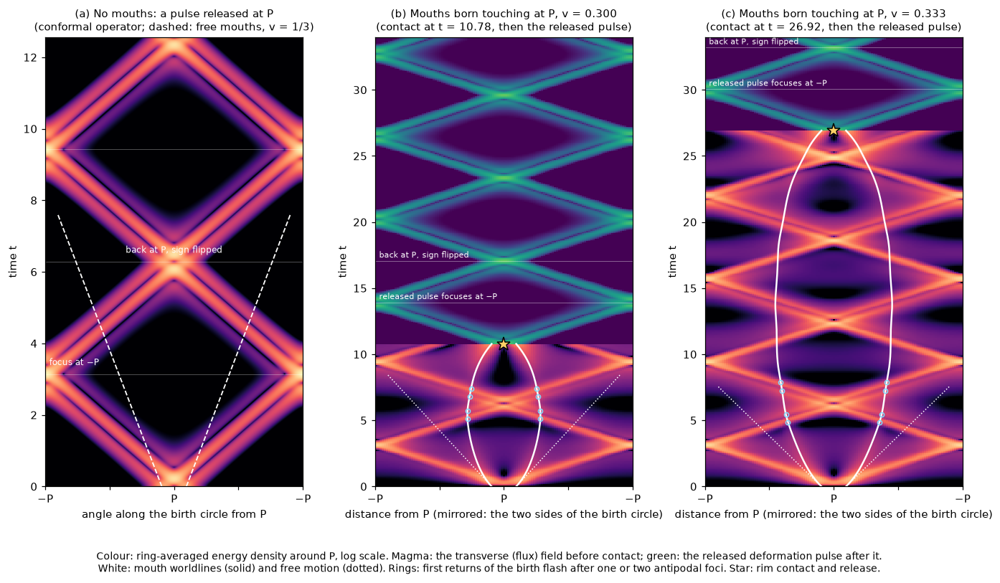
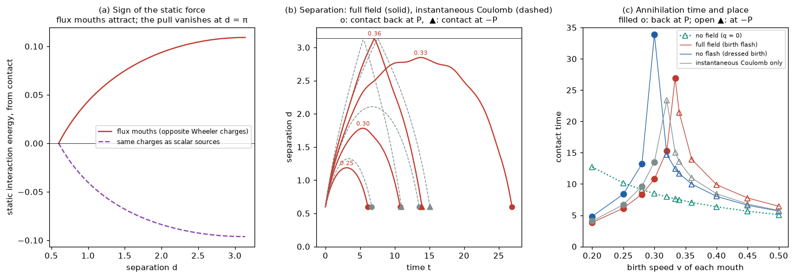
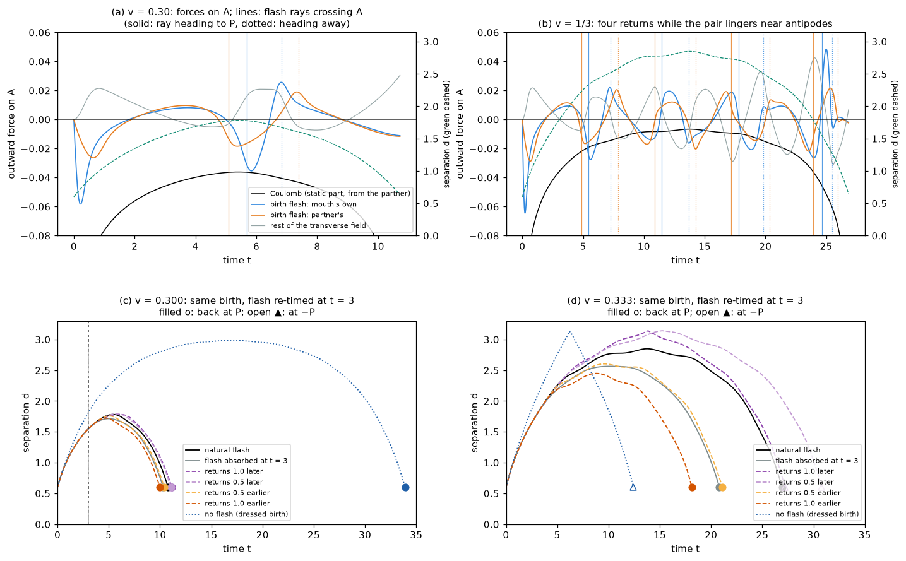
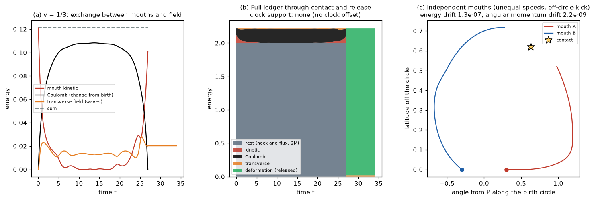
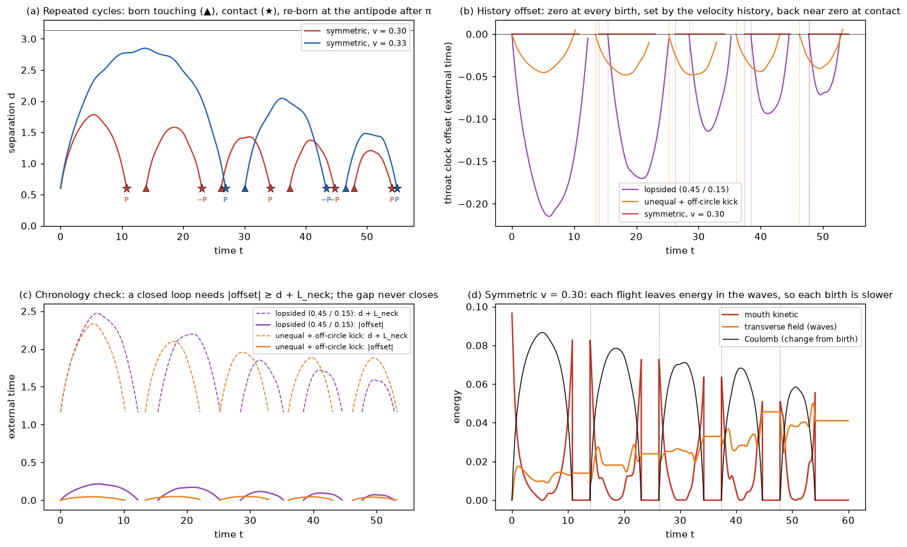

# Pair birth to annihilation: antipodal returns, attraction and release

A classical experiment on #345, answering the acceptance test set in its review (end of
[mouth_kick_experiments.md](mouth_kick_experiments.md)).
- **The story:** two mouths are born touching at a point P and fly apart with the momentum
  left over from pair creation. Then:
  - the wave emitted at birth refocuses at the antipode and comes back to meet them;
  - the pair slows, turns round, and is pulled back together;
  - the rims touch, the handle is removed, and its energy leaves as a wave.
- **The mouths move independently.** Every force on them comes from one action, and nothing
  about the motion is scheduled.
- **Classical throughout.** Nothing is quantized; "exchange" here means the retarded field of
  the partner.



**Answers in brief.**
1. **Without mouths,** a pulse released at P refocuses at −P at t = π. It comes back to P at
   t = 2π with its sign flipped, and repeats (panel a).
   - This is exact for the conformal operator.
   - The massless operator, which carries the mouths' field, refocuses to within a few per cent
     over two loops.
2. **The mouths attract because the flux is conserved.**
   - Two mouths sharing one handle carry equal and opposite flux (Wheeler's charge without
     charge).
   - The static energy of their field grows with separation, so they attract. The same pair
     treated as scalar sources would repel.
   - On the sphere the pull vanishes at antipodes, where the field lines are equally long both
     ways round.
3. **Born touching, apart, back: two outcomes.**
   - Without a field, the mouths always meet again on the far side, at −P, at t = (π − 2a)/v.
   - With the field, pairs slower than v ≈ 1/3 turn round and annihilate back at the birth point
     P.
   - Faster pairs pass the antipodal configuration and meet at −P, later than free motion.
   - At v = 1/3 the pair reaches 163°, stays beyond 143° for about 13 time units, and is
     pulled back to P.
4. **Waves decelerate.**
   - The sudden birth radiates a flash, which carries 13% of the birth kinetic energy.
   - The mouths pay for it, so the speed needed to cross over rises from 0.30–0.32 (no flash) to
     0.333–0.34.
   - The partner's flash reaches each mouth at t ≈ 0.8 and pulls it towards the partner. That is
     the first exchange.
5. **The flash comes back at the predicted times.**
   - After one or two antipodal foci, each returning ray pushes the mouth it crosses along the
     ray's direction of travel.
   - The returning ray from −P meets the outgoing mouth head-on and pushes it back towards P.
   - This held in 40 of 40 event windows across ten runs. Windows placed at the wrong
     (unshifted) times agree in 21 of 32, with half the impulse.
   - Later returns keep their timing but not a fixed sign.
6. **Near the threshold, timing decides where annihilation happens.**
   - Take the same birth at v = 1/3, with the flash re-timed after it has left the mouths.
   - Returns 0.5 or 1.0 later send the pair over to −P.
   - Returns earlier, or the flash absorbed, bring it back to P sooner.
   - The energy change of the intervention does not order these outcomes.
7. **Annihilation follows a stated rule.**
   - The glued surface is regular while the rims are disjoint. The dynamics brings them into
     contact at a computed time.
   - At contact the handle is removed. Its energy (rest, kinetic and Coulomb; 2.19 at v = 0.30)
     and its angular momentum leave as one deformation pulse.
   - The pulse refocuses at the antipode of the contact point and returns with its sign flipped,
     as in #344.
8. **The complete history closes the cycle, and the throat clocks follow it.**
   - The released pulse refocuses at the antipode after π, and the pair is re-born there. That
     is the archived v39 cycle, now with exact energy and angular momentum: five births and
     four re-births in 60 time units.
   - Each mouth carries its proper time since its own birth. The throat offset is the
     integrated difference, so it depends on the whole velocity history, never on position.
   - Symmetric pairs have no offset at all.
   - Even a lopsided birth (0.45 / 0.15) peaks at 0.215 mid-flight and is back below 0.0011 at
     contact. The offset resets at every birth.
   - A closed loop through the throat would need |offset| ≥ d + L_neck. The margin never falls
     below 1.155.

**What this is not.**
- **The field and mouths are effective.** The sphere-side field is 2+1 Maxwell on the round
  unit sphere, and the mouths are point particles with Gaussian footprints.
  - The neck is not part of the field domain, unlike #338/#345's glued mesh.
  - Its shape is rigid, and its energy is a fixed rest energy M per mouth.
- **The removal is a rule, not dynamics.** The surgery at contact is a stated rule. #342's
  waist-barrier collapse is not coupled here.
- **The static part looks instantaneous only in this gauge.** The calculation uses Coulomb
  gauge. The gauge-invariant total field of each mouth is retarded.
- **None of this is QED.** It is a classical analogue, with no quantization step anywhere.

## Model
`geometrodynamics/waves/pair_birth.py`.

**Mouths.**
- There are two mouths, with independent positions x_A, x_B on the unit sphere and independent
  momenta.
- They are relativistic particles of rest energy M. That energy stands for the handle: neck
  surface energy plus the flux energy inside the neck. It is held fixed.
- Each mouth has a Gaussian footprint of width f, which smooths its charge and current as #340's
  footprint does.

**Charges.**
- A carries flux +q through the handle and B carries −q.
- On the sphere side, Gauss's law forces the two charges to be opposite whatever the gluing, so
  Klein and torus handles do not differ here.

**Field.** 2+1 Maxwell on the sphere, in Coulomb gauge.
- The longitudinal part has energy U(x_A, x_B) = ½∫|∇φ|².
  - It is fixed by the mouth positions.
  - It is a Legendre series in cos d, where d is the mouths' separation.
- The transverse part is A = n × ∇χ, with modes ω_l = √(l(l+1)) for l ≤ 32.
- Dual description: in 2+1 dimensions this is one scalar ψ, with E = n × ∇ψ and B = ψ_t.
  - ψ winds by ±q around the two rims, so the mouths are a vortex and an antivortex of one
    scalar wave field.
  - That is the 2-D form of Wheeler's charge without charge, and the dual of #345's static flux
    field.

**Action.**

  L = Σ_k [−M√(1 − v_k²) + q_k v_k·A(x_k)] − U(x_A, x_B) + ½ Σ_lm l(l+1)(|ċ_lm|² − l(l+1)|c_lm|²)

- **Conservation.** Total energy and total canonical angular momentum are conserved: the
  mouths' x × (p + qA), plus the field's.
- **Two-sided forces.** Every change of mouth momentum is matched by one in the field.
- **The field is split by source.** It is kept as one copy per mouth, each driven only by that
  mouth's current. Linearity then splits the force on A exactly into:
  - the partner's field: Coulomb plus transverse, the retarded exchange;
  - A's own transverse field: local reaction, plus A's own emission returning.

**Integrator.**
- It alternates exact free-field flow (mouths frozen, transverse electric kick −qΔA) with mouth
  motion in the frozen field.
- That motion is a Coulomb kick, a magnetic rotation and an exact geodesic drift. The mouths'
  currents feed the field on a trapezoid rule.
- The step is dt = 0.004.

**Birth.**
- The rims touch at P, so the separation is 2a with a = 0.3 (#338).
- The field starts as the static Coulomb field of the touching pair, with no transverse field.
- Each mouth is kicked away from P along one great circle with speed v.
- The sudden start of the currents radiates the **birth flash**.
  - By linearity the flash is exactly the free wave launched by −Q_qs.
  - Q_qs is the quasi-static (magnetostatic) field of the initial currents.
  - So the flash's force on the mouths along any trajectory can be computed after the fact.

**Regularity law and release.**
- The glued surface is regular while the two rim discs are disjoint, d > 2a.
- **The contact time is dynamical.** When the dynamics brings the separation down to 2a, the run
  stops on the step that reaches 2a exactly (secant refinement).
- **Then the surgery rule:**
  - the mouths, their neck and their longitudinal field are removed;
  - their energy (rest + kinetic + Coulomb) goes into one pulse of the conformal deformation field
    (−Δ + ¼, #339/#344) at the contact point;
  - the pulse is shaped by least squares to carry the pair's canonical angular momentum, and its
    amplitude fixes the energy.
- **What continues afterwards:** the transverse field continues freely.

**Parameters.**

| quantity | value |
|---|---|
| rest energy per mouth M | 1 |
| flux q | 0.75 |
| rim radius a | 0.3 |
| footprint f | 0.12 |
| mode cutoff | l ≤ 32 |
| release pulse width | 0.25 |
| horizon | t = 34 |
| static barrier U(π) − U(2a) | 0.109 |

**Controls.**
- **no field:** q = 0.
- **instantaneous Coulomb:** no transverse field, so no waves.
- **no flash (dressed birth):** the transverse field starts as Q_qs.
- **flash absorbed at t = 3:** the known free flash is removed when it is near its foci, far from
  the mouths, as if it escaped to infinity.
- **flash re-timed at t = 3:** the flash is removed and put back advanced or delayed by up to 1.
  The birth is identical, so only the returns move.

## 1. The timeline without mouths
`bare_timeline` evolves an axisymmetric pulse released at rest at P. Panel (a) of the figure above
shows its energy density along the birth circle.
- **Conformal operator** (ω = l + ½):
  - the pulse focuses at −P at t = π;
  - it is back at P at t = 2π with its sign flipped;
  - it is back at P unchanged at t = 4π.
- **Massless operator** (ω = √(l(l+1))), which the mouths' field uses:
  - the peak at −P reaches 97% of the conformal one at t = π, and 91% at t = 3π.
- **Free mouths** (dashed, v = 1/3) meet the returning front at t = (2π − a)/(1 + v) = 4.49, at
  103° from P.
- **The flash has two sources.** With mouths, it leaves from the two start points ±a rather than
  from P.
  - Each mouth's own flash focuses at the antipode of its own start.
  - Its partner's flash focuses on the mouth's own side of the circle.

## 2. Why opposite flux mouths attract


Panel (a) shows the static interaction energy against separation.
- **Flux mouths attract.** For the flux mouths it rises monotonically, by 0.109, from contact
  (d = 2a) to antipodes.
- **The pull vanishes at antipodes.** The slope there is zero, so the antipodal configuration is
  force-free.
- **Scalar sources repel.** The same charges treated as sources of the conformal scalar
  (#339/#340-style exchange) give the opposite slope: a source–sink pair is pushed apart.
- **So the attraction comes from conservation.** Opposite-orientation mouths attract because the
  flux through the handle is conserved (Maxwell), not because a scalar is exchanged.

## 3. Birth, separation and return
Contact time and place for each birth speed v. The free column is (π − 2a)/v.

| v | free (q = 0) | full field | no flash | instantaneous Coulomb |
|---|---|---|---|---|
| 0.200 | 12.71 at −P | 3.85 at P | 4.83 at P | 4.07 at P |
| 0.250 | 10.17 at −P | 6.12 at P | 8.36 at P | 6.69 at P |
| 0.280 | 9.08 at −P | 8.36 at P | 13.21 at P | 9.64 at P |
| 0.300 | 8.47 at −P | 10.78 at P | 33.90 at P | 13.52 at P |
| 0.320 | 7.94 at −P | 15.30 at P | 14.71 at −P | 23.36 at −P |
| 0.333 | 7.62 at −P | **26.92 at P** | 12.43 at −P | 15.07 at −P |
| 0.340 | 7.48 at −P | 21.38 at −P | 11.66 at −P | 13.57 at −P |
| 0.360 | 7.06 at −P | 13.94 at −P | 9.99 at −P | 10.97 at −P |
| 0.400 | 6.35 at −P | 9.89 at −P | 8.02 at −P | 8.44 at −P |
| 0.450 | 5.65 at −P | 7.76 at −P | 6.60 at −P | 6.79 at −P |
| 0.500 | 5.08 at −P | 6.44 at −P | 5.67 at −P | 5.77 at −P |

- **Free mouths never come back.** On a sphere they meet again anyway, but always on the far
  side.
- **With the field there are two outcomes.**
  - **Bound** (back to P): the pair turns round before antipodes.
  - **Crossing over** (to −P): the pair passes antipodes and meets at −P, later than free motion.
- **Where the threshold sits:**
  - between 1/3 and 0.34 with the full field;
  - between 0.30 and 0.32 without the flash, and also without waves at all.
- **The figure.** Panel (b) shows separations, and panel (c) contact times and places.
- **The user's sequence happens near threshold.** It is born touching, moves into near-antipodal
  positions, and is attracted back.
  - **Example:** at v = 1/3 the pair reaches d = 2.85 (163°) at t = 13.7.
  - **Lingering:** it stays beyond d = 2.5 from t ≈ 7.1 to t ≈ 19.8.
  - **Return:** it annihilates back at P at t = 26.92.

## 4. The birth flash and its returns


**Waves decelerate.**
- **The flash's energy.** It is a free wave, so its energy equals that of the dressing it removes:
  0.0128 at v = 0.30 and 0.0158 at v = 1/3, about 13% of the birth kinetic energy at every speed.
- **Where the energy comes from.** The mouths pay for it.
  - In panels (a) and (b), the reaction of each mouth's own flash in the first 0.3 time units
    (blue dip) decelerates it.
  - This is why the full-field threshold is the highest.
- **The first exchange.** The partner's flash reaches mouth A from behind at t = 0.79
  (v = 0.30) and t = 0.83 (v = 1/3), before any focus.
  - It pulls A towards its partner, with impulse −0.014 and −0.016.

**First returns.**
- After one antipodal focus, a ray heading back to P meets the outgoing mouth head-on and pushes
  it towards P.
- After two foci, a ray heading away from P overtakes the mouth and pushes it outwards.
- At v = 0.30 the four first-return crossings of mouth A are:

| time | flash from | ray heading | foci | impulse on A (window ±0.35) |
|---|---|---|---|---|
| 5.09 | partner | to P | 1 | −0.0081 |
| 5.69 | own | to P | 1 | −0.0187 |
| 6.82 | own | away from P | 2 | +0.0132 |
| 7.39 | partner | away from P | 2 | +0.0109 |

- **The statistics.** Across the two natural runs and eight re-timed runs:
  - **at the flash's own timing:** 40 of 40 first-return windows point along the ray, with mean
    impulse 0.0116;
  - **at the unshifted (wrong) timing:** in the re-timed runs, 21 of 32 windows agree, with mean
    impulse 0.0061.

**Later returns.**
- They keep their timing: panel (b) shows four loops at v = 1/3.
- The sign of their push is not fixed. The transverse modes are not exactly periodic
  (ω = √(l(l+1))), and the returns overlap the mouths' own continuing radiation (grey).
- **Size near antipodes.** The static pull falls to 0.006–0.01 there, while the returning flash
  pushes by ±0.02–0.05. Near antipodes, the force is mostly the returning wave.

## 5. Same birth, re-timed flash
At t = 3 the flash is near its foci and at least 1.4 rad from both mouths. It is removed and,
except in the absorbed case, put back advanced or delayed. The birth and its energy cost are
identical. The energy change at t = 3 comes from cross terms with the rest of the field.

| v | flash after t = 3 | returns shifted by | energy change at t = 3 | contact |
|---|---|---|---|---|
| 0.300 | natural | 0 | 0 | 10.78 at P |
| 0.300 | absorbed | — | −0.0113 | 10.31 at P |
| 0.300 | re-timed | +1.0 (later) | +0.0004 | 11.14 at P |
| 0.300 | re-timed | +0.5 (later) | −0.0028 | 11.05 at P |
| 0.300 | re-timed | −0.5 (earlier) | +0.0048 | 10.40 at P |
| 0.300 | re-timed | −1.0 (earlier) | +0.0042 | 9.98 at P |
| 0.333 | natural | 0 | 0 | **26.92 at P** |
| 0.333 | absorbed | — | −0.0145 | 20.81 at P |
| 0.333 | re-timed | +1.0 (later) | +0.0020 | **27.22 at −P** |
| 0.333 | re-timed | +0.5 (later) | −0.0024 | **30.78 at −P** |
| 0.333 | re-timed | −0.5 (earlier) | +0.0045 | 21.09 at P |
| 0.333 | re-timed | −1.0 (earlier) | +0.0028 | 18.12 at P |

- **Below threshold** (v = 0.30), the returning flash only moves the contact time, by −0.8 to
  +0.4, with the same place.
- **Near threshold** (v = 1/3), it decides the place.
  - Returns delayed by 0.5 or 1.0 push the lingering pair over to −P.
  - Earlier returns, or no return, bring it back to P sooner.
  - With the natural timing the pair still returns to P, but 6.1 later than without the
    return.
- **The energy change does not explain this.** A change of −0.0024 still ends at −P, and
  +0.0045 ends at P.
- **Compact versus open.** On an open space the flash would escape: that is the absorbed run.
  Annihilation would then come at 20.81 rather than 26.92.

## 6. Ledger, contact and release


**Ledger rows:**
- rest energy 2M (neck surface and flux energy, fixed);
- mouth kinetic energy;
- Coulomb (longitudinal) field energy;
- transverse field: the waves;
- the released deformation pulse.

**Clock support:** no offset is imposed. The throat offset that the mouths' own histories
generate is tracked in §7. #345 §3 treats imposed offsets separately.

| v | kinetic at birth | birth flash | kinetic at contact | transverse field at contact | released |
|---|---|---|---|---|---|
| 0.200 | 0.0412 | 0.0057 | 0.0296 | 0.0116 | 2.1360 |
| 0.250 | 0.0656 | 0.0089 | 0.0642 | 0.0014 | 2.1705 |
| 0.280 | 0.0833 | 0.0111 | 0.0615 | 0.0218 | 2.1679 |
| 0.300 | 0.0966 | 0.0128 | 0.0826 | 0.0139 | 2.1889 |
| 0.320 | 0.1110 | 0.0145 | 0.0917 | 0.0193 | 2.1980 |
| 0.333 | 0.1213 | 0.0158 | 0.1012 | 0.0202 | 2.2075 |
| 0.340 | 0.1267 | 0.0164 | 0.1171 | 0.0096 | 2.2234 |
| 0.360 | 0.1437 | 0.0184 | 0.1168 | 0.0269 | 2.2231 |
| 0.400 | 0.1822 | 0.0227 | 0.1249 | 0.0573 | 2.2312 |
| 0.450 | 0.2396 | 0.0287 | 0.1901 | 0.0495 | 2.2964 |
| 0.500 | 0.3094 | 0.0354 | 0.2343 | 0.0751 | 2.3406 |

- **The kinetic deficit is in the waves.** Contact happens at the birth separation, so the Coulomb
  energy is the same at birth and contact. The mouths' kinetic deficit at contact equals the
  transverse field energy then.
- **Exchange during the flight.** Panel (a) shows that during the flight the kinetic energy goes
  into the Coulomb field and comes back. The waves take a share at birth, and exchange it at each
  return.
- **Release.** At contact the rest, kinetic and Coulomb energy go into one deformation pulse.
  - It focuses at the antipode of the contact point at t_c + π and returns with its sign flipped
    at t_c + 2π (panels b and c of the timeline figure).
  - With independent mouths the pulse also carries the pair's angular momentum. The residual is
    below 10⁻⁹.

**Independent mouths.**
- In this run the speeds are unequal and one mouth is kicked off the birth circle (panel c).
- The mouths move apart on separate tracks, come back together and touch off the circle at
  t = 10.26.
- Energy drift is 1.3 × 10⁻⁷. The angular-momentum drift is 2.2 × 10⁻⁹, through the release.

## 7. Complete history: throat clocks and the closed cycle


The archived v39 cycle (in PR #1's `archive/geometrodynamics_v39.py`) runs as follows:
- separation from the birth point;
- exchange across the sphere;
- attraction back together;
- annihilation;
- the annihilation wave travelling to the antipode;
- re-creation there, and the cycle repeats.

`run_history` now does the same with the action-derived model.

**Re-birth.**
- At t_c + π the conformal release pulse has refocused at −c.
- The rule (`recreate`) removes it and places a touching pair at the antipodal images of the
  contact positions. It starts from the contact momenta, which already point apart there.
- Least squares in the tangent planes then correct those momenta, so the new pair carries
  exactly the pulse's energy and canonical angular momentum.
- For a symmetric pair the mirror needs no correction.
- The transverse field is left untouched.
- Like the release, this is a stated rule.

**Throat clocks.**
- Each mouth carries its proper time τ_k since its own birth, integrated with the midpoint
  1/γ of every step. The throat identifies equal proper times on the two mouths (MTY).
- The throat's external-time offset is therefore t_B − t_A with τ_B(t_B) = τ_A(t_A). To first
  order it is γ_B(τ_A − τ_B).
- So the offset is a functional of the two velocity histories since birth. It is zero at
  every birth, and clock memory does not survive the surgery.
- Chronology check: a closed null loop through the throat needs |offset| ≥ d + L_neck, with
  L_neck = 2S = 0.565 (#338).

| run | births | contacts | max throat offset in each cycle | offset at contact | min chronology margin |
|---|---|---|---|---|---|
| symmetric, v = 0.30 | 5 | P, −P, P, −P, P | 0 | 0 | 1.165 |
| symmetric, v = 1/3 | 3 | P, −P, P | 0 | 0 | 1.165 |
| unequal speeds + off-circle kick | 5 | off the circle, wandering | 0.045, 0.048, 0.048, 0.044, 0.041 | ≤ 0.0093 | 1.155 |
| lopsided, 0.45 and 0.15 | 5 | on the circle at 113°, 24°, −92°, 146°, 14° | 0.215, 0.170, 0.115, 0.094, 0.072 | ≤ 0.0011 | 1.164 |

**What the history shows.**
- **Every cycle closes.**
  - Contacts alternate P, −P, P, … for symmetric pairs, as in v39. With net angular momentum
    the contact point wanders.
  - Total energy holds to 5 × 10⁻⁷ over 60 time units and nine surgeries.
  - Angular momentum holds to 3 × 10⁻⁸ (10⁻¹⁷ for symmetric pairs).
- **Waves accumulate.**
  - At v = 0.30 the pair is re-born at speeds 0.300, 0.279, 0.262, 0.246 and 0.221.
  - The transverse field grows from 0.014 after the first flight to 0.041 after the fifth.
    Each birth inherits the previous cycles' waves (panel d).
- **No clock offset for symmetric pairs.** Both mouths age identically, so the offset is
  exactly zero throughout. A symmetric cycle has no MTY ingredient at all.
- **Asymmetric births give small, transient offsets.**
  - The offset grows while one mouth is faster. It cancels once the attraction has reversed
    the roles: the mouth born fast arrives slow, and the slow one arrives fast.
  - Even the lopsided birth peaks at 0.215 and is back within 0.0011 at contact. The peak
    falls cycle by cycle as energy goes into the waves.
- **No chronology horizon.** Separation plus neck length always exceeds the offset by at least
  1.155.
- **An imposed offset is not reachable here.** An offset of order 1, such as the −1.2 imposed
  at t = 0 in #346's port model, cannot arise from these histories. It would need a sustained
  velocity-squared difference of about 0.1 over T ≈ 24 without the attraction reversing it.

## 8. Checks

| check | result |
|---|---|
| energy, all 51 single-flight runs | maximum relative drift 2.4 × 10⁻⁷ |
| energy and angular momentum over repeated cycles | 5 × 10⁻⁷ and 3 × 10⁻⁸ through up to nine surgeries per run; each re-birth matches the pulse it replaces to rounding |
| free clocks (q = 0) | τ = t √(1 − v²) to 10⁻⁹; zero offset for equal speeds |
| angular momentum | symmetric runs below 10⁻¹⁸; independent mouths 2.2 × 10⁻⁹ |
| mirror symmetry of the forces on A and B | exact (difference 0) |
| step halved (dt = 0.002) | contact time changes by 4 × 10⁻⁶ (v = 0.30) and 2.5 × 10⁻⁴ (v = 1/3) |
| cutoff 40 instead of 32 | contact time changes by 4 × 10⁻⁸ and 5 × 10⁻⁷ |
| no field (q = 0) | contact at −P at 7.62478 = (π − 2a)/v |
| vector potential and magnetic force | match finite differences of the action |
| flash decomposition | for weak charge, default − dressed force equals the post hoc flash force (2%) |
| instantaneous Coulomb turning point | matches the energy budget |
| history offset | equals the integrated dilation difference; the external offset agrees with γ_B(τ_A − τ_B) |
| tests | `tests/test_pair_birth.py`: 13 checks |

## Against the acceptance test

| requirement (review of 3428e48) | status here |
|---|---|
| independently moving, non-antipodal mouths | yes: two rotors with their own positions and momenta; an asymmetric run |
| a two-sided force, or a recoil from an action | yes: one Lagrangian; energy and canonical angular momentum conserved |
| event-aligned returns of the same field, with mistiming controls | first returns: 40/40 along the ray at the predicted times, against 21/32 at wrong times; re-timing changes the outcome. Later returns: timing only |
| ledger of wave, mouth, neck and clock-support energy | waves (transverse, deformation), mouths (kinetic), Coulomb; neck energy is the fixed rest energy; no imposed clock support, and the history-generated throat offset is tracked (§7) |
| collapse from a stated regularity law, not a schedule | rim contact sets the time dynamically; the surgery itself is a stated rule |

## Limits and next steps
- **Effective geometry.** The round sphere, point mouths and a rigid neck are used, not the
  glued mesh of #338/#345. The mouths move on the sphere only.
- **No collapse by amplitude yet.** The neck has no waist dynamics. The next step is to couple
  #342's metastable waist to the field at the mouths. Annihilation would then be a wave
  amplitude crossing the barrier, with contact as the backstop.
- **Approximate refocusing.** The transverse modes are massless, so they refocus only
  approximately. The released deformation pulse refocuses exactly.
- **Parameters not scanned.** The thresholds depend on q, M and the footprint. Only the birth
  speed and the flash timing were scanned.
- **Clocks are bookkeeping here.** The throat offset is tracked, but nothing travels through
  the throat in this model, so the offset does not feed back on the dynamics.
  - That needs a neck channel whose port timing is set by the history offset, as proposed for
    #346.
  - In these histories the offset stays below 0.22, so an "earlier re-emission" through the
    throat would be a small, transient effect.

## Reproduction
```bash
python experiments/closure_ledger/pair_birth_probe.py featured   # v = 0.30, 1/3 with field maps, ~1 min on 4 cores
python experiments/closure_ledger/pair_birth_probe.py scan       # 11 speeds x 3 field models, ~3 min
python experiments/closure_ledger/pair_birth_probe.py retimed    # flash absorbed or re-timed at t = 3, ~2 min
python experiments/closure_ledger/pair_birth_probe.py checks     # step, cutoff, free motion, independent mouths
python experiments/closure_ledger/pair_birth_probe.py history    # repeated cycles with throat clocks, ~1 min
python experiments/closure_ledger/pair_birth_report.py           # tables, figures, summary.json, sha256.json
python -m pytest -q tests/test_pair_birth.py
```
Results are in `experiments/closure_ledger/runs/20261019_pair_birth/`.
