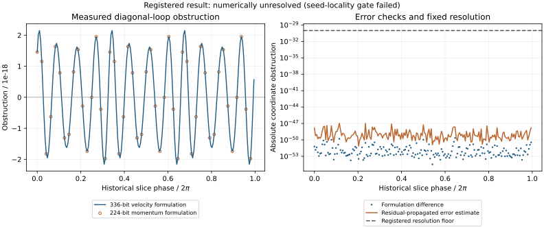

# Diagonal loop: registered locality failure and measured obstruction

The registered result is **NUMERICALLY_UNRESOLVED**: 131 of 192 phases fail
the original seed-displacement gate. All other registered gates pass. The
score and original empty root stage are preserved, without a relaxed gate.

The scan nevertheless measures a clear nonzero obstruction, consistent between
two high-precision formulations. A disclosed supplemental analysis tests its
24 observed sign-change brackets. That analysis is separate from the registered
result. Its specification and the complete original scan were public at
[`ce65db88`](https://github.com/davidmdrpi/geometrodynamics/commit/ce65db88e2ae329643659b4d7242f3ea65b72dda)
before any supplemental root search; the scan pattern was already known.

## Registered scan

| Quantity | Result |
| --- | --- |
| Completed primary/check phases | 192 / 192 |
| Maximum absolute obstruction | 2.1600485904e-18 |
| Maximum empirical error estimate | 1.1070333031e-47 |
| Fixed resolution floor / detection threshold | 1e-30 / 1e-28 |
| Dominant raw harmonic / detected sign changes | 12 / 24 |
| Effective exponent, -ln(max absolute obstruction)/12 | 3.38970008 |
| Maximum augmented Jacobian condition number | 2935.99734 |
| Controls, solves, error, conditioning, constraints | Pass |
| Seed locality | **Fail**: maximum 0.02787193 > 0.01 |



The amplitude exceeds the fixed detection threshold by about 2.16e10.
This large margin does not override the failed locality gate. The historical
phase is nonuniform and its unfolding normalization varies: the raw spectrum's
nonmultiples of twelve do not falsify the symmetry selection rule. The 192
samples and subsequent bracket searches cannot exclude additional zeros
between sampled phases.

## Why locality failed

The two historical seed curves use separate chord-length parameters. Pairing
their values at equal phase can therefore select mismatched nodes. The new
protocol retained those seeds but did not calibrate its displacement cap to
that mismatch. This was a design error in this experiment's gate.

A post-inspection audit uses node zero's chord grid for both seed curves.
The largest displacement then becomes 3.4888656861e-6; the phase anchor and
tangent are exactly unchanged in this audit, so the solved augmented equations
are unchanged. Every solved node also lies within 9.7506e-10 of the unsymmetrized
degree-20 loop fit, inside #326's previously registered 1.9919e-8 membership
gate. These support locality, but are **post-hoc diagnostics**, not a replacement
registered pass. See the [published follow-up specification](r3_diagonal_obstruction_followup.md).

## Supplemental isolated-root checks

The separate label is **SUPPLEMENTAL_ROOTS_VERIFIED**. All 24 detected
brackets produce distinct roots satisfying every frozen isolation criterion.

| Worst value over 24 roots | Measured | Required |
| --- | --- | --- |
| Absolute unfolding parameter | 8.727e-52 | <1e-51 |
| Independent closure residual | 7.423e-52 | <1e-45 |
| Inverse norm times Jacobian disagreement | 1.911e-22 | <0.01 |
| Inferred Newton correction, maximum norm | 1.025e-35 | <1e-12 |
| Inverse multiplication residual | 2.715e-83 | <1e-40 |
| Minimum distinct node-zero separation | 0.03762765 | >1e-6 |

The maximum inverse norm is 3.7643e16; the small singular direction really
requires high precision. Up to 14 bracket iterations were needed. Under the
full-clock return P and cyclic axis permutation C the 24 representatives form
**four classes of six**. Including the half-clock action H gives **two classes
of twelve**. Both classifications have maximum matching error 5.899e-17,
against the fixed 1e-8 matching tolerance. Full labelled nodes, bracket histories
and diagnostics are archived in `supplement.json`.

This supports the leading-twelfth pattern on the sampled component. It does not
count 24 independent physical objects, establish a complete census between
samples, or classify the roots' elliptic/hyperbolic stability.

The scientific direction is now clearer: the old numerical continuum has
strong evidence for ordinary, symmetry-allowed breaking at finer resolution.
Additional anomalous suppression on this particular loop is no longer the
promising lead suggested by the old null. The failed primary gate prevents a
claim of registered success, and the supplementary checks do not turn this
into a dynamical action-selection mechanism.

## What the labels mean

The obstruction uses exactly the historical dimensionless section coordinates,
Euclidean phase-slice tangent and symplectic-dual unfolding normalization.
Its amplitude is not an energy or a normal-form coefficient. The historical
splines supply phase anchors and Newton seeds; they do not assert an exact
invariant circle or a uniform symmetry angle. Both two-node closures are solved
again at high precision. All twelve node coordinates may change in the solve.
The protocol's statement about no amplitude retuning means no external search
for a more favorable family or resonance; it does not hold the node amplitudes
fixed. This remains a fine-tuned periodic boundary-value calculation.

A nonzero obstruction rules out the proposed exact periodic continuum in the
local branch tested by these transverse slices. Numerical nonsingularity of
the unaugmented closure Jacobian then supports isolated periodic points. Those
conclusions do not rule out every conceivable extra integral in the system.
Isolation refers to the **labelled diagonal subsystem**: its two six-dimensional
nodes make a 12-dimensional unaugmented closure problem. The full homogeneous
system retains rotational symmetry directions, and inhomogeneous modes are
outside this test. These results also do not establish quantized action: continuous nonperiodic initial
data remain allowed, the physical hyperbolic direction remains, and this
calculation supplies no dynamical mechanism selecting periodic initial data.

The 1e-28 detection threshold was fixed in advance. The empirical error estimate
combines differences between formulations with residuals amplified by the
augmented inverse-Jacobian row. Its fixed 1e-30 resolution floor prevents us
from turning every additional arithmetic digit into a claim of significance.
Neither that estimate nor the finite-difference isolation check is a rigorous
interval error bound or existence theorem.

The two integrators share convolution and exponential recurrence utilities.
They use different state variables (canonical momenta versus shear velocities),
different evolution recurrences for those variables, different clock-crossing
solvers (Newton versus bisection), and different precision/order settings.
Thus they are substantial independent numerical checks, not wholly independent
software stacks. The separately derived full matrix equations were checked off
the family at double precision, and the known LRS solutions supply an external
high-precision control.

## Controls and provenance

The [protocol](r3_diagonal_obstruction_prereg.md), numerical implementations,
scoring rules, tests and passing controls were public at
[`e95f8582f4d1537ada9765c620cae79238565469`](https://github.com/davidmdrpi/geometrodynamics/commit/e95f8582f4d1537ada9765c620cae79238565469)
before the new diagonal obstruction was evaluated. The old loop, the old null
scan and #326's symmetry result were already known. No new diagonal amplitude
was used to tune a threshold or integration setting.

Three phase-distinct LRS 3/7 solutions agree with the pinned 48-digit archive
within 1.451e-38; the new formulations agree within 4.417e-51 on those solved
slices. The synthetic epsilon=1e-24 kick-drift control recovers its known
obstruction within 9.300e-61 and has exactly 24 sign changes. The epsilon=0
control returns zero. These controls preceded diagonal production.

The computation uses eight numerical workers. Every primary phase solve is
saved before its independent check, and every completed phase and root is
atomically checkpointed. The aggregate archives reconstruct those checkpoint
bytes. Source/input fingerprints and a pinned manifest protect the published
record. Historical sources and this study's frozen sources are unchanged.

Install the research test dependency with `pip install -e '.[dev]'`. Production
used Python 3.12.14, NumPy 2.3.5, SciPy 1.17.0 and gmpy2 2.3.2. Authenticate and
replay the published archives without regenerating them:

```sh
OPENBLAS_NUM_THREADS=1 python -m experiments.closure_ledger.r3_diagonal_obstruction_replay --full
python -m pytest tests/test_r3_diagonal_obstruction.py tests/test_r3_diagonal_obstruction_replay.py -q
python -m experiments.closure_ledger.r3_diagonal_obstruction_figure
```

For a new production run, use a separate checkout and run the following stages.
They overwrite that checkout's aggregate archives. Timings and possible
platform rounding change the bytes, so regenerated archives do not match the
published byte fingerprints; compare numerical outputs separately. Preserve
the published archives for the authenticated replay above.

```sh
OPENBLAS_NUM_THREADS=1 python -m experiments.closure_ledger.r3_diagonal_obstruction_probe scan --workers 8
OPENBLAS_NUM_THREADS=1 python -m experiments.closure_ledger.r3_diagonal_obstruction_probe roots --workers 8
OPENBLAS_NUM_THREADS=1 python -m experiments.closure_ledger.r3_diagonal_obstruction_supplement audit
OPENBLAS_NUM_THREADS=1 python -m experiments.closure_ledger.r3_diagonal_obstruction_supplement roots --workers 8
```

Archived checkpoint files are excluded from git because they reconstruct from
the aggregate. A normal replay authenticates the archive, recomputes the score
and checks the phase slices and numerical flags. Full replay reevaluates all
192 augmented check solutions using the momentum formulation at 336 bits and
checks all supplemental roots' unaugmented closures. The original registered root stage remains empty.

## Independent review and scope of reproduction

The [pre-results review](https://github.com/davidmdrpi/geometrodynamics/pull/327#issuecomment-6110943618)
reports a separately implemented momentum Taylor integrator agreeing with these
maps at three generic off-family points to at most 4e-56, with its own section
and return code. It also reports an exact reproduction of one LRS control.
These are reviewer-reported checks, not reruns performed by this producer and
not an independent reproduction of this diagonal scan.

The review suggested committing to descriptive reporting below the fixed
label threshold. That suggestion was read after the scan was known; no new
pre-results commitment is claimed. The actual amplitude is above the threshold,
and the entire numerical record is reported despite the failed locality gate.

## Final validation

All **22 focused tests pass** under both NumPy 2.3.5 and 2.2.6. Authenticated
replay reconstructs all 408 checkpoint fingerprints, rescoring the original
failure and supplemental result independently. Full numerical replay also
passes all 192 phase solutions and all 24 supplemental roots using the momentum
formulation at 336 bits/order 64. Its maximum phase residual is 9.921e-66 and
maximum root closure residual 7.423e-52; individual results are in `replay.json`.

The manifest binds all seven input/result archives, and replay verifies both
frozen source/input bindings and the supplemental input bindings. Tamper tests
reject altered bytes, incomplete or duplicate phase/root grids, changed slices,
nonfinite values, incorrect error estimates and inconsistent numerical flags.
The frozen implementation's GitHub CI passed on Python 3.10 and 3.12; the PR's
latest CI status is tracked separately on GitHub.

PR #327 targets `codex/r3-resonance-symmetry`, which contains the merge of #326
and has the same tree as its former base. The audit branch has #325 but still
needs the #326/#327 chain integrated. That eventual merge must preserve both
the audit branch's `precision` extra and this PR's `gmpy2` development dependency;
no audit-branch merge is performed as part of this experiment.
