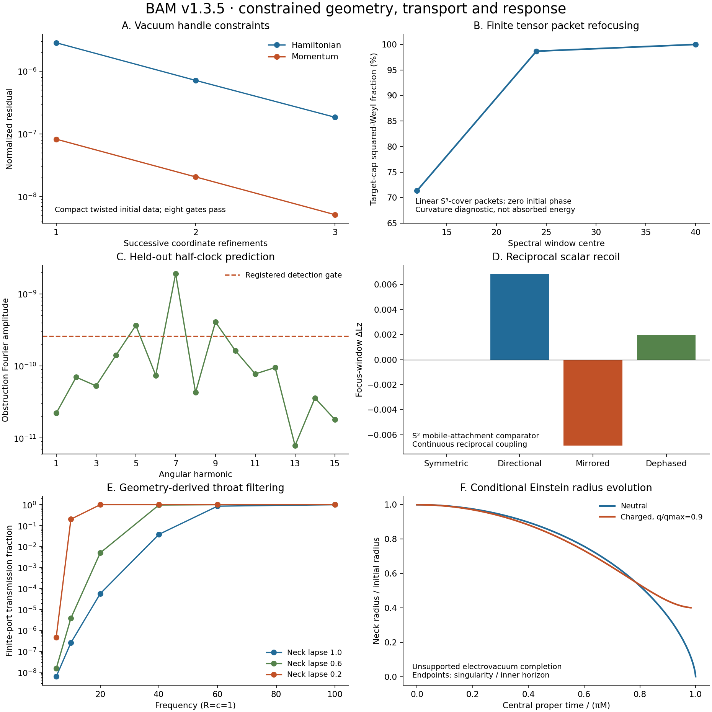

# v1.3.5 — BAM research capstone

**From constrained handle data to wave transport, resonant histories and computed
mechanical response.** This capstone collects the strongest verified results
from PR #301–#350 since v1.3.0. It prepares a reproducible foundation for the
coupled BAM model release, with source, numerical records, tests and explicit
physical scopes.



## Verified results

The table is generated from the archived JSON files. Every measurement has a
JSON pointer, formatting rule, pinned source commit and corresponding test in
the [evidence index](bam-foundations-evidence.json). CI rejects changes to either
the saved data or the printed table unless they are deliberately reconciled.

<!-- BEGIN VERIFIED RESULTS -->
| Result | Verified measurement | Scope |
| --- | --- | --- |
| [Vacuum handle constraints](https://github.com/davidmdrpi/geometrodynamics/blob/ae9764042de4486c46d769794f585f35f8fb3e3d/docs/mouth_momentum.md) | registered gates: **8**; off-grid residual: **3.13e-12** | Compact twisted vacuum initial data; minimal anti-trapped section; chosen Λ and seed. |
| [Localized handle initial data](https://github.com/davidmdrpi/geometrodynamics/blob/19a674d8625469c869c4f373efe062c7ab55c1e1/docs/localized_mouth_error_budget.md) | registered gates: **8**; reference H residual: **3.95608e-08** | Chosen four-scalar family; independent coordinate error budget, not a vacuum derivation. |
| [Tensor Floquet refocusing](https://github.com/davidmdrpi/geometrodynamics/blob/109c7ee6146d1e3134bbad33f1b380db06b4f0cc/docs/esu_floquet_refocusing.md) | infidelity exponent: **1.9520** | Linear tensor sector of the supported breathing ESU; other sectors have separate stability verdicts. |
| [Finite tensor packet transit](https://github.com/davidmdrpi/geometrodynamics/blob/b8b6cbd9c4e9ad9c275561d49cedbca4e7e5710b/docs/finite_packet_first_transit.md) | target cap fraction (%): **98.6686** | Centre-24, zero-phase S³-cover packet; squared-Weyl fraction is a curvature diagnostic, not absorbed energy. |
| [Two-region metric response](https://github.com/davidmdrpi/geometrodynamics/blob/1fcbd30df62d36df318bd57570d4a98cc3a6e114/docs/two_gravitating_regions.md) | off-diagonal response A←B: **-0.0225323** | Proper matter inventory response for overlapping seeds; registered coarse-grid gate remains failed; not body acceleration. |
| [Poincaré–Cartan implementation](https://github.com/davidmdrpi/geometrodynamics/blob/8388f7f7056677e3d79ca43f80647d77432d0d21/docs/dynamical_action_selection.md) | numerical check passed: **true** | Conserved preparation-loop circulation checks canonical dynamics, not physical action selection. |
| [R3 polarization-dependent shift](https://github.com/davidmdrpi/geometrodynamics/blob/b1b265bb14a432fc14f0353aee46e22cd531d16e/docs/r3_extension.md) | largest sampled coefficient: **0.847972** | Homogeneous constrained return map; local shift toward resonance, not proof of a crossing. |
| [R3 closed two-return family](https://github.com/davidmdrpi/geometrodynamics/blob/e226d69d8a87ea3d849827c51d41eb4ad0001c47/docs/r3_family.md) | loop action: **0.018847372581**; action uncertainty: **1.6e-09** | Traced diagonal-circular family at one action; elliptic diagonal response with unreduced secular drift and ESU instability. |
| [Bounded R3 normal response](https://github.com/davidmdrpi/geometrodynamics/blob/80d894a9304b9c1cbe4db51b955865a0083d6f4b/docs/r3_normal_quotient.md) | constraint residual: **2.38e-13** | Linear centre quotient after removing rotation/family tangents and excluding the physical hyperbolic pair; finite horizon. |
| [Held-out half-clock prediction](https://github.com/davidmdrpi/geometrodynamics/blob/196fc881782f270ec09cb705584d9896079ac406/docs/r3_half_clock.md) | dominant harmonic: **7**; sign changes: **14**; seventh coefficient: **1.9060575e-09** | Resolved angular harmonic and sign changes; conventional symmetry selection, not action quantization. |
| [Order-twelve selection](https://github.com/davidmdrpi/geometrodynamics/blob/39e3527b4b5b16c46f21f20f43b4da3bc93a1a26/docs/r3_diagonal_symmetry.md) | sampled points: **24**; commutator defect: **3.26e-14** | Sampled commuting half-clock and axis-permutation actions; whole-circle extension remains a condition. |
| [Directional antipodal recoil](https://github.com/davidmdrpi/geometrodynamics/blob/4e6223a20680f0827708798a2b8b7817ec76b582/docs/antipodal_kick_results.md) | focus-window ΔLz: **0.00686137**; focus activity (%): **92.88** | Smooth round-S² scalar comparator with a reciprocal mobile attachment; continuous coupling. |
| [Reciprocal moving pairs](https://github.com/davidmdrpi/geometrodynamics/blob/45224b64399583c949ead4b90eaa64cfeda64641/docs/moving_mouth_pairs_results.md) | axis A motion (degrees): **3.19186**; axis B motion (degrees): **8.44402** | Two constrained antipodal pairs in an effective S² scalar Hamiltonian; no evolving handled metric. |
| [Strict-cycle timing bands](https://github.com/davidmdrpi/geometrodynamics/blob/cd70f0fa1386dc95c648a8c2bdf5565025f43e20/docs/pair_birth_timeline.md) | lower speed (open): **0.26014413**; upper speed (closed): **0.26967136**; flash transmission: **9.41286e-08** | Final PR #345 packet reduction; unit neck lapse, k=1. Exact router closure retains stated capture/rebirth laws and omits scattering phases. |
| [Exact S³ Maxwell refocusing](https://github.com/davidmdrpi/geometrodynamics/blob/dc9c6890ea2fd843cafbd53f7b2ee64746cb5fd9/docs/s3_maxwell_encounter.md) | full-field defect: **8.66e-15** | Prepared source-free dipole-sector Maxwell reference on the round S³. |
| [Geometry-derived throat scattering](https://github.com/davidmdrpi/geometrodynamics/blob/dc9c6890ea2fd843cafbd53f7b2ee64746cb5fd9/docs/maxwell_throat_response.md) | cases: **138**; unitarity defect: **6.852e-10**; phase-force error: **5.53e-08** | Finite ports and specified supported lapse; independent boundary-map and phase-force checks. |
| [Action-derived attraction](https://github.com/davidmdrpi/geometrodynamics/blob/dc9c6890ea2fd843cafbd53f7b2ee64746cb5fd9/docs/deformable_alice_boundary.md) | separation: **8.229874**; prepared radiation (% rest energy): **42.37** | 1+1-D three-field kink analogue with prepared radiation; t=120, dx=0.05. |
| [Einstein radius evolution](https://github.com/davidmdrpi/geometrodynamics/blob/dc9c6890ea2fd843cafbd53f7b2ee64746cb5fd9/docs/einstein_throat_evolution.md) | histories: **12**; relative radius discrepancy: **5.29e-12** | Unsupported spherical electrovacuum completion; radius dynamics, with neutral singular and charged inner-horizon endpoints. |
<!-- END VERIFIED RESULTS -->

## What this connects

The constraint studies establish explicit gravitational initial data on a handle.
The ESU and packet studies test propagation on a specified supported background.
The R3 sequence traces closed histories and tests their response and symmetry.
The scalar comparisons supply reciprocal field–attachment momentum accounting.
The Maxwell and Einstein calculations add geometry-derived throat response and
conditional radius dynamics. These are complementary calculations with their own
assumptions; assembling them is not a joint sourced field–mouth solution.

The [Klein-handle explorer at ac7188e](https://github.com/davidmdrpi/geometrodynamics/blob/ac7188e2c0bf0764f460e397894461a2ba3eb844/geometrodynamics/viz/klein_handles.py)
adds intrinsic surface propagation, orientation reversal, MTY clock offsets,
advanced emergence and explicit chronology controls. Its drawn neck is an
illustration; its propagation follows the intrinsic metric. Its regression suite
is included in the capstone test command.

## Final pair-birth and throat work

This candidate ships PR #345's final `pair_birth`, `antipodal_pair_birth`,
`s3_focusing` and `throat_two_port` modules and tests from `cd70f0f`, replacing
the early pair-birth dependency. The final work contains exact conformal S³
refocusing for the stated identification sign, timing-derived strict-cycle bands,
and an independent reproduction of the Maxwell transmission and group-delay
tables. The packet router preserves front-phase bookkeeping but omits the
complex two-port scattering phases and uses mean delays. Its exact closure is
closure of that stated router, not a coherent Maxwell recoil solution. The
chosen identification sign and field–mouth matching remain part of its scope.

Strict BAM interactions remain antipodal interception/reflection or throat
passage. The continuously coupled scalar comparators are labelled as comparisons.

## Coverage and research record

The [index](bam-foundations-evidence.json) distinguishes code already on `main`,
code imported into this candidate and results pinned to side-branch commits.
For the latter, byte-identical verdict/data snapshots are bundled and the complete
raw histories, source and tests remain linked at immutable commits. This release
does not claim that all stacked research branches have been merged into `main`.

The [research record](bam-foundations-research-record.md) preserves the historical
scalar failure, scale controls, unresolved mechanisms and all original caveats.
The original component archives and their reported verdicts remain unchanged.

## Reproduce

```sh
python -m pip install -e '.[dev]'
python scripts/verify_bam_foundations_release.py
OPENBLAS_NUM_THREADS=1 python scripts/verify_bam_foundations_release.py --tests
python scripts/bam_release_catalog.py --write
python scripts/render_bam_capstone.py
```

The default verifier protects saved evidence while letting source and tests
evolve. Explicit historical audits are available when the pinned Git history is
present:

```sh
python scripts/verify_bam_foundations_release.py --ref 2c07ff0e66162bf02fc1003a575221ee606c9326
python scripts/verify_bam_foundations_release.py --source-ref dc9c6890ea2fd843cafbd53f7b2ee64746cb5fd9
```

The first command audits the original import snapshot. The second also checks
all capstone snapshots and final PR #345 source against their own recorded
commits. Missing objects fail explicitly. The index records which tests were
run for this candidate; pinned side-branch studies are authenticated historical
results, not newly repeated full simulations.

**Candidate validation:** the indexed `--tests` command passes all 362 tests,
including fourteen verifier regressions. The 1.3.5 wheel passes isolated import and two-port numerical
checks; an extracted evidence bundle verifies without Git. Earlier full CI passed
on Python 3.10 and 3.12 at `df4cb86`; the new candidate must pass its own CI.

## Release preparation

Package version, wheel version and planned tag are **1.3.5**. After this PR's
checks pass, preserve its history with a merge commit, then create `v1.3.5` at
that merge commit. Do not squash away the pinned import ancestor. Once that tag
exists, `python scripts/verify_bam_foundations_release.py --ref v1.3.5` audits the
release imports at the tag; the original snapshot audit above remains separate.

Build the wheel, evidence tarball and checksum file with:

```sh
python scripts/build_bam_release_assets.py --output-dir dist/bam-1.3.5
```

The tarball contains the selected run data, original manifests, images, capstone
snapshots, index, release notes and verification scripts. Historical side-branch
raw archives that are only linked in the index are not silently claimed as
bundled. The preparation workflow uploads these files as CI artifacts. Attaching
them to the GitHub release is a separate publishing step after the tag exists.

[CITATION.cff](../../CITATION.cff) and [CHANGELOG.md](../../CHANGELOG.md) provide
citation metadata and a release entry. The repository already links a Zenodo
record; a version-specific DOI requires the maintainer's Zenodo/GitHub integration
and is not assigned by this PR.
