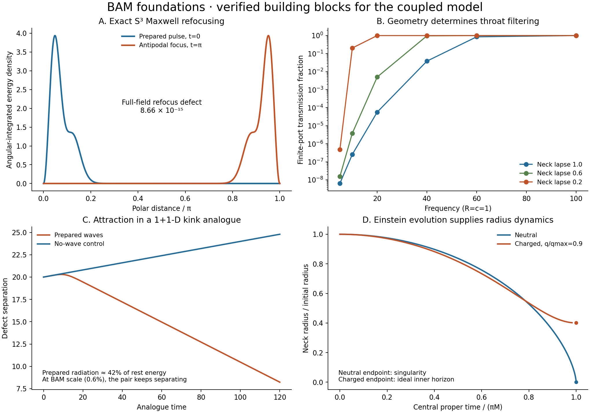

# BAM foundations — research record

**A reproducible research release of the wave, scattering and mechanical
building blocks for the coupled BAM model.** This release brings the strongest
verified results from the PR #349 research sequence onto `main`, with their
source, tests, figures and original numerical histories. It prepares a common
baseline for the next model release; it does not announce a completed derivation
of mouth attraction, nonsingular annihilation or quantum field theory.



## The results worth carrying forward

| Building block | Demonstrated result | Why it matters |
| --- | --- | --- |
| Exact antipodal Maxwell transport on S³ | Full electric and magnetic fields refocus with sampled error **8.66 × 10⁻¹⁵** in the implemented dipole sector | Removes the S² dispersion obstruction from this S³ reference problem |
| Geometry-derived throat response | **138** Maxwell scattering cases; maximum unitarity defect **6.86 × 10⁻¹⁰**; independent boundary-map validation | Replaces an assumed transmission rule with a response calculated from the metric |
| Mechanical loads from the same action | Internal-stress and scattering-phase force calculations agree to **5.53 × 10⁻⁸** across 16 checks | Separates waist pressure from intrinsic throat tension and supplies verified field terms for a coupled model |
| Motion generated by field dynamics | In a 1+1-D three-field kink analogue, separation at t=120 is **8.22987** with prepared radiation versus **24.79515** without it | Establishes a concrete wave-induced attraction mechanism without prescribing a particle trajectory |
| Einstein radius evolution | Twelve exact electrovacuum histories agree with an independent ODE integration to **5.29 × 10⁻¹²** of initial radius | Adds gravitational dynamics and distinguishes contraction, horizons and singularities from a release animation |

These are separate, explicitly specified calculations. The attraction analogue,
the supported scattering throat and the unsupported electrovacuum evolution
are not combined into one physical solution by placing them in the same release.

## 1. A correct S³ Maxwell reference

The implemented transverse Maxwell modes on the unit round S³ have integer
frequencies n=k+1, n>=2. The curvature term in the vector operator matters.
The exact full-field antipodal identity is checked against spatial transport,
Maxwell's equations, modal normalization and independent numerical integration.
The previous sqrt(l(l+1)) dispersion result describes a different, S² diagnostic.

A second advance is a complete finite-receiver momentum balance. Across 18
size, offset and deformation cases, a stress-only partial-window calculation
can appear to deliver an impulse of **0.11842** per unit prepared energy.
Including the change in stored field momentum cancels that apparent matter
impulse to **1.52 × 10⁻¹⁵** for those partial windows. This is a transparent
observation surface; it does not absorb or recoil.

A genuine fixed-conductor comparison has an inward radius load and zero net
translation by symmetry. Its integrated radius load at radius 0.3 is
**−1.70683** per unit prepared energy, changing by **0.035%** on the final
spatial refinement. That result belongs to a conducting boundary. It is not
transferred to a wormhole throat.

[Derivation, data and limitations](../s3_maxwell_encounter.md)

## 2. The throat filters waves, and its action determines its loads

The matched spherical bridge now has a Maxwell two-port response derived from
its stated geometry and positive lapse. Both radiative polarizations have the
same radial operator in this test-field setting. The release retains the
complex scattering matrix, internal fields and independent
Dirichlet-to-Neumann calculation.

For the neutral a=0.3 bridge and ell=1:

| Frequency | Transmission, neck lapse 1 | Transmission, neck lapse 0.6 | Transmission, neck lapse 0.2 |
| ---: | ---: | ---: | ---: |
| 10 | 2.585 × 10⁻⁷ | 3.854 × 10⁻⁶ | 0.20406 |
| 20 | 5.679 × 10⁻⁵ | 0.005030 | 0.99967 |
| 60 | 0.85188 | 0.99999 | 0.99999 |

The same spatial bridge can be opaque or highly transmitting depending on its
Lorentzian completion. For the prescribed width-0.2 S³-weighted drive,
transmission is **6.36 × 10⁻⁷** at unit lapse and **0.27958** at neck lapse 0.2.
These are finite-port drives, not a solved charged-mouth emission event.

Varying the same Maxwell action gives two distinct mechanical effects:

- Radiation opens the waist for the specified nonnegative radial enlargement
  at fixed lapse and proper length. Coherent counter-incidence cannot reverse
  the square-sign identity for that variation.
- Static electric flux also opens the waist, but supplies **intrinsic-length
  tension**. For charge fraction 0.9, unit lapse and a=0.3, the waist load is
  **+0.03171386** and the stretch load is **−0.01724436**.

That tension is a concrete candidate ingredient, not yet attraction between
mouth centers on S³. It requires the relation between the intrinsic throat
geometry and exterior mouth displacement, as well as the exterior stress.
The charged profiles solve the interior time-symmetric Einstein-Maxwell
constraint before finite static charge is included.

The independent two-port implementation in
[PR #345 at c1a5ae6](https://github.com/davidmdrpi/geometrodynamics/commit/c1a5ae6247423c6fff5b2bff4bed8434faf258c1)
also reproduces the transmission and six-lapse group-delay tables. Its packet
router keeps each front's phase as bookkeeping but discards the two-port's
scattering phases. These discarded phases and a single scheduled delay cannot establish coherent recoil or exact field closure.
That router is not imported as the new physical throat law in this release.

[Maxwell action, scattering and loads](../maxwell_throat_response.md)

## 3. An attraction mechanism with an explicit scale test

The deformable benchmark is a 1+1-D three-field kink analogue (φ, ψ₁, ψ₂
on a line). It evolves positive-kinetic-energy fields from one local action.
Wave conversion into a different outgoing channel transfers momentum
to a deforming defect. A pair initially separating at speed 0.02 turns inward
with prepared radiation. No-wave, opposite-channel, disconnected, offset,
spatial/time-refinement and reversal controls are retained, together with the
full saved field states.

The limits are part of the result. Prepared radiation in the successful
benchmark is approximately **42.4% of the defects' rest energy**. With radiation
at **0.6%** and initial speed **0.3**, the refined BAM-scale comparison slows
by only **0.0014593** relative to its no-wave control and continues separating.
The current quadratic coupling cannot emit that radiation from exactly zero
radiative field. At collision the strong-drive analogue forms an oscillating
remnant; irreversible annihilation is not demonstrated.

Untwisted pair returns reinforce the inward branch. The channel-swapping twist
cancels the single-defect return in the tested control. These observations
identify a mechanism and its failure at the tested BAM scale, without assigning
an attractive force to the antipodal router.

[Field action and complete histories](../deformable_alice_boundary.md) ·
[Scale, return and review controls](../pr349_review_assessment.md)

## 4. Gravity now supplies a conditional radius evolution

The angular Einstein equation gives the unsupported, spherical electrovacuum
normal-geodesic radius acceleration

\[
\frac{d^2r}{d\tau^2}=-\frac{M}{r^2}+\frac{q^2}{r^3}.
\]

The central exact solution is checked against an independent second-order
integration. At a=0.3, the neutral completion reaches a curvature singularity
at central proper time **0.04053978**. For charge fraction 0.9, the ideal
charged completion reaches the nonzero inner-horizon radius **0.00751934**
at **0.04128985**. The calculation stops at the inner horizon and does not
claim a stable bounce or a smooth annihilation event.

The supported static throat is a different completion. Its required negative
radial support pressure cancels the contraction. At identical initial spatial
constraint data, zero, holding and twice-holding support pressure produce
initial radius accelerations **−15.96782, 0 and +15.96782**, respectively, for
charge fraction 0.9. This demonstrates the missing support-response equation;
it is not a fit of three long-time material models.

The release also includes **282** modal group-delay calculations and **18**
refinement checks. At neck lapse 0.2, the transmitted weighted group delay is
**2.00190**, while the optical length is **1.40704**. Neither is automatically
a broadband event time. The neutral central collapse time is likewise not an
exterior clock reading, so it does not justify an automatic mouth-absorption
switch in the router.

[Einstein evolution, delay tables and independent checks](../einstein_throat_evolution.md) ·
[GR time orientation and support controls](../gr_handle_orientation.md)

## What the next model must establish

The release preserves the strict BAM requirement: surface interception and
reflection occur only at eligible antipodal events, with throat passages handled
through their boundary conditions. The continuous couplings in the comparison
models are isolated and are not presented as that interaction law.

The next coupled model must close the sourced field and mouth history together:
retain complex scattering phases, derive the directional exterior/junction
response, specify the support dynamics, and establish the Klein/time attachment.
It must distinguish a true change in mouth-center motion from radius contraction
and a regular release from a curvature singularity.

The earlier scalar candidate's failure of sustained approach and collapse is
preserved in its
[pinned report](https://github.com/davidmdrpi/geometrodynamics/blob/dc9c6890ea2fd843cafbd53f7b2ee64746cb5fd9/docs/coupled_mouth_throat_results.md)
and
[nine-case archive](https://github.com/davidmdrpi/geometrodynamics/tree/dc9c6890ea2fd843cafbd53f7b2ee64746cb5fd9/experiments/closure_ledger/runs/20261020_coupled_mouth_throat_replay).
Those historical archives are referenced rather than duplicated in this selected
release. Nothing here supersedes the negative result or its limitations.

## Reproduce and audit

Install from the release checkout, then verify its evidence and run its selected
integration tests:

```sh
python -m pip install -e '.[dev]'
python scripts/verify_bam_foundations_release.py
OPENBLAS_NUM_THREADS=1 python scripts/verify_bam_foundations_release.py --tests
```

**Release validation:** 228 tests pass on Python 3.12 with one OpenBLAS thread.
The original candidate wheel built successfully. The full repository-wide suite passed
on Python 3.10 and 3.12 in [CI for the original release commit
2c07ff0](https://github.com/davidmdrpi/geometrodynamics/actions/runs/40792853865);
the 228 count covers the 13 selected integration and baseline test files.
The independent upstream six-lapse delay-table test also passes. After review,
all 228 release tests and nine archive-verifier regressions pass. Temporarily
substituting PR #345's newer pair-birth source and test at `c1a5ae6` gives
248 passing tests (the selected suite plus verifier regressions), and the
archive gate still passes. The original imported dependencies are retained.

The [evidence index](bam-foundations-evidence.json) lists every imported file,
its source commit, SHA-256 digest and size, the six original component manifests,
the tested file list and the measured release checks. The original manifests
are unchanged. By default, the verifier checks only the working-tree run data,
images and replay-state hashes. Source, tests, producers and reports can evolve
without breaking the historical archive gate. The index retains their original
hashes as a record of the imported snapshot, not as a constraint on future code.

To verify all 122 historical imports, or independently verify their Git blobs
against the source commit, run these explicit checks with the relevant Git
history available:

```sh
python scripts/verify_bam_foundations_release.py --ref 2c07ff0e66162bf02fc1003a575221ee606c9326
python scripts/verify_bam_foundations_release.py --source-ref dc9c6890ea2fd843cafbd53f7b2ee64746cb5fd9
```

The first command reads the imported files from the pinned release commit,
which is retained in this branch's ancestry, regardless of later working-tree
changes. A release tag can be supplied as `--ref` once it exists. The second
checks the source tree's Git blob IDs, SHA-256 digests and sizes, plus credited
origin commits. Missing history fails explicitly; the verifier never silently
skips provenance or fetches refs. The default archive check establishes internal
consistency only, and neither mode proves the physical model.

**Original PR #345 import.** `pair_birth.py` and its test originate
in [PR #345's fe228ac](https://github.com/davidmdrpi/geometrodynamics/commit/fe228aca57698ac2dc248d060609aa104b2a7cec),
inherited through the PR #349 research branch. They are dependencies of the
selected numerical controls, not an adoption of PR #345's later packet router.
The v1.3.5 candidate now ships the final PR #345 source at `cd70f0f`. The
original dependency snapshot remains auditable at `2c07ff0`.

Individual calculation producers remain available:

```sh
python -m experiments.closure_ledger.s3_maxwell_probe
python -m experiments.closure_ledger.maxwell_throat_probe
python -m experiments.closure_ledger.einstein_throat_probe
python -m experiments.closure_ledger.deformable_boundary_probe
python -m experiments.closure_ledger.pr349_review_probe
```

These regenerate numerical outputs and can take longer than the test suite.
Historical upstream event-order audits are separate, require their pinned git
objects, and are not needed to run the numerical release tests. Older reports
retain the test counts from their original research checkpoints; the evidence
index records this assembled release's validation.

The overview figure is generated from the included data and the exact S³
reference by `python scripts/render_bam_foundations_release.py`. It is a
scientific comparison of separate models, not a visualization of a solved BAM
matter-wave cycle.
