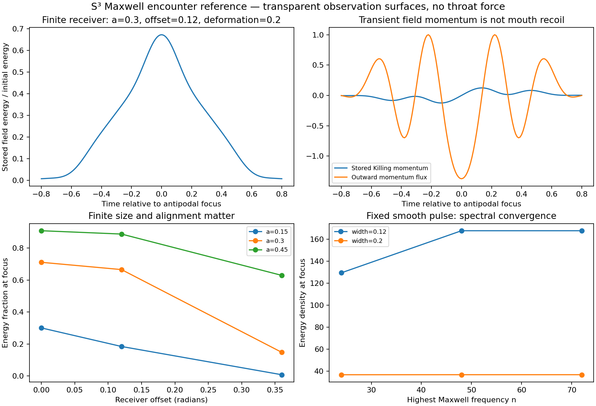

# S3 Maxwell encounter: exact refocusing, momentum storage, and radial pressure

This extends PR #349 at `27155c9`. It follows the request to apply wave-focusing
analysis to a finite BAM receiver on **S3**, with the field operator distinguished
from the existing S2 visualization model. It also checks review
[6406620342](https://github.com/davidmdrpi/geometrodynamics/pull/349#issuecomment-6406620342).

**Results:** the free round-S3 Maxwell field refocuses exactly in the tested
vector sector. Its spectrum does not have the S2 dispersion obstruction.
Transparent receiver surfaces acquire no mechanical impulse after stored field
momentum is accounted for. An actual, centered conducting boundary receives
inward radius pressure, while its net translational force vanishes by symmetry.
Neither comparator supplies a Klein throat or self-consistent mouth motion.

## 1. Correct the dimensional inference before changing the throat

The earlier `pair_birth.py` explicitly implements **2+1 Maxwell on S2**. Its
frequencies sqrt(l(l+1)), the scalar conformal control l+1/2, and the old
phase-defect tables remain correct for that model. They are not the transverse
Maxwell spectrum on S3. Previous reports and manifests are left intact.

For a transverse one-form on a round S3 of radius R, the rough-Laplacian
eigenvalue is [k(k+2)-1]/R^2. The Maxwell operator is the Hodge Laplacian,
which adds Ricci=2/R^2, yielding

\[
\Delta_1=-\nabla^2+\mathrm{Ric},\qquad
\omega_k^2=(k+1)^2/R^2,\quad k\ge1.
\]

The harmonics and divergence identities are given by Lindblom, Taylor and
Zhang, [arXiv:1709.08020](https://arxiv.org/abs/1709.08020), equations 13--20.
The implemented benchmark derives and checks its radial Maxwell equation
directly, rather than replacing frequencies in the S2 code.

Set R=c=epsilon0=mu0=1. In the TE dipole sector define

\[
A_{\hat\phi}=\sqrt{3/(8\pi)}\,{f(t,\chi)\over\sin\chi}\sin\theta,
\quad
\ddot f-f''+2\csc^2\chi\,f=0.
\]

An orthonormal radial basis is

\[
f_n(\chi)={\sin^2\chi\,C_{n-2}^{(2)}(\cos\chi)
\over\sqrt{\pi(n^2-1)/8}},\qquad \omega_n=n\ge2.
\]

The nonzero orthonormal field components are

\[
E_{\hat\phi}=-c_1\dot f\sin\theta/\sin\chi,\quad
B_{\hat\chi}=2c_1f\cos\theta/\sin^2\chi,\quad
B_{\hat\theta}=-c_1f'\sin\theta/\sin\chi,
\quad c_1=\sqrt{3/(8\pi)}.
\]

The code evaluates regular combinations at the poles. Independent coordinate
differences verify Faraday and Ampere equations. Radial ODE integration checks
the basis without using the Gegenbauer recurrence. Duality provides a TM
control with identical stress-energy. This is a selected TE/TM dipole sector,
not a numerical implementation of every vector harmonic or any spin-2 field.

The prepared smooth initial potential is proportional to
sin^2(chi) exp[(cos(chi)-1)/width^2], with zero initial canonical momentum and
unit total energy. It is not the field emitted by a derived mouth-birth source.

## 2. Exact spatial refocusing does not select a time-reversing boundary law

In this sector the antipodal pullback has modal parity (-1)^n, exactly equal
to free evolution at t=pi. The embedding derivative -I is included when
comparing vectors at opposite points. Across nine arbitrary-phase/time tests,
the largest full E/B component defect is **8.66e-15**. No fitted phase, gain or
projection is used. Repetition at odd multiples of pi has the same identity.

For canonical data (q,p), however, a stipulated time-reversing seam can be
written K_eta(q,p)=(eta*Pi*q,-eta*Pi*p). At T=pi:

- eta=+1 requires p=0, and leaves q free;
- eta=-1 requires q=0, and leaves p free.

For a uniform canonical rotation by theta, the raw endpoint-defect energy
divided by initial energy is 4 sin^2(theta) or 4 cos^2(theta), respectively.
The test verifies these identities. Eta is an **explicit internal-sign
convention**, not a sign derived from a charged Klein handle. Spatial Maxwell
refocusing by itself neither chooses eta nor supplies the source jump law.

There is also a dimensional orientation distinction: the antipodal map on S3
preserves orientation; on S2 it reverses it. The older two-dimensional rim-loop
calculation cannot be promoted to full S3 electromagnetic throat matching
without transporting the normal and tangential fields.

## 3. Finite receivers: subtract stored field momentum

We observe the exact vacuum field across a closed S2 surface around a point
near the south pole. Its radius is r(u)=a[1+epsilon P2(u dot z)]. Offsets change
the observer's centre; epsilon changes the observation surface. They do not
deform the metric, scatter the wave or impose an absorbing boundary.

For a spatial Killing vector xi normalized to a chosen unit direction at the
receiver centre, define

\[
P_\xi=\int_V(E\times B)\cdot\xi\,dV,\qquad
T_{ij}=\tfrac12(E^2+B^2)g_{ij}-E_iE_j-B_iB_j.
\]

The integrated matter impulse is

\[
J_\xi=-\Delta P_\xi-\int dt\int_{\partial V}T_{ij}n^j\xi^i\,dA.
\]

A Killing vector avoids treating unrelated tangent vectors around S3 as a
global Euclidean momentum. The corresponding charge is an SO(4) rotation
charge; it agrees with the chosen local momentum direction at the centre.

Eighteen receiver cases use a=0.15,0.30,0.45; offset=0,0.12,0.36; and
epsilon=0,0.2. Both whole [pi-1,pi+1] and partial [pi-0.8,pi-0.12] windows are
retained. The largest partial-window stress-only apparent impulse is
**0.1184187079** per unit prepared energy. Including stored momentum reduces
the largest absolute matter impulse to **1.52e-15**. Whole-window momentum
residuals are at most **2.59e-15**, and energy residuals **1.43e-16**.
These are numerical conservation checks of a known vacuum solution, not
evidence for a force-free physical throat. Omitting the storage term would
manufacture a recoil signal of either sign; reversing the offset reverses the
signed transient momentum.

For undeformed observation surfaces, energy actually inside the region at
the focal instant is:

| Geodesic radius | Offset 0 | Offset 0.12 | Offset 0.36 |
| ---: | ---: | ---: | ---: |
| 0.15 | 0.300438 | 0.184193 | 0.007353 |
| 0.30 | 0.710974 | 0.665424 | 0.147447 |
| 0.45 | 0.908577 | 0.887790 | 0.629115 |

These fractions are **stored vacuum energy**, not absorption probabilities.
The incoming/outgoing characteristic norms are also diagnostics, not a
constitutive scattering law. Cases whose geometrical focus is outside the
receiver are explicitly flagged; their wave tails must not trigger a strict
antipodal BAM event. No continuous or off-antipodal kick is installed.

## 4. A true reflection control produces compression, not translation

A second calculation replaces the transparent surface by a fixed perfect
electric conductor at chi_b=pi-a, centered at the antipode. It solves the
exterior TE radial problem on 0<chi<chi_b with f=0 at both ends. A symmetric
finite-difference operator is diagonalized and evolved by its normal modes.
This supplies a reflected field, not a doubled incident-flux estimate.

At the conductor E_t=0, B_normal=0. Exterior Maxwell stress gives the
generalized force on the receiver radius,

\[
F_a=-\tfrac12[f'(\chi_b)]^2\le0.
\]

The angular integral is already included. Negative means compression of the
receiver. The vector force vanishes by dipole angular symmetry. The receiver
is held fixed, so this pressure does no work in these runs; integrating it
does not evolve a radius or demonstrate collapse.

For width=0.2 and unit prepared energy, over [pi-1,pi+1]:

| Radius | Integrated radius load, 2048 cells | Relative change from 1024 cells |
| ---: | ---: | ---: |
| 0.15 | -1.23871988 | 0.00687% |
| 0.30 | -1.70682954 | 0.03503% |
| 0.45 | -1.83847748 | 0.03674% |

Twelve spatial-refinement cases are retained, from 256 to 2048 cells. Increasing
time quadrature from 256 to 384 nodes changes these integrals by less than
4.0e-8. Peak force estimates are sampled diagnostics. Independent checks compare
the first four frequencies with roots of
omega cos(omega chi_b)-cot(chi_b)sin(omega chi_b)=0, and compare time-averaged
single-mode pressure with -I*domega/da at fixed oscillator action I=E/omega.
The latter checks shape work without using the boundary stress formula.

This supplies a concrete classical route to **radial compression conditional
on reflection**. It does not establish the reflectivity, support stress,
constitutive response or stability of a BAM throat. In particular, specular
conductor reflection on the finite S2 is a comparator, not the strict router's
antipodal continuation or a Klein/time-reversing throat map. A moving,
transmitting throat must be solved separately before this load can drive it.

## 5. Latest review and verification

The review's uniform-phase result is reproduced on its original S2 operators.
For k=0,1,2,3 the optimal Maxwell correction-energy fractions are
0.00170172, 0.01521148, 0.04168100 and 0.08003315. Conformal +/-45-degree
rotation reduces the defect below 5e-30. This is a useful reduction of the
S2 prepared-data mismatch, not a derived source phase and not an S3 obstruction.

The same pinned endpoint reproducer was rerun against upstream
`a464530e5fc9a1b257582ee45e0bea3d92bcee6c`. All six exact and six just-inside
runs now capture before contact; all six just-outside runs release first.
Thus the reported event-ordering fix is verified. The old failing pin and its
data remain unchanged as historical evidence.

There are 18 spectral/quadrature refinement cases. At width 0.12, focal density
changes from 129.3996 (cutoff 24) to 167.6896 (48) and 167.6911 (72). The
partial-window stress-only integral changes by about 5.27e-8 between 48 and 72.
This deliberately shows why excellent conservation at a low cutoff is not
proof of a converged focal amplitude. Width 0.2 converges more quickly.

The focused suite contains 131 tests. New checks include independent radial
ODEs, coordinate Maxwell equations, full-vector antipodal transport, local
and integrated energy/momentum balance, duality, conductor spectrum, local
discrete energy, and independent shape work. The new manifest binds the
source, tests, report, tables, trace and figure. Earlier large archives are
unchanged and are not rerun.

## 6. What the wave-focusing article contributes

[OpenAI's announcement](https://openai.com/index/building-scientific-understanding-with-academic-communities/)
motivated separating a focal peak from its spacetime-integrated effect. Its
[published formalization scope](https://github.com/openai/math/blob/main/lean/docs/079.md)
concerns the Euclidean half-wave equation. We do not import its estimate as
a theorem for this curved domain or its conducting boundary. The S3 results
here follow from explicit Maxwell solutions and independent balance checks.

For the next full-cycle operator, round-S3 bulk propagation can now be supplied
without the spurious S2 dispersion penalty. Still required are the two-mouth
Maxwell transmission/reflection map, its normal and time parity, a birth-source
law, and throat shape dynamics derived with the same energy/momentum budget.
The conductor control identifies a candidate compression channel; it supplies
no tangential attraction between separate mouths. The previous scalar failure
of sustained approach and collapse remains unchanged.

## Reproduction

```sh
OPENBLAS_NUM_THREADS=1 python -m experiments.closure_ledger.s3_maxwell_probe
git fetch origin a464530e5fc9a1b257582ee45e0bea3d92bcee6c
OPENBLAS_NUM_THREADS=1 python -m experiments.closure_ledger.s3_maxwell_probe --upstream-review
python -m pytest -q tests/test_s3_maxwell_encounter.py
python -c 'from experiments.closure_ledger.s3_maxwell_probe import manifest; manifest()'
```


