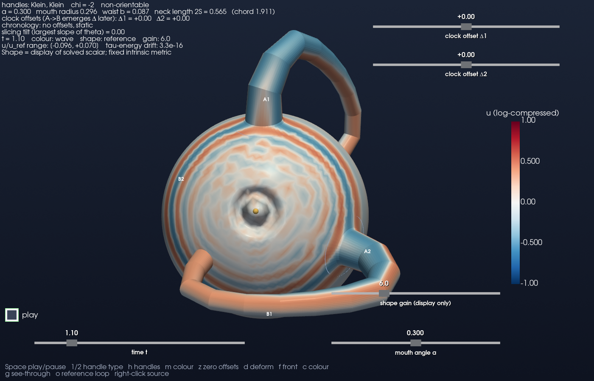
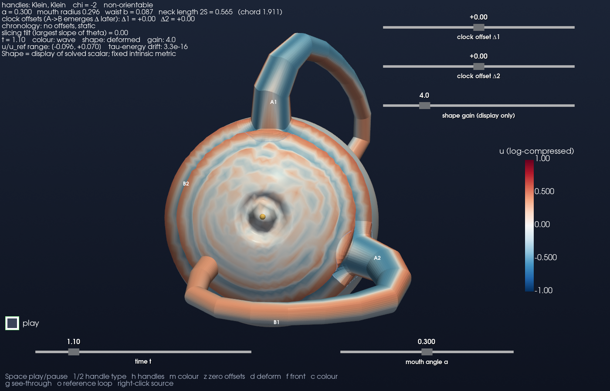
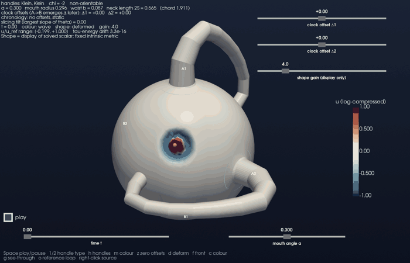

# Scalar wavefronts as moving geometry

This follows PR #337. The main picture is now an opaque surface whose shape
moves with the **computed signed scalar field**. The crest, trailing trough,
reflections, and interference are features of that evolving shape. The
first-arrival contour is off by default and can be enabled as a diagnostic.

The visual precedent is `archive/geometrodynamics_v39.py`, followed by the
solved-field radial graph in `geometrodynamics/viz/warped_sphere.py` and
`scripts/geometrodynamics_v41_warped_sphere.py`. This extends that display idea
to #337's triangulated, handled surface and its mouth clock offsets. It does
not revive the archive's prescribed pulse or timed mound.

## Look first

Same scalar solution, same external time (approximately 1.1), same camera,
same launch normalization, display gain 4:

| Fixed display geometry | Scalar-driven geometry |
|---|---|
|  |  |



The movie runs from external time 0 to 3.4 with two Klein handles and zero
clock offsets. The source is `(0.5, -0.7, 0.5)`, normalized to the sphere.
It uses the same default spatial mesh and scalar solver as #337, not a
separate animation model. Playback is slowed and uniformly sampled apart
from rounding to the nearest stored frame. Small angular ripples can include
mesh dispersion: their existence is not evidence of a new physical effect.

## Run and compare

```bash
PYTHONPATH=. python scripts/klein_wormhole_explorer.py
PYTHONPATH=. python scripts/klein_wormhole_explorer.py --neutral --gain 6
PYTHONPATH=. python scripts/klein_wormhole_explorer.py --offsets=-0.8,0.6
PYTHONPATH=. python scripts/klein_wormhole_explorer.py --handles none
PYTHONPATH=. python scripts/render_scalar_deformation_examples.py
```

Install NumPy, SciPy, PyVista and Pillow; the explorer's `--gif` additionally
uses imageio. Rendering requires a working VTK backend. The committed examples
were rendered with PyVista 0.49.1 / VTK 9.5.2 using EGL, which works without an X
server in the development environment. Backend availability varies by machine.

| Control | What it changes |
|---|---|
| Time / Space | Scrub / play the stored solution |
| `d` / `--flat` | Deformed / reference display geometry, without rerunning the wave |
| `--n-sphere 12000` | Refine the sphere mesh (default 6000); increases simulation cost |
| Gain slider / `--gain` | Shape exaggeration only; default 4 |
| `c` / `--neutral` | Remove wave colour to inspect shape alone |
| `f` / `--front` | Optional first-threshold-crossing contour |
| `g` | Opaque / transparent sphere; use this to see the Klein entry through the wall |
| `m` | Wave / first arrival / slicing tilt / curvature |
| `o` | Orientation loop on the **reference** geometry |
| Right-click | Relaunch at the corresponding intrinsic sphere vertex |

Diagnostic colour modes use reference geometry. Rims and the source marker
follow the deformed surface in wave mode. At a nonzero clock jump, both waist
faces are drawn separately using their respective external-time samples.
An unreached vertex retains an undefined first arrival; it is not assigned a
fictional arrival at the simulation's final time.

## What the shape means

For a unit-sphere vertex with reference position X, the displayed position is

    X_display = X + W(X) tanh(g u(X,t) / u_ref),     W(X) = 0.22 X.

Here `u_ref` is the maximum absolute launch field, fixed for the entire run.
Positive field pushes outward; negative field pulls inward. The sphere radius
stays between 0.78 and 1.22. There is no frame-by-frame rescaling. The HUD shows
the uncompressed signed field range and the solver's conserved-energy drift
on its evolution slices. Wave colour retains #337's separate log compression.

The bounded map preserves signs and ordering at a given point but changes
amplitude ratios. It is nonlinear even though the underlying scalar equation
is linear. Superposition belongs to the field **before** the display map.
High display gain can exaggerate numerical tails and saturate large crests;
use gain zero / `d` and the raw field range to compare them. A visible crease
or contact in this drawing is not a spacetime caustic or a topology change.

A Klein surface has no global continuous unit normal. Consequently, the
handle displacement is an explicit ambient vector, not a claim of global
normal displacement. At each drawn tube ring, a transverse radial vector is
blended with the corresponding glued rim's sphere-radial vector using
`w = q²(3−2q)`, `q = |s|/S`. The transverse contribution has magnitude
`0.22 r(s)`, while the rim contribution has magnitude 0.22. The vector matches
at shared mouth vertices, respects the far-rim permutation, and is continuous
through the waist; it may have tangential components. It describes breathing
of the drawing, not an isometric embedding or a material membrane law.

The field samples are exactly #337's `sim.frames[frame]` on its cut mesh,
already resampled from evolution time to external time. Clock-separated waist
copies are never averaged or welded. Their spatial separation under this
map is a display consequence of showing different events, not a torn throat.

**Physics scope:** the scalar evolves on #337's fixed intrinsic metric. The
deformed coordinates never enter its stiffness, mass, clock, or evolution
operators. No Einstein backreaction, mouth motion, or new focus regularity
law has been calculated here. The new tests exercise display fidelity and
retain #337's existing mechanics tests; they do not independently establish
its continuum chronology claims.

## Verification

```bash
PYTHONPATH=. pytest -q tests/test_scalar_deformation.py tests/test_viz_klein_handles.py
```

The new checks cover the signed radial graph, fixed amplitude normalization,
Klein and torus rim matching, local waist breathing, separate clock-cut faces,
actual nonzero-offset field samples, and absence of changes to the operator,
reference geometry, or stored field when changing display gain. Rendered
examples use the actual explorer, including its controls, rather than a
separate plotting implementation.

For this change, **35 focused tests passed** (8 new display checks and 27
existing handle/clock checks). An EGL viewer smoke run also checked actual
actor vertex updates, deformation and colour toggles, gain without rerunning
the solver, all four colour modes, nonzero offsets, bare-sphere focusing, and
#337's chronology-refusal state. Both PNGs and the 48-frame GIF were rendered
and inspected, including intermediate and final movie frames. Sphere lighting
uses updated smooth normals; the underlying vertex geometry is not smoothed.

## Review follow-up and bubble interpretation

The first-arrival contour now excludes any cell with an unknown arrival,
preventing VTK from interpolating NaN positions. The default gain is reduced
from 6 to 4, the gain slider sits below the clock controls, and
`--n-sphere 12000` allows a mesh comparison. Display identities use portable
floating-point tolerances. The example images have been regenerated.

The opaque default is retained for reading deformation. Press **g** to see
the Klein handle's interior entry. Clock jumps are primarily visible in
colour and the gold waist rings: the independent review measured only
0.006–0.007 separation for offsets (−0.8,+0.6), time 1.0, gain 6. Those
values are below 1% of the unit sphere radius, not a large opening.

For the next physical comparison, see [bubble propagation and mouth
response](bubble_wave_mouth_response.md). It distinguishes mouth-free
refocusing, passive attached features, and a dynamically coupled mouth.

Review-fix validation: the 8 display tests plus the new optional PyVista
NaN-contour regression passed (9 targeted tests). The 27 unchanged
handle/clock tests had also been independently reproduced on the prior
commit. The contour regression runs without opening a render window and
skips when PyVista is not installed.

The second independent review reproduced **36 tests** at `d622909`.
Install the optional viewer dependencies with `pip install -e ".[dev,viz]"`.
A dedicated `viz-contour` CI job now installs that extra and runs the contour
regression without a render window, so this check is not silently skipped
by the minimal-dependency test matrix. The later physical suggestions are
assessed in [the second-review audit](bubble_wave_review_audit.md); its new
transmission measurements are not claimed as reproduced results here.

For the next visualization with **two independently moving antipodal mouth
pairs**, see [the effective momentum-exchange experiment](moving_mouth_pairs_results.md).
It uses this viewer's handle geometry and gluing with #339's round-sphere
effective scalar mechanics; it does not yet evolve this handled-domain PDE
on a moving metric.
