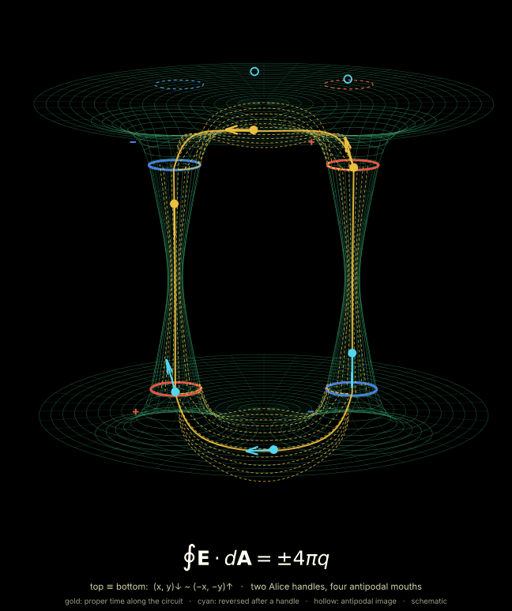

# Two classical throats cannot replace the tensor product: three obstructions

This is a note, not a pre-registered test. Every claim below is either a short
exact argument or a direct numerical check; the checks are archived in
`experiments/closure_ledger/runs/20261127_two_throat_nogo/`. No solver run on a
two-throat model was needed.

*Figure (schematic; no field equation is solved).* The two sheets are one
surface: the bottom point (x, y) is the top point (−x, −y).
* **Handles.** Two Alice handles, the columns at (d, 0) and (0, d), each join a
  pair of antipodal points of that surface, giving four mouths as in #338/#340.
* **Charge without charge.** Sourceless flux (dashed gold) circulates top
  sheet → throat 1 → bottom sheet → throat 2. By Gauss's law,
  ∮E·dA = ±4πq, each mouth shows an apparent charge: red where flux leaves
  onto a sheet, blue where it enters. Each sheet carries zero net charge.
* **One worldline, both time orientations.** Balls circulate on one closed
  worldline. Each handle reverses time orientation at its waist, so a ball's
  proper-time arrow runs along the circulation on the top sheet (gold) and
  against it on the bottom (cyan).
* **The Alice seam.** A white band with a half-twist tick marks each flip.
  Each handle is the seam type with s_t = s_f = −1: it reverses both time and
  charge. By E2 of `docs/klein_handle_electric.md`, that is the only
  time-reversing type through whose tube trapped flux can pass. Placing the
  seam at the waist is a choice of chart. That the circuit crosses two seams
  is not.
* **The single surface.** Dashed rings and hollow markers on the top sheet show
  the bottom mouths and balls at their antipodal images on the one surface. One
  dotted chord pairs the bottom + mouth with its image: the same point, with
  the sheet normal ↓ below and ↑ above.
* **Source.** Drawn by `geometrodynamics/viz/alice_circulation.py`. The throat
  profile is the finite-mouth neck with a = 0.3, stretched vertically.

This is the setting the note asks about: one closed, antipodally identified
space with two handles.

## The question

#367 obtained complementary readings (u + v = 1) for one throat from a
variational selection on a Berger-squashed S³, and Born frequencies from the
invariant preparation measure. A Bell test needs two throats. The natural
classical lift takes two #367 throats, z_A and z_B on S³_A × S³_B, with each
local norm fixed, and couples them. The question is whether any such coupling
can reach |S| > 2 while keeping:
* complementary readings on each side;
* both binary marginals at 1/2;
* each side's local statistics independent of the other side's setting;
* every prepared history counted.

Throughout, the kinetic term is

    L = |ż_A|² + |ż_B|² + λ_s(A_A² + A_B²) + 2λ_c A_A A_B,   |λ_c| < λ_s,

where A = Im(z†ż) is the velocity along the Hopf fibre. Settings enter as
port-symmetric analyzer loads −(κ/2)(2u − 1)², which depend only on the point
the visit reaches on the Bloch sphere. With λ_c = 0 the model is two
independent copies of #367, a local model, so |S| ≤ 2.

## 1. Coupling through the fibre is inert

**Claim.** If the setting loads depend only on Bloch-sphere data, then every
global minimizer has A_A = A_B = 0, at every κ. The term 2λ_c A_A A_B
therefore vanishes, the problem splits into two #367 problems, and |S| ≤ 2
exactly.

**Argument.**
* Fix the midpoint ray M on one throat. Any path x → y → −x costs at least
  the round-metric cost of two great arcs, because the Berger and λ_c terms add
  a positive-definite vertical form.
* Choose the phase of y in the fibre over M so that Im⟨x, y⟩ = 0. Then both
  great arcs are horizontal, and that bound is attained.
* The loads see only M, so the global minimizer is horizontal on both throats.

**Check** (`quadratic_load_check.py`). An 8-segment Berger optimizer with
λ = 2, a complex preparation and κ = 0.1 and 0.3 was run. The largest vertical
component per segment on the minimizers is at most 1.2e-6, which is optimizer
tolerance on segments of about 0.4.

**From review, not checked here.** The lock is stronger than first-order
stationarity: when a load moves the midpoint by δ, the arc's second variation
lowers the horizontal cost by about (π/2)δε², while fibre velocity of order ε
costs (1 + λ_s)ε².

## 2. With a fixed preparation, port-symmetric loads still break complementarity

The identity (2u − 1)² + (2v − 1)² = 2σ² + 2(u − v)², with σ = u + v − 1, has
zero first derivative in σ only if both visits can move. In #367 the first
visit is the prepared state, so u is fixed. The u-load is then a constant, and
the v-load pulls v away from 1 − u.

The problem reduces exactly to the midpoint shift δ in the real horizontal
plane, with cost π²/2 + 2δ² − (κ/2)cos²(2α + 2δ), where u = cos²α. To first
order the defect is

    σ ≈ −2κ u(1 − u)(2u − 1).

It vanishes only at u ∈ {0, ½, 1}, and |σ| reaches about 0.19κ.

**Check** (`quadratic_load_check.txt`).

| κ | u | full optimizer | reduced 1-D | first order |
|---|---|---|---|---|
| 0.1 | 0.20 | +0.01929 | +0.01929 | +0.01920 |
| 0.1 | 0.35 | +0.01476 | +0.01476 | +0.01365 |
| 0.3 | 0.20 | +0.05640 | +0.05640 | +0.05760 |
| 0.3 | 0.35 | +0.05181 | +0.05181 | +0.04095 |
| any | 0.50 | 0 | 0 | 0 |

## 3. A shared holonomy is trivial, lopsided or unstable

The proposal replaces the two antipodal conditions with one joint condition on
the fibre phases θ_A and θ_B, where z(1) = e^{iθ}z(0).

**The single-throat cost.** Write c(θ) for the least action reaching phase θ.
It is set by the spherical isoperimetric inequality for horizontal motion and
by the vertical cost (1 + λ_s)θ²:

    c(π ± ψ) = π² − (1 + λ_s)ψ²/λ_s,   c ≈ (1 + λ_s)θ² near 0,   c(0) = 0.

So c is even about π, and **θ = π, the complementary great semicircle, is its
maximum**.

**Check** (`shared_holonomy_check.txt`). A 24-segment optimizer agrees with the
closed form to within 0.007:

| θ | numeric, λ_s = 2 | closed form | numeric, λ_s = 0.5 | closed form |
|---|---|---|---|---|
| π | 9.8696 | 9.8696 | 9.8696 | 9.8696 |
| π − 0.5 | 9.4960 | 9.4946 | 9.1207 | 9.1196 |
| π/2 | 6.1747 | 6.1685 | 3.7011 | 3.7011 |
| 0.5 | 0.7500 | 0.7500 | 0.3750 | 0.3750 |

**What each joint condition gives:**

| joint condition | bare minimizers | why it fails |
|---|---|---|
| θ_A + θ_B ≡ 0 (mod 2π) | neither throat moves (cost 0) | no exchange on either side |
| θ_A + θ_B ≡ π, λ_s > 1 | (π, 0) or (0, π); total 9.870 against 12.35 symmetric | one side frozen (v = u); the A↔B symmetry breaks |
| θ_A + θ_B ≡ π, λ_s < 1 | (π/2, π/2), pure fibre rotation; total 7.40 | neither side complementary |
| lifted total winding 2π | (π, π) is a maximum of c(π + ψ) + c(π − ψ) | unstable; also needs a real-valued phase the Hopf bundle does not supply |

**The K symmetry.** The antiunitary spin flip sends θ → −θ.
* The mod-2π conditions are K-invariant.
* The lifted 2π condition maps to −2π, so K is a symmetry only if both windings
  are allowed, and that restores the instability.

When both throats are complementary, A = 0 and the fibre is a dead channel.
The fibre carries information only where complementarity is already lost.

## 4. Coupling on the Bloch sphere gives either |S| ≤ 2 or a signal

The remaining option couples the projected histories directly, through a
singlet-style term μ n_A·n_B plus the port-symmetric analyzer loads. This
case was argued in review and checked here (`bloch_joint_case2.py`, 400,000
uniform preparations, weak-coupling limit).

* **Pinned first visit (#367's geometry).**
  * u_A is fixed by the preparation and α. So any coupling that keeps
    u_A + v_A = 1 makes Alice's reading independent of β, and |S| ≤ 2.
  * Exceeding 2 requires breaking complementarity in a way that depends on β,
    which signals through Alice's miss and double rate.
* **Both visits free, at t = 1/4 and 3/4.**
  * The singlet lock picks e_B = −e_A on the degenerate great circles, with e
    the leading eigenvector of a⊥a⊥ᵀ + b⊥b⊥ᵀ.
  * Complementarity is exact, and the binary marginals are 0.500 ± 0.001 at all
    four CHSH pairs.
  * **|S| = 3.34**, beyond 2√2, with |E| ≈ 0.835 at each pair.
  * But Alice's mean squared polarization E[(2u_A − 1)²] is **0.667** when
    Bob's axis is parallel to hers and **0.499** when it is perpendicular.
    Bob's setting changes Alice's local intensity statistics at order one. That
    is a signal, visible in her finite-time barrier crossings.
  * Moving the first visit off t = 0 also cuts #367's link between the reading
    and the prepared state.

## Conclusion

On S³_A × S³_B with intensity-only setting loads, classical couplings between
two #367 throats split into two cases:
* coupling through the fibre is inert whenever both sides are complementary,
  so |S| ≤ 2;
* coupling on the Bloch sphere gives either |S| ≤ 2 (pinned preparation) or
  |S| > 2 at the price of setting-dependent local intensity statistics, which
  is signaling.

Neither reproduces the tensor product ℂ² ⊗ ℂ² without exceeding the Bell bound
only by signaling. Together with #367 (single-throat complementarity and Born
frequencies from the measure) and #370 (handle exchange protecting
complementarity under depletion), this marks the boundary of the classical
two-time measurement programme in these models.

Scope: classical variational models on fixed geometry with the stated loads.
This is not a no-go theorem for all classical dynamics. Couplings that are not
intensity-only, or other state spaces, are not covered.

## Figure 2: the setting built up in four steps

*Schematic; no field equation is solved.* The same camera and geometry are used
in every panel. The six throats stand in one row, in three pairs, as in
Wheeler's multi-throat picture. Each panel adds one layer.

1. **Wheeler.** Sourceless flux runs down one throat of each pair and up the
   other. By ∮E·dA = ±4πq, each mouth shows an apparent charge.
2. **+ Kaluza–Klein.** The inset zooms on one waist and shows the Hopf fibre χ.
   The matter wave is the winding mode Ψ = ψ(x)e^{ikχ}, and the charge is the
   winding k (`docs/guidance_law_from_5d.md`). Flux through a throat is fibre
   momentum, not a pasted-on source.
3. **+ Closure.**
   * The two sheets are hemispheres of one closed surface, joined at one
     equator, with bottom (x, y) ≡ top (−x, −y).
   * Dashed rings are the six bottom mouths on that one surface. The dotted
     chord pairs one of them with its image.
   * A pulse from a mouth p crosses the equator and, on the cover, refocuses at
     −p (`antipodal_focusing`). The identification makes −p the point p
     itself.
   * Focusing alone creates nothing (#329).
4. **+ Alice seams.**
   * Every handle has s_t = s_f = −1: it reverses time orientation and the
     fibre, so χ → −χ and q → −q.
   * E2 of `docs/klein_handle_electric.md` makes this the only time-reversing
     type that lets the flux through its tube.
   * Each flux loop is one closed worldline: gold where proper time runs with
     the circulation, cyan where it runs against it.

Drawn by `geometrodynamics/viz/alice_strip.py`. Its tests are in
`tests/test_viz_alice_strip.py`.
