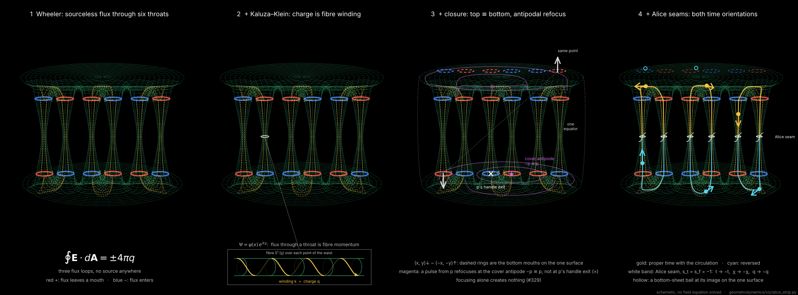

# Two classical throats and the tensor product: what is ruled out, and an open fibre channel

This is a note, not a pre-registered test. Every claim below is either a short
exact argument or a direct numerical check; the checks are archived in
`experiments/closure_ledger/runs/20261127_two_throat_nogo/`.

**Corrected after review of `215aace`.** The first version claimed that the
fibre coupling is always inert. That claim was wrong and is withdrawn in
Section 1, which gives the counterexample. Three other statements are narrowed:
* the holonomy table holds for λ_c = 0 only;
* the central-preparation result holds for κ < 1 only;
* the claim that Alice can detect the change from finite-time barrier crossings
  is dropped.

The review's numbers are reproduced in `review_checks.py`.

*Figure (schematic; no field equation is solved).* The two sheets are one
surface: the bottom point (x, y) is the top point (−x, −y).
* **Handles.** Two Alice handles, the columns at (d, 0) and (0, d), each join
  top c to bottom c, which on the one surface is the point −c. That gives four
  mouths, as in #338/#340.
  * Here "antipodal" means the identification map (x, y) → (−x, −y).
  * On the round cover, a handle's two ends are not antipodes. The cover
    antipode of a mouth is the mouth's own identified image (Figure 2,
    panel 3).
* **Charge without charge.** Sourceless flux (dashed gold) circulates top
  sheet → throat 1 → bottom sheet → throat 2. By Gauss's law,
  ∮E·dA = ±4πq, each mouth shows an apparent charge: red where flux leaves
  onto a sheet, blue where it enters. Each sheet carries zero net charge.
* **One worldline, both time orientations.** Balls circulate on one closed
  worldline. Each handle reverses time orientation at its waist, so a ball's
  proper-time arrow runs along the circulation on the top sheet (gold) and
  against it on the bottom (cyan).
* **The Alice seam.** A white band with a half-twist tick marks each flip.
  Each handle is the seam type with s_t = s_f = −1: it reverses both time and
  charge. By E2 of `docs/klein_handle_electric.md`, that is the only
  time-reversing type through whose tube trapped flux can pass. Placing the
  seam at the waist is a choice of chart. That the circuit crosses two seams
  is not.
* **The single surface.** Dashed rings and hollow markers on the top sheet show
  the bottom mouths and balls at their antipodal images on the one surface. One
  dotted chord pairs the bottom + mouth with its image: the same point, with
  the sheet normal ↓ below and ↑ above.
* **Source.** Drawn by `geometrodynamics/viz/alice_circulation.py`. The throat
  profile is the finite-mouth neck with a = 0.3, stretched vertically.

This is the setting the note asks about: one closed, antipodally identified
space with two handles.

## The question

#367 obtained complementary readings (u + v = 1) for one throat from a
variational selection on a Berger-squashed S³, and Born frequencies from the
invariant preparation measure. A Bell test needs two throats. The natural
classical lift takes two #367 throats, z_A and z_B on S³_A × S³_B, with each
local norm fixed, and couples them. The question is whether any such coupling
can reach |S| > 2 while keeping:
* complementary readings on each side;
* both binary marginals at 1/2;
* each side's local statistics, intensities included, independent of the other
  side's setting;
* every prepared history counted.

Throughout, the Lagrangian is

    L = |ż_A|² + |ż_B|² + λ_s(A_A² + A_B²) + 2λ_c A_A A_B,   |λ_c| < λ_s,

where A = Im(z†ż) is the velocity along the Hopf fibre.
* The action is S = ½∫L dt, the convention of #367's `arc_action`. The loads
  are added to S.
* Values quoted as "∫L" are 2S.
* Settings enter as port-symmetric analyzer loads −(κ/2)(2u − 1)². These depend
  only on the point the visit reaches on the Bloch sphere.

With λ_c = 0 the model is two independent copies of #367. That is a local
model, so |S| ≤ 2.

## 1. Coupling through the fibre is not inert (corrected)

**Withdrawn.** The first version claimed that every global minimizer is
horizontal (A_A = A_B = 0) at every κ, so that 2λ_c A_A A_B drops out and
|S| ≤ 2. That is false.

**Where the argument failed.**
* It fixed the midpoint ray M and chose the phase of y in the fibre over M so
  that Im⟨x, y⟩ = 0, making both arcs x → y → −x horizontal.
* That choice does not minimize the round cost. Write ⟨x, y⟩ = a + ib. The two
  arcs then have lengths arccos a and π − arccos a, and their round cost is
  least at a = 0.
* The midpoint ray depends only on |⟨x, y⟩|. So it can be reached horizontally,
  through a, or vertically, through b.

For a small midpoint shift ρ, in S units per throat:
* the horizontal route costs 2ρ²;
* a uniform tilt of the great semicircle toward the fibre costs
  (π²/2)·Λ·ρ². Here Λ is the vertical stiffness of the mode being tilted: λ_s
  for one throat, λ_s + λ_c for a co-rotating pair and λ_s − λ_c for a
  counter-rotating pair.

Because a² + b² = ρ², the two routes compete rather than add. The tilt is
therefore preferred whenever Λ < 4/π² ≈ 0.405. This is a sufficient
condition, from one trial family, not the exact threshold.

**Counterexample** (from review, reproduced in `review_checks.py`).
* **Setup.** λ_s = 2, λ_c = 1.99 and κ = 0.3. Both throats are prepared at
  x = (1, 1)/√2, with the first-port analyzer.
* **The paths.** z_{A,B}(t) = cos(πt)x ± i sin(πt)(1, 0). Both end at −x and
  reach unit first-port intensity at the midpoint. Their fibre velocities are
  A_A = −A_B = π/√2.
* **Its action.** Joint S minus the loads is **9.61895**, at 8 and at 64
  segments.
* **The horizontal floor.** No horizontal pair can go below π² = 9.86960. At
  u = ½ a shift δ costs 2δ² per throat, and the load returns at most
  (κ/2) sin² 2δ ≤ 2κδ².
* **In ∫L units** with unhalved loads, the review's convention, these are
  19.53790 and 2π² = 19.73921.

**What survives.** With λ_c = 0 and λ_s = 1 (Λ = 1 > 4/π²), the archived
single-throat optimizer finds horizontal minimizers at κ = 0.1 and 0.3. The
largest vertical component is at most 1.2e-6 per segment. That is what the
comparison above predicts.

**Open.** In the coupled case the minimizer can be non-horizontal, and λ_c
ties the sign of one side's fibre velocity to the other's. Whether that gives
|S| > 2, and whether it does so without signaling, is not computed here. It is
the natural next test, and it should be pre-registered.

## 2. With a fixed preparation, port-symmetric loads still break complementarity

The identity (2u − 1)² + (2v − 1)² = 2σ² + 2(u − v)², with σ = u + v − 1, has
zero first derivative in σ only if both visits can move. In #367 the first
visit is the prepared state, so u is fixed. The u-load is then a constant, and
the v-load pulls v away from 1 − u.

Take a single throat with λ_s = 1, where the optimizer finds horizontal
minimizers (Section 1). The problem then reduces to the midpoint shift δ in the real
horizontal plane, with cost (S units)

    π²/2 + 2δ² − (κ/2)cos²(2α + 2δ),   u = cos²α.

To first order the defect is

    σ ≈ −2κ u(1 − u)(2u − 1).

It vanishes only at u ∈ {0, ½, 1}, and |σ| reaches about 0.19κ.

**Check** (`quadratic_load_check.txt`, S units, λ_s = 1).

| κ | u | full optimizer | reduced 1-D | first order |
|---|---|---|---|---|
| 0.1 | 0.20 | +0.01929 | +0.01929 | +0.01920 |
| 0.1 | 0.35 | +0.01476 | +0.01476 | +0.01365 |
| 0.3 | 0.20 | +0.05640 | +0.05640 | +0.05760 |
| 0.3 | 0.35 | +0.05181 | +0.05181 | +0.04095 |
| κ < 1 | 0.50 | 0 | 0 | 0 |

**The central preparation holds only for κ < 1.**
* At u = ½ the cost relative to δ = 0 is 2δ² − (κ/2) sin² 2δ. Its curvature at
  δ = 0 is 4(1 − κ).
* For κ > 1 the complementary point is unstable, and the two mirror minima
  break complementarity: σ = ±0.340 at κ = 1.5 and ±0.406 at κ = 2
  (`review_checks.txt`).

## 3. With λ_c = 0, a shared holonomy is trivial, lopsided or unstable

The proposal replaces the two antipodal conditions with one joint condition on
the fibre phases θ_A and θ_B, where z(1) = e^{iθ}z(0).

**The single-throat cost.** Write c(θ) for the least ∫L reaching phase θ, which
is twice the least S. It is set by the spherical isoperimetric inequality for
horizontal motion and by the vertical cost (1 + λ_s)θ²:

    c(π ± ψ) = π² − (1 + λ_s)ψ²/λ_s,   c ≈ (1 + λ_s)θ² near 0,   c(0) = 0.

So c is even about π, and **θ = π, the complementary great semicircle, is its
maximum**.

**Check** (`shared_holonomy_check.txt`). A 24-segment optimizer agrees with the
closed form to within 0.007:

| θ | numeric, λ_s = 2 | closed form | numeric, λ_s = 0.5 | closed form |
|---|---|---|---|---|
| π | 9.8696 | 9.8696 | 9.8696 | 9.8696 |
| π − 0.5 | 9.4960 | 9.4946 | 9.1207 | 9.1196 |
| π/2 | 6.1747 | 6.1685 | 3.7011 | 3.7011 |
| 0.5 | 0.7500 | 0.7500 | 0.3750 | 0.3750 |

**What each joint condition gives, for λ_c = 0.** Here the joint cost is
c(θ_A) + c(θ_B), and the table below assumes exactly that.

| joint condition | bare minimizers | why it fails |
|---|---|---|
| θ_A + θ_B ≡ 0 (mod 2π) | neither throat moves (cost 0) | no exchange on either side |
| θ_A + θ_B ≡ π, λ_s > 1 | (π, 0) or (0, π); total 9.870 against 12.35 symmetric | one side frozen (v = u); the A↔B symmetry breaks |
| θ_A + θ_B ≡ π, λ_s < 1 | (π/2, π/2), pure fibre rotation; total 7.40 | neither side complementary |
| lifted total winding 2π | (π, π) is a maximum of c(π + ψ) + c(π − ψ) | unstable; also needs a real-valued phase the Hopf bundle does not supply |

**With the cross term, the costs do not add.**
* For pure fibre rotations the joint ∫L is
  (1 + λ_s)(θ_A² + θ_B²) + 2λ_cθ_Aθ_B.
* At λ_s = 2 and λ_c = −1.5, equal rotations through π/2 satisfy
  θ_A + θ_B = π and cost 0.75π² = 7.40. That is below the π² of either frozen
  split (`review_checks.txt`).
* Neither side is complementary there, so this fails the same way as the
  λ_s < 1 row.
* With λ_c ≠ 0, a full classification needs a joint minimization. That is not
  done here.

**The K symmetry.** The antiunitary spin flip sends θ → −θ.
* The mod-2π conditions are K-invariant.
* The lifted 2π condition maps to −2π, so K is a symmetry only if both windings
  are allowed, and that restores the instability.

On a great semicircle, a complementary midpoint (⟨x, y⟩ = 0) forces A = 0.
So in this family the fibre carries information only where complementarity is
already lost, as in Section 1's counterexample.

## 4. Coupling on the Bloch sphere gives either |S| ≤ 2 or setting-dependent intensities

The remaining option couples the projected histories directly, through a
singlet-style term μ n_A·n_B plus the port-symmetric analyzer loads. This
case was argued in review and checked here (`bloch_joint_case2.py`, 400,000
uniform preparations, weak-coupling limit).

* **Pinned first visit (#367's geometry).**
  * u_A is fixed by the preparation and α. So any coupling that keeps
    u_A + v_A = 1 makes Alice's reading independent of β, and |S| ≤ 2.
  * Exceeding 2 requires breaking complementarity in a way that depends on β.
* **Both visits free, at t = 1/4 and 3/4.**
  * The singlet lock picks e_B = −e_A on the degenerate great circles, with e
    the leading eigenvector of a⊥a⊥ᵀ + b⊥b⊥ᵀ.
  * Complementarity is exact, and the binary marginals are 0.500 ± 0.001 at all
    four CHSH pairs. They stay exactly ½ in the ensemble, by its random-sign
    symmetry.
  * **|S| = 3.34**, beyond 2√2, with |E| ≈ 0.835 at each pair.
  * But Alice's mean squared polarization E[(2u_A − 1)²] is **0.667** when
    Bob's axis is parallel to hers and **0.499** when it is perpendicular.
    Bob's setting changes Alice's local intensity statistics at order one,
    which violates the third requirement above.
  * Whether a detector can read that change, for example through finite-time
    barrier crossings, needs a crossing-time or detector calculation. The
    script computes signs and intensities only.
  * Moving the first visit off t = 0 also cuts #367's link between the reading
    and the prepared state.

## Conclusion

On S³_A × S³_B with intensity-only setting loads:
* **Coupling on the Bloch sphere** gives either |S| ≤ 2, with a pinned
  preparation, or |S| > 2 with setting-dependent local intensity statistics.
* **Shared-holonomy constraints with λ_c = 0** are trivial, lopsided or
  unstable.
* **A fixed preparation** breaks complementarity under port-symmetric loads,
  except at u ∈ {0, ½, 1}; at u = ½ only for κ < 1.
* **Coupling through the fibre is not inert.** The counter-rotating fibre mode
  can make the coupled minimizer non-horizontal, and its Bell behaviour is
  open.

So this note does not close the classical two-throat programme. It rules out
the Bloch-sphere couplings and uncoupled holonomy constraints considered. It
leaves one channel, the fibre coupling 2λ_c A_A A_B, for a pre-registered test.

Scope: classical variational models on fixed geometry with the stated loads.
This is not a no-go theorem for all classical dynamics. Couplings that are not
intensity-only, or other state spaces, are not covered.

## Figure 2: the setting built up in four steps

*Schematic; no field equation is solved.* The same camera and geometry are used
in every panel. The six throats stand in one row, in three pairs, as in
Wheeler's multi-throat picture. Each panel adds one layer.

1. **Wheeler.** Sourceless flux runs down one throat of each pair and up the
   other. By ∮E·dA = ±4πq, each mouth shows an apparent charge.
2. **+ Kaluza–Klein.** The inset zooms on one waist and shows the Hopf fibre χ.
   The matter wave is the winding mode Ψ = ψ(x)e^{ikχ}, and the charge is the
   winding k (`docs/guidance_law_from_5d.md`). Flux through a throat is fibre
   momentum, not a pasted-on source.
3. **+ Closure.**
   * The two sheets are hemispheres of one closed surface, joined at one
     equator, with bottom (x, y) ≡ top (−x, −y).
   * Dashed rings are the six bottom mouths on that one surface. The dotted
     chord pairs one of them with its image.
   * A pulse from a mouth p crosses the equator. On the cover it refocuses at
     the cover antipode −p (`antipodal_focusing`), which the identification
     makes p itself. So the pulse returns to its own source.
   * That is a different point from p's **handle exit**, the bottom end of p's
     own throat (top c ↔ bottom c).
     * With the source as a unit vector, its dot product is −1 with the
       refocus point and −0.729 with the handle exit.
     * Refocusing at the identified source and reaching the other mouth are
       different events. The figure labels them separately.
   * Focusing alone creates nothing (#329).
4. **+ Alice seams.**
   * Every handle has s_t = s_f = −1: it reverses time orientation and the
     fibre, so χ → −χ and q → −q.
   * E2 of `docs/klein_handle_electric.md` makes this the only time-reversing
     type that lets the flux through its tube.
   * Each flux loop is one closed worldline: gold where proper time runs with
     the circulation, cyan where it runs against it.

Drawn by `geometrodynamics/viz/alice_strip.py`. Its tests are in
`tests/test_viz_alice_strip.py`.
