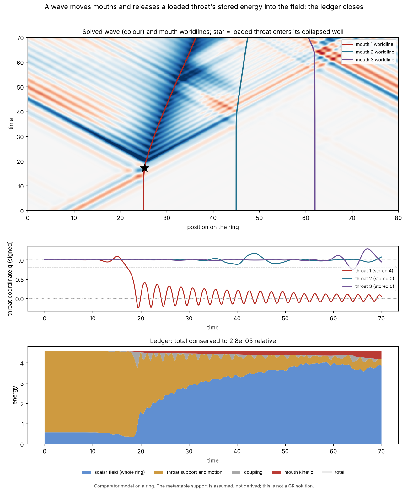

# A visualization drawn from a solved model: a wave moves mouths, tips a loaded throat, and the ledger closes



**Every line and colour in this figure is integrated from one Hamiltonian.**
Nothing is posed or animated by hand. It shows three things:

1. **A wave moves a mouth.** A real wave packet reaches a mouth and pushes
   it. All three mouths end displaced, at up to a quarter of the wave speed.
2. **A wave releases a throat's stored energy into the field.** The packet
   tips a loaded throat over its support barrier into its collapsed well,
   where it rings down. The **total scalar-field energy** on the ring ends
   6.7 times what the packet started with. That is a whole-ring total, not
   a measured outgoing flux; see "What the field-energy number is" below.
3. **A ledger closes.** Wave, mouth motion, throat and coupling energies are
   booked at every step, and their sum is conserved to `2.8e-05`.

It is a **comparator model, not a GR solution**, and the collapse is
**enabled by an assumption**: the loaded throat is given a metastable
support by hand. What the model computes is whether the wave triggers it,
where the energy goes, and how the mouths move. That limitation is the main
thing to keep in mind when reading the picture.

Module `geometrodynamics/viz/wave_mouth_network.py`; script
`scripts/render_wave_mouth_network.py`; tests
`tests/test_wave_mouth_network.py` (12).

```bash
python scripts/render_wave_mouth_network.py        # four figures and summary.json
python -m pytest -q tests/test_wave_mouth_network.py
```

## Why a new visualization

PR #340 (`viz/moving_mouth_pairs.py`) moves the handle drawing with axes from
a solved rotor model. Its own docstring says what it is not: *"This
coordinate map is NOT a fluid solution or a moving-metric wave operator"*,
and the solver behind it has *"no scalar propagation on the drawn necks"*.
It has no collapse and draws no energy ledger. So the picture shows mouths
moving, but not a wave moving them, and nothing a viewer could check.

This one keeps #340's reciprocal coupling form and adds what was missing: a
propagating wave, a throat that can collapse, relativistic mouth motion, and
a ledger drawn next to the picture it accounts for.

## The model

A real wave `ψ` on a ring, mouths at positions `X_k` with throat
coordinates `q_k`:

    H = Σ_i dx [ p_i²/2 + (ψ_{i+1} − ψ_i)²/(2dx²) + m² ψ_i²/2 ]
        + Σ_k [ sqrt(M² + P_k²) − M            relativistic mouth
                + pq_k²/(2μ) + S(q_k)          throat coordinate, support 
                + κ/2 (q_k − 1 − ⟨ψ⟩_k)² ]     reciprocal coupling,

with `⟨ψ⟩_k` the wave averaged over the mouth. The coupling is the mismatch
form of `waves/moving_mouth_pairs.py`: the throat follows the wave at its
mouth, and the same term pushes the mouth along the wave's gradient and lets
a moving throat radiate. A loaded throat has a double-well support `S` with
an open state at `q = 1` holding energy `E_s = 4` above the collapsed state
`q = 0`; an unloaded throat has an ordinary stable well.

`q` is a **signed reaction coordinate**, not literally a nonnegative
opening: `1` is the open state, `0` the collapsed one, and nothing stops it
passing below zero. In the documented run it reaches `−0.249` while ringing
in the collapsed well.

Integration is velocity Verlet, which is symplectic for this `H`. The vector
field is checked against a finite-difference gradient of `H`.

## What the figure shows, with numbers

One packet of energy `0.572` starts 15 units from mouth 1. Mouth 1 is
loaded; mouths 2 and 3 are not.

| | value |
|---|---:|
| throat 1 enters its collapsed well | `t = 17.2`, after the packet arrives |
| throat 1 first below `q = 0.5` | `t = 18.4` |
| throat 1 coordinate, minimum and final | `−0.249`, `0.05` |
| total scalar-field energy, start → end | `0.572` → `3.856` |
| field energy farther than `2` from every mouth, start → end | `0.572` → `3.110` |
| support energy released | `3.906` of `4` |
| displacement of mouths 1, 2, 3 | `11.3`, `2.5`, `−1.4` |
| largest mouth speed | `0.249` of the wave speed |
| energy conservation | `2.8e-05` relative |
| continuum momentum drift | `4.0e-03` |

The second panel shows the throat ringing down in its collapsed well; the
dashed line is the top of the support barrier, `q = 0.8125`. As it rings
down the ledger's throat band shrinks and its scalar-field band grows.

### What counts as a transition

A transition is recorded only for a **loaded** throat, when its coordinate
passes below the barrier top and stays below it to the end of the run.
Crossing a threshold is not enough. The first version of this figure used
`q < 0.5`, and review of `89ceeed` showed that this fires on a stable
throat: with amplitude `1.0` and no stored energy, throat 1 dips to `0.455`
at `t = 20` and returns to `0.951`. There is no collapsed well for it to
enter. That case is now a test and is archived in `summary.json` as
`detector_control`; it reports a threshold crossing and no transition.

### What the field-energy number is

`3.856` is the scalar-field term of the ledger summed over the whole ring.
It includes field energy sitting at the mouths and, on a ring, waves that
have travelled round. It is **not** an outward flux through a boundary, so
"the emitted wave carries 6.7 times the trigger's energy" would overstate
it, and the earlier text said that. As a rougher separation, the field
energy farther than `2` (five mouth widths) from every mouth goes from
`0.572` to `3.110`, a factor `5.4`. That is still a region total, not a
flux.

## Controls

| run | transition | total field energy | mouth 1 displacement |
|---|---|---|---:|
| no wave | none | `0` → `0` | `0` |
| weaker wave (amplitude `0.2`) | none | `0.187` → `0.164` | `1.88` |
| same wave, no stored energy | none | `0.572` → `0.421` | `8.40` |
| documented run | `t = 17.2` | `0.572` → `3.856` | `11.34` |

* Without a wave nothing moves and there is no transition. The loaded throat is
  stable by itself.
* A weaker wave still moves the mouths and does not tip the throat.
  There is a threshold between amplitudes `0.20` and `0.35`.
* With no stored energy the field only loses energy. **The field-energy gain
  is paid for by the support; a wave does not amplify itself.**
* For weak waves the push is second order in amplitude (measured slope
  `2.0`).

Figures for the three controls are in `docs/images/wave_mouth_network/`.

## Numerical checks

* Energy error falls by a factor of four when the step is halved.
* **Full-window check against DOP853** (`rtol = 1e-10`), archived in
  `docs/images/wave_mouth_network/validation.json`: over the whole
  documented run to `t = 70`, the relative final-state error is `7.8e-05`
  at the documented step `0.005` and `2.0e-05` at `0.0025`, a ratio of
  `4.00`, as a second-order method should give. The earlier text quoted
  `1.2e-05` as if for the documented run; that number came from a small
  configuration run to `t = 12`, which the test suite still uses as a
  quick convergence check.
* The momentum row is the continuum Noether momentum of wave plus mouths. A
  lattice breaks translation symmetry, so it is conserved only approximately
  and is reported, not asserted. Doubling the number of sites reduces the
  drift from `4.0e-03` to `9.8e-04`, so it is a lattice effect.

## A problem found while building it

The first parameter set collapsed the throat and the wave did **not** grow.
The released energy stayed in the throat's own ringing, because the
collapsed throat rang at a frequency far above what a mouth of that width
can radiate. The documented parameters put the ringing inside the mouth's
bandwidth. So release of the stored energy into the field is not automatic in this model:
it needs the throat's ring-down frequency to match the mouth's size.

## What this does and does not show

Shown, for this Hamiltonian: a real wave transfers momentum to mouths; it
can tip a loaded throat into its collapsed well; the total scalar-field
energy then grows well beyond the trigger's, paid for by the support; and
the energy is accounted for term by term. Not measured: an outgoing flux.

Not shown:

* **That BAM throats collapse.** The repository's record is that its scalar
  candidate did *not* produce sustained approach and collapse, and that
  support dynamics are not derived from GR. The metastable support here is
  an input.
* **A geometric wave in the GR sense.** `ψ` is a real scalar on a ring, not
  a solved metric perturbation, and the ring is not `S²` or `S³`.
* **A wormhole network.** Three mouths share one wave. Nothing passes
  through a handle, and no throat connects two of them.
* **The universe's energy.** The ledger is the energy of this model.
* **A replacement for #340's module**, which is left unchanged.
* Parameters were chosen so the effect is visible. The threshold and the
  gain depend on them.
