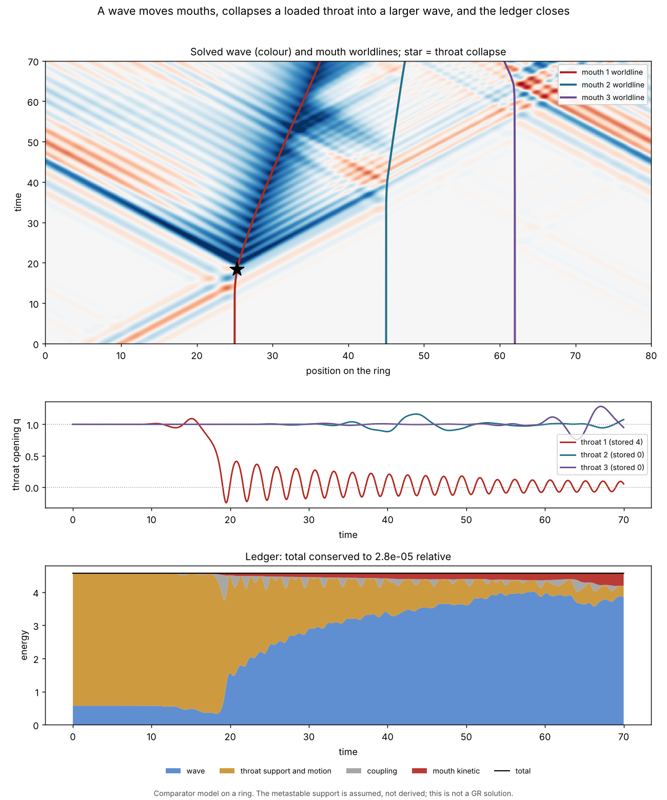

# A visualization drawn from a solved model: a wave moves mouths, collapses a throat, and the ledger closes



**Every line and colour in this figure is integrated from one Hamiltonian.**
Nothing is posed or animated by hand. It shows three things:

1. **A wave moves a mouth.** A real wave packet reaches a mouth and pushes
   it. All three mouths end displaced, at up to a quarter of the wave speed.
2. **A wave collapses a throat into a bigger wave.** The packet tips a loaded
   throat over its support barrier. The throat closes and rings down by
   radiating. The outgoing wave carries 6.7 times the energy of the packet
   that triggered it.
3. **A ledger closes.** Wave, mouth motion, throat and coupling energies are
   booked at every step, and their sum is conserved to `2.8e-05`.

It is a **comparator model, not a GR solution**, and the collapse is
**enabled by an assumption**: the loaded throat is given a metastable
support by hand. What the model computes is whether the wave triggers it,
where the energy goes, and how the mouths move. That limitation is the main
thing to keep in mind when reading the picture.

Module `geometrodynamics/viz/wave_mouth_network.py`; script
`scripts/render_wave_mouth_network.py`; tests
`tests/test_wave_mouth_network.py` (12).

```bash
python scripts/render_wave_mouth_network.py        # four figures and summary.json
python -m pytest -q tests/test_wave_mouth_network.py
```

## Why a new visualization

PR #340 (`viz/moving_mouth_pairs.py`) moves the handle drawing with axes from
a solved rotor model. Its own docstring says what it is not: *"This
coordinate map is NOT a fluid solution or a moving-metric wave operator"*,
and the solver behind it has *"no scalar propagation on the drawn necks"*.
It has no collapse and draws no energy ledger. So the picture shows mouths
moving, but not a wave moving them, and nothing a viewer could check.

This one keeps #340's reciprocal coupling form and adds what was missing: a
propagating wave, a throat that can collapse, relativistic mouth motion, and
a ledger drawn next to the picture it accounts for.

## The model

A real wave `ψ` on a ring, mouths at positions `X_k` with throat openings
`q_k`:

    H = Σ_i dx [ p_i²/2 + (ψ_{i+1} − ψ_i)²/(2dx²) + m² ψ_i²/2 ]
        + Σ_k [ sqrt(M² + P_k²) − M            relativistic mouth
                + pq_k²/(2μ) + S(q_k)          throat opening and support
                + κ/2 (q_k − 1 − ⟨ψ⟩_k)² ]     reciprocal coupling,

with `⟨ψ⟩_k` the wave averaged over the mouth. The coupling is the mismatch
form of `waves/moving_mouth_pairs.py`: the throat follows the wave at its
mouth, and the same term pushes the mouth along the wave's gradient and lets
a moving throat radiate. A loaded throat has a double-well support `S` with
an open state at `q = 1` holding energy `E_s = 4` above the collapsed state
`q = 0`; an unloaded throat has an ordinary stable well.

Integration is velocity Verlet, which is symplectic for this `H`. The vector
field is checked against a finite-difference gradient of `H`.

## What the figure shows, with numbers

One packet of energy `0.572` starts 15 units from mouth 1. Mouth 1 is
loaded; mouths 2 and 3 are not.

| | value |
|---|---:|
| collapse of throat 1 | `t = 18.4`, after the packet arrives |
| final opening of throat 1 | `0.05` |
| wave energy, start → end | `0.572` → `3.856` |
| support energy released | `3.906` of `4` |
| displacement of mouths 1, 2, 3 | `11.3`, `2.5`, `−1.4` |
| largest mouth speed | `0.249` of the wave speed |
| energy conservation | `2.8e-05` relative |
| continuum momentum drift | `4.0e-03` |

The second panel shows the throat ringing down after it collapses. That
ring-down is the emission: the ledger's throat band shrinks as its wave band
grows.

## Controls

| run | collapse | wave energy | mouth 1 displacement |
|---|---|---|---:|
| no wave | none | `0` → `0` | `0` |
| weaker wave (amplitude `0.2`) | none | `0.187` → `0.164` | `1.88` |
| same wave, no stored energy | none | `0.572` → `0.421` | `8.40` |
| documented run | `t = 18.4` | `0.572` → `3.856` | `11.34` |

* Without a wave nothing moves and nothing collapses. The loaded throat is
  stable by itself.
* A weaker wave still moves the mouths and does not collapse the throat.
  There is a threshold between amplitudes `0.20` and `0.35`.
* With no stored energy the wave only loses energy. **The larger wave is
  paid for by the support; a wave does not amplify itself.**
* For weak waves the push is second order in amplitude (measured slope
  `2.0`).

Figures for the three controls are in `docs/images/wave_mouth_network/`.

## Numerical checks

* Energy error falls by a factor of four when the step is halved, and the
  final state agrees with an independent DOP853 integration to `1.2e-05`
  at the documented step, across the collapse.
* The momentum row is the continuum Noether momentum of wave plus mouths. A
  lattice breaks translation symmetry, so it is conserved only approximately
  and is reported, not asserted.

## A problem found while building it

The first parameter set collapsed the throat and the wave did **not** grow.
The released energy stayed in the throat's own ringing, because the
collapsed throat rang at a frequency far above what a mouth of that width
can radiate. The documented parameters put the ringing inside the mouth's
bandwidth. So "collapse into a bigger wave" is not automatic in this model:
it needs the throat's ring-down frequency to match the mouth's size.

## What this does and does not show

Shown, for this Hamiltonian: a real wave transfers momentum to mouths; it
can trigger the collapse of a loaded throat; the collapse emits a wave
larger than the trigger; and the energy is accounted for term by term.

Not shown:

* **That BAM throats collapse.** The repository's record is that its scalar
  candidate did *not* produce sustained approach and collapse, and that
  support dynamics are not derived from GR. The metastable support here is
  an input.
* **A geometric wave in the GR sense.** `ψ` is a real scalar on a ring, not
  a solved metric perturbation, and the ring is not `S²` or `S³`.
* **A wormhole network.** Three mouths share one wave. Nothing passes
  through a handle, and no throat connects two of them.
* **The universe's energy.** The ledger is the energy of this model.
* **A replacement for #340's module**, which is left unchanged.
* Parameters were chosen so the effect is visible. The threshold and the
  gain depend on them.
